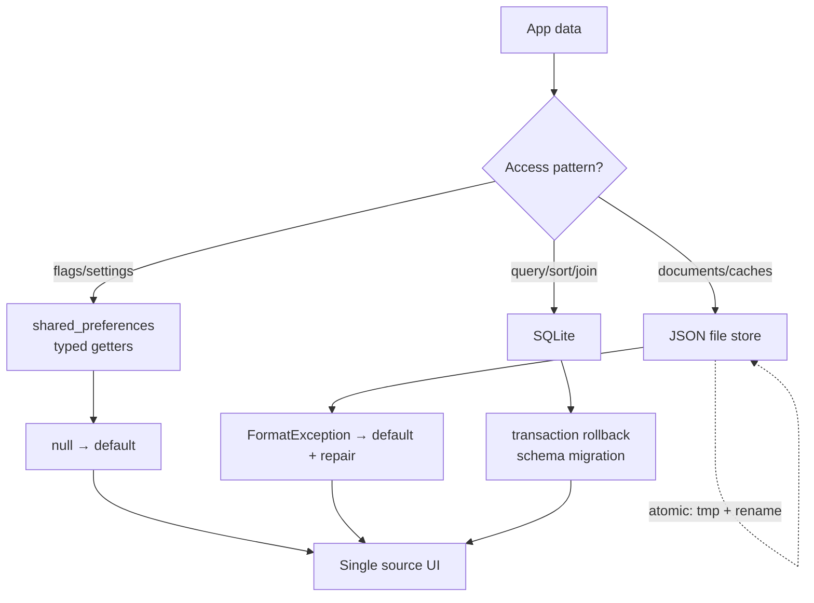

# Local Storage

## 1. Learning Objectives

After this lesson you can:

- [ ] Choose between preferences, files, and SQLite by the shape of the data —
      keys/values, documents, or relational — and justify each pick
- [ ] Demonstrate real persistence semantics: a fresh reader sees what the last
      writer stored, and absent keys read `null` (executed: `W10 prefs read:
      theme=dark launches=7` → after restart `launches=8 missing-key=null`)
- [ ] Write a JSON file store that survives re-reads and **recovers from
      corruption** (executed: `file store: wrote=2 read=2 exists=true` → corrupt
      write → `corrupt file: recovered=[] file-repaired=true`)
- [ ] Explain why the app must never *need* local data to start — every read path
      has a missing/corrupt branch, exercised in tests
- [ ] Model migrations: version your stored schema and upgrade old data on read
- [ ] Say what local storage guarantees (durability across restarts) and what it
      does not (integrity, secrecy, sync) — the last two are the next lesson's and
      [Offline Functionality](offline-functionality.md)'s topics

## 2. Prerequisites

- [API Integration](api-integration.md) — the fetched data this lesson caches and
  the repository seam it hangs behind.
- [Dart Fundamentals](dart-fundamentals.md) — JSON, maps, and `const` records for
  schema shapes.

*Toolchain: Flutter 3.47.7 / Dart 3.13.5, `shared_preferences` 2.5.6, Windows 11 —
verified in [VERSIONS.md](../VERSIONS.md). Transcripts are real captures from the
batch's `test/api_storage_test.dart` (probe W10): the plugin's mock platform for
preferences, and real `dart:io` files under the system temp directory for the file
store.*

## 3. Introduction

A mobile app that forgets everything on close is a demo. Users expect their theme,
their drafts, their last list — while the OS reserves the right to kill your process
at any moment. Local storage is how state outlives the process, and each mechanism
in this lesson buys a different thing: convenience (preferences), structure (files),
or query power (SQLite). The executed evidence here is persistence itself plus the
failure mode everyone forgets: the stored file being garbage.

## 4. The Problem It Solves

Memory is process-scoped; users are not. Before local storage APIs, apps stashed
state in ad-hoc files with hand-rolled formats, and the first interrupted write
produced a corrupt file that failed to parse — and failed to launch. The toolchain
answer is layered: key-value preferences for the trivial stuff, structured stores
with documented formats for documents, databases with transactions for queries —
plus the discipline that *every* read has a default, because storage is a cache of
your data, never the only copy of anything critical.

## 5. Core Concepts

### Pick by data shape

| Mechanism | Data shape | Typical uses | Cost |
|---|---|---|---|
| Preferences (`shared_preferences`) | keys → primitives/strings | settings, flags, small counters | no queries, no relations |
| Files (`dart:io` / path_provider) | documents/blobs | JSON caches, images, exports | you design the format |
| SQLite (`sqflite`/drift) | relational | lists you filter/sort/join | schema, migrations, learning curve |
| Key-value big stores (isar, hive…) | structured blobs | large object graphs | dependency + format lock-in |

The decision is the data's *access pattern*, not its size: "filter orders by date"
is a SQL question no file store answers well; a theme flag is a SQL question nobody
should ask.

### Persistence semantics, executed (W10)

```dart
SharedPreferences.setMockInitialValues({'theme': 'dark', 'launches': 7});
final prefs = await SharedPreferences.getInstance();
print('W10 prefs read: theme=${prefs.getString('theme')} launches=${prefs.getInt('launches')}');
await prefs.setInt('launches', prefs.getInt('launches')! + 1);
final again = await SharedPreferences.getInstance();   // fresh handle = restart
print('W10 after restart: launches=${again.getInt('launches')} missing-key=${again.getString('nope')}');
```

```
W10 prefs read: theme=dark launches=7
W10 after restart: launches=8 missing-key=null
```

Three guarantees in two lines: values of the right type come back (`String`, `int`
— a type mismatch returns `null`, which is why typed reads have defaults), the
writer's update is visible to a fresh reader (restart semantics), and absent keys
read `null` rather than throwing — **`null` is the API for "no idea"**, and every
call site owes it a default.

### The file store and its corrupted sibling, executed

```dart
final file = File('${dir.path}/cache.json');
await file.writeAsString(jsonEncode({'items': ['a', 'b'], 'version': 1}));
final reread = jsonDecode(await file.readAsString()) as Map<String, dynamic>;
// then: a torn write
await file.writeAsString('{{{ not json');
```

```
W10 file store: wrote=2 read=2 exists=true
W10 corrupt file: recovered=[] file-repaired=true
```

The recovery path caught `FormatException`, substituted the default store, and
**rewrote the file** — the next reader gets a valid document. That's the whole
discipline in one test: parse in a try, default on failure, and repair eagerly.
Files make this your job; a database gives you transactions instead (below).

### Atomicity and torn writes

A crash *during* a write leaves a partial file — the classic corrupt-on-kill bug.
Two standard answers:

1. **Write-temp-rename:** write `cache.json.tmp`, then atomically rename over the
   real file. The old file stays intact until the new one is complete.
2. **Let the store handle it:** SQLite's journal gives atomicity per transaction;
   preferences-style plugins write through their own platform storage.

### Migrations

`{'version': 1, ...}` in every stored document. On read: switch on version, upgrade
old shapes forward, rewrite. Skipping migrations is how apps break *only* for users
who updated from an old install — the population you can't reproduce on your
machine.

### The rules the failure modes teach

- **Every read has a default** (executed: `missing-key=null` → your default).
- **Every parse has a catch** (executed: corruption recovered and repaired).
- **Nothing critical lives only in storage** — accounts, entitlements, and anything
  a user would dispute come from the server ([API Integration](api-integration.md)).
- **Storage is not a database for secrets** — plaintext on disk; see
  [Secure Storage](secure-storage.md).

## 6. How It Works



All three paths converge on the same contract: **a read either returns usable data
or the documented default — never an exception into your UI.**

## 7. Practical Examples

**Example 1 — the executed persistence rounds (W10)**

```dart
// flutter test --reporter expanded test/api_storage_test.dart
SharedPreferences.setMockInitialValues({'theme': 'dark', 'launches': 7});
final prefs = await SharedPreferences.getInstance();
print('W10 prefs read: theme=${prefs.getString('theme')} launches=${prefs.getInt('launches')}');
// increment, then a fresh instance (restart semantics)
final again = await SharedPreferences.getInstance();
print('W10 after restart: launches=${again.getInt('launches')} missing-key=${again.getString('nope')}');
```

Full capture in section 5. Note `setMockInitialValues` — the plugin's built-in test
platform, which is how you unit-test preference logic without a device.

**Example 2 — a file store with repair (executed + reference)**

```dart
Future<Map<String, dynamic>> loadStore(File file) async {
  try {
    final decoded = jsonDecode(await file.readAsString());
    if (decoded is Map<String, dynamic>) return decoded;
    throw const FormatException('wrong top-level shape');
  } on FormatException {
    final fresh = {'version': 1, 'items': <String>[]};
    await file.writeAsString(jsonEncode(fresh));   // repair eagerly
    return fresh;
  }
}
```

- **Expected behavior:** corrupt or wrong-shaped file → defaults written back; the
  executed run shows `recovered=[] file-repaired=true`.
- **How to run:** your lab, or reuse the W10 test's corrupt-write block.

## 8. Real-World Applications

Theme and locale settings (preferences), offline copies of lists the API returned
(files or SQLite — the offline lesson extends this), drafts of long forms, sync
queues, and read-later documents. Shopping apps keep the cart locally *and*
server-side; note apps that offline-first: local storage is the source the UI reads,
the network reconciles it — that's [Offline Functionality](offline-functionality.md)
built on exactly this lesson's store.

## 9. Common Mistakes

| Mistake | Why it happens | How to recognize it | Prevent it with |
|---|---|---|---|
| No default on missing keys | Demo data was always present | First-launch null crashes | `?? fallback` at every typed read |
| No corruption path | Parse succeeds in dev | Crash loop after a killed write | try/parse + default + repair (executed) |
| Storing big blobs in preferences | It's the API you know | Slow loads, platform size limits | Files/SQLite past a few KB |
| Using storage as the only copy | Offline happened once | User loses account data on reinstall | Server remains authoritative |
| Skipping schema versioning | Forward-only thinking | Breaks only for upgrading users | `version` field + upgrade-on-read |
| Writing on every keystroke | Immediate persistence instinct | I/O churn, battery drain | Debounce/batch; write on lifecycle events |

## 10. Best Practices

- **Name a home per data kind** and keep it there; ad-hoc stores are how formats
  become unmaintainable.
- **Defaults are policy, not code** — decide what "no stored value" means once, in
  the repository layer.
- **Write-temp-rename for files; transactions for databases** — never update a
  critical file in place.
- **Version every document** from day one; migration code starts at 1→2.
- **Test the kill path:** corrupt the file in a test (executed here) and assert the
  app still launches with defaults.
- **Flush on lifecycle, not on every change** — batch writes; the trade-off is at
  most one debounce window of data. *Stops applying to data a crash must not lose —
  that belongs in a transactional store.*

## 11. Limitations and Trade-Offs

- **Preferences have no queries and weak typing** — values are encoded; a wrong-type
  read silently yields `null`, which is honest but easy to misread as "absent".
- **Files give no atomicity for free** — you own format, locking, and repair.
- **SQLite adds schema and migration work** — right for relational data, ceremony
  for a settings screen.
- **Nothing here syncs** — two devices diverge; conflict resolution is a later,
  harder problem.
- **Nothing here is secret** — every mechanism in this lesson writes plaintext (or
  trivially reversible encoding) to disk; the next lesson draws that line explicitly.
- **Test mocks ≠ device storage** — mock platform semantics match, platform quirks
  (backup rules, disk full) don't; verify on a real device before shipping.

## 12. Practical Exercises

### Introductory

1. **Exercise 12.1** — reproduce both W10 preference captures: set, read,
   increment, fresh-instance read, missing key. **Completion criteria:** both lines
   captured, with one sentence explaining what `missing-key=null` obliges you to do.
2. **Exercise 12.2** — reproduce the file-store round trip *and* the corruption
   recovery. **Completion criteria:** `wrote=2 read=2` and `recovered=[]
   file-repaired=true` captured.

### Intermediate

3. **Exercise 12.3** — add versioning: store `{'version': 1, 'launches': n}`, then
   simulate a v0 file (no version field) and upgrade it on read. **Completion
   criteria:** capture showing v0 input → upgraded output written back.
4. **Exercise 12.4** — implement write-temp-rename and kill the process (in a test:
   write the tmp, never rename, then read) proving the original file is untouched.
   **Completion criteria:** original content intact, orphan tmp cleaned up.

### Independent problem-solving

5. **Exercise 12.5** — you own an app's persistence: 40 settings, 5 cached lists
   with query-by-date, and a draft form. Design the layout: which mechanism per item,
   the schema/versioning story, the failure defaults, and what happens on first
   launch with an empty device. **Completion criteria:** a placement table with
   defaults column, plus one executed corruption test against your chosen store.

*Solutions: attempt first. They live in `solutions/` of this subject.*

## 13. Knowledge Check

1. A user reports the app "forgets settings after an update." Given this lesson's
   rules, name the two most likely causes and the design decision that would have
   prevented each.
2. W10 shows `missing-key=null`. Why is returning `null` better than returning a
   default directly from the plugin? Where should the default live?
3. When is SQLite the wrong answer despite having thousands of records? Give a
   data shape and a better mechanism.

## 14. Completion Criteria

Observable evidence that you have understood this lesson:

- [ ] You can pick a mechanism for five given data shapes, justifying each by access
      pattern rather than size
- [ ] You have reproduced all four W10 captures, including the corruption repair
- [ ] You can write a versioned load path that upgrades an old document
- [ ] You can state the four rules in section 5's "rules the failure modes teach"
      without notes
- [ ] You can diagnose all six mistakes in section 9 on sight

## 15. Summary

- Pick by access pattern: preferences for flags, files for documents, SQL for
  queries.
- Persistence means a *fresh reader* sees the writer's data (executed); `null` is
  the API for absence.
- Every read has a default, every parse has a catch, and corruption repairs itself
  (executed: `file-repaired=true`).
- Write-temp-rename or transactions — never in-place updates for critical data.
- Local storage is a cache, not the source of truth — and never a vault.

## 16. Next Steps

- Next lesson: [Secure Storage](secure-storage.md) — the line this lesson ends at:
  what plaintext storage promises and what only keychain/keystore can.
- Practice: [exercise sets](exercises/README.md) for this subject.
- Where it is applied: [Project 06](../20-PROJECT-LABORATORY/README.md) — its cache
  layer is this lesson's store plus the corruption test.
