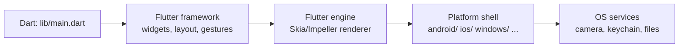

# Mobile Development Fundamentals

## 1. Learning Objectives

After this lesson you can:

- [ ] Name the platform model an app actually runs on — app sandbox, lifecycle, UI
      thread, and the OS services it borrows — and say what "cross-platform" changes
      about it (executed: the scaffold below built for six targets from one tree)
- [ ] Point at the exact boundary between what Flutter shares and what stays
      platform-specific in a real generated project (executed: one shared
      `lib/main.dart` + `test/widget_test.dart` against `android/`, `ios/`, `web/`,
      `windows/`, `linux/`, `macos/` — with `AndroidManifest.xml` and `Info.plist`
      living on their own sides of the line)
- [ ] Run the toolchain and read what it tells you (executed: `Flutter 3.47.7 •
      channel stable`, `Dart SDK version: 3.13.5`, `flutter analyze` → `No issues
      found! (ran in 94.7s)`, `flutter test` → `+1: All tests passed!`)
- [ ] Explain why the same Dart line means different things per device (executed:
      `D1 platform: isAndroid=false isIOS=false isWindows=true` from code that
      compiles identically everywhere)
- [ ] State the three constraints — memory, battery, and unreliable networks — as
      design forces rather than surprises, and name which lessons later in this
      subject answer each one
- [ ] Describe where a platform channel sits and why crossing it is a cost you pay
      deliberately, not a default

## 2. Prerequisites

- [02-PROGRAMMING-FUNDAMENTALS](../02-PROGRAMMING-FUNDAMENTALS/README.md) — control
  flow, functions, and data structures; this lesson assumes you can read code, not
  that you know Dart (Dart is taught next: [Dart Fundamentals](dart-fundamentals.md)).
- [11-BACKEND-ENGINEERING](../11-BACKEND-ENGINEERING/README.md) — by the time you
  reach [API Integration](api-integration.md) the app needs an HTTP API to talk to.

*Toolchain: Flutter 3.47.7 / Dart 3.13.5 stable on Windows 11 (Git Bash), Android
SDK 36.1.0 — verified in [VERSIONS.md](../VERSIONS.md). Every transcript in this
lesson was executed on that machine; where something is an illustration it says so.*

## 3. Introduction

A mobile app is ordinary code with three unusual neighbours: it runs on hardware you
don't control, on an operating system that may kill it at any moment, and behind a
store that decides whether users ever see it. This lesson sets the map before any
syntax — what the platform gives your app, what it takes away, and precisely which
parts of a Flutter project are shared and which are per-platform. Every later lesson
hangs off this map: null safety protects the language, state management protects the
logic, offline and secure storage protect exactly the seams you'll see here.

## 4. The Problem It Solves

The default way to ship on two platforms was to write the app twice — Kotlin for
Android, Swift for iOS — and keep two teams, two bug trackers, and two feature
timelines in lockstep. Divergence was guaranteed: the platforms differ in permissions,
navigation conventions, file systems, and release process, so "parity" was a ongoing
tax, not a milestone.

Cross-platform toolkits attack that tax by sharing the part that changes most — the
UI and business logic — and leaving the platform seams where they already were.
Flutter's particular answer is radical: it doesn't reuse the platform's widgets at
all. It draws every pixel itself on a platform-provided canvas, so an app looks and
behaves the same on both operating systems. The cost of that answer is that anything
which truly belongs to the OS (camera, keychain, notifications, store rules) must
still be reached through the platform — and knowing where that line sits is the
subject of this lesson.

## 5. Core Concepts

### The platform model

**App sandbox** — each app installs into its own isolated storage and permission
domain. It cannot read another app's files, and the OS enforces that, not your code.

**Lifecycle** — apps are created, resumed, paused, and eventually killed by the
system, often without warning. Mobile operating systems reclaim memory by terminating
background apps, so *saving state before you lose it* is a requirement, not hygiene.

**UI thread** — rendering and event handling run on one thread. Work done there blocks
the frame; a 300 ms computation on the UI thread is a visible stutter. This is why
[Asynchronous Dart](asynchronous-dart.md) comes before anything UI-heavy in this
subject.

**OS services** — storage, camera, sensors, notifications, and networking are granted
permission by the OS, at runtime, and can be refused. The app is a guest.

### What Flutter shares vs what stays platform-specific

Executed in the batch's lab: `flutter create scaffold` produced one tree that builds
for six targets. The structure, as captured:

```
--- shared code (lib/ + test/)
lib/main.dart
test/widget_test.dart
--- platform folders
android/  ios/  web/  linux/  macos/  windows/
--- one platform boundary each side
AndroidManifest.xml        (android/app/src/main/)
Info.plist                 (ios/Runner/)
```

- **Shared:** everything Dart — `lib/` (your whole app) and `test/` (its tests) —
  plus `pubspec.yaml`, whose `environment: sdk: ^3.13.5` pins the language version.
- **Platform-specific:** `android/` carries the Gradle build, manifest, and
  permissions; `ios/` carries the Xcode project, provisioning, and `Info.plist`.
  The web, Windows, Linux, and macOS folders are the same idea for those targets.

One codebase, six launchers. The line runs exactly where the OS's own configuration
begins — and every lesson about permissions, signing, and release lives on the far
side of it.

### Platform branching inside shared code

Shared code still asks which platform it's on. From probe **d1** (executed):

```dart
import 'dart:io';
// ...
print('D1 platform: isAndroid=${Platform.isAndroid} isIOS=${Platform.isIOS} '
    'isWindows=${Platform.isWindows} ');
// D1 platform: isAndroid=false isIOS=false isWindows=true
```

Same source, different answer — the branch is a *runtime fact*, and the common
failure is testing only the branch your dev machine takes.

### Platform channels

When shared Dart needs something only the OS has (keychain, camera intent, a
share sheet), it talks to a small native module through a **platform channel** — an
async, serialised message bridge. Each crossing costs serialisation, a context switch,
and a second implementation to test. It is the right tool for genuine OS access and
the wrong default for app logic; the rule of thumb: *if it's your data or your rules,
keep it in Dart; if it's the device's capability, cross the channel once and wrap it.*

### The three constraints

| Constraint | What it looks like in production | Answered by |
|---|---|---|
| Memory | OS kills background apps; state vanishes | [Local Storage](local-storage.md), state restoration |
| Battery | radios and GPS dominate drain | batching, [Offline Functionality](offline-functionality.md) |
| Network | offline, metered, flaky by default | loading/error states, [API Integration](api-integration.md) |

## 6. How It Works

A Flutter app's render path never touches the platform's widget toolkit:



Read it right to left: your code produces *descriptions* of UI; the engine rasterises
them into the surface the platform shell handed it; the shell is where `AndroidManifest`
permissions and `Info.plist` keys live. Nothing on the left side of `D` changes when
you target a new OS — which is the whole economy of the toolchain — and everything
on the right side still must be proven per platform, which is why this subject ends
with two separate release lessons.

## 7. Practical Examples

**Example 1 — the scaffold, executed**

```bash
# How to run (Windows 11 / Git Bash):
cd /c/Users/PC/AppData/Local/Temp/b14
flutter create scaffold && cd scaffold
flutter analyze
flutter test
```

- `flutter create` generated the six-platform tree above.
- **Expected output** (actual capture, `analyze.txt` / `test1.txt`):

```
Analyzing scaffold...
No issues found! (ran in 94.7s)
00:00 +0: loading .../scaffold/test/widget_test.dart
00:00 +0: Counter increments smoke test
00:01 +1: All tests passed!
```

- The green test is the template's counter app asserting a tap increments a label —
  proof from minute zero that the shared layer has a real test harness.
- **Assumptions:** Flutter 3.47.7 stable, Dart 3.13.5, first run pays a ~95 s
  analyzer warm-up on this machine.

**Example 2 — asking the platform a question at runtime**

```dart
import 'dart:io';

String targetName() {
  if (Platform.isAndroid) return 'android';
  if (Platform.isIOS) return 'ios';
  if (Platform.isWindows) return 'windows';
  if (Platform.isMacOS) return 'macos';
  if (Platform.isLinux) return 'linux';
  return 'web-or-unknown';
}

void main() => print('target: ${targetName()}');
// target: windows   (on this machine; identical source on a phone)
```

- **How to run:** `dart run target.dart`
- **Expected output:** `target: windows` on the authoring machine; an Android
  device prints `target: android`.
- The branch returns a *name* rather than executing per-platform code inline — the
  seam stays visible and testable.

## 8. Real-World Applications

Every production Flutter app is built on this map: a shared `lib/` holding widgets,
state, and domain logic; thin per-platform shells holding permissions, signing, and
store metadata. Teams shipping on Android and iOS with a small crew (the classic
economizer case) lean hardest on the share; teams that lean on camera, background
sync, or notifications discover the platform-channel seam early and wrap it in one
service so the rest of the app never sees it. The same structure — shared core,
platform shells — appears in every cross-platform technology, which is why the mental
model transfers even if you later switch tools.

## 9. Common Mistakes

| Mistake | Why it happens | How to recognize it | How to prevent it |
|---|---|---|---|
| Testing only the dev-machine branch | `Platform.isWindows` is true on your laptop | Feature works in dev, never runs on a phone | Put platform branches behind functions you can inject and unit-test |
| Doing heavy work in `build`/`main` | The UI thread is the obvious place | Jank, dropped frames, ANR-style hangs | Offload to `async` + isolates — [Asynchronous Dart](asynchronous-dart.md) |
| Treating the app as always-alive | Desktop apps taught you that | State lost after backgrounding | Persist on lifecycle events — [Local Storage](local-storage.md) |
| Assuming Android and iOS match | Their docs disagree in quiet ways | Permission denied / feature missing on one OS | Read both release lessons before shipping either |
| Crossing platform channels for app logic | The native side "feels" official | Business rules duplicated in Kotlin/Swift | Keep rules in Dart; cross only for device capabilities |

## 10. Best Practices

- **Keep `lib/` platform-agnostic until proven otherwise.** `dart:io` imports break
  web builds; isolate platform calls in one file so portability has a single seam.
  *Stops applying when the product genuinely is one-platform.*
- **Run `flutter analyze` and `flutter test` before every commit.** Executed here at
  `No issues found!` / `+1` — both are seconds, not minutes, after warm-up.
- **Name platform branches by outcome** (`targetName()`), not by OS — the caller
  stays readable and the branch becomes swappable in tests.
- **Budget for the lifecycle, not the happy path.** Assume the process dies at any
  moment; write down where each piece of state would be lost.
- **Pin the SDK.** `pubspec.yaml`'s `environment: sdk` is what stops a teammate's
  toolchain from silently changing your language semantics.

## 11. Limitations and Trade-Offs

- **You don't get the platform's widgets.** Apps look identical across OSs — and
  also slightly *unlike* each OS. If pixel-perfect platform-conformance is the
  product requirement, native or a per-platform wrapper is better.
- **Platform channels are a real cost:** serialisation, two implementations, and two
  test surfaces for every OS capability you touch.
- **Build size and startup** carry the engine; a "hello" Flutter app is bigger than
  a native one. For tiny utilities or deeply platform-integrated apps, native wins.
- **Web is a target, not an equal.** Desktop and mobile share `lib/`; web shares it
  with caveats (rendering, SEO, `dart:io`). Plan for it explicitly or exclude it.

## 12. Practical Exercises

### Introductory

1. **Exercise 2.1** — run `flutter create` into a fresh directory and produce the
   shared/platform inventory for *your* machine: list which folders are Dart-shared
   and which are OS-owned, and identify one file on each side of the boundary.
   **Completion criteria:** a written inventory naming `lib/` + `test/` as shared and
   at least one real per-OS config file (e.g. `AndroidManifest.xml`, `Info.plist`).
2. **Exercise 2.2** — run `flutter analyze` and `flutter test` on the scaffold and
   record both outputs. Then break `lib/main.dart` with a typo and re-run the
   analyzer. **Completion criteria:** three captured outputs — clean, failing, and
   clean again after the fix.

### Intermediate

3. **Exercise 2.3** — write a `targetName()`-style function covering all six
   platforms and a unit test for it that passes **without** a device, by injecting
   the platform facts. **Completion criteria:** `flutter test` green on your desktop
   while testing branches your desktop can't take.
4. **Exercise 2.4** — take the three constraints table in section 5 and, for each
   row, write one sentence describing a concrete failure a shipping app would show
   (not the abstract risk — the user-visible symptom). **Completion criteria:** three
   symptoms a tester could reproduce on a real phone.

### Independent problem-solving

5. **Exercise 2.5** — your app must show a "Share" button on Android and iOS but
   nothing on Windows. Design where that decision lives: Dart-side branch, platform
   channel, or build-time config. **Completion criteria:** a written design naming
   the seam, the failure mode if the OS denies it, and how you'd test each of the
   three platforms' behavior from one codebase.

*Solutions: attempt first. They live in `solutions/` of this subject.*

## 13. Knowledge Check

1. If Flutter draws every pixel itself, why does an `android/` folder still exist?
   Name two things inside it your Dart code can't provide.
2. What would happen if a `Platform.isAndroid` branch were only ever exercised by
   running the app on your desktop? Give the user-visible symptom, not "a bug".
3. When would you *not* choose Flutter — name a product requirement that makes the
   native path the right one, and justify it against section 11.

## 14. Completion Criteria

Observable evidence that you have understood this lesson:

- [ ] You can point at the shared/platform boundary in a real generated project and
      name two files on each side from memory
- [ ] You have run `flutter analyze` and `flutter test` and can read their outputs
- [ ] You can explain the lifecycle risk by stating where each piece of state in a
      simple app would be lost if the OS killed it right now
- [ ] You can diagnose all five mistakes in section 9 on sight
- [ ] You can state one requirement that makes Flutter the wrong choice

## 15. Summary

- Cross-platform shares the Dart code and keeps OS seams — one tree, six launchers.
- The boundary is visible: `lib/` + `test/` shared; manifest, plist, and store
  config per platform.
- Sandbox, lifecycle, UI thread, and OS services are the four platform forces; memory,
  battery, and network are the three product forces.
- Platform channels are for device capabilities, never for app logic.
- Flutter's uniform rendering buys parity and costs platform-native look — an honest
  trade, not a defect.

## 16. Next Steps

- Next lesson: [Dart Fundamentals](dart-fundamentals.md) — the shared language those
  six launchers all run: types, collections, classes, and the toolchain that checks
  them.
- Practice: [exercise sets](exercises/README.md) for this subject.
- Where it is applied: [Project 06](../20-PROJECT-LABORATORY/README.md) — the
  subject's app, built on exactly the shared-core/platform-shell structure above.
