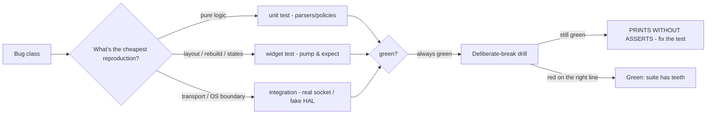

# Mobile Testing

## 1. Learning Objectives

After this lesson you can:

- [ ] Name the three test tiers and place each of this subject's probes in one
      (executed: one `flutter test` run covering all four batteries —
      `00:13 +25: All tests passed!`)
- [ ] Explain why prints are evidence but **assertions are teeth** — including the
      captured failure of a test that printed the bug and still passed
      (executed: `email-error="<absent>"` printed while the suite stayed green,
      until the assertion was added)
- [ ] Run a deliberate-break (red/green) drill and quote its failure output
      (executed: `Found 0 widgets with text "Enter an email"` → `Some tests
      failed`, exit 1 → revert → 25 green again)
- [ ] Choose the cheapest tier that can catch each bug class — from parsing logic
      to a real HTTP round trip — and defend the choice
- [ ] Write widget tests that assert *behavior users see* (texts, enabled states,
      counts) rather than implementation details of your widget tree
- [ ] Organize tests so the whole suite stays under ~15 seconds — the threshold
      at which "run it every time" survives contact with reality

## 2. Prerequisites

- [Flutter Fundamentals](flutter-fundamentals.md) — `pump`, `pumpAndSettle`, and
  what the tree does between frames.
- [Asynchronous Dart](asynchronous-dart.md) — fake-async time in tests versus real
  time in plain tests (this batch's batteries use both).
- Any two prior lessons' probes — every capture below came out of batteries you
  have already seen written.

*Toolchain: Flutter 3.47.7 / Dart 3.13.5, Windows 11 — verified in
[VERSIONS.md](../VERSIONS.md). All captures are **executed**: the full suite run,
the red/green drill (including the print-vs-assert failure that authorship
actually hit), and the tier breakdowns from this batch's four test files.*

## 3. Introduction

This subject's lessons kept saying "executed" — this one explains the machinery
behind those claims and formalizes it: what each tier buys, how assertions differ
from output, and the drill that proves a suite can fail. The batch's test files
are the worked example: 25 tests, four batteries, one command, seconds.

## 4. The Problem It Solves

"Manual QA on a phone" doesn't scale to a codebase that changes daily, and
screenshots-as-evidence catch only what someone thought to look at. Automated
tests flip the economics — but only if they *can fail*. A suite full of prints
and `expect(true, true)` is theater: it goes green forever while the app breaks.
The proof that a suite can fail is a deliberate break: break the code, watch the
exact assertion fire, revert, watch green. This lesson's captured drill also shows
the subtler failure it caught *in authorship*: a round that printed the bug and
passed anyway, because print ≠ assert.

## 5. Core Concepts

### The three tiers (and where this batch's probes sit)

| Tier | What it runs | This batch's examples | Speed |
|---|---|---|---|
| **Unit** (no widgets) | pure Dart: parsers, validators, policies | `parseItems`, validators table, `parseScan`, queue replay, `resolve()` | milliseconds |
| **Widget** (`testWidgets`) | your widgets in a fake app, real framework | W1 walk, W6 routes, W7 rebuild counts, W8 forms, W9b states, W13 gate | ~0.1–1 s each |
| **Integration** | real boundaries — actual HTTP sockets | W9 against a live local `HttpServer` (400s bypass: `HttpOverrides.global = null`) | seconds |

The placement rule: **the cheapest tier that can reproduce the bug.** Parsing
logic never needs a widget; a rebuild-scope claim never needs a device; a
`RenderFlex` overflow needs the real layout engine (widget tier); the transport
contract needs a real socket. Each of this batch's batteries was written at the
lowest tier that could make its claim honest.

### Prints are evidence; assertions are teeth — executed failure

The red/green drill's first round exposed a genuine hole. Deliberate break: make
`_email` accept empty input. Expected red. Actual:

```
W8 empty submit: email-error="<absent>" password-error="At least 8 characters"
00:08 +4: All tests passed!
```

The bug printed itself — `"<absent>"` is right there — and the suite stayed green,
because round 1 *only printed*. The fix was two lines:

```dart
expect(find.text('Enter an email'), findsOneWidget);
expect(find.text('At least 8 characters'), findsOneWidget);
```

Then the same break produced:

```
W8 empty submit: email-error="<absent>" password-error="At least 8 characters"
Expected: exactly one matching candidate
  Actual: _TextWidgetFinder:<Found 0 widgets with text "Enter an email": []>
00:07 +3 -1: Some tests failed.        (exit 1)
```

Three lessons in one drill: output is for humans reading a report, `expect` is
for the machine deciding the exit code; a failing claim must be an assertion; and
if your test can't fail, you haven't tested it.

### What to assert — behavior, not structure

Assert what a user or the contract sees: which texts exist, whether a button is
enabled, how many items render, which source label the data carried. Avoid
asserting internal widget types and class names — those refactors legitimately
while behavior holds. The W-batteries demonstrate the balance: tree dumps (W2) for
*understanding*, text/state assertions for *gating*.

### Time in tests

`testWidgets` runs a **fake clock**: `pump(500ms)` advances simulated time, timers
fire deterministically, and animations settle via `pumpAndSettle()`. Plain `test()`
uses **real time** — that's why the W9 HTTP battery (real sockets, a 2 s slow
route, a 150 ms timeout) is written as plain tests, and the W9b state walk (a
50 ms fake fetch) as widget tests. Choosing per test is the difference between
flaky and deterministic.

### The suite as a product

- **Fast enough to always run:** this subject's full suite is `+25` in ~13 s —
  under the threshold where people start skipping it.
- **Isolated:** each test builds its own widgets and state (the batteries reset
  counters in-test); no order dependence.
- **Hermetic:** the only real network is a server the test itself binds on
  loopback; platform channels are faked; device features inject their HAL.
- **Named for reports:** expanded reporter output doubles as this lesson's
  capture log.

## 6. How It Works



The drill is a *test of your tests* — the meta-check that turns "we have tests"
into "these tests can fail."

## 7. Practical Examples

**Example 1 — the full suite, executed**

```
$ flutter test
...
W8 valid submit: email=ada@example.com password=correct horse errors-gone=true
00:09 +24: .../test/widget_test.dart: Counter increments smoke test
00:10 +25: All tests passed!            (exit 0)
```

- Four batteries (`lab_test`, `nav_state_form_test`, `api_storage_test`,
  `offline_device_test`) plus the scaffold's own smoke test = 25 tests.
- **How to run:** `flutter test` — or `flutter test --reporter expanded
  <file>` for the per-test captures quoted throughout this subject.

**Example 2 — the red/green drill, executed**

```bash
# 1. break: in form_lab.dart make _email return null for empty input
flutter test test/nav_state_form_test.dart   # → red?
# 2. (after adding the two assertions) → red, exactly where expected:
#    Found 0 widgets with text "Enter an email" — Some tests failed (exit 1)
# 3. revert the break
flutter test                                  # → 00:13 +25: All tests passed!
```

The transcript's first round printed `<absent>` and stayed green — the hole — and
the second round, with assertions, failed on the exact missing widget. Both
outputs are quoted in section 5.

## 8. Real-World Applications

The pattern this batch used *is* the industry pattern: models and parsers unit-
tested with fixture tables, screens widget-tested through their states, transport
exercised against a local fake server, and CI gating on the exit code. Teams add
golden tests (pixel baselines — catch visual regressions; note they're brittle
across font/OS changes, so keep them few and intentional) and a small device-lab
smoke pass before releases. The deliberate-break drill is standard practice in
safety-minded teams: a suite that has never failed has never been checked.

## 9. Common Mistakes

| Mistake | Why it happens | How to recognize it | Prevent it with |
|---|---|---|---|
| Prints instead of asserts | Output looks like coverage | Suite green while the bug prints (executed!) | Every claim gets an `expect`; drill the suite |
| Testing at the wrong tier | Reach for the biggest hammer | Slow suites, brittle tests | Cheapest tier that can reproduce the bug |
| Asserting widget internals | Easiest selector to write | Tests fail on harmless refactors | Assert texts, counts, enabled states |
| Fighting the fake clock | `Future.delayed` in a widget test | Test passes on fast machines only | `pump(ms)` in widget tests; plain `test()` for real time |
| Network in widget tests | Real HTTP inside `testWidgets` | 400s everywhere (the binding's stub!) | `HttpOverrides.global = null` only in plain tests (executed) |
| Never failing | See drills avoided | 100% green forever | Quarterly red/green drill; fix holes it exposes |

## 10. Best Practices

- **Write the assertion first where a claim is stated** — if the lesson (or
  ticket) says "shows an error", the test asserts the error text.
- **Drill every suite once** at creation: break → red → revert → green.
- **Reset shared state in-test** (the W batteries reset their counters in each
  body) — isolation beats clever fixtures.
- **Name tests for reports:** "W8 validators fire, then a valid submit" reads as
  a spec; `test1` does not.
- **Keep the whole suite seconds-fast** — speed is what makes "run always" work;
  move slow tiers behind a flag rather than letting them rot.
- **Label provenance in captured output** — which machine, which versions, which
  parts fake. This subject's lessons do it; keep the habit.

## 11. Limitations and Trade-Offs

- **Widget tests aren't pixels** — they prove layout *logic* and text, not
  rendering; goldens cover some of it, real devices cover the rest.
- **Fakes can diverge from platforms** — permission/notification fakes prove your
  state machine, not the OS dialog; device passes remain non-negotiable.
- **25 tests is a tutorial suite** — a shipped app needs far more; this batch
  demonstrates the *shape*, not a coverage target.
- **No CI on this machine** — the suite runs locally; wiring GitHub Actions
  (VERSIONS pins the runner) is a separate, worthwhile chore.
- **Flakiness hides in timing** — any test needing a real delay twice in a row
  deserves suspicion; the batteries prefer `pump` boundaries over sleeps.

## 12. Practical Exercises

### Introductory

1. **Exercise 17.1** — reproduce the full-suite run and file each of the four
   batteries into its tier. **Completion criteria:** the `+25` capture plus a
   table mapping test file → tier → what it proves.
2. **Exercise 17.2** — reproduce the deliberate-break drill on any probe of your
   choosing: break, capture the failure, revert, capture green.
   **Completion criteria:** red output naming the exact assertion, green output
   after revert — both with exit codes.

### Intermediate

3. **Exercise 17.3** — take a test you wrote earlier that only prints, and convert
   it to assertions; then break the code and confirm it now fails. **Completion
   criteria:** before (green despite printing the bug) and after (red) captures.
4. **Exercise 17.4** — move one real-time assumption: write the same 50 ms fetch
   test once with real time (plain `test`) and once with `pump(50ms)`
   (widget test); state which is deterministic and why. **Completion criteria:**
   both runs plus the fake-async explanation.

### Independent problem-solving

5. **Exercise 17.5** — design the test plan for one screen of Project 06: list
   every behavior worth gating, assign each a tier, name the cheapest assertion,
   and specify one deliberate break per tier. **Completion criteria:** the plan
   plus the three drills executed (unit, widget, integration red/green pairs),
   with the suite's total runtime recorded.

*Solutions: attempt first. They live in `solutions/` of this subject.*

## 13. Knowledge Check

1. The suite printed `email-error="<absent>"` and stayed green. What exactly was
   missing — the failure, the code, or the assertion — and what one-line principle
   does it prove?
2. W9's timeout test is a plain `test`, not `testWidgets`. Reconstruct what would
   break if it were a widget test, in terms of the fake clock.
3. When is a golden test the right tier? Name what it catches that
   `find.text(...)` cannot — and one cost it imposes.

## 14. Completion Criteria

Observable evidence that you have understood this lesson:

- [ ] You can classify any test into unit/widget/integration and justify the tier
- [ ] You have run a deliberate-break drill and quoted its red and green outputs
- [ ] You can point to the print-vs-assert capture and explain why the first
      round's green was wrong
- [ ] You know why this batch mixes `test()` and `testWidgets` (real vs fake time)
- [ ] You can diagnose all six mistakes in section 9 on sight

## 15. Summary

- Three tiers, cheapest that can reproduce the bug; this batch's 25 tests run in
  ~13 s.
- Prints are evidence; assertions decide the exit code — the executed
  print-only hole proved the difference.
- The deliberate-break drill is how a suite earns the right to be trusted.
- Widget tests use the fake clock; real sockets need plain tests (and
  `HttpOverrides` cleared).
- Assert behavior users see; keep the suite fast, isolated, and hermetic.

## 16. Next Steps

- Next lesson: [Android Release](android-release.md) — taking a tested app to the
  Play Store: signing, bundles, and the store's rules.
- Practice: [exercise sets](exercises/README.md) for this subject.
- Where it is applied: [Project 06](../20-PROJECT-LABORATORY/README.md) — its
  acceptance criteria are written as tests at these tiers.
