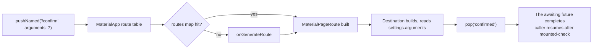

# Navigation

## 1. Learning Objectives

After this lesson you can:

- [ ] Push and pop routes by name and by value, and read the resulting stack state
      (executed: `W6 pushed: detail="detail" home-gone=true` → `W6 popped:
      home="home" detail-gone=true`)
- [ ] Pass arguments into a route and read them **in the destination**, plus await a
      result back at the call site (executed: `W6 argument: "confirm order 7"` then
      `W6 result awaited: "result: confirmed"`)
- [ ] Choose between the Navigator 1.0 API (named routes, `onGenerateRoute`) and
      Navigator 2.0 (declarative router) for a given app — and say what deep links
      demand of each
- [ ] Explain why `context.mounted` checks before showing results after an `await`
      are mandatory, not defensive style
- [ ] Structure route definitions so URLs, tests, and the type of argument each
      route accepts stay in one place
- [ ] Handle system-back (Android) and gesture-swipe-back (iOS) as first-class
      navigation events rather than afterthoughts

## 2. Prerequisites

- [Flutter Fundamentals](flutter-fundamentals.md) — widget tree and `BuildContext`;
  routes are pushed onto a navigator inside that tree.
- [Widgets and Layouts](widgets-and-layouts.md) — pages are layouts; navigation
  decides which layout is mounted.

*Toolchain: Flutter 3.47.7 / Dart 3.13.5, Windows 11 — verified in
[VERSIONS.md](../VERSIONS.md). Transcripts are real captures from the batch's
`test/nav_state_form_test.dart` (probe W6); `+4: All tests passed!` for the full
W6–W8 battery.*

## 3. Introduction

A mobile app is a stack of screens, not a set of pages: users push forward, pop back,
and arrive from links your app doesn't control. Navigation is where that stack becomes
an API — route names, arguments, and results — and where apps either keep a
testable, linkable structure or accumulate `Navigator.push(context, MaterialPageRoute(...))`
calls that no external URL can ever reach.

## 4. The Problem It Solves

Passing data by constructor (`DetailPage(order: order)`) works until something three
screens away needs the same value, until a notification must open a specific screen,
or until a tester needs to launch directly at a deep state. Frameworks solved this by
giving the app a *route table*: navigation becomes "go to X with Y", and the table
becomes the single place that knows how X is built, what Y it takes, and what comes
back. Deep links (URLs opening your app) and web URLs force the same model — which is
why even mobile-only apps benefit from routes defined by name.

## 5. Core Concepts

### The route stack

`Navigator` owns an ordered stack of routes. **Push** adds; **pop** removes and
returns a value; the app's back behavior pops the top if there's anything to pop.
Executed in W6 — three states of one stack:

```
W6 initial: home="home"
W6 pushed: detail="detail" home-gone=true
W6 popped: home="home" detail-gone=true
```

`home-gone=true` while pushed: the covered route is *offstage* — still mounted, not
built each frame (Flutter keeps it in the tree but stops building it; that's why
`home` reappears instantly with its state intact).

### Named routes and arguments

```dart
MaterialApp(
  initialRoute: '/',
  routes: {
    '/': (context) => const HomePage(),
    '/detail': (context) => const DetailPage(),
  },
  onGenerateRoute: (settings) {
    if (settings.name == '/confirm') {
      final order = settings.arguments as int;
      return MaterialPageRoute(
        settings: settings,
        builder: (_) => ConfirmPage(orderId: order),
      );
    }
    return null;
  },
)
```

- The `routes` map handles the fixed cases; `onGenerateRoute` handles the rest
  (typed arguments, unknown-route policy) and is where you cast — and validate —
  `settings.arguments`. A cast failure here is a route-level crash: check the type,
  fall back to the home route on anything unexpected.

### Returning results

`pushNamed` returns a `Future` — the caller awaits the pop's value:

```dart
final result = await Navigator.of(context).pushNamed('/confirm', arguments: 7);
if (context.mounted) {
  ScaffoldMessenger.of(context).showSnackBar(SnackBar(content: Text('result: $result')));
}
```

```
W6 argument: "confirm order 7"
W6 result awaited: "result: confirmed"
```

Two lessons in one capture: the argument arrived typed at the destination (`order
7`), and the popped `'confirmed'` came back to the *original* screen. The
`context.mounted` guard is the honest part — during that `await` the user could have
popped your screen; using the context anyway throws. Flutter's lint enforces the
pattern because forgetting it is a crash, not a style flaw.

### Navigator 1.0 vs 2.0

- **1.0 (used here):** imperative stack — `pushNamed`/`pop`. Simple, testable,
  perfect for apps whose URLs are a handful of named screens.
- **2.0 (`Router`/`RouterDelegate`):** declarative — state *is* the route list; the
  framework reconciles the stack from it. Required when one state must be expressible
  as a URL (web, restore-after-restart) and mirrored from incoming deep links.
- The migration cost of 2.0 is real; the rule of thumb: *adopt 1.0 first, move to 2.0
  when a product requirement (web, link restore) demands a single source of truth.*

### Deep links

A cold-start notification tap lands as an initial route: `/confirm/7` must map
through `onGenerateRoute` to the same page a push would reach. Route names as
strings are your URL scheme — invent them once, in the table.

## 6. How It Works



The navigator is a stateful widget like any other: pushes mark it dirty, it rebuilds
with the new stack, and the offstage route stays mounted (state preserved) but
unbuilt. The future returned by `push` completes *before* the pop animation ends —
which is why resuming code may safely show a snackbar immediately.

## 7. Practical Examples

**Example 1 — the executed navigation battery (W6)**

```dart
// test (abridged) — flutter test --reporter expanded test/nav_state_form_test.dart
await tester.pumpWidget(const NavApp());
print('W6 initial: home="${textOf(tester, 'home')}"');

await tester.tap(find.text('open detail'));
await tester.pumpAndSettle();
print('W6 pushed: detail="${textOf(tester, 'detail')}" '
    'home-gone=${find.text('home').evaluate().isEmpty}');
// ... pop, then pushNamed with arguments and await the result
```

Complete capture:

```
W6 initial: home="home"
W6 pushed: detail="detail" home-gone=true
W6 popped: home="home" detail-gone=true
W6 argument: "confirm order 7"
W6 result awaited: "result: confirmed"
```

- `pumpAndSettle` waits out the route transition animation; `pump()` alone would
  assert mid-slide.
- **How to run:** `flutter test --reporter expanded test/nav_state_form_test.dart`
- **Assumptions:** Flutter 3.47.7, headless test environment.

**Example 2 — a route table with typed arguments (reference, on W6's pattern)**

```dart
class AppRoutes {
  static const home = '/';
  static const detail = '/detail';
  static const confirm = '/confirm';

  static Route<dynamic> generate(RouteSettings settings) {
    switch (settings.name) {
      case confirm:
        final id = settings.arguments;
        if (id is int) {
          return MaterialPageRoute(
              settings: settings, builder: (_) => ConfirmPage(orderId: id));
        }
        return MaterialPageRoute(builder: (_) => const HomePage()); // safe fallback
      default:
        return MaterialPageRoute(builder: (_) => const HomePage());
    }
  }
}
```

- One place owns every route name, its argument type, and the fallback for unknown
  or mistyped entries.
- **Expected behavior:** an unknown deep link lands on home instead of crashing in
  a cast.

## 8. Real-World Applications

Every app with more than two screens routes by name; e-commerce apps route
product/order ids and await payment results; messaging apps deep-link to a chat id
from a push notification; apps with a web presence share the same route table with
URLs. The await-a-result pattern is exactly how checkout returns "paid" or "cancelled"
to the cart screen that started it.

## 9. Common Mistakes

| Mistake | Why it happens | How to recognize it | How to prevent it |
|---|---|---|---|
| Using context after `await push` | The line reads naturally | `Looking up a deactivated widget's ancestor` crash | `if (!context.mounted) return;` before any use — the lint enforces it |
| Casting `arguments` blindly | It worked in the demo | Type error on a deep link you didn't test | Type-check + fallback route in `onGenerateRoute` |
| Pushing duplicates of the same screen | Back stack fills with copies | Back button walks through N identical screens | `pushNamedAndRemoveUntil` for tab/checkout roots |
| Building screens inline everywhere | One-off `MaterialPageRoute(...)` is quick | Route structure untestable; URLs impossible | Every destination in the table, even if only one caller |
| Ignoring system back on Android | iOS has no back button | Android users exit the app from a child screen | Understand what pops by default; intercept only deliberately |
| Forgetting `pumpAndSettle` in tests | `pump()` is the habit | Assertions race the transition animation | Settle after every push/pop in tests |

## 10. Best Practices

- **Route names are a contract:** define them once (Example 2), use constants, and
  treat them as public URLs — notifications and server links will reference them.
- **Validate arguments at the boundary** — the route table is an API endpoint; a
  malformed argument behaves like a malformed request.
- **Await results through futures, state through routes** — if a screen needs to
  *change* something, it pops a value; if it *is* something, it's a pushed page.
- **Test navigation by stack state, not pixels:** assert which texts exist and that
  the covered screen is gone, exactly as W6 does. *Stops applying to transition
  animations themselves, which need frame-accurate pumps.*
- **Prefer 1.0 until a requirement forces 2.0** — the honest trade from section 5.

## 11. Limitations and Trade-Offs

- **Named routes lose type safety** — arguments are `Object?`; the table's casts are
  the compiler's substitute, and they're only as good as your fallbacks.
- **1.0 doesn't model URLs natively** — web/restore needs 2.0's `RouteInformationParser`;
  retrofitting later rewrites every call site.
- **`pushAndRemoveUntil` predicate bugs** wipe stacks silently — a wrong predicate
  either keeps too much or ejects the root; assert the resulting stack in tests.
- **Animations and slow devices interact** — tests settle instantly; real devices
  don't. Never assert transition timing on wall-clock.

## 12. Practical Exercises

### Introductory

1. **Exercise 8.1** — reproduce the W6 battery from a blank file: named push, pop,
   argument, awaited result. **Completion criteria:** all five `W6` lines captured
   with `home-gone`/`detail-gone` transitions shown.
2. **Exercise 8.2** — add an unknown route (`/nope`) to the table and push it;
   capture where the user lands. **Completion criteria:** a capture showing the
   fallback screen, plus one sentence stating which function decided it.

### Intermediate

3. **Exercise 8.3** — build a two-step wizard (form → review) where step 2 pops a
   boolean and step 1 reacts to it — with the `mounted` guard in place. Then remove
   the guard and make the crash happen in a test by popping the caller during the
   await. **Completion criteria:** both transcripts: the working flow and the exact
   error the guard prevents.
4. **Exercise 8.4** — make one route reachable two ways: pushed programmatically
   and as a cold-start deep link (`initialRoute: '/confirm/7'`). **Completion criteria:**
   two tests landing on the same page with the same `orderId=7`.

### Independent problem-solving

5. **Exercise 8.5** — design the route table for an app with tabs, nested stacks,
   a modal checkout, and shareable product links. Decide which entries are named,
   which arguments are validated where, and when `pushAndRemoveUntil` is correct.
   **Completion criteria:** a written table (route → argument type → entry points →
   back-stack effect) plus two executed tests proving the trickiest entry's stack
   behavior.

*Solutions: attempt first. They live in `solutions/` of this subject.*

## 13. Knowledge Check

1. After `await pushNamed(...)`, the code shows a snackbar without a `mounted` check.
   Construct a user action that crashes it, and name the framework error you'd see.
2. W6 shows `home-gone=true` while detail is open. Is the home route's `State`
   destroyed? What evidence from this lesson answers that?
3. When is Navigator 2.0 worth its complexity? Give one requirement that forces it
   and one app where it would be over-engineering.

## 14. Completion Criteria

Observable evidence that you have understood this lesson:

- [ ] You have reproduced all five W6 captures from a blank file
- [ ] You can write an `onGenerateRoute` that validates argument types and falls back
- [ ] You can explain what happens to the covered route (offstage, state kept)
- [ ] You can demonstrate the post-await context crash and its fix in a test
- [ ] You can diagnose all six mistakes in section 9 on sight

## 15. Summary

- Navigation is a stack: push adds, pop returns a value, covered routes stay mounted
  offstage.
- Route names are URLs; the table owns names, argument types, and fallbacks.
- Awaited results need `context.mounted` — the crash is constructible without it.
- Navigator 1.0 until a URL/restore requirement forces 2.0's declarative model.
- Test stack state (`home-gone=true`), not transition pixels.

## 16. Next Steps

- Next lesson: [State Management](state-management.md) — where the data these
  screens render lives, and how it reaches them.
- Practice: [exercise sets](exercises/README.md) for this subject.
- Where it is applied: [Project 06](../20-PROJECT-LABORATORY/README.md) — its tab
  stacks and result-returning checkout use exactly this table.
