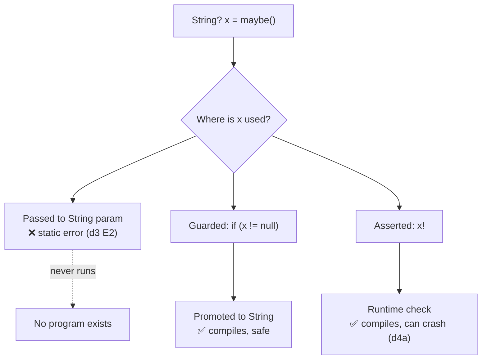

# Null Safety

## 1. Learning Objectives

After this lesson you can:

- [ ] Explain null as a *type*: `String` and `String?` are different types, and the
      compiler enforces the difference (executed: `error - ...5:14 - A value of type
      'Null' can't be assigned to a variable of type 'String' ... invalid_assignment`)
- [ ] Predict which of two null bugs the compiler catches and which survives to
      runtime — then verify (executed: the `d3` battery fails `dart analyze` with
      `2 issues found`; the `d4a` `!` operator compiles clean and crashes with
      `Null check operator used on a null value` plus a stack trace)
- [ ] Read a stack trace for the exact failing line (executed: `#0 main
      (file:///.../d4a_bang.dart:6:23)` — line 6 is the `name!`)
- [ ] Use `late` correctly — and diagnose when its guarantee was a lie (executed:
      `LateInitializationError: Field 'user' has not been initialized.` from
      `d4b_late.dart`, the `init` argument never passed)
- [ ] Trust flow analysis: an `is` check narrows `Object?` so the body compiles and
      runs arithmetic on it (executed: `narrowed: 8` from `o + 1` where `o` was
      `Object?`)
- [ ] Apply the null-safety toolbox — `?.`, `??`, `!`, `required`, `late` — choosing
      each by *what guarantee you actually have*, not habit

## 2. Prerequisites

- [Dart Fundamentals](dart-fundamentals.md) — types, classes, and the analyzer; this
  lesson is what `String?` means in that system.
- [02-PROGRAMMING-FUNDAMENTALS](../02-PROGRAMMING-FUNDAMENTALS/README.md) —
  variables and control flow.

*Toolchain: Dart 3.13.5 (stable), Windows 11 / Git Bash — verified in
[VERSIONS.md](../VERSIONS.md). Captures: probes `d3_assign_null.dart` (analyzer +
compiler), `d4a_bang.dart`, `d4b_late.dart`, `d4c_flow.dart` — all executed in the
batch's lab; outputs quoted verbatim, including exit behavior.*

## 3. Introduction

Null reference errors are the oldest recurring bug class in mainstream programming —
subroutine, typo, or missing field all end in the same crash at the worst moment.
Dart's answer is not a linter or a convention: it made nullability part of the type
system. `String` means "always a string"; `String?` means "a string or null", and
the compiler forces you to handle the second case before it will compile. This lesson
teaches exactly where that fence stands — because the interesting part is the handful
of places it deliberately doesn't cover, and those are the ones that still crash
production apps.

## 4. The Problem It Solves

Before sound null safety, every object reference in most languages was *probably*
non-null. Code like `int.parse(config.get('port'))` compiles whether `get` returns a
value or not, and the failure happens on the user's device. Defensive `if (x != null)`
sprawled everywhere, most of it checking values that could never be null, while the
one check that mattered was forgotten.

Dart 2.12 flipped the default: non-null unless you opt into nullability with `?`.
The sprawl of redundant checks disappears, and the checks that remain are exactly the
ones where something can genuinely be absent. The trade — accepted honestly — is that
`?` and `!` move the risk from "where the data was lost" to "where you asserted it
wasn't", so knowing which assertions are justified is the real skill.

## 5. Core Concepts

### `T` vs `T?` — two types, not one with a flag

`String?` is a supertype relationship the compiler tracks. Assigning null to `String`,
or passing `String?` where `String` is required, are **static errors** — they never
become programs. Executed probe `d3`:

```dart
void main() {
  // E1: assigning null to a non-nullable String
  String s = null;
  print(s.length);

  // E2: nullable passed where non-nullable required
  String? maybe = pick();
  int n = int.parse(maybe);   // maybe is String?, not String
  print(n);
}

String? pick() => null;
```

```
$ dart analyze d3_assign_null.dart
Analyzing d3_assign_null.dart...

  error - d3_assign_null.dart:5:14 - A value of type 'Null' can't be assigned to a
          variable of type 'String'. Try changing the type of the variable, or
          casting the right-hand type to 'String'. - invalid_assignment
  error - d3_assign_null.dart:10:21 - The argument type 'String?' can't be assigned
          to the parameter type 'String'.  - argument_type_not_assignable

2 issues found.
```

The same file run directly fails the same way at the compiler:

```
$ dart run d3_assign_null.dart
d3_assign_null.dart:5:14: Error: A value of type 'Null' can't be assigned to a variable of type 'String'.
  String s = null;
             ^
d3_assign_null.dart:10:21: Error: The argument type 'String?' can't be assigned to the parameter type 'String'.
  int n = int.parse(maybe);   // maybe is String?, not String
                    ^
```

Both bugs are gone before any device sees them. Note the two tools report the same
findings — `dart analyze` is the compiler's front end without a build.

### Removing nullability safely

Four tools, each a different *guarantee*:

| Tool | Guarantee | Cost |
|---|---|---|
| `!` | "It's non-null right now — assert it" | Crashes where asserted if wrong |
| `?.` | "Do nothing if null" | Silently produces null downstream |
| `??` | "Use this substitute if null" | You must pick a sane substitute |
| `late` | "It will be initialized before first read" | Checked at **runtime**, not compile time |
| `required` | Caller must pass it (non-null) | Compile error at construction site |

### Where the compiler stops: the `!` operator

`d4a` compiles **clean** — nothing is statically wrong — and dies at runtime:

```dart
void main() {
  String? name;
  print('before: $name');
  print('after: ${name!}');   // runtime: null check on null
}
```

```
$ dart run d4a_bang.dart
before: null
Unhandled exception:
Null check operator used on a null value
#0      main (file:///C:/Users/PC/AppData/Local/Temp/b14/d4a_bang.dart:6:23)
#1      _delayEntrypointInvocation.<anonymous closure> (dart:isolate-patch/isolate_patch.dart:313:19)
#2      _RawReceivePort._handleMessage (dart:isolate-patch/isolate_patch.dart:192:12)
```

`#0` points at line 6, column 23 — the `!`. A null-safety crash is a *documented*
promise broken at a named place; reading the trace, not guessing, is the workflow.

### `late`: a runtime-checked promise

```dart
class Session {
  late String user;   // guaranteed to be set by init(); or so the comment says
}

void main(List<String> args) {
  final s = Session();
  if (args.contains('init')) s.user = 'ade';
  print('user=${s.user}');
}
```

```
$ dart run d4b_late.dart
Unhandled exception:
LateInitializationError: Field 'user' has not been initialized.
#0      Session.user (file:///C:/Users/PC/AppData/Local/Temp/b14/d4b_late.dart)
#1      main (file:///C:/Users/PC/AppData/Local/Temp/b14/d4b_late.dart:10:19)
```

Without the `init` argument the conditional never assigns — and `late` converts what
*would* have been a compile error into a runtime one. `late` is right for
construction-time-impossible initialization (a value derived after the constructor),
wrong as a way to silence the compiler about a field you simply forgot.

### Flow analysis: the compiler's narrowing

```dart
void main() {
  Object? o = maybeAnInt();
  if (o is int) {
    print('narrowed: ${o + 1}');      // analyzer knows o is int here
  } else {
    print('not an int: $o');
  }
}

Object? maybeAnInt() => 7;
```

```
$ dart run d4c_flow.dart
narrowed: 8
```

Inside the `is` branch, `o` is promoted from `Object?` to `int` — arithmetic compiles
with no `as` cast. Promotion is the reason good Dart has far fewer casts than older
null-assertion code: *check once at the boundary, use freely inside.*

## 6. How It Works

The type system tracks nullability through every expression, and flow analysis carries
it through control flow:



Narrowing is computed by the compiler from `if (x != null)`, `is` checks, `??`, and
early `return`s — assignments inside closures or fields it cannot see (frozen at the
boundary) do not promote, which is why a getter returning `String?` stays `?` even
after you checked the backing field.

## 7. Practical Examples

**Example 1 — choosing a tool from the guarantee (reference — run in your lab)**

```dart
String? input = readConfig();          // genuinely may be absent

final shown  = input ?? 'default';     // substitute: UI always has text
final len    = input?.length ?? 0;     // safe chain: no crash, sensible zero
if (input != null) {
  print(input.toUpperCase());          // promoted: no ! anywhere
}
// input!.isEmpty;                      // only if you hold a real invariant — and you can prove it
```

- **Expected output:** the first two lines print for any input; the promoted block
  runs only when non-null.
- **How to run:** `dart run` in your lab; make `readConfig()` return null and null
  alternately and watch each line's behavior.
- **Assumption:** each pattern costs differently — `??` hides absence, `!` bets on
  it, promotion makes you handle both.

**Example 2 — the analyzer as reviewer (executed)**

```
$ dart analyze d3_assign_null.dart
... 2 issues found.          # before the fix

# after fixing E1 to `String? s` and E2 to `int.parse(maybe ?? '0')`:
$ dart analyze d3_assign_null.dart
No issues found!
```

- **How to run:** `dart analyze <file>`; exit status is non-zero on errors, so it
  slots into CI unchanged.

## 8. Real-World Applications

In the app you'll build this subject: form fields are `String?` until validated;
API responses deserialize into nullable fields because the server's contract is a
*claim*, not a guarantee; caches return `T?` and the miss path is a first-class case;
tokens are absent before sign-in and present after — each of these is a `T?` with a
transition you can point at. The crashes this lesson prevents are exactly the
"works with good data, dies with real data" failures that make the difference between
a demo and a product.

## 9. Common Mistakes

| Mistake | Why it happens | How to recognize it | How to prevent it |
|---|---|---|---|
| Sprinkling `!` to silence errors | It compiles and the warning goes away | `Null check operator used on a null value` in crash logs | Ask which invariant justifies it; use `??`/promotion otherwise |
| `late` as a shrug | It moves the error to runtime | `LateInitializationError` at first read | Make it nullable, or restructure so the value exists |
| Null-checking something non-nullable | Old habit from pre-2.12 code | Analyzer: `unnecessary_null_comparison` | Trust the type; delete the check |
| Assuming promotion everywhere | Fields and getters don't promote | "not promote" errors inside closures | Copy to a local, or check at the boundary |
| `?? ''` hiding absence | Empty string is also wrong data | UI shows blank where an error was expected | Model absence (`?`) and render it deliberately |

## 10. Best Practices

- **Make absence explicit in the type, always.** If a field can be missing from the
  server, its type says `?` — the contract and the compiler agree.
- **Promote instead of asserting:** `if (x != null)` (or early return) beats `x!`
  because the compiler re-verifies it every build.
- **Reserve `!` for provable invariants** — enum guarantees, test-backed
  assumptions — and write the invariant in a comment next to it. *Stops applying the
  moment the value can come from outside the process.*
- **Treat `LateInitializationError` and `Null check operator` crashes as design
  feedback,** not bad luck: both name the field where a promise was broken.
- **Run the analyzer in CI** — `dart analyze` failing the build is the whole point
  of paying for the type system.

## 11. Limitations and Trade-Offs

- **`late` and `!` are escape hatches by design** — the system can't verify runtime
  promises, so every use transfers a compile-time guarantee into a runtime one.
- **JSON and other dynamic boundaries arrive unchecked** — deserialization is where
  `?` must be chosen honestly; the compiler can't help you map `'absent'` to null.
- **Promotion breaks at async seams** — a value can change between check and use
  across `await`; re-check after the gap rather than trusting the earlier promotion.
- **`??` can lie** — an empty string or `0` default satisfies the compiler while
  being wrong data; defaults need domain judgment, not syntax.

## 12. Practical Exercises

### Introductory

1. **Exercise 4.1** — reproduce the `d3` battery from a blank file: write the two
   wrong lines, capture `dart analyze`, fix each with the *smallest* type change,
   capture the clean run. **Completion criteria:** both error messages quoted, then
   `No issues found!`.
2. **Exercise 4.2** — predict, before running, which of these crash at runtime vs
   compile time: `String? a; print(a!.length);` · `String b = null;` · `late int n;
   print(n);` · `String? c; if (c != null) print(c.length);`. Then execute all four.
   **Completion criteria:** four predictions, four captures, each match explained.

### Intermediate

3. **Exercise 4.3** — take a function reading three optional config keys and produce
   two versions: one using `!` (and its crash transcript when a key is missing) and
   one using `??` + promotion (and its output for the same missing key).
   **Completion criteria:** both transcripts; one sentence stating which version's
   failure mode is acceptable for user-facing config.
4. **Exercise 4.4** — write a `late` field that *correctly* initializes (assigned
   exactly once on a known path) and one that fails; capture both runs.
   **Completion criteria:** correct one prints its value; failing one shows the full
   `LateInitializationError` trace with the line that reads too early identified.

### Independent problem-solving

5. **Exercise 4.5** — design the null model for an API response where the server may
   omit a field, send `null`, or send `""` — three different absences. **Completion
   criteria:** a type design (e.g. `String?` vs a sealed tri-state) that keeps the
   three distinguishable downstream, with a written note of where `??` would have
   destroyed information the UI needed.

*Solutions: attempt first. They live in `solutions/` of this subject.*

## 13. Knowledge Check

1. `dart analyze` passes but the app crashes with `Null check operator used on a
   null value`. What does the analyzer's silence tell you — and what does it not?
2. Why does `late` belong in the null-safety lesson when it removes a `?` rather
   than handling one? State precisely which check moves from compile time to runtime.
3. When is `?? ''` worse than a nullable UI state? Describe a screen where the
   default would mislead a user.

## 14. Completion Criteria

Observable evidence that you have understood this lesson:

- [ ] You can reproduce both `d3` errors and their clean fix from a blank editor
- [ ] You can read a null-safety stack trace and name the exact line and promise that
      broke, for both `!` and `late` failures
- [ ] You can explain why flow promotion succeeded in `d4c` and name one situation
      where it would not
- [ ] You can diagnose all five mistakes in section 9 on sight
- [ ] You can justify every `!` in a piece of existing code — or remove it

## 15. Summary

- `T` and `T?` are distinct types; assigning or passing across that line is a static
  error the compiler refuses to build.
- `!` asserts (runtime crash if wrong), `?.` skips, `??` substitutes, `required`
  pushes the obligation to the caller, `late` defers the check to runtime.
- The compiler stops exactly where the guarantee becomes a runtime promise — that's
  where traces and discipline take over.
- Flow analysis promotes after `is`/null checks, including `Object?` → `int`.
- Null-safety crashes are named: read `#0`, find the field, fix the promise.

## 16. Next Steps

- Next lesson: [Asynchronous Dart](asynchronous-dart.md) — the same nullable thinking
  applied to values that arrive *later*: futures, streams, and isolates.
- Practice: [exercise sets](exercises/README.md) for this subject.
- Where it is applied: [Project 06](../20-PROJECT-LABORATORY/README.md) — every
  network result and cache read in the app is a `T?` with an explicit absence path.
