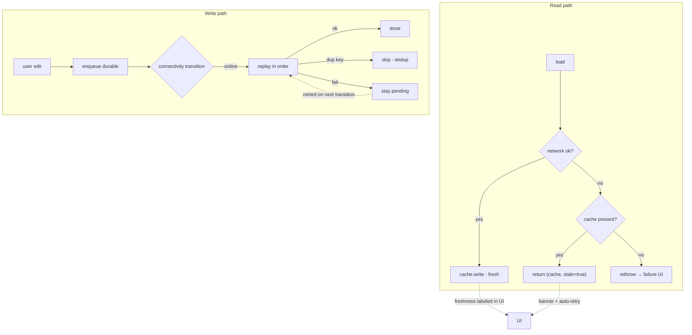

# Offline Functionality

## 1. Learning Objectives

After this lesson you can:

- [ ] Implement stale-while-offline reads: network wins, a dead network falls
      back to cache marked stale, an empty cache surfaces real failure (executed:
      `W14 online: source=network items=3 stale=false` → `W14 offline:
      source=cache(stale) items=3 stale=true` → `W14 offline, no cache: caught=
      SocketException → UI shows failure`)
- [ ] Build a write-behind queue that replays in order, deduplicates by
      idempotency key, and keeps what failed (executed: `replay: sent=[PUT /notes/1,
      PUT /notes/2] dedup-skipped=1 kept-pending=1`)
- [ ] Resolve conflicts with an explicit, tested policy instead of hope (executed:
      version compare → `remote wins (newer)` / `local wins (newer)` / `NoOp`)
- [ ] State the three offline questions every screen must answer: is this data
      fresh, when will it sync, and what happens if two edits collide
- [ ] Choose a sync direction — last-write-wins, server-wins, or field merge —
      and say who loses what
- [ ] Design the connectivity signal itself: transitions, not booleans, and the
      retry that re-runs the queue

## 2. Prerequisites

- [API Integration](api-integration.md) — the fetch this lesson wraps and the
  repository seam it extends.
- [Local Storage](local-storage.md) — the store behind the cache and queue.
- [Asynchronous Dart](asynchronous-dart.md) — retries, timers, and the stream of
  connectivity events.

*Toolchain: Flutter 3.47.7 / Dart 3.13.5, Windows 11 — verified in
[VERSIONS.md](../VERSIONS.md). All three probes are **executed** (batch test
battery W14): the cache fallback ran against a real faked-network repository, the
queue replay against real futures, the conflict resolver as pure functions — each
captured verbatim below.*

## 3. Introduction

Mobile networks are unreliable by default: tunnels, lifts, planes, and cheap data
plans all mean your app spends real fractions of its life disconnected. "Offline
support" is often sold as a mode; it's actually a *contract* on every read and
write: reads answer from somewhere honest, writes survive the gap, and collisions
have a policy. This lesson executes all three halves of that contract.

## 4. The Problem It Solves

The naive app does two things wrong: it shows a spinner forever when the network
dies (no fallback), or it drops the user's edit when the request fails (no queue).
Both are information-architecture failures — the app had no *source* for data when
the network wasn't one. The fix is to make the local store a first-class citizen:
reads become "best available, labeled", writes become "durably queued, replayed",
and the UI tells the truth about which one it's showing. The executed W14 battery
is that contract's acceptance test.

## 5. Core Concepts

### Reads: best-available, labeled (executed)

```dart
Future<(List<Item>, String)> load() async {
  try {
    final items = await fetch();
    cache.write(items);
    return (items, 'network');
  } catch (e) {
    final cached = cache.read();
    if (cached != null) {
      cache.stale = true;
      return (cached, 'cache(stale)');
    }
    rethrow;   // no cache → honest failure, not an empty lie
  }
}
```

```
W14 online: source=network items=3 stale=false
W14 offline: source=cache(stale) items=3 stale=true
W14 offline, no cache: caught=SocketException → UI shows failure
```

Three lines, three rules: **fresh when possible, labeled when stale, honest when
empty.** The `stale` flag is what the UI renders as "showing saved data ·
retrying" — an app that hides staleness trains users to distrust it the first time
the data is wrong. Note the third line: with no cache, `rethrow` means the screen
shows its failure state instead of rendering an empty list that looks like "you
have no orders."

### Writes: the queue (executed)

Writes made while offline must be **durable, ordered, and idempotent** — the
SyncQueue battery:

```dart
void enqueue(String key, String op) => _pending.add((key, op));

Future<List<String>> replay(send, {shouldFail}) async {
  // in order; skip duplicate keys; keep failures pending for next attempt
}
```

```
W14 queue offline: pending=4 (4 enqueued, none sent)
W14 replay: sent=[PUT /notes/1, PUT /notes/2] dedup-skipped=1 kept-pending=1
```

Four enqueued (one a duplicate idempotency key): replay sends two, drops the
duplicate (`dedup-skipped=1`), and the failing one stays pending
(`kept-pending=1`) for the next connectivity event — the queue never forgets and
never double-applies. The idempotency key is the same contract
[Backend Engineering](../11-BACKEND-ENGINEERING/README.md)'s API design lesson
(BACK-04) enforces server-side: both sides must agree, or retries double-charge.

### Conflicts: a policy, executed

```dart
Conflict resolve(int localVersion, int remoteVersion) =>
  localVersion == remoteVersion ? NoOp(...)
  : localVersion > remoteVersion ? LocalWins(...) : RemoteWins(...);
```

```
W14 conflict: local=3 remote=5 → remote wins (newer) | local=5 remote=3 → local wins (newer) | equal → NoOp
```

Version compare decides *mechanically*; the policy decision is what the app does
with the loser's data:

- **Last-write-wins / version-wins** — simple, somebody's edit vanishes silently
  (fine for "status", terrible for "notes").
- **Server-wins** — predictable, discards offline edits; needs a "your change
  wasn't saved" notice.
- **Field merge** — per-field versions or CRDTs; correct, expensive.
The executed resolver is the mechanism; the exercise asks you to choose the policy
per data type — that's the actual engineering.

### The connectivity signal

Connectivity is a **stream of transitions**, not a boolean: `offline → online` is
the event that triggers replay, and *online* itself lies (captive portals,
no-signal-yet). Treat it as a hint: attempt, and let the request's own failure
decide — exactly what `replay`'s keep-failed behavior encodes.

### What the UI owes the user

Three answers, always: **is this fresh** (stale banner), **when will it sync**
(queue size / next retry), and **what collided** (a conflict notice, never a
silent overwrite of text the user typed).

## 6. How It Works



The two paths meet in the UI's honesty: both label their source, and the queue's
pending state is user-visible information, not an implementation detail.

## 7. Practical Examples

**Example 1 — the executed offline battery (W14)**

```dart
// flutter test --reporter expanded test/offline_device_test.dart
final (items1, source1) = await repo.load();          // online
print('W14 online: source=$source1 items=${items1.length} stale=${cache.stale}');
online = false;
final (items2, source2) = await repo.load();          // network dies
print('W14 offline: source=$source2 items=${items2.length} stale=${cache.stale}');
// and with an empty cache → SocketException propagates
```

Complete capture in section 5. **How to run:** `flutter test --reporter expanded
test/offline_device_test.dart`.

**Example 2 — wiring the trigger (reference, on the executed pieces)**

```dart
connectivity.onOnline.listen((_) async {
  final sent = await queue.replay(repository.send, shouldFail: (_) => !onlineNow);
  if (sent.isNotEmpty) invalidateAndRefetch();   // cache freshness changes
});
```

- Replay rides the *transition*; failures stay queued; a successful batch
  invalidates the now-stale cache and refetches.
- **Expected behavior:** edits made in a tunnel flush once the bars return, and
  the list's staleness flag clears in the same frame the refetch lands.

## 8. Real-World Applications

Note apps (edits queue as you type's debounce), delivery drivers' photo uploads
and status updates in coverage dead zones, field-service forms, shopping carts
kept locally and reconciled at checkout, and every "works on the plane" feature.
The read-side rule (labeled staleness) is what makes maps, feeds, and mail usable
under flaky networks — and the queue is what stops apps from losing work, the
single most damaging offline failure.

## 9. Common Mistakes

| Mistake | Why it happens | How to recognize it | Prevent it with |
|---|---|---|---|
| Rendering stale cache as fresh | Simplest code | Users trust old data and act on it | Carry the source label to the UI (W14's `stale=true`) |
| Empty cache → empty list | `?? []` feels safe | "My orders disappeared offline" | Rethrow to the failure state (executed) |
| Queue that isn't durable | In-memory list | Edits lost on kill — the exact bug | Persist the queue with the local-storage rules |
| Retrying without idempotency | Server not consulted | Duplicate orders/photos after replay | Shared keys, server-side dedup (BACK-04) |
| Silent last-write-wins | Policy never decided | User's paragraph replaced by older copy | Per-data-type policy + conflict notice |
| Trusting a connectivity boolean | API returns true | Captive portal counts as "online" | Transitions are hints; request outcome decides |

## 10. Best Practices

- **Every read returns `(data, source)`** — freshness as data, not a UI guess.
- **Fail honestly when empty** — a failure state is better than a false empty.
- **Persist the queue** with the store's corruption rules; it holds user work.
- **Order + idempotency keys** on every replayable write, server-agreed.
- **Policy per data type, written down:** settings → server wins; free text →
  never silently lose; counters → merge. *Stops applying only for genuinely
  single-writer data, where it's unnecessary by definition.*
- **Test all three probes as acceptance tests** — the battery takes seconds and
  covers the whole contract.

## 11. Limitations and Trade-Offs

- **Version compare is not merge** — the executed resolver *detects* divergence;
  real merging costs schema (per-field versions) or algorithm (CRDTs).
- **Durable queues on mobile** — process death mid-replay needs write-ahead
  persistence or the at-least-once/idempotency pair; exactly-once doesn't exist.
- **Stale banners cost trust you must earn** — a banner that never clears (no
  background refetch) trains users to ignore it.
- **Conflict UI is product design** — "which version do you want?" dialogs are
  honest but annoying; silent resolution is smooth and occasionally wrong. Choose
  per data type, deliberately.
- **Offline tests use fakes for the radio** — real networks drop mid-byte; the
  battery covers logic, not TCP behavior; keep a manual pass on a real tunnel.

## 12. Practical Exercises

### Introductory

1. **Exercise 16.1** — reproduce all three W14 read lines (online, offline with
   cache, offline without cache). **Completion criteria:** the three captures, plus
   one sentence stating which line each UI state (content, stale banner, failure)
   renders.
2. **Exercise 16.2** — reproduce the queue battery: four enqueues with a duplicate
   key, one failing replay. **Completion criteria:** `sent=2, dedup-skipped=1,
   kept-pending=1` captured, and the failing op re-sent successfully on a second
   replay.

### Intermediate

3. **Exercise 16.3** — make the queue durable: persist pending ops to a file with
   the corruption rules from [Local Storage](local-storage.md), then "kill" (new
   instance) and prove the pending set survived. **Completion criteria:** capture
   showing pending=1 across process restart before the successful replay.
4. **Exercise 16.4** — add a conflict *notice* to a widget: local v5 vs remote v3
   while a text field holds the user's newer edit; the UI must show both and
   choose. **Completion criteria:** a widget test capturing the notice and the
   final chosen content — with your policy stated in one line.

### Independent problem-solving

5. **Exercise 16.5** — design offline for a collaborative notes app: read source
   labels, write queue with attachments (larger than a message), per-field merge,
   and what the queue does when a *merge* changes the payload it queued.
   **Completion criteria:** the full design plus executed tests of the riskiest
   piece — replay after a field-level merge altered the op — showing no lost user
   text, with any platform-only steps labelled.

*Solutions: attempt first. They live in `solutions/` of this subject.*

## 13. Knowledge Check

1. W14's third line rethrows when the cache is empty. A teammate replaces it with
   `return ([], 'cache')` — describe the user-visible lie this creates and the
   incident it causes.
2. The queue dedupes by key (`dedup-skipped=1`). Why must the *server* also know
   the key for this to be safe? What failure remains if only the client dedupes?
3. When is last-write-wins the *right* policy? Give a field and defend it against
   section 5's policy list.

## 14. Completion Criteria

Observable evidence that you have understood this lesson:

- [ ] You have reproduced all three read lines, the queue replay, and the conflict
      table from a blank file
- [ ] You can write the `load()` contract — network, fallback, rethrow — from
      memory and justify the third branch
- [ ] You can name the queue's three guarantees and the server-side contract each
      needs
- [ ] You can pick and defend a conflict policy for three different data types
- [ ] You can diagnose all six mistakes in section 9 on sight

## 15. Summary

- Reads: network wins, stale cache is labeled, empty cache fails honestly — three
  executed lines.
- Writes: durable queue, ordered replay, idempotency keys, failures stay pending.
- Conflicts: version compare detects (executed), policy decides — write the
  policy per data type.
- Connectivity is a transition stream and only a hint; the request's outcome is
  the truth.
- The UI owes three answers: fresh?, syncing?, collided?

## 16. Next Steps

- Next lesson: [Mobile Testing](mobile-testing.md) — the batteries in this batch
  formalized: unit, widget, and integration tiers plus the red/green drill.
- Practice: [exercise sets](exercises/README.md) for this subject.
- Where it is applied: [Project 06](../20-PROJECT-LABORATORY/README.md) — its sync
  layer is this lesson's three executed contracts.
