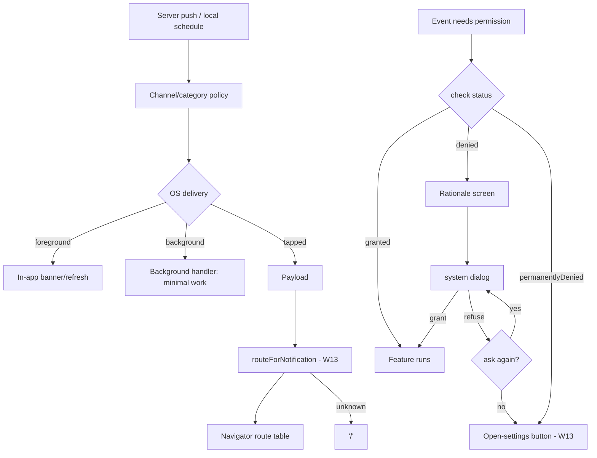

# Permissions and Notifications

## 1. Learning Objectives

After this lesson you can:

- [ ] Drive the full permission sequence and name each state's next move
      (executed: `permission: unknown` → `denied` → `permanentlyDenied` with
      `open settings hint shown` → after settings `granted` / `camera unlocked`)
- [ ] State the Android/iOS differences that break naive implementations —
      request-once semantics, permanent denial, pre-prompt timing, and notification
      registration — in a comparison table you can build from memory
- [ ] Route notification taps to the right screen from a payload, with a safe
      fallback for anything unrecognized (executed: `order → /confirm?id=7`,
      `message → /messages/c-9`, `mystery → /`)
- [ ] Explain why permission must be requested at the moment of need, and what
      each platform *does* to apps that ask at launch
- [ ] Design the four notification payloads a real app needs (alert, silent,
      actionable, deep-link) and say which wakes the app
- [ ] Handle foreground vs background delivery, and the channel/importance model
      Android alone imposes

## 2. Prerequisites

- [Camera and QR Codes](camera-and-qr-codes.md) — the request-at-need flow this
  lesson generalizes.
- [Navigation](navigation.md) — notification taps are deep links into the same
  route table.
- [Asynchronous Dart](asynchronous-dart.md) — permission futures and background
  handlers.

*Toolchain: Flutter 3.47.7 / Dart 3.13.5, Windows 11 — verified in
[VERSIONS.md](../VERSIONS.md). The permission gate walk and payload routing are
**executed** (probe W13 — the platform channel is faked by the test, the state
machine is real). System dialogs, notification channels, and background delivery
are **labelled reference**: no device session exists on this machine; the
exercises run those steps on yours.*

## 3. Introduction

Permissions and notifications are the two features where your app negotiates with
the *operating system* rather than with hardware — and both platforms have opinions,
different ones, and opinions about when you're allowed to ask. This lesson executes
the state machines you control and tabulates the platform behavior you must
accommodate, so a first submission doesn't get rejected (or worse, silently denied)
for asking at the wrong moment.

## 4. The Problem It Solves

"Works on my phone" dies here more than anywhere: the dev device granted everything
during testing, so the denied path never ran — and real users, who decline or who
never see a prompt at all, get a dead button. Notifications fail the other way: an
app that requests at launch and sends by default gets uninstalled, and Android's
channel model means an unconfigured app's alerts may never appear at all. The
structural answer: model permission as a **state machine with an unreachable-but-
handled dead end** (permanently denied), and treat notification payloads as a
**routing contract** with the navigation table you already own.

## 5. Core Concepts

### Permission as a state machine, executed (W13)

```dart
enum PermStatus { unknown, granted, denied, permanentlyDenied }
// The gate: request → show status → route permanentlyDenied to settings
```

```
W13 start: "permission: unknown"
W13 after request 1: "permission: denied"
W13 after request 2: "permission: permanentlyDenied" hint="open settings hint shown"
W13 after settings: "permission: granted" camera="camera unlocked"
```

Four states, three transitions, all driven by a faked platform channel that
returns: denied → permanently denied → granted. Read what each line obliges the UI
to do:

- `denied` → you may ask again (with rationale);
- `permanentlyDenied` → **you may not ask**; only a settings deep-link remains —
  the state most apps forget, leaving users with a button that silently does
  nothing forever;
- `granted` → unlock the feature, and re-check on every resume (users revoke in
  settings while your app is backgrounded).

### The platform differences that actually bite

| Behavior | Android | iOS |
|---|---|---|
| Request timing | once per session; "don't ask again" after two refusals or a deny-and-ask | system may stop showing the dialog after denial → permanently denied |
| Pre-prompt rationale | recommended (education UI before the dialog) | `permission_...` usage strings *must* be in Info.plist or the app crashes on request |
| Notification permission | channels, no runtime grant needed (post-13: POST_NOTIFICATIONS runtime prompt) | explicit runtime prompt (UNUserNotificationCenter), iOS 10+ |
| Notifications registered by | channel id + importance at first use | authorization request at first use |
| Deep-link on tap | intent extras / link | userInfo payload |
| Revocation | in settings any time; app must re-check on resume | in settings any time |

Rules of thumb this table enforces: **check, don't assume** (status can change
under you), **configure Android channels before the first send**, and **declare
every usage string** (iOS) / manifest permission (Android) or the request never
reaches the user.

### Notification payloads are routing data, executed (W13)

```dart
String routeForNotification(Map<String, dynamic> payload) =>
  switch (payload['type']) {
    'order'   => '/confirm?id=${payload['orderId']}',
    'message' => '/messages/${payload['chatId']}',
    _         => '/',
  };
```

```
W13 notify order → /confirm?id=7
W13 notify message → /messages/c-9
W13 notify mystery → /
```

The default branch is the lesson: an unknown type lands on `/` (safe) instead of
crashing a cold-start route cast. This function is pure — it is the exact seam
where a notification tap enters the route table from [Navigation](navigation.md),
and it's unit-testable without any notification ever being delivered.

### Delivery modes

- **Foreground:** your app is visible — show in-app UI; don't assume the system
  banner appears (iOS shows it only if configured; Android depends on channel).
- **Background:** payload arrives without UI — Android's isolate/handler or iOS's
  silent push must finish fast (Android ~10 s window; iOS silent pushes are
  best-effort and throttled). Do **minimal work**: update a badge, schedule local
  work.
- **Terminated:** tapping launches the app — handle the payload in the launch
  path, *before* deciding an initial route (this is why route functions are pure).

### Channels (Android) and categories (both)

Group notifications by purpose with an importance level: messages high, marketing
low. Users toggle per channel — which means your channel names are UX, and an
app with one catch-all channel trains users to silence everything.

## 6. How It Works



The permission side is a loop with one terminal dead-end; the notification side
ends in the same route table every other navigation entry uses.

## 7. Practical Examples

**Example 1 — the executed permission walk (W13)**

```dart
// flutter test --reporter expanded test/offline_device_test.dart
var calls = 0;
Future<PermStatus> platform() async {
  calls++;
  return switch (calls) { 1 => PermStatus.denied, 2 => PermStatus.permanentlyDenied, _ => PermStatus.granted };
}
await tester.pumpWidget(MaterialApp(home: PermissionGate(request: platform)));
// tap 'request' → 'request' → 'open settings', pumping between taps
```

Full capture in section 5; the test asserts `calls == 3` and that
`camera unlocked` appears.

**Example 2 — cold-start notification routing (reference, on W13's function)**

```dart
void main() {
  WidgetsFlutterBinding.ensureInitialized();
  final launch = WidgetsBinding.instance.platformDispatcher.initialData; // payload
  runApp(App(initialRoute: routeForNotification(launch ?? const {})));
}
```

- **Expected behavior:** tapping an `order` notification cold-starts straight into
  `/confirm?id=7`; an unknown payload starts on `/`.
- **How to run:** wire the real plugin on a device; the routing function is the
  executed part.

## 8. Real-World Applications

Messaging apps (permission → channels → tap-to-chat), delivery tracking
(`order → status screen`), two-factor prompts, calendar and reminder apps
(local notifications with scheduled payloads), and every app that uses push for
re-engagement — where the *unsubscribe-per-channel* control these models provide is
also a retention feature: users silence marketing, keep messages, and stay installed.

## 9. Common Mistakes

| Mistake | Why it happens | How to recognize it | Prevent it with |
|---|---|---|---|
| Requesting at launch | "Get it out of the way" | High denial rates; store-review friction | Request at moment of need + rationale (W13's flow) |
| Ignoring permanentlyDenied | Denial treated as final failure | Button does nothing; user stuck | Settings deep-link branch — executed |
| Not re-checking on resume | One-time check habit | Feature dead after user revokes | Re-check status on every resume |
| One giant notification channel | Default config | Users silence the whole app | Channels/categories by purpose |
| Unhandled payload type | Happy-path routing | Crash or blank screen on new push type | `default → '/'` (executed) |
| Forgetting platform declarations | Dev device already granted | iOS crash on request; Android prompt never shows | Info.plist usage strings / manifest permissions in the checklist |

## 10. Best Practices

- **Status enum + switch with every branch visible** — the compiler keeps you
  honest if you add a state.
- **Check → explain → ask** in that order; never ask cold, never ask twice when
  the system says stop.
- **Pure payload → route function** with tests for known *and* unknown types.
- **Channels/categories before the first send**; name them for users, since they
  appear in system settings.
- **Background handlers do less than you think** — schedule, don't compute.
- **Test the gate with a faked channel** (executed template) — the dialog itself
  is the only part that needs a device.

## 11. Limitations and Trade-Offs

- **Platform policy changes** — notification consent and tracking rules have moved
  repeatedly (iOS 12+ prompts, Android 13's POST_NOTIFICATIONS); re-verify against
  current docs before shipping, not from memory.
- **Faked channels prove your logic, not the OS's** — dialog wording, Doze, and
  focus modes need real-device passes.
- **Push reliability is not yours** — iOS silent pushes are throttled; treat them
  as nudges, never as a delivery guarantee.
- **Deep links can be spoofed** — a notification payload is untrusted input: type-
  check every field, and authorize the destination server-side (the same rule the
  backend lessons give route arguments).
- **Over-prompting has no undo** — a denied permission with permanently-denied
  state can only be fixed by the user in settings; design the settings deep-link
  well.

## 12. Practical Exercises

### Introductory

1. **Exercise 15.1** — reproduce the four-line W13 permission walk and the three
   payload routes. **Completion criteria:** seven captured lines; the
   `permanentlyDenied` line's UI obligation stated in one sentence.
2. **Exercise 15.2** — build the Android/iOS table of section 5 from memory, then
   verify three rows against current platform docs. **Completion criteria:** your
   table plus the three verified rows marked and any corrections noted.

### Intermediate

3. **Exercise 15.3** — add a `promo` payload type to `routeForNotification` and a
   test that unknown types still land on `/`. Then delete the default branch and
   capture the compiler's exhaustiveness complaint. **Completion criteria:** three
   captures — new route, fallback, and the compile error without `_`.
4. **Exercise 15.4** — implement `PermissionGate`'s missing state: `unknown` on
   first launch must not show a button that requests immediately — insert a
   rationale screen and re-run the walk. **Completion criteria:** updated capture
   where the first tap shows rationale, the second triggers the (faked) dialog.

### Independent problem-solving

5. **Exercise 15.5** — design the notification system for a messaging app:
   channels (messages/likes/system), permission strategy on iOS and Android,
   payload formats for the four delivery modes, and the routing table they feed.
   **Completion criteria:** a payload schema, the pure routing function with tests,
   and a written statement of what each background handler is allowed to do within
   its platform's time budget — with the device-only steps labelled.

*Solutions: attempt first. They live in `solutions/` of this subject.*

## 13. Knowledge Check

1. After the W13 walk, the app's "request" button appears on `denied` but must not
   behave identically on `permanentlyDenied`. What does each state's handler do,
   and what does the framework do if you get it wrong?
2. Why is `routeForNotification` pure — no context, no navigator — and what
   specific crash does that separation prevent on cold start?
3. Name two Android/iOS differences from section 5's table that would each break
   an app built and tested on only one platform.

## 14. Completion Criteria

Observable evidence that you have understood this lesson:

- [ ] You have reproduced the four-line permission walk and three-route payload
      capture
- [ ] You can rebuild the platform-differences table from memory and correct at
      least three rows against current docs
- [ ] You can explain what happens at each delivery mode (foreground, background,
      terminated) and where the payload is handled in each
- [ ] You can state the check → explain → ask discipline and its permanently-denied
      branch without notes
- [ ] You can diagnose all six mistakes in section 9 on sight

## 15. Summary

- Permission is a four-state machine with one dead end; permanently-denied means
  settings, not asking again (executed walk).
- The platforms differ on timing, declarations, and notification consent — the
  table is the checklist.
- Notification payloads are untrusted routing data: pure function, typed fields,
  safe default (`/` — executed).
- Channels/categories are UX; configure before the first send.
- Faked channels test your logic; devices test the OS — label which is which.

## 16. Next Steps

- Next lesson: [Offline Functionality](offline-functionality.md) — the app working
  when the network doesn't: caches, queues, and conflicts.
- Practice: [exercise sets](exercises/README.md) for this subject.
- Where it is applied: [Project 06](../20-PROJECT-LABORATORY/README.md) — its push
  taps route through this lesson's pure function.
