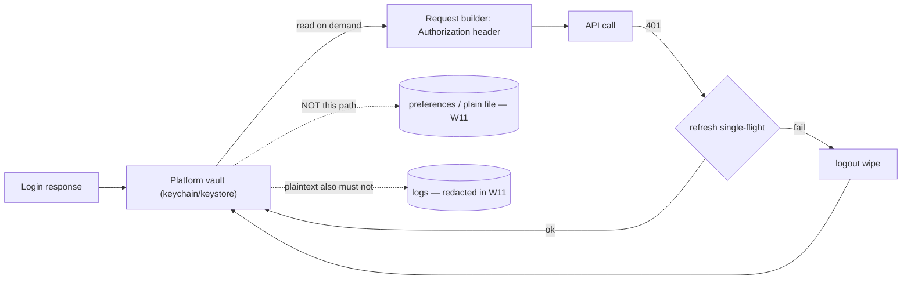

# Secure Storage

## 1. Learning Objectives

After this lesson you can:

- [ ] State exactly what "secure storage" promises — platform-protected at rest —
      and the three things it does **not** promise (secrecy from a rooted device,
      secrecy from the running app, or server-side protection)
- [ ] Demonstrate why plaintext preferences are not token storage (executed: a
      token written to a real file reads back `contains-token=true` — the secret is
      literally in the bytes)
- [ ] Apply log redaction as the companion habit (executed: the same content with
      the token replaced reads `{"token":"***"}`)
- [ ] Choose the platform vault — iOS Keychain, Android Keystore — and say what
      each guarantees, including the encrypted-file fallback and its weaker story
- [ ] Design a token lifecycle: store, read, refresh, revoke, logout-wipe — and
      name where each step lives
- [ ] Recognize the attacks local storage can't stop (backups extraction, clipboard
      leaks, screenshots) and the mitigations that do apply

## 2. Prerequisites

- [Local Storage](local-storage.md) — the plaintext baseline this lesson draws a
  line under.
- [API Integration](api-integration.md) — tokens are credentials for that client.

*Toolchain: Flutter 3.47.7 / Dart 3.13.5, Windows 11 — verified in
[VERSIONS.md](../VERSIONS.md). The plaintext and redaction captures are executed
(real files under the system temp directory, probe W11). The platform vault paths
(iOS Keychain / Android Keystore) are **labelled reference**, not executed here:
this machine has no device or emulator session — reproduce them on yours per the
exercises. Nothing below pretends to be a screenshot it is not.*

## 3. Introduction

The moment you store a session token or an API key, you've created a file whose
contents *are* your user's account. This lesson is about that file: what can read
it, what the platform offers to stop them, and the honest limits of every layer —
because the failure mode of secure storage isn't "it didn't work", it's "everyone
assumed something stronger than what was delivered."

## 4. The Problem It Solves

Session tokens in preferences were the industry default for years, and the results
were predictable: on a rooted/jailbroken device, a backup extraction, or a stolen
unencrypted laptop backup, a simple file read yields live credentials. Worse, the
same token usually leaked through logs ("here's the header we sent"). The platform
vendors responded with hardware-backed vaults — Keychain and Keystore — that store
secrets behind the device's own encryption and unlock state. This lesson's job is
to use those vaults *without* over-believing them.

## 5. Core Concepts

### The promise, precisely

**Secure storage = credentials encrypted at rest by the platform, keyed to the
device/user, readable only through the OS's API (and, for hardware-backed
variants, only while the device is unlocked).** It promises protection against:

- offline file extraction from the app sandbox (without the key),
- casual forensic recovery of app data,
- other apps (sandbox + keystore isolation).

It does **not** promise:

- protection from malware running *as* the user on a compromised device,
- protection from the app itself — any code in your process can call the vault and
  get the plaintext back,
- anything about the token's lifetime — that's server policy (revoke/refresh).

### Why preferences are not vault storage — executed (W11)

```dart
final file = File('${dir.path}/prefs.json');
await file.writeAsString(jsonEncode({'token': 'SECRET-TOKEN-42'}));
final raw = await file.readAsString();
print('W11 plaintext file: contains-token=${raw.contains('SECRET-TOKEN-42')} ...');
```

```
W11 plaintext file: contains-token=true bytes=27
W11 redacted log line: {"token":"***"}
```

Line one *is* the vulnerability, executed: anyone who can read the file holds the
token. Line two is the companion discipline: the same data, redacted before it
enters a log, because logs travel — to crash reporters, to log aggregators, to
screenshots in bug tickets.

### The platform vaults (labelled reference)

| | iOS | Android |
|---|---|---|
| API | Keychain (`kSecClassGenericPassword`) | Keystore + EncryptedSharedPreferences / DataStore |
| Backed by | device keychain, escrowed in backups by default | Android Keystore (hardware-backed on modern devices) |
| Survives app delete? | yes (keychain items persist) — a double-edged trait | generally no |
| Unlock gating | accessible-unless-unlocked options per item | keys can require user authentication (biometric) |
| Flutter surface | `flutter_secure_storage` (writes through the platform channels of this subject's [Mobile Fundamentals](mobile-development-fundamentals.md) boundary) | same package; per-OS options differ |

Honest notes: hardware-backed means the key can't leave the secure element — the
*encryption* runs there, but **your app still receives plaintext** to put in an
`Authorization` header. And backups matter: Keychain items may sync to new devices
through iCloud Keychain (convenient, weaker), which you can opt out of — decide
consciously.

### The token lifecycle

1. **Store** — token lands in the vault at login, never in preferences.
2. **Read** — fetched just-in-time when building a request; not cached in statics
   or globals (a static is RAM a crash dump can read).
3. **Refresh** — single-flight: one refresh in progress, everyone awaits it (the
   classic double-refresh race invalidates the second use).
4. **Revoke/expire** — on 401: clear, then re-auth; never infinite-retry.
5. **Wipe** — logout and account-switch *delete* the entry; uninstall may or may
   not (iOS keychain persists — handle it: validate on first launch).

### The leaks outside the vault

Clipboard (password managers paste, keyboards log), screenshots (banking apps
FLAG_SECURE / screenshot blocking), screenshots in app switcher previews, deep-link
URLs, and analytics SDKs you onboarded that print request headers. Secure storage
protects *at rest*; these are *in use* — each needs its own mitigation.

## 6. How It Works



Two dashed lines carry this lesson's executed evidence: the path that must never
exist (plaintext storage) and the leak it must not feed (logs).

## 7. Practical Examples

**Example 1 — the executed contrast (W11)**

```dart
// flutter test --reporter expanded test/api_storage_test.dart
await file.writeAsString(jsonEncode({'token': 'SECRET-TOKEN-42'}));
final raw = await file.readAsString();
print('W11 plaintext file: contains-token=${raw.contains('SECRET-TOKEN-42')} bytes=${raw.length}');
final logged = raw.replaceAll('SECRET-TOKEN-42', '***');
print('W11 redacted log line: $logged');
```

```
W11 plaintext file: contains-token=true bytes=27
W11 redacted log line: {"token":"***"}
```

- **How to run:** `flutter test --reporter expanded test/api_storage_test.dart`
- **Expected behavior:** `contains-token=true` is the assertion that makes plaintext
  storage indefensible; `isFalse` on the redacted line is the habit's test.
- **Assumptions:** Windows 11, temp file — the same bytes on any OS.

**Example 2 — vault-backed token store (labelled reference, run on a device)**

```dart
class TokenStore {
  static const _key = 'session.token';

  final FlutterSecureStorage _vault;

  Future<void> save(String token) =>
      _vault.write(key: _key, value: token,
          aOptions: const AndroidOptions(encryptedSharedPreferences: true),
          iOptions: const IOSOptions(accessibility: KeychainAccessibility.first_unlock));

  Future<String?> read() => _vault.read(key: _key);

  Future<void> wipe() => _vault.delete(key: _key);
}
```

- **How to run:** your lab on a device/emulator — this battery cannot execute on the
  authoring machine (no device session); the API surface above matches
  `flutter_secure_storage`'s documented options.
- **Expected behavior:** app data directory contains **no** plaintext token; on
  Android with `encryptedSharedPreferences`, the file exists but decrypts only
  through the Keystore key.

## 8. Real-World Applications

Any app with sessions (all of them), banking and health apps that additionally block
screenshots, apps whose API keys must ship in the binary (accept that they're
extractable — the server should scope them per-device instead), and refresh-token
rotation schemes where the vault holds the rotating half. The lesson's redaction
habit applies to your crash reporter *today*: audit what your HTTP layer logs
before your first incident, not during it.

## 9. Common Mistakes

| Mistake | Why it happens | How to recognize it | Prevent it with |
|---|---|---|---|
| Token in preferences "temporarily" | It's one line | W11's capture: secret in the file | Vault from the first commit; review checklist item |
| Caching the token in a static/global | Avoid a read per request | Crash dumps contain it | Just-in-time read from the vault |
| Logging headers for debugging | Headers are useful | Token in aggregated logs | Redaction at the logging layer (executed) |
| Believing "encrypted = unreadable" | Marketing language | Extracted APK still yields plaintext via app code | Scope tokens server-side; assume the app side is inspectable |
| Ignoring backup behavior | Default settings | Token restored onto a different device | Opt out of iCloud keychain backup / test restore |
| No wipe on logout | Delete feels redundant | Next user of a shared device is logged in | `wipe()` in the logout path — test it |

## 10. Best Practices

- **Vault for credentials, preferences for flags** — the boundary is "would this
  being read be a security incident?"
- **Read just-in-time; never log the value; wipe deliberately.** Three habits, one
  sentence each in code review.
- **Rotate and scope on the server** — local storage protects at rest; the server
  decides how much a stolen token can do and for how long.
- **Single-flight refresh** — one in-flight refresh shared by awaiting callers.
- **Test the wipe:** store → read → wipe → read returns null, on a real device.
- **Threat-model the extras** (clipboard, screenshots, backups) per product — a
  banking app and a notes app make different, defensible choices. *Stops applying
  only where the threat model says so, written down.*

## 11. Limitations and Trade-Offs

- **The app gets plaintext by design** — anything running inside your process can
  call the vault; there is no in-app secret from yourself.
- **Vaults are platform-shaped** — per-OS options, migration, and restore semantics
  differ; `flutter_secure_storage` papers over, but doesn't erase, the differences.
- **Keychain persistence across uninstall** surprises migrations (old token valid
  after reinstall); decide and test your policy.
- **Biometric gating can lock users out** — an auth-required key on a locked device
  means your app can't refresh in the background; choose accessibility options
  deliberately.
- **Nothing here covers XSS/injection in web views** — a token in JS-reachable
  storage in a WebView is compromised regardless of the vault; keep web views
  unauthenticated or use cookies with proper flags.
- **The server is still the authority** — no vault makes an unrevocable token safe.

## 12. Practical Exercises

### Introductory

1. **Exercise 13.1** — reproduce the W11 pair: plaintext capture and redacted
   capture. Then grep your own app's logging calls for anything within two lines of
   a token and fix one. **Completion criteria:** both captures, plus the before/after
   of one real log line.
2. **Exercise 13.2** — write the three-sentence guarantee for your current app:
   what secure storage protects it from, what it doesn't, and where the line is.
   **Completion criteria:** the statement names at least two non-promises from
   section 5.

### Intermediate

3. **Exercise 13.3** — on a device/emulator: implement `TokenStore` (Example 2),
   save, kill and relaunch the app, read back; then search the app's data directory
   for your token string. **Completion criteria:** token readable through the API,
   `grep`-style search finds no plaintext occurrence in the data directory.
4. **Exercise 13.4** — implement logout wipe and the shared-device test: login as
   A, logout, login as B, force-quit, relaunch. **Completion criteria:** relaunch
   shows B's session only, and read-after-wipe returned null.

### Independent problem-solving

5. **Exercise 13.5** — design token handling for an app that must survive
   reinstall, support two accounts, and work offline for 24 h after logout is
   pressed once. **Completion criteria:** a written lifecycle (store/read/refresh/
   wipe) covering the reinstall case explicitly, with the platform behaviors your
   design relies on named — and a stated server-side control for whatever the
   client cannot guarantee.

*Solutions: attempt first. They live in `solutions/` of this subject.*

## 13. Knowledge Check

1. Your app's token is in the Keychain and the app is fully compromised by
   malware running as the user. Is the token safe? Defend the answer from
   section 5's promise list.
2. W11 shows `contains-token=true` in a *file*. Restate what changes on iOS/
   Android when the same bytes live in the vault — and what stays the same from
   your app's point of view.
3. A teammate says "we encrypt user data locally, so we're fine logging their
   token." Identify both errors in that sentence.

## 14. Completion Criteria

Observable evidence that you have understood this lesson:

- [ ] You can state the three promises and three non-promises without notes
- [ ] You have reproduced the W11 plaintext/redaction captures
- [ ] You can name, per platform, what the vault is backed by and one restore/backup
      behavior that differs
- [ ] You can walk a token through store → read → refresh → wipe with the failure
      mode each step prevents
- [ ] You can diagnose all six mistakes in section 9 on sight

## 15. Summary

- Secure storage promises protection *at rest from outside the process* — nothing
  more; the app itself always sees plaintext.
- Preferences are plaintext — executed: `contains-token=true` in real bytes.
- Redact secrets before they reach logs; that capture is the same file's other
  truth.
- Vault per OS (Keychain/Keystore), read just-in-time, single-flight refresh,
  wipe on logout.
- Server-side scope and revocation are the controls for everything a client can't
  guarantee.

## 16. Next Steps

- Next lesson: [Camera and QR Codes](camera-and-qr-codes.md) — device capability
  through the platform-channel boundary: permissions, capture, and scanning.
- Practice: [exercise sets](exercises/README.md) for this subject.
- Where it is applied: [Project 06](../20-PROJECT-LABORATORY/README.md) — its auth
  flow stores tokens exactly as this lesson specifies.
