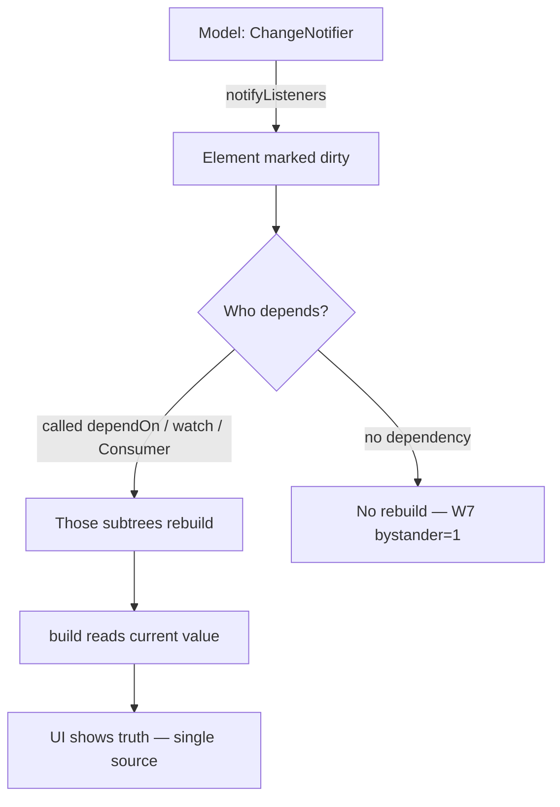

# State Management

## 1. Learning Objectives

After this lesson you can:

- [ ] Place each kind of state — ephemeral, screen, app, server — where it belongs,
      and name the failure each placement prevents
- [ ] Rung 1→2: replace a top-level `setState` with an `InheritedNotifier` and
      **measure** who rebuilds (executed: `W7 mount: dependent=1 bystander=1` →
      `W7 after inc: dependent=2 bystander=1 value=1` — the bystander that never
      reads the counter never rebuilt)
- [ ] Rung 3: consume app-wide state through `Provider` and prove notification is
      *type-directed* (executed: after `inc`, `theme-consumer-builds=1 (was 1)`
      with the counter view updating; after `flip`, `theme-consumer-builds=2`)
- [ ] Explain why `context.watch`/`Consumer` rebuilds and `context.read` doesn't —
      and which belongs in callbacks vs build
- [ ] Compare Provider, Riverpod, Bloc, and setState-on-what-you-own honestly: what
      each costs, what each fixes, and when plain `setState` still wins
- [ ] Diagnose the three classic state bugs — over-rebuild, missed rebuild, stale
      copy — from rebuild counters alone

## 2. Prerequisites

- [Flutter Fundamentals](flutter-fundamentals.md) — `setState` mechanics and subtree
  rebuilds; this lesson generalizes them.
- [Dart Fundamentals](dart-fundamentals.md) — `ChangeNotifier`, mixins, and streams
  appear in every implementation here.

*Toolchain: Flutter 3.47.7 / Dart 3.13.5, `provider` (latest, added via `flutter pub
add provider`), Windows 11 — verified in [VERSIONS.md](../VERSIONS.md). Transcripts
are real captures from the batch's `test/nav_state_form_test.dart` (probe W7);
`+4: All tests passed!` for the W6–W8 battery.*

## 3. Introduction

"Where does this value live?" is the question that decides whether an app's UI stays
consistent or drifts into screens disagreeing about the truth. State management is
not a library choice — it's a placement decision plus a notification mechanism. This
lesson moves up the ladder from `setState` to inherited state to Provider, with each
rung's rebuild behavior *measured* in executed tests rather than asserted in prose.

## 4. The Problem It SolveS

A cart total shown in three screens, updated in the fourth: with `setState` alone,
each screen keeps its own copy and the fourth must remember to notify the other
three — a fan-out of manual wiring that breaks the first time a screen is added.
Global mutable variables "fix" it differently and worse: now nothing knows *when* to
rebuild, and tests share invisible state.

The structural answer is a single source of truth with a subscription mechanism:
state lives once, interested widgets subscribe, and notifications are addressed by
*type* — the counter's subscribers get told about counter changes and nothing else.
W7 executes exactly that claim for both the hand-rolled and the packaged version.

## 5. Core Concepts

### Kinds of state and where each lives

| Kind | Example | Lives | Wrong placement costs |
|---|---|---|---|
| Ephemeral | scroll offset, hover | widget itself | rebuilds for nothing |
| Screen | form draft, wizard step | that screen's `State` | prop-drilled or global for one screen |
| App | theme, session, cart | app-wide notifier | three screens, three copies |
| Server | lists, profiles | cache + refetch | pretending it's local → stale truth |

### Rung 1 — `setState` (recap)

Fine when the state and its readers share a `State` object. The failure is scope:
readers *above* or *beside* the owner can't subscribe, so owners start lifting state
higher than it belongs — until one giant `setState` rebuilds the world.

### Rung 2 — InheritedNotifier, executed (W7)

An `InheritedWidget` publishes a value down the tree; `InheritedNotifier<T>` adds
notification: dependents rebuild when the notifier fires. The lab's hand-rolled
version:

```dart
class Counter extends InheritedNotifier<CounterModel> {
  const Counter({super.key, required CounterModel model, required super.child})
      : super(notifier: model);
  static CounterModel of(BuildContext context) =>
      context.dependOnInheritedWidgetOfExactType<Counter>()!.notifier!;
}
```

Executed rebuild counts:

```
W7 mount: dependent=1 bystander=1
W7 after inc: dependent=2 bystander=1 value=1
```

`Dependent` called `Counter.of(context)` — it *depends* — so one `inc()` rebuilt it
(1→2). `Bystander` sits in the same subtree and never read the counter — it stayed
at 1. **Rebuild scope = who called dependOn**, not who's nearby. That single line is
the mechanism every higher-level library is built on.

### Rung 3 — Provider, executed (W7)

`provider` packages rung 2 with type-directed lookup (`context.watch<T>()`,
`context.read<T>()`) and lifecycle (`ChangeNotifierProvider` disposes its notifier):

```dart
MultiProvider(
  providers: [
    ChangeNotifierProvider(create: (_) => CounterModel()),
    ChangeNotifierProvider(create: (_) => ThemeToggle()),
  ],
  child: const MaterialApp(home: ConsumerScreen()),
)
```

```
W7 provider after inc: theme-consumer-builds=1 (was 1) count-view="provider count=1"
W7 provider after flip: theme-consumer-builds=2
```

The `Consumer<ThemeToggle>` did **not** rebuild when the counter changed — the count
view updated to 1 in the same frame — and rebuilt once when the theme flipped.
Notification is addressed by *type*, which is why splitting state into small
`ChangeNotifier`s is a rebuild-scoping tool, not a style preference.

### watch vs read

- `context.watch<T>()` (or `Consumer`) = subscribe: rebuilds build when T notifies.
  Only valid in `build`.
- `context.read<T>()` = grab the instance for a callback: no subscription, no
  rebuild. Valid anywhere after the provider exists.
Swapping them is the classic bug: `read` in build → UI never updates; `watch` in an
onPressed → works until it doesn't (and lints at you).

### The wider menu

- **`setState`** — owns local; zero dependencies; still the right answer for most
  screens.
- **Provider** — inherited state, DI-ish access, proven at scale; minimal API.
- **Riverpod** — compile-safe rework of Provider: no BuildContext needed, providers
  are objects; steeper learning, fewer runtime lookup errors.
- **Bloc** — events in, state out, explicit reducers; ceremony that pays off in
  large teams needing auditability of every state change.
- **Streams/`StreamBuilder`** — natural when the source *is* a stream (websockets);
  the async lesson's patterns apply directly.

The honest axis: *how much structure can you justify?* State that two widgets share
is a `ChangeNotifier`; state a team argues about needs an event log.

## 6. How It Works



The framework tracks dependencies per element during build (the `dependencies:` list
W2 dumped). `notifyListeners` marks exactly those elements dirty; the next frame
rebuilds them. No manual subscription bookkeeping — the build phase *is* the
subscription phase.

## 7. Practical Examples

**Example 1 — the rebuild-count proof (executed, W7)**

```dart
// test (abridged)
dependentBuilds = 0; bystanderBuilds = 0;
await tester.pumpWidget(MaterialApp(
  home: CounterScope(model: model,
    child: Column(children: const [Dependent(), Bystander(), _IncButton()]),
  ),
));
print('W7 mount: dependent=$dependentBuilds bystander=$bystanderBuilds');
await tester.tap(find.text('inc'));
await tester.pump();
print('W7 after inc: dependent=$dependentBuilds bystander=$bystanderBuilds '
    'value=${model.value}');
```

```
W7 mount: dependent=1 bystander=1
W7 after inc: dependent=2 bystander=1 value=1
```

- **How to run:** `flutter test --reporter expanded test/nav_state_form_test.dart`
- **The method:** counters inside `build` turn the invisible question ("who
  rebuilt?") into a number you can assert.

**Example 2 — Provider split-state, executed (W7)**

```dart
Consumer<ThemeToggle>(builder: (context, theme, _) {
  providerConsumerBuilds++;
  return Text('theme dark=${theme.dark}');
});
Consumer<CounterModel>(builder: (context, counter, _) =>
  Text('provider count=${counter.value}'));
// buttons: context.read<CounterModel>().inc() / context.read<ThemeToggle>().flip()
```

```
W7 provider after inc: theme-consumer-builds=1 (was 1) count-view="provider count=1"
W7 provider after flip: theme-consumer-builds=2
```

- **Expected behavior:** counter changes update the count view without touching the
  theme consumer; theme changes touch only it.
- **Assumptions:** `provider` latest from pub.dev, Flutter 3.47.7.

## 8. Real-World Applications

Session/auth state, theme and locale, shopping carts, drafts of long forms, live
dashboards — all app-scoped state follows W7's shape: a `ChangeNotifier` per domain,
providers at the root, `Consumer` at the leaves that care. Teams that skip the
placement decision end up with prop drilling (mechanical, visible) or globals
(invisible, untestable); both are the same mistake at different distances. The
rebuild-counter technique from this lesson is how performance regressions in state
design are caught in code review rather than in production traces.

## 9. Common Mistakes

| Mistake | Why it happens | How to recognize it | How to prevent it |
|---|---|---|---|
| One mega-notifier for everything | Fewer providers = less wiring | Every change rebuilds every consumer (counter would equal all builds) | One notifier per domain; assert per-consumer counts as in W7 |
| `watch` in a callback / `read` in build | The names are subtle | UI never updates, or rebuilds on every tap | `read` in callbacks, `watch`/`Consumer` in build |
| Mutating a model without `notifyListeners` | The field did change | UI stale until unrelated rebuild | Every mutation path ends in notify |
| Copying state into locals | Reading once to "use later" | Screen shows stale value after change | Read in build every time; treat models as read-only views |
| Lifting screen state to app scope | Provider is the new hammer | Draft form data lives globally | State lives at the lowest common ancestor of its readers |
| Using setState for server data | It's the familiar tool | Refresh logic scattered; no single source | Server state → fetch/cache layer ([API Integration](api-integration.md)) |

## 10. Best Practices

- **Decide placement by readers:** lowest scope where every reader can reach it.
- **Split notifiers by domain** — W7's theme/counter split *is* the rebuild-scope
  argument in practice.
- **Make rebuilds measurable:** a counter (or Flutter DevTools' rebuild stats)
  converts opinions into evidence.
- **Keep models dumb and pure-ish:** no BuildContext, no navigation; test them as
  plain Dart classes.
- **Start with `setState` and lift deliberately** — every rung up adds wiring;
  move only when a second reader exists. *Stops applying when state outlives the
  screen or crosses branches.*

## 11. Limitations and Trade-Offs

- **Provider/InheritedWidget depend on build context** — lookup at the wrong place
  fails at runtime; that's Riverpod's founding complaint.
- **Notification is coarse-grained** — one notify marks whole subtrees dirty;
  without const/splitting, rebuilding is the cost.
- **No story for server state** — caching, refetching, and optimistic updates are
  your own (or a query library's); a notifier holding HTTP data invites staleness.
- **Blocs and streams add ceremony** — for two shared values, the ceremony costs
  more than the discipline saves.
- **Rebuild counters measure tests, DevTools measures reality** — do both; a green
  test battery doesn't prove a smooth frame on a low-end phone.

## 12. Practical Exercises

### Introductory

1. **Exercise 9.1** — reproduce both W7 captures from a blank file: the
   `InheritedNotifier` pair and the Provider split-state. **Completion criteria:**
   four lines of output with `bystander=1` and `theme-consumer-builds=1 (was 1)`
   present.
2. **Exercise 9.2** — convert a `setState` counter app to `InheritedNotifier`
   without changing its UI. **Completion criteria:** identical visible behavior plus
   the W7-style rebuild counters proving the bystander doesn't rebuild.

### Intermediate

3. **Exercise 9.3** — make the classic bugs happen: swap `read`/`watch` and capture
   the broken behavior (UI frozen), then fix it. **Completion criteria:** failing
   capture, fixed capture, one sentence naming which mechanism broke.
4. **Exercise 9.4** — split one mega-notifier (theme + cart + counter) into three
   and re-run a consumer-count test. **Completion criteria:** before/after numbers
   showing a cart change no longer rebuilds the theme consumer.

### Independent problem-solving

5. **Exercise 9.5** — an app has: login state, a cart mutated from four screens,
   and a search box whose text drives a list. Design the placement of each (which
   scope, which mechanism) and defend it. **Completion criteria:** a placement table
   with the reasoning per row, plus one executed rebuild-count test for the design's
   riskiest boundary — proving exactly which widgets rebuild when the cart changes.

*Solutions: attempt first. They live in `solutions/` of this subject.*

## 13. Knowledge Check

1. W7's bystander never rebuilt. State the precise rule that decided that, in terms
   of the framework's dependency tracking — not "it wasn't watching".
2. Your team's app has one `AppNotifier` with 14 fields. Predict the rebuild pattern
   on a single-field change and name the measurement that would prove your
   prediction.
3. When is plain `setState` still the right answer? Give a concrete screen and
   justify the choice against section 10.

## 14. Completion Criteria

Observable evidence that you have understood this lesson:

- [ ] You can place four kinds of state (section 5's table) without looking up which
      scope each belongs to
- [ ] You have reproduced both W7 captures and can explain every number in them
- [ ] You can state the `watch`/`read` rule and demonstrate the bug each misuse causes
- [ ] You can name three state libraries and one honest cost of each
- [ ] You can diagnose all six mistakes in section 9 on sight

## 15. Summary

- State placement is the decision; notification is the mechanism — pick the lowest
  scope that reaches every reader.
- Dependency tracking is who *called* dependOn: W7's bystander at `1` is the proof.
- Provider addresses notifications by type — split notifiers to scope rebuilds.
- `read` in callbacks, `watch`/`Consumer` in build; swapping them is the classic bug.
- Measure rebuilds; library choice is a function of how much structure you can
  justify, not fashion.

## 16. Next Steps

- Next lesson: [Forms and Validation](forms-and-validation.md) — user input as
  state, validators as contracts (the W8 capture is already waiting there).
- Practice: [exercise sets](exercises/README.md) for this subject.
- Where it is applied: [Project 06](../20-PROJECT-LABORATORY/README.md) — cart and
  session state follow this lesson's placement table.
