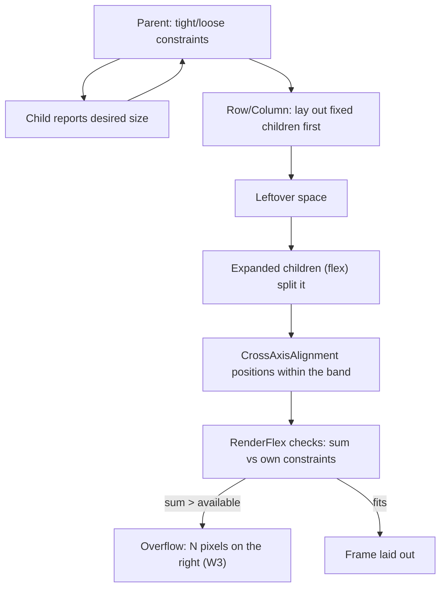

# Widgets and Layouts

## 1. Learning Objectives

After this lesson you can:

- [ ] Compose a screen from `Row`, `Column`, `Stack`, `Expanded`, and `Padding`
      knowing what each does to constraints — and prove it with coordinates
      (executed: `stack: background topLeft=(Offset(0.0, 0.0)) badge topLeft=
      Offset(50.0, 40.0) badge size=Size(60.0, 30.0)`)
- [ ] Diagnose a layout overflow from the framework's own message, including the
      exact side and pixel count (executed: `FlutterError: A RenderFlex overflowed
      by 740 pixels on the right.` captured via `tester.takeException()`)
- [ ] Build a responsive branch that reads real constraints instead of guessing
      screen size (executed: `layout: narrow w=390` at a 390-wide viewport, then
      `layout: wide w=1280` after resizing the same widget tree)
- [ ] Explain why width must come from `LayoutBuilder`/`MediaQuery` while *text*
      must come from `MediaQuery.textScalerOf` — and where each breaks
- [ ] Predict how a `Row` distributes free space among `Expanded`, `Flexible`, and
      fixed children before running the test
- [ ] Choose between stack-based and flex-based composition for a real screen
      (overlay badges, FABs, toolbars) and justify the choice by constraint behavior

## 2. Prerequisites

- [Flutter Fundamentals](flutter-fundamentals.md) — build lifecycle and the
  element/render layers; every capture here is a widget test built on it.
- [Dart Fundamentals](dart-fundamentals.md) — `const`, collections, and expressions.

*Toolchain: Flutter 3.47.7 / Dart 3.13.5, Windows 11 — verified in
[VERSIONS.md](../VERSIONS.md). Transcripts are real captures from the batch's
`test/lab_test.dart` battery (probes W3–W5); `flutter analyze` → `No issues found!
(ran in 64.0s)` over the same code.*

## 3. Introduction

A Flutter layout is not coordinates — it's a conversation about constraints that flows
down the tree and sizes that flow back up. This lesson teaches that conversation
through the two failures you will actually meet (overflow, and assuming a width) and
the two structures you'll actually use (flex for documents, stack for overlays),
each proven with executed tests rather than diagrams alone.

## 4. The Problem It Solves

Hand-positioned UI dies on contact with real devices: one phone is 320 dp wide, the
next is 412, a tablet is 800, and text grows with the user's font setting. Frameworks
that expose pixels force you to compute positions everywhere and still break.
Flutter's constraint-propagation model inverts it: parents tell children the space
available, children say how big they need to be, and responsive behavior becomes a
*branch on a measured number* — which is exactly what probe W4 executes.

## 5. Core Concepts

### Constraints down, sizes up

Each child receives **min/max width and height** from its parent, returns a size,
and the parent positions it. `Row`/`Column` (flex) pass *unbounded* constraints along
their main axis to non-flex children — which is why a `Text` inside a `Row` can be as
wide as it wants, and why the parent `Row` then complains when that exceeds its own
bounds (see W3).

### Flex: Row, Column, Expanded, Flexible

- **`Row`** lays children left→right; **`Column`** top→bottom; the rest is identical.
- **`Expanded`** = "take all remaining space, flex-grow 1" — its child gets tight
  constraints of the leftover width.
- **`Flexible`** with `fit: FlexFit.loose` = "you may take up to this much, your
  choice" — the child keeps its intrinsic size when smaller.
- **`MainAxisAlignment`/`CrossAxisAlignment`** position children *within* the space
  that's left; they never change how much space anyone gets.

### The overflow, executed (W3)

Two 30-character texts in a 100-pixel-wide `Row`:

```dart
Directionality(
  textDirection: TextDirection.ltr,
  child: Center(child: SizedBox(width: 100, child: overflowRow())),
)
```

Captured by the test with `tester.takeException()`:

```
W3 exception: FlutterError: A RenderFlex overflowed by 740 pixels on the right.
```

The message is a *measurement*, not a mood: 740 px past the right edge, from
`RenderFlex`. In debug builds it also paints the striped yellow-black banner; in
release builds the children are simply clipped — so a test that calls
`takeException` (or any uncaught-exception check) is what catches it before users do.
The fix is structural — `Expanded` around one child, a wrap, or a scrollable — never
`overflow: clip` to hide the symptom.

### Stack and Positioned

`Stack` ignores the conversation and places children in layers: non-positioned
children size to the stack (loosely), positioned children are pinned by
left/top/right/bottom. Executed coordinates (W5):

```
W5 stack: background topLeft=(Offset(0.0, 0.0)) badge topLeft=Offset(50.0, 40.0) badge size=Size(60.0, 30.0)
```

The `Positioned(left: 50, top: 40)` child landed at exactly (50, 40) with its
declared 60×30 size — coordinates as *assertions* in a test, which is how you lock
down overlay placement.

### Responsive: read constraints, don't guess

Probe **W4** renders one widget at two viewport sizes:

```dart
return LayoutBuilder(builder: (context, constraints) {
  final narrow = constraints.maxWidth < breakpoint;   // 600
  final w = constraints.maxWidth.toStringAsFixed(0);
  return Text('layout: ${narrow ? 'narrow' : 'wide'} w=$w');
});
```

```
W4 "layout: narrow w=390"
W4 "layout: wide w=1280"
```

Same code, real numbers: the branch keyed off `constraints.maxWidth`, not a
device-name check. The test set `tester.view.physicalSize` to 390×844, pumped, then
1280×900 and pumped again — resizing the viewport is a one-liner in tests, and the
captured widths are the *constraints the widget saw*, not window metrics you hope
match.

### Text scaling is its own axis

Width comes from constraints; readable text comes from `MediaQuery.textScalerOf`.
Layouts that hard-code font sizes to fit a design break for users with large text
settings — treat text size as an input your layout absorbs (wrap, scroll, reflow),
not a constant.

## 6. How It Works



Flex layout is a three-pass algorithm: measure non-flex children, divide the
leftover among flex children by their flex factors, then position. The overflow error
is emitted at the final check — which is why the number names the exact excess.

## 7. Practical Examples

**Example 1 — overflow and its capture (executed, W3)**

```dart
// test/lab_test.dart (abridged)
await tester.pumpWidget(const Directionality(
  textDirection: TextDirection.ltr,
  child: Center(child: SizedBox(width: 100, child: _Overflow())),
));
final exception = tester.takeException();
print('W3 exception: ${exception.runtimeType}: '
    '${exception.toString().split('\n').first}');
expect(exception.toString(), contains('RenderFlex overflowed'));
```

```
W3 exception: FlutterError: A RenderFlex overflowed by 740 pixels on the right.
```

- **How to run:** `flutter test --reporter expanded test/lab_test.dart`
- **Expected output:** the message's pixel count varies with font metrics; the
  `RenderFlex overflowed` phrase and the right side don't.
- **Assumptions:** debug-mode test build (overflow is reported, not silently clipped).

**Example 2 — a responsive two-pane layout (reference, built on W4's pattern)**

```dart
class ResponsiveBody extends StatelessWidget {
  const ResponsiveBody({super.key});

  static const double breakpoint = 720;

  @override
  Widget build(BuildContext context) {
    return LayoutBuilder(builder: (context, c) {
      if (c.maxWidth < breakpoint) {
        return const Column(children: [HeaderPane(), Expanded(child: ListPane())]);
      }
      return const Row(children: [
        SizedBox(width: 280, child: HeaderPane()),
        Expanded(child: ListPane()),
      ]);
    });
  }
}
```

- Narrow: stacked panes — each gets the full width.
- Wide: side-by-side — `Expanded` hands the list everything after the fixed rail.
- **How to run:** reference shape; prove it the W4 way — pump at 390 and 1280 and
  assert which pane arrangement exists at each width.

## 8. Real-World Applications

Flex builds every document-shaped screen (settings pages, forms, feeds); stack builds
every overlay (FAB over content, badges on avatars, shimmer placeholders, snackbars
above content). Responsive branches decide list-vs-grid galleries, the two-pane
master/detail of email clients, and whether a toolbar wraps. The overflow capture is
the single most common Flutter test assertion in production codebases — teams assert
"no overflow on any supported width" by pumping the widget at several sizes.

## 9. Common Mistakes

| Mistake | Why it happens | How to recognize it | How to prevent it |
|---|---|---|---|
| Fixed-width children in a `Row` | Design compiles at one width | `RenderFlex overflowed by N pixels` (W3's exact failure) | `Expanded`/`Flexible` or a wrap for variable content |
| Reading window size instead of constraints | `MediaQuery.sizeOf` works in dev | Wrong layout inside dialogs/splits/sheets that aren't full-screen | `LayoutBuilder` where the *local* bounds matter |
| Ignoring text scale | Pixel-perfect design habit | Text clipped or overflowing at large font settings | Let rows wrap/reflow; test at 1.3×+ scale |
| Positioning by index in a Stack | Stacking feels positional | Badge drifts when siblings change | `Positioned` + keys; assert coordinates in tests (W5's approach) |
| Choosing flex vs stack by habit | One is familiar | Overlays implemented as padded rows that jump | Decide by question: *does it flow (flex) or float (stack)?* |
| Hiding overflows with clipping | Banner looks ugly | Content silently missing on small phones | Fix the constraint chain; keep the error visible in tests |

## 10. Best Practices

- **Let content decide, constraints bound it** — intrinsic sizes for text/images,
  `Expanded` for the space-sharers, fixed sizes only for rails and thumbnails.
- **Branch on `constraints.maxWidth`, not device names** — W4's `390`/`1280` proof
  works for any future device because it tests a number, not a model.
- **Assert layout in tests** — `getTopLeft`/`getSize` turn positions into
  expectations (W5); a layout regression then fails CI instead of shipping.
- **Test the corners:** pump your responsive widget at your breakpoint ±1, at the
  narrowest supported width, and at a large text scale. *Stops applying when the
  widget is truly fixed-size (an icon badge, a canvas tool).*
- **Wrap instead of shrink-to-fit:** `Wrap`, `ListView`, and `SingleChildScrollView`
  absorb content you can't predict — better than tuning fixed heights.

## 11. Limitations and Trade-Offs

- **Flex fights very irregular designs** — overlapping/angled layouts need `Stack`
  (or custom `RenderBox`), which trades constraint help for manual work.
- **Intrinsic measurements cost layout passes** — `IntrinsicWidth`-style sizing can
  lay subtrees out multiple times; fine occasionally, expensive in hot lists.
- **`MediaQuery` is coarse** — window size ≠ your widget's box inside dialogs,
  drawers, or split views; only `LayoutBuilder` knows the local truth.
- **Overflow errors don't fail release builds** — they clip instead; the safety net
  is tests, not the runtime.
- **Responsive ≠ adaptive** — layout branching changes arrangement, not behavior;
  platform conventions are a separate decision (compare the OS in
  [Mobile Development Fundamentals](mobile-development-fundamentals.md)).

## 12. Practical Exercises

### Introductory

1. **Exercise 7.1** — reproduce W3: two wide texts in a 100 px `Row`, capture the
   exception, then fix it with `Expanded` around the first text and capture the
   clean run. **Completion criteria:** both transcripts, with the pixel count and
   the fix's structural reason stated.
2. **Exercise 7.2** — reproduce W5: build a `Stack` with a background and a
   `Positioned` badge, and assert its `getTopLeft` in a test. Then move the badge to
   `right: 20` (via `Positioned(right: 20, top: 40)`) and update the assertion from
   the *measured* value, not by arithmetic guesswork. **Completion criteria:** two
   passing runs with different asserted coordinates.

### Intermediate

3. **Exercise 7.3** — reproduce W4 with your own breakpoint: pump at 390, 601, and
   1280 and capture the constraint each time. Then wrap the widget in a 400-wide
   `SizedBox` *inside* a 1280 viewport and explain which width the branch reports.
   **Completion criteria:** three captures plus one sentence naming which value
   `LayoutBuilder` reports (local constraints — and why).
4. **Exercise 7.4** — build the two-pane `ResponsiveBody` of Example 2 and assert:
   narrow → `Column` with header above list; wide → `Row` with list `Expanded` to
   (viewport − 280). **Completion criteria:** a passing test at both widths using
   `find.byType`/`getSize`, no manual pixel math.

### Independent problem-solving

5. **Exercise 7.5** — a card must show an avatar, name, timestamp, and a 2-line
   preview; at 320 dp width with 1.3× text scale nothing may overflow. Design the
   layout (flex? wrap? shrink text?) and prove it: a test pumping at 320 dp /
   1.3× scale that asserts **zero** exceptions. **Completion criteria:** the passing
   corner-case test plus a written note of which single decision absorbed the extra
   text width.

*Solutions: attempt first. They live in `solutions/` of this subject.*

## 13. Knowledge Check

1. `MediaQuery.sizeOf(context).width` says 1280 but your widget's `LayoutBuilder`
   reports 400. Reconstruct the tree that produces this, and say which number you'd
   branch on.
2. The W3 overflow says "740 pixels on the right." Which of flex's three passes
   produced that number, and which fix (Expanded, Wrap, scroll) would you choose for
   a button row — and why not the others?
3. When is a `Stack` the wrong tool even though the design "looks overlapped"?
   Name a case where flex with `Stack`-free composition is better and justify it.

## 14. Completion Criteria

Observable evidence that you have understood this lesson:

- [ ] You can explain the constraint flow (down) and size flow (up) without notes,
      matching section 6
- [ ] You have reproduced the W3 overflow and its fix, capturing both runs
- [ ] You have a responsive widget asserted at two widths in a passing test (W4-style)
- [ ] You can read a `getTopLeft` assertion and predict the coordinates before
      running (W5-style)
- [ ] You can diagnose all six mistakes in section 9 on sight

## 15. Summary

- Constraints flow down, sizes flow up; flex distributes leftover space after fixed
  children, and overflow is the arithmetic failing loudly (`740 pixels on the right`).
- `Expanded` takes, `Flexible` may take, fixed children ask — that's all of flex.
- `Stack` + `Positioned` is for things that float; coordinates are assertable.
- Responsive means branching on `constraints.maxWidth` (executed at 390 and 1280),
  never on device names.
- Text scale is an input; layout absorbs it or the user can't read your app.

## 16. Next Steps

- Next lesson: [Navigation](navigation.md) — moving between screens, passing data,
  and deep links.
- Practice: [exercise sets](exercises/README.md) for this subject.
- Where it is applied: [Project 06](../20-PROJECT-LABORATORY/README.md) — its
  list/detail screens use exactly the responsive branch proven here.
