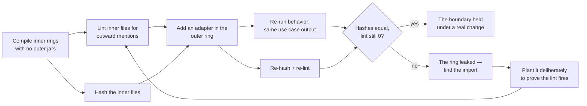

# Clean Architecture

## 1. Learning Objectives

By the end of this lesson you will be able to:

- State the dependency rule precisely and identify a violation by reading imports alone.
- Draw the rings of a system (entity, use case, adapter) and say which direction arrows may point.
- Prove an outer-ring swap with file hashes: add a delivery mechanism without touching inner rings.
- Run an import-direction lint and watch it catch a planted violation with a before/after count.
- Explain what clean architecture costs — ceremony, indirection, and the difficulty of reading the wiring — and when that cost is not worth paying.

## 2. Prerequisites

- Completed ARCH-07 (clean code), ARCH-08 (SOLID), and ARCH-09 (separation of concerns): the dependency rule is the structural generalization of DIP, which you executed there.
- Java 21+ on the PATH (`javac -version`); all probes are plain `javac`/`java`, no build tool.
- Comfort reading an import list — every probe in this lesson is ultimately a grep over imports.

## 3. Introduction

Clean Architecture is often drawn as concentric circles with an arrow pointing inward, and
that single arrow **is the entire theory**: source-code dependencies must point toward the
center. Nothing in an inner ring may know that an outer ring exists. The circles have names
in different vocabularies — entities, use cases, interfaces & adapters, frameworks — and the
drawing is less important than the discipline the drawing encodes, which is checkable:
count outward mentions in inner files, hash the inner files, apply a change, hash again.

This lesson treats the rule as an experiment rather than an aspiration. The probes compile
rings that obey it, compile a ring that breaks it (and watch the failure name the import),
swap two delivery mechanisms around an untouched use case, and then deliberately plant a
violation to prove the lint is not a rubber stamp.

## 4. The Problem It Solves

The problem is **framework and delivery churn touching business rules**. An entity annotated
with `jakarta.validation` cannot be compiled or tested without that framework on the classpath;
a use case that formats HTTP responses cannot be reused from a batch job; a domain rule
embedded in a controller gets re-reviewed every time the routing library changes. The evidence
in this lesson is small but literal: the moment `Order` mentions `jakarta`, it no longer
compiles on its own, and the moment `PlaceOrder` mentions `HttpDelivery` and `java.sql`, a
four-line lint reports two violations it previously reported as zero. Churn in the outer ring
becomes a compile error in the inner one — that coupling is the problem, and the dependency
rule is the fix.

## 5. Core Concepts

### The dependency rule

Arrows point inward, always: entities know nothing about use cases, use cases know nothing
about which framework is driving them, and only the outermost ring touches HTTP, SQL, or
GUIs. The executed contrast:

```text
--- P1 the dependency rule: does an inner ring import an outer one?
P1a: domain entity depends on jakarta -> Order.java:1: error: package jakarta.validation.constraints does not exist
P1b: inner rings compile
lint: inner-ring outward mentions = 0
```

`Order.java` with the annotation does not merely risk coupling — it *fails to compile*
without the outer ring's jar, which is the dependency rule stated by the compiler. The clean
version (`OrderClean`, `OrderRepo`, `PlaceOrder`) compiles with zero framework jars present,
and the lint confirms the absence rather than assuming it.

### Ports: the seam the use case depends on

`OrderRepo` is an interface declared next to the use case, so the inner rings depend only on
abstractions they own. That is DIP from ARCH-08 made structural: the use case cannot reach
storage or HTTP even in principle, because neither type exists in its ring.

### Outer-ring swap, measured by hash

The proof a boundary is real is that work on one side of it produces zero edits on the other:

```text
--- P2 outer ring swap: hash the inner rings, replace the delivery mechanism
http adapter: HTTP 200 {"total":90.0}
cli adapter:  cli: order A-1 total 90.0
same use case object drives both adapters
P2: second delivery mechanism -> 0 inner-ring files modified (hashes unchanged)
```

The two adapters drive the *same* `PlaceOrder` instance, so the behavioral output differs
only where it should (formatting), and the sha256 of the three inner files is byte-identical
before and after the second adapter arrives.

### The lint must have teeth

A lint nobody trusts is worse than no lint. P3 plants the exact violations it claims to
detect, then reverts:

```text
--- P3 dependency direction lint: does it actually catch a planted violation?
lint: inner-ring outward mentions = 0
  violation: PlaceOrder.java mentions java.sql
  violation: PlaceOrder.java mentions HttpDelivery
lint: inner-ring outward mentions = 2
lint: inner-ring outward mentions = 0
```

The same command that prints `0` prints `2` the moment the use case grows a `java.sql` import
and a field of adapter type, and `0` again after the revert. That is the drill this
curriculum uses everywhere: green, deliberate break, red with the reason visible, revert, green.

## 6. How It Works



Two independent signals are required every time: a *hash* proves nothing changed, and the
*lint* proves nothing was allowed to change — a file could hash equal merely because the
change was never attempted, but the lint shows there is no outward reference to change with.

## 7. Practical Examples

### Reading a ring violation before you compile

Any inner file with an import naming a framework, driver, or adapter is a dependency-rule
violation by inspection:

```java
// domain entity — inner ring
import jakarta.validation.constraints.NotNull;   // ← the arrow points OUT
public class Order { ... }
```

The probe compiles this file alone and the failure names the package. In a real codebase the
equivalent check is one grep across the inner directories; nothing else in this lesson needs
sophistication.

### One use case, two delivery mechanisms

```java
public class PlaceOrder {                    // use case ring
    private final OrderRepo repo;            // port, declared in this ring
    public PlaceOrder(OrderRepo repo) { this.repo = repo; }
    public OrderClean byId(String id) { return repo.find(id).withDiscount(0.1); }
}

public class HttpDelivery {                  // adapter ring — may point inward
    private final PlaceOrder useCase;
    String handle(String id) { return "HTTP 200 {\"total\":" + useCase.byId(id).total() + "}"; }
}
```

`CheckHttp` and `CheckCli` construct the use case with an inline lambda repository and drive
it through each adapter; the inner three files are never edited for either.

### The lint itself

```java
static final String[] FW = {"jakarta.", "javax.", "org.springframework", "java.sql",
                            "HttpDelivery", "CliDelivery"};
// for each inner file: report every substring hit, print a total
```

It is deliberately a substring check over a watch-list, not an import parser: fast, readable
in the lesson, and sufficient to catch the violations that matter here. A production version
would parse import statements and enforce a package allow-list per ring — the drill in P3 is
what makes that worth doing.

## 8. Real-World Applications

- **Framework isolation.** Spring Boot, Jakarta EE, and Hexagonal ("ports and adapters")
  codebases keep controllers and repositories in the outer ring so the domain compiles with
  no framework jars — exactly the P1b condition (`inner-ring framework imports = 0`).
- **Testability without mocks.** Because `PlaceOrder` depends on an interface it owns, its
  tests supply a lambda; no HTTP server, no database, no mock framework.
- **Delivery churn.** A product that starts as HTTP and later adds a message-queue or CLI
  entry point reuses the use case unchanged — P2's hash-equality is the acceptance criterion
  for that migration.
- **Refactoring safety.** Teams enforce ring boundaries with ArchUnit, jQAssistant, or a
  CI grep; P3 shows the shape of the check and why a planted-break drill keeps it honest.
- **Independent deployability.** If the inner rings never mention delivery, they can move
  into a separate module or service later without a rewrite — the boundary was already there.

## 9. Common Mistakes

- **Counting circles instead of arrows.** Four rings drawn correctly with one inward arrow
  pointing out is still violated. The lint checks direction, not geometry.
- **A "domain" entity that imports JPA.** An entity annotated `@Entity` is a persistence
  model wearing domain clothes; P1a is what happens when you test the difference.
- **Passing DTOs inward.** If use cases accept and return the HTTP layer's request/response
  types, the outer ring leaks inward through signatures even when imports look clean — the
  lint should also watch for adapter type names in inner files (the planted `HttpDelivery`
  field in P3).
- **Trusting a lint that has never failed.** A check that has only ever printed `0` might be
  broken; P3's `0 → 2 → 0` is the minimum evidence that it observes reality.
- **Applying the rule to a script.** A 200-line utility with one entry point has no rings to
  protect; the ceremony outweighs any churn risk.

## 10. Best Practices

- Keep the watch-list short and specific (`java.sql`, framework roots, adapter class names)
  and print per-file hits so a violation names itself.
- Hash *and* lint on every structural change: one proves stability, the other proves absence
  of coupling.
- Declare ports (`OrderRepo`) inside the ring that uses them; the outer ring implements them.
- Run the lint in CI as a failing gate, not a warning — and drill it quarterly by planting a
  violation, as P3 does, so the gate cannot silently rot.
- Let the compiler help: inner rings should compile with no dependency beyond the JDK, which
  makes `javac Ring.java` the cheapest possible boundary test.

## 11. Limitations and Trade-Offs

- **Indirection has a reading cost.** Finding where `handle` actually does work now requires
  following a constructor-injected interface; in a small class the direct call was clearer.
- **More files for the same behavior.** `OrderClean`, `OrderRepo`, `PlaceOrder`, two adapters,
  a lint — the probe's ring count is ceremony you pay before the second delivery mechanism
  exists. If it never exists, P2's hash proves nothing of value.
- **The lint is a heuristic.** Substring matching misses reflection, service loaders, and
  dependency injection configured by name — boundaries enforced at runtime, not at compile time.
- **Rings are not free security.** An inner ring can still leak secrets through return values;
  direction of import says nothing about data classification.
- **Over-rigid layering fights change.** Some features genuinely span rings (a streaming
  response that must interleave use-case steps with transport frames); forcing them through
  the rings produces pass-through methods that add a layer and remove understanding.

## 12. Practical Exercises

### Introductory

1. Take any file in your project and classify its imports as inward, outward, or same-ring.
   Report the count of outward mentions from the innermost ring you can identify.
2. Reproduce P1: create an entity that imports a framework, compile it alone, then remove the
   import and compile again. Paste both outputs.
3. Reproduce P3's drill: run the lint, plant one violation, capture the non-zero total, revert,
   confirm the total returns to zero.

### Intermediate

4. Reproduce P2 end-to-end: hash the inner files, add a second adapter, re-hash, and show the
   behavior difference is confined to formatting.
5. Give the use case a second use case (`CancelOrder`) that reuses the same port. Show which
   files change and which do not.
6. Write the reverse lint: flag any *adapter* file that imports another adapter — adapters may
   point inward only.

### Independent problem-solving

7. Take a real module from your codebase that fails the lint and refactor it so the lint
   reports zero, keeping all existing tests green. Report files touched by ring.
8. Design the boundary for a system that must later run the same rules over HTTP, a message
   queue, and a nightly batch. Explain what each ring would contain before writing code, then
   validate with the hash experiment.
9. Argue the opposite: pick a small feature and make the case that clean architecture would
   make it *worse*, using concrete numbers (files, indirections, time-to-first-behavior).

## 13. Knowledge Check

1. In one sentence, what does the dependency rule constrain — and what does it say nothing about?
2. Why does P1a's failure count as evidence for the rule rather than merely a missing jar?
3. What two independent measurements does this lesson take after an outer-ring change, and what
   does each one prove that the other cannot?
4. What is wrong with a lint that has only ever printed `0`?
5. Name one cost of the structure that P2's hash equality does not reveal.

<details>
<summary>Answers</summary>

1. It constrains the direction of source-code dependencies (imports point inward); it says
   nothing about data flow, security, or runtime behavior.
2. Because the entity's compilation *depends on an outer-ring artifact*: the coupling is
   observable without running anything, which is the rule stated by the compiler.
3. File hashes (prove the inner files were not modified) and the import lint (prove there was
   no outward reference to modify) — a hash can pass when no change was attempted; the lint
   can pass when a change was attempted and failed to compile.
4. It may be broken — a check that never fires has never been observed to work; P3's
   `0 → 2 → 0` is the evidence it actually observes the violation.
5. Readability of the call path (an extra interface hop per call), file count, and the time a
   newcomer spends tracing wiring before seeing behavior.

</details>

## 14. Completion Criteria

You have completed this lesson when:

- [ ] You can state the dependency rule and point to the import that violates it in any given file.
- [ ] P1 reproduces on your machine with `P1a` failing on the framework import and `P1b` compiling with `lint: inner-ring outward mentions = 0`.
- [ ] P2's change request leaves `before-inner.txt` and `after-inner.txt` byte-identical.
- [ ] P3 prints `0 → 2 → 0`, and you can explain what each number means.
- [ ] You can name two real costs of the structure and one situation where you would not apply it.
- [ ] The mermaid diagram in Section 6 parses.

## 15. Summary

The dependency rule is one sentence with a compiler-visible consequence: arrows point inward.
Clean Architecture names the rings, but the value is entirely in the enforcement — a lint that
counts outward mentions (and has been proven to fire), and hashes that show outer-ring work
producing zero inner-ring edits. P1 shows the rule stated by `javac`, P2 shows a second delivery
mechanism arriving at zero cost to the use case, and P3 shows the check itself surviving a
deliberate break. The trade-offs are real: indirection, file count, and a call path that is
longer than a script's. Apply the rule where churn is likely; leave it out where it isn't.

## 16. Next Steps

- ARCH-14 `domain-driven-design.md` — bounded contexts, ubiquitous language, and value
  objects, with the same measured before/after style (the shared model vs two models, executed).
- ARCH-15 `event-driven-architecture.md` — decoupling, duplicate delivery, and the idempotent
  consumer, where the "lint" is a balance that must come out right.
- Revisit ARCH-08's DIP probe: the port in this lesson is the same seam, now placed inside a
  ring diagram.
