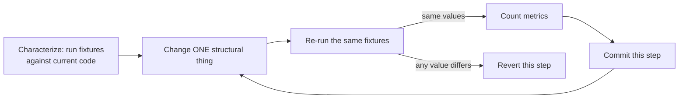

# Clean Code

## 1. Learning Objectives

After this lesson you can:

- [ ] Refactor a working function for readability **without changing its behavior**, and
      prove the behavior is identical — executed: the same six fixtures return the same
      values before and after (`ok fixture-EU-2lines before=21.4 after=21.4` … all six)
- [ ] Measure readability instead of asserting it — executed: the two source texts score
      `before: lines=12 maxDepth=1 shortIdentifiers=8` vs
      `after: lines=7 maxDepth=0 shortIdentifiers=0`
- [ ] State what renaming *cannot* fix, and show it: a comment that lies about the code
      — executed: the acceptance check reports `got 20.0 want 19.9 -> AC RED` on the
      lying code and `got 19.9 want 19.9 -> AC GREEN` after the fix
- [ ] Order a refactor safely: characterization tests first, small steps, measurements
      after each step
- [ ] Diagnose the four readability smells in a real module (names, magic numbers,
      nesting, duplicate intent) and name the specific edit that removes each
- [ ] Decide when *not* to clean code — the trade-off between churn and value

*Provenance: all transcripts are **executed on the authoring machine** — a single probe
(`CleanLab.java`, Java 25) that contains both the ugly and the refactored version, runs
the same fixtures through each, and counts metrics over the exact source texts shown in
this lesson.*

## 2. Prerequisites

- [The Complete Development Process](the-complete-development-process.md) — stage 15
  (implementation) and stage 16 (code review) are where this lesson's practices live.
- [Functional and Non-Functional Requirements](functional-and-nonfunctional-requirements.md)
  — you cannot preserve behavior you have never written down; its acceptance checks are
  the harness this lesson refactors against.
- [04-JAVA-PROGRAMMING](../04-JAVA-PROGRAMMING/README.md) — the probes are Java.

## 3. Introduction

"Clean code" is usually presented as taste: short functions, good names, no comments.
Taste does not survive a code review, and it does not survive a refactor either — because
the real question is never "is this prettier?" but **"is this the same program?"** A
refactor that changes what the software does is not a cleanup; it is a rewrite wearing a
cleanup's clothes. This lesson therefore treats cleanliness as two separate, checkable
claims: *behavior preserved* (proven by running the same fixtures) and *readability
improved* (proven by counting something, however crudely). Both claims are executed here,
and one probe deliberately shows the limit of the second: a comment can describe code
that does not exist, and no amount of renaming will notice.

## 4. The Problem It Solves

Before anyone cares about cleanliness, the cost shows up as **change friction**. The
`a(List<Double> l, double d, String r)` shape — single letters, `0.07` hanging in an
`if`, nesting that makes you scroll — is readable to its author for about a week and to
nobody else ever. The failure it causes is not "ugly"; it is *misreading*: two people
read `s -= d` as "apply the discount percent" and it is a flat amount, or they read the
`if (n < 0) n = 0` clamp as dead code and delete it. Worse, the lying-comment probe shows
the failure mode that cleanliness alone cannot catch: the comment promises
discount-before-tax, the code does tax-before-discount, and the difference is real money
(`20.00` vs `19.90`). Clean code is what makes a codebase *auditable*; tests are what
make it *trustworthy*. This lesson is about the first, and about knowing it is not enough.

## 5. Core Concepts

### Behavior preservation is the constraint, not a step

A refactor is defined as a change to structure with no change to observable behavior.
"Observable" means what the fixtures observe: values returned, exceptions thrown, state
left behind. If you cannot enumerate the observations, you cannot refactor — you can only
rewrite and hope. The probe's `probeA()` runs **six** fixtures (including the empty order
and the odd `99.99 + 0.01` money case) through both versions and compares them pairwise.

### The four smells this lesson measures

| Smell | In the `before` source | The edit that removes it |
|---|---|---|
| Imprecise names | `a`, `l`, `d`, `r`, `s`, `n` | name the *role*: `orderTotal`, `lineAmounts`, `afterDiscount` |
| Magic numbers | `0.07`, `0.0`, `100.0` inline | `EU_TAX_RATE`, `US_TAX_RATE`; rounding stays as a named step |
| Nesting | `if / else if / else` inside the arithmetic | extract `taxRateFor(region)` — a `switch` expression returns, so the body is flat |
| Mixed intent | discount, tax, clamp and rounding in one block | sequence of named intermediates: subtotal → afterDiscount → taxRate → total |

The measurable proxy for the last three: `maxDepth` (brace nesting) and
`shortIdentifiers` (distinct single/double-letter identifiers, keywords excluded).

### Readability metrics are evidence, not truth

`lines=12 maxDepth=1 shortIdentifiers=8` versus `lines=7 maxDepth=0 shortIdentifiers=0`
does not prove the code is good. It proves *this specific claim* — that the refactor did
what it claimed to the text. Treat such counters as a smoke detector: they cannot tell you
the building is beautiful, only that a particular kind of smoke is absent. A metric you
game (naming everything `x1` to keep identifiers short) is a metric that has stopped
carrying information; this is Goodhart's law applied to source code.

### Comments explain *why*, and only when they are true

The probe's `b_before()` carries the comment `// discount before tax` above code that
applies tax first. The acceptance check — `AC = 19.90` for two 10.00 lines with a 1.40
discount in the EU — reports `got 20.0 want 19.9 -> AC RED`. Renaming, un-nesting and
reformatting that function all leave the RED exactly where it is, because the defect is
not stylistic. When code and comment disagree, one of them is wrong and **only execution
says which**. After fixing the order: `got 19.9 want 19.9 -> AC GREEN`.

## 6. How It Works

The safe refactor runs as a loop, not a leap:



Every arrow out of `C` is a real branch: if a fixture value moves, the step was not a
refactor and goes back — you do not "fix forward" a behavior change inside a cleanup,
because then nobody knows which edit changed the product. The measurement at `D` happens
*after* the behavior is known-preserved, which is the only order that means anything: a
more readable version of the wrong program is a worse program.

In the executed run, the loop's two interesting points are `probeA` (six fixtures equal,
then metrics) and `probeB` (fixtures unequal — the RED is the loop's "revert" signal
firing on a defect that was already there).

## 7. Practical Examples

**Example 1 — the before/after pair with proof**

The ugly function, exactly as counted in the transcript:

```java
static double a(java.util.List<Double> l, double d, String r) {
    double s = 0;
    for (double x : l) s += x;
    if (d > 0) { s -= d; }
    double t;
    if (r.equals("EU")) { t = 0.07; }
    else if (r.equals("US")) { t = 0.0; }
    else { t = 0.0; }
    double n = s * (1 + t);
    if (n < 0) { n = 0; }
    return Math.round(n * 100.0) / 100.0;
}
```

The refactored pair — flat body, named constants, the region table extracted:

```java
static final double EU_TAX_RATE = 0.07;
static final double US_TAX_RATE = 0.0;

static double orderTotal(java.util.List<Double> lineAmounts, double discountAmount, String region) {
    double subtotal = lineAmounts.stream().mapToDouble(Double::doubleValue).sum();
    double afterDiscount = subtotal - discountAmount;
    double taxRate = taxRateFor(region);
    double total = afterDiscount * (1 + taxRate);
    return Math.max(0, Math.round(total * 100.0) / 100.0);
}

static double taxRateFor(String region) {
    return switch (region) {
        case "EU" -> EU_TAX_RATE;
        case "US" -> US_TAX_RATE;
        default -> 0.0;
    };
}
```

Executed output:

```text
--- A1 behavior preserved: before vs refactored, 6 fixtures
ok   fixture-EU-2lines before=21.4 after=21.4
ok   fixture-EU-2lines-disc before=19.9 after=19.9
ok   fixture-US-1lines before=5.0 after=5.0
ok   fixture-XX-1lines before=5.0 after=5.0
ok   fixture-EU-0lines before=0.0 after=0.0
ok   fixture-EU-2lines-disc before=104.33 after=104.33
--- A2 readability metrics of the two source texts
before: lines=12 maxDepth=1 shortIdentifiers=8
after:  lines=7 maxDepth=0 shortIdentifiers=0
ok   short-identifiers-gone before=8 single/double-letter identifiers, after=0
ok   nesting-reduced before maxDepth=1, after maxDepth=0
CLEAN-LAB ALL PASS
```

- The six `before=… after=…` pairs are the entire justification for the second block;
  without them, the metrics would only prove the text got shorter.
- `maxDepth=0` in the `after` text means the method body is the only brace level left —
  `taxRateFor` absorbed the nesting rather than the nesting being re-indented.
- **How to run it:** `javac CleanLab.java && java CleanLab` (Java 25 on the authoring
  machine; output above is the executed run).
- **Assumptions:** no dependencies beyond the JDK; the fixtures are hard-coded in
  `probeA()`.

**Example 2 — the comment that only execution can refute**

```java
// comment says "discount before tax" but the code applies tax first
static double b_before(java.util.List<Double> lines, double flatDiscount, String region) {
    double sum = 0;
    for (double x : lines) sum += x;
    double taxed = sum * (1 + taxRateFor(region));    // tax first
    double discounted = taxed - flatDiscount;         // ... then discount
    return Math.round(discounted * 100.0) / 100.0;
}
```

With `lines = [10.00, 10.00]`, `flatDiscount = 1.40`, `region = "EU"`, the acceptance
value is `19.90` (`20.00 − 1.40 = 18.60`, `18.60 × 1.07 = 19.902 → 19.90`):

```text
--- B1 AC against code whose comment lies (discount before tax)
ok   ac-catches-lying-comment BEFORE fix: got 20.0 want 19.9 -> AC RED (comment and code disagree)
ok   ac-passes-fixed-code AFTER fix: got 19.9 want 19.9 -> AC GREEN
B summary: renaming can never fix this - only the executed AC exposed the 20.00 vs 19.90 gap between comment and code
CLEAN-LAB ALL PASS
```

Note the line begins `ok` even while reporting `AC RED`: the probe's *assertion* is that
the check **catches** the defect, so "the test fails on the bad code" is the pass. The
`b_after` version computes discount first and the same check goes green.

- **How to run it:** same command; `probeB()` runs after `probeA()` inside one JVM.

## 8. Real-World Applications

- **Legacy modernization**, where characterization tests ("golden master" tests) are
  written *around* existing behavior — including the buggy parts — before any edit. The
  fixture list in `probeA` is a miniature of that practice.
- **Code review**, where reviewers ask for the observation behind each requested change:
  "shorter" is an opinion, "`maxDepth` 1 → 0 removes the scroll" is a reason.
- **Money code**, where `Math.round(x * 100.0) / 100.0` and the order of discount vs tax
  are product decisions; the clean version makes the decision *visible as a named line*
  instead of buried in arithmetic.
- **Static-analysis gates** (Checkstyle, PMD, SonarQube) that encode exactly the counts
  this probe prints — the probe shows what such a gate is actually measuring.
- **Interviews and pairing**, where the refactor-with-fixtures exercise separates people
  who edit code from people who prove they did not break it.

## 9. Common Mistakes

| Mistake | Why it happens | How to recognize it | How to prevent it |
|---|---|---|---|
| Refactoring without a harness | "it's just a rename" | no fixture list; a later bug report is the first signal | write characterization tests before the first edit |
| Refactoring and changing behavior in one commit | mixing cleanup with a fix | review shows `20.00 → 19.90` in a "cleanup" diff | two commits: behavior change first (or second), never both |
| Trusting a comment over the code | comments feel authoritative | comment and output disagree, nobody runs it | treat comments as claims; the AC decides (`AC RED` above) |
| Chasing metrics | a gate rewards low counts | `shortIdentifiers` gamed with `x1`, `x2` | metrics as smoke detectors, never as the goal |
| Big-bang rewrites of a whole module | frustration with old code | huge diff, no way to bisect a regression | one structural step per commit, fixtures green at each |
| "Clean" = more abstractions | name-driven design | interfaces with one implementation, wrappers of wrappers | add structure only when a probe shows a change it would have absorbed |

## 10. Best Practices

- **Characterize before you touch.** Enumerate observations (fixtures) and get them
  passing on the current code. Six fixtures caught four edge cases here: empty input,
  zero tax, unknown region, and a rounding-boundary sum.
- **One structural concern per step** — names, then constants, then extraction. Each step
  has one reason to be reverted.
- **Measure after behavior, not instead of it.** The `A1` block must come before `A2`.
- **Prefer named intermediates to comments.** `afterDiscount = subtotal - discountAmount`
  replaces the paragraph of prose that used to explain it, and cannot go stale.
- **Extract until the body reads as a list of the nouns in the requirement.** The
  refactored `orderTotal` reads: subtotal, afterDiscount, taxRate, total — the four steps
  `FR1` names.
- **Let the compiler help.** The `switch` expression in `taxRateFor` forces exhaustiveness
  thinking about the default branch; the old `if/else` chain silently duplicated `0.0`.
- **Stop cleaning when the expected change rate is zero.** Dead code nobody touches is
  cheaper to leave than to churn — see the trade-off below.

## 11. Limitations and Trade-Offs

- **Readability metrics are shallow.** They count braces and identifiers; they cannot see
  that `orderTotal` is doing someone else's job. A perfectly flat, well-named function
  can still be in the wrong place — that is a separation-of-concerns question, covered in
  [Separation of Concerns](separation-of-concerns.md).
- **Behavior preservation is only as complete as the fixtures.** Six fixtures passed while
  a *comment* lied; a seventh fixture — the discount-order case — had to be written
  deliberately. Characterization tests prove what they exercise, not what exists.
- **Cleanliness has a churn cost.** Every structural edit is a diff for reviewers and a
  merge-conflict risk for teammates. Cleaning hot paths and shared modules pays; cleaning
  a stable script once read does not.
- **Formatting debates are not this lesson.** A formatter (google-java-format, Prettier)
  settles style mechanically so human attention goes to names and structure.
- **Some "unclean" code is load-bearing.** Clever bit tricks in hot loops and copy-pasted
  per-client code may be deliberate; verify intent before rewriting.

## 12. Practical Exercises

### Introductory

1. **Exercise 7.1** — Take the `before` source in Example 1 and refactor it yourself
   without running anything. Then run the six fixtures.
   **Completion criteria:** all six pairs print identical `before=`/`after=` values, and
   your `maxDepth` is 0 with no identifier shorter than three letters.
2. **Exercise 7.2** — Add a seventh fixture for a **negative** discount (a surcharge) to
   both versions.
   **Completion criteria:** you can say, from the outputs alone, whether the two versions
   still agree — and they do not, because `if (d > 0)` in the `before` version skips the
   negative. Report which version matches `FR1` and why the fixture found a pre-existing
   divergence.

### Intermediate

3. **Exercise 7.3** — Replace the `EU_TAX_RATE`/`US_TAX_RATE` constants with a
   `Map<String, Double>` region table, keeping `taxRateFor`'s signature.
   **Completion criteria:** the same six fixtures stay green, and you can name one thing
   the table makes possible that the switch did not (runtime configuration) and one thing
   it loses (compile-time exhaustiveness).
4. **Exercise 7.4** — Write a comment-then-code disagreement of your own: a function
   documented as "rounds half up" that actually rounds half to even, plus the AC that
   exposes it.
   **Completion criteria:** the AC fails on the original code with a value difference you
   can print, not just a boolean.

### Independent problem-solving

5. **Exercise 7.5** — You inherit a 400-line function with no tests. Design the
   characterization suite: what inputs do you choose, in what order, and how do you know
   when you have enough to start refactoring?
   **Completion criteria:** a fixture list where each entry is justified by a behavior it
   locks down (you can point at the line of code it protects), plus a stated stopping
   rule — and one executed demonstration of your suite catching a deliberate mutation you
   introduced and then reverted.

*Solutions: attempt first. They live in `solutions/` of this subject.*

## 13. Knowledge Check

1. Your refactor leaves every fixture green and every reviewer happy, but a customer
   reports a wrong total. What, precisely, does that tell you about your fixtures rather
   than about your code? … *The suite had a coverage gap: fixtures prove only what they
   observe. The customer's case was unobserved — you need it as a new fixture.*
2. "What would happen if we deleted the comment in `b_before` and left the code?" …
   *Nothing about behavior changes — but the disagreement becomes invisible. The code
   would then be right about its own behavior and wrong about the requirement; only the
   AC, not either artifact, can tell you which.*
3. When would you *not* clean up a module that reads badly? … *When it is stable, rarely
   changed, and not shared — the churn (diffs, conflicts, regression risk) outweighs the
   readability gain. Also when you lack the fixtures to prove preservation: then the
   honest options are "write tests first" or "leave it".*

## 14. Completion Criteria

Observable evidence that you have understood this lesson:

- [ ] You ran `CleanLab` and can explain why `A1` appears before `A2` in its output
- [ ] You can refactor a function you wrote last week and show identical fixture values
- [ ] You can point at the four smells in the `before` text and name the edit for each
- [ ] You can explain why the lying-comment RED is a *pass* for the probe and a *fail*
      for the code, and why no rename would have found it
- [ ] You can state one situation where leaving badly-named code alone is the right call

## 15. Summary

- Refactoring = structure changes, behavior does not — so fixtures come first and every
  step ends with them green.
- The four measured smells (names, magic numbers, nesting, mixed intent) have four
  specific edits, not a general vibe.
- Metrics are evidence about the text, not about the design; they can be gamed.
- Comments are claims. When a comment and the code disagree, only execution says which
  one is lying — here `20.00` vs `19.90` said it for us.
- Cleanliness is worth its churn where change is expected; that cost is a real reason to
  stop.

## 16. Next Steps

- Next lesson: [SOLID Principles](solid-principles.md) — the same "where does the change
  land?" question, asked of whole modules rather than one function.
- Practice: [exercise set](exercises/README.md).
- Where it is applied: [Project 07 — Architecture Decision Record](../20-PROJECT-LABORATORY/README.md),
  where a refactor's before/after evidence belongs in the record.
