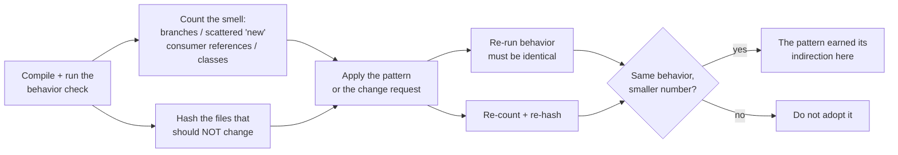

# Design Patterns

## 1. Learning Objectives

After this lesson you can:

- [ ] Name a pattern only after naming the **smell** it removes, and prove the removal by
      counting something — executed: strategy collapsed `conditional decision points = 6`
      to `0` with all six behavior checks still agreeing (`P1 both designs agree on all
      three cases`)
- [ ] Execute the factory measurement: the "which concrete class?" decision living in
      callers vs in one table — executed: `channel.equals` decisions `5 across 2 files`
      → `0 … lives in 1 file: NotifierFactory.java`, and the new channel lands with
      `callers edited for the new channel: 0`
- [ ] Show who knows whom, before and after observer — executed: `MODIFIED existing file
      -> OrderServiceTight.java (producer now knows 3 consumers)` vs `OrderServiceLoose
      hash unchanged`
- [ ] Count the combinatorial explosion decorator removes — executed: `subclass approach
      needs 8 classes for 3 independent options (2^3)` vs `4 classes for 8 combinations`
- [ ] Prove a repository seam holds — executed: swapping persistence prints `0 existing
      files modified (OrderService.java hash unchanged)` and `service imports persistence
      types? 0`
- [ ] Decide when *not* to use a pattern, using the cost each probe makes visible

*Provenance: all transcripts are **executed on the authoring machine** —
`patterns-probes.sh` (five sections, each compiling and running a behavior check where a
behavior claim is made, plus `sha256sum` before/after for the change-landing claims and
`grep` counts for the structural ones). Java 25, no dependencies beyond the JDK.*

## 2. Prerequisites

- [Clean Code](clean-code.md) and [SOLID Principles](solid-principles.md) — the
  vocabulary (change landing, blast radius) these probes continue to use.
- [Separation of Concerns](separation-of-concerns.md) — a pattern is a named way to
  separate two particular concerns.
- [04-JAVA-PROGRAMMING](../04-JAVA-PROGRAMMING/README.md) — the probes are Java.

## 3. Introduction

A design pattern is a **named solution to a smell you can demonstrate** — that is the
whole definition, and it is deliberately narrower than the usual one. The common framing
("a general reusable solution to a commonly occurring problem") invites pattern
collecting: memorizing twenty names and then looking for somewhere to spend them. This
lesson takes the other direction. Each of the five patterns here appears only after its
smell has been *measured* — branches counted, `new` calls located, dependencies hashed —
and each is evaluated by how much the number drops. A pattern you cannot show a before
number for is decoration.

## 4. The Problem It Solves

The underlying problem is that **structure written in advance is a guess**, and guesses
cost when they are wrong. Conditional designs (P1's six-branch `price`) are what you get
when you don't guess: they are correct, obvious, and fine — right up until the fourth
rule, the fifth channel, the third notification consumer. At that point the cost shows up
as the numbers this lesson prints: 5 scattered decisions, 8 subclasses for 3 binary
options, a producer file edited for every new listener. Patterns are the recorded,
reusable answers to those recurring costs; the reason to learn them *with* the smell is
that the same structure, applied where no smell exists, is pure indirection.

## 5. Core Concepts

### The smell-first rule

The mapping this lesson uses, one smell per pattern:

| Pattern | The smell it answers | The number that proves it moved |
|---|---|---|
| Strategy | a condition selecting an algorithm; algorithm varies at runtime | `decision points 6 → 0` |
| Factory | `new ConcreteX` / type selection scattered across callers | `5 across 2 files → 0, table in 1 file` |
| Observer | producer hardcodes its consumers; every consumer = producer edit | `MODIFIED OrderServiceTight → hash unchanged` |
| Decorator | n independent options → 2ⁿ subclasses | `8 classes needed → 4 classes give 8` |
| Repository | persistence details leak into the domain/service | `OrderService hash unchanged, sql imports 0` |

### Strategy: the condition *is* the algorithm table

The conditional version selects behavior with nesting; the strategy version passes the
behavior as a value. Both are executed against the same three cases:

```text
ok   conditional retail = 100.0
ok   conditional enterprise EU = 90.0
ok   conditional wholesale promo = 76.0
ok   strategy retail = 100.0
ok   strategy enterprise = 90.0
ok   strategy wholesale promo = 76.0
P1 both designs agree on all three cases
P1: conditional decision points = 6; strategy decision points = 0
```

Two properties fall out of the second line. The branch nest disappears from the *caller's*
reading path, and each rule becomes a value you can pass to a test directly — no need to
construct the region/promo combination that reaches the branch you want.

### Factory: one file owns "which class?"

The smell is not object creation; it is **the type decision duplicated**:

```text
scattered: 'channel.equals' decisions in callers = 5 across 2 files
factory: 'channel.equals' decisions in callers = 0; the channel table lives in 1 file: NotifierFactory.java
factory after adding whatsapp: Whats:welcome
callers edited for the new channel: 0 (SignupFlow2/ImportFlow2 untouched)
```

`ImportFlow` had only two of the three channels — a divergence already present before the
change request. Consolidating the table makes that divergence visible as a row that was
missing, and the new channel becomes one new row plus one new file, with the callers
provably untouched.

### Observer: reverse the knowledge

```text
tight: producer references 2 concrete consumers
tight: change request 'notify analytics' MODIFIED existing file -> OrderServiceTight.java (producer now knows 3 consumers)
audit placed A-1
mail receipt A-1
loose: producer compiled once, consumers registered from outside
audit placed A-2
mail receipt A-2
metric placed A-2
loose: same change request -> 0 existing files modified (OrderServiceLoose.java hash unchanged)
```

The behavior is identical in both runs (audit and mail fire either way); only the
direction of knowledge changed. That is what the pattern buys, and its price appears in
Section 11: now nobody can see the listener list by reading the producer.

### Decorator: count the classes before you need them

```text
subclass approach needs 8 classes for 3 independent options (2^3 combinations)
log write 7b
decorator read-back: gzip(enc(payload))
classes available: FileSource, GzipSrc, EncSrc, LogSrc = 4 classes for 8 combinations
decorator: concrete classes written = 4, combinations expressible = 8, subclass classes required = 8
```

The read-back line is the honesty check: wrapping order is *compositional*, so
`new LogSrc(new EncSrc(new GzipSrc(...)))` gives a different stack than any subclass
could name precisely — and the stack is assembled at the call site where the order is
known.

### Repository: a seam you can hash

```text
revenue via in-memory repo = 40.0
persisted C to file store
revenue via file repo = 5.0
repository: swap persistence -> 0 existing files modified (OrderService.java hash unchanged; new FileRepo.java only)
repository: service imports persistence types? 0 (0 = the seam holds)
```

Two independent checks: the hash proves the service did not move, and the import count
proves it never knew the storage detail in the first place (a hash could pass because
nothing was recompiled; the imports show there was nothing to change).

## 6. How It Works

Every probe follows the same experimental shape — measure, change, measure:



The left branch (behavior) and the right branch (structure) are both mandatory: a design
that is smaller and wrong fails `E`, and a design that is correct but unchanged in every
count fails `G`.

## 7. Practical Examples

**Example 1 — strategy as a value, executed**

```java
import java.util.function.Function;

public class StrategyPricing {
    static final Function<Double,Double> RETAIL = b -> b;
    static final Function<Double,Double> ENTERPRISE = b -> b * 0.9;
    static final Function<Double,Double> WHOLESALE = b -> b * 0.8;
    public static double price(double base, Function<Double,Double> rule) { return rule.apply(base); }
    public static Function<Double,Double> promo(Function<Double,Double> rule) { return b -> rule.apply(b) * 0.95; }
}
```

- What the important lines do: the rules are *values*, so promotion composes with any
  rule (`promo(WHOLESALE)`) instead of needing a nested case for the combination.
- **Expected output:** the six `ok` lines and `decision points = 0`.
- **How to run it:** `bash patterns-probes.sh` (section P1).
- **Assumptions:** bash, JDK 25; results are exact (integer-valued cases, no tolerance
  issues beyond 1e-9).

**Example 2 — the factory table**

```java
public class NotifierFactory {
    static Notifier make(String channel) {
        return switch (channel) {
            case "email"    -> new NotifyEmailAdapter();
            case "sms"      -> new NotifySmsAdapter();
            case "push"     -> new NotifyPushAdapter();
            case "whatsapp" -> new NotifyWhatsAdapter();   // the change request, one row
            default -> throw new IllegalArgumentException(channel);
        };
    }
}
```

- The callers reduced to `NotifierFactory.make(c).send("welcome")` — which is why the
  new channel printed `callers edited … 0`.
- **Expected output:** `factory after adding whatsapp: Whats:welcome`.
- **How to run it:** section P2 of the same script.

**Example 3 — swapping persistence behind the seam**

```java
public interface OrderRepo { List<Order> all(); void save(Order o); }

public class OrderService {
    private final OrderRepo repo;
    public OrderService(OrderRepo repo) { this.repo = repo; }
    double revenue() { return repo.all().stream().mapToDouble(Order::total).sum(); }
}
```

- The `revenue()` method contains no storage vocabulary — hence `service imports
  persistence types? 0`.
- **Expected output:** `revenue via in-memory repo = 40.0`, `revenue via file repo = 5.0`,
  `OrderService.java hash unchanged`.
- **How to run it:** section P5.

## 8. Real-World Applications

- **Strategy** underlies every pricing rule set, sorting comparator chosen at runtime,
  pluggable validation and compression — anywhere the branch count grows with the
  product's catalog rather than with its logic.
- **Factory** is the shape of every "channel" or "provider" selection (notifications,
  payments, storage drivers); the probe's missing `sms` case in `ImportFlow` is the
  classic production bug it prevents.
- **Observer** is the event bus, the webhook fan-out, and the audit/notification hooks
  you already met in [11-BACKEND-ENGINEERING](../11-BACKEND-ENGINEERING/README.md).
- **Decorator** is middleware and interceptor stacks: logging, retries, compression and
  auth wrapping a handler in any order, which the probe's compositional read-back shows.
- **Repository** is the seam that let the batch-13 backend lessons swap H2 for Postgres
  and in-memory fixtures without touching services.

## 9. Common Mistakes

| Mistake | Why it happens | How to recognize it | How to prevent it |
|---|---|---|---|
| Naming a pattern before naming the smell | pattern-first learning | "we should add a factory" with no count attached | require the before-number in the proposal |
| Strategy for one fixed rule | enthusiasm | one implementation, one caller, extra interface | wait for the second rule (P1 has three) |
| Factory with one `case` | cargo-culted from a codebase with 30 | the factory is a one-line indirection | inline it until a second type exists |
| Observer for a critical path | "decoupling" | the call graph is unreadable; a failure's cause is invisible | keep must-run steps direct; observe the optional ones |
| Decorator order unstated | composition hides sequence | `log` doesn't see the decrypted payload | fix the stack explicitly at the call site, as `Check6` does |
| Repository that leaks anyway | interface in name only | service still imports `java.sql` or builds query strings | count the imports — probe P5's second check |
| Using these as a résumé | substitution for design thought | patterns present, change request still lands in 4 files | re-run the change-landing test |

## 10. Best Practices

- **Write the smell measurement first.** If you cannot count branches, scattered `new`s,
  or consumer references, you cannot show the pattern helped.
- **Behavior checks run in both designs** — P1's six `ok` lines are the reason the
  structural claim is meaningful.
- **Prefer the standard library's pattern** (a `Function` is a strategy) over a hand-rolled
  class hierarchy when it reads better; the probe uses `Function` deliberately.
- **Compose rather than enumerate**: decorators and strategies should combine at the call
  site (see `promo(WHOLESALE)`) instead of pre-enumerating combinations in types.
- **Keep the seam testable** — the repository's value is that `Check7` and `Check8` run
  the same service against two stores in one JVM.
- **State the pattern's cost in the same document as its benefit**, so the next reader
  knows what they gave up (Section 11).
- **Re-run the probe when the design drifts** — a factory whose `case` list is copied
  back into callers will show `5 across 2 files` again.

## 11. Limitations and Trade-Offs

- **Indirection is real cost.** Every pattern adds a file, a hop, and a name to learn.
  The strategy's `decision points = 0` comes at the price of readers jumping to the rule
  implementation; with two branches and stable rules, the conditional wins.
- **Observer trades visibility for extensibility.** After the probe, no single file lists
  who receives an order event — that is the point, and it is also why event-driven
  debugging needs tracing (see [Event-Driven Architecture](event-driven-architecture.md)).
- **Factories can hide a switch.** P2's factory *is* a `switch`; it moved the decision,
  it did not remove it. That is worth knowing before claiming the conditional is gone.
- **Decorator stacks are order-sensitive.** `gzip(enc(x))` and `enc(gzip(x))` are
  different programs; the pattern makes both possible and neither obvious.
- **Repository can degenerate into an abstraction of one.** With exactly one store and no
  test double, the interface is speculative — justified when a probe (like `Check8`) shows
  a second implementation actually arriving.
- **None of these five is architecture.** They are local structures; composition rules
  between them are what [Layered Architecture](layered-architecture.md) and the later
  lessons address.

## 12. Practical Exercises

### Introductory

1. **Exercise 10.1** — Run `patterns-probes.sh` and, for each of the five sections, write
   the smell it counts and the before/after numbers from the transcript.
   **Completion criteria:** a five-row table where every number is copied from the
   output, including the two `hash unchanged` lines.
2. **Exercise 10.2** — Add a fourth pricing rule to both P1 designs.
   **Completion criteria:** both still pass their behavior checks, and you report the new
   decision-point counts — plus one sentence on which design you would keep at four rules
   and why.

### Intermediate

3. **Exercise 10.3** — The factory probe's `ImportFlow` was missing the `sms` case
   *before* the change request. Design the test that would have caught that, and show it
   failing on the original code.
   **Completion criteria:** an executed red on the scattered version, green after the
   table exists, with both outputs printed.
4. **Exercise 10.4** — Add a fifth option to the decorator probe (base64) and construct
   three different stacks of four.
   **Completion criteria:** the read-back lines demonstrate that stack order is visible
   in the result, and you state which orderings are semantically meaningful versus
   accidental.

### Independent problem-solving

5. **Exercise 10.5** — Take a real change request from your own project's history (or
   invent one you expect soon). Decide between "keep the conditional", "strategy",
   "observer" or "factory" by writing the count you expect each option to produce *before*
   implementing any of them, then implement the winner and report the actual number.
   **Completion criteria:** a predicted number and an actual number that agree, or an
   explanation of the gap — plus the behavior checks passing on both sides.

*Solutions: attempt first. They live in `solutions/` of this subject.*

## 13. Knowledge Check

1. P2's factory contains a `switch` over channels, and the lesson also says "the
   conditional decision points = 0" for strategy. Is the conditional gone in both? …
   *No. The factory relocated the `switch` into one owned file; the strategy removed the
   per-call nesting. Moving a decision to a single table is consolidation, not removal —
   the probe says `lives in 1 file`, not `no conditionals`.*
2. What does `OrderServiceLoose.java hash unchanged` prove that the behavior output alone
   does not? … *The outputs prove listeners fired; the hash proves the producer was not
   edited to make them fire — i.e., the change really was additive and the knowledge
   direction is what the design claims.*
3. When is a repository pattern *not* worth its interface? … *When there is exactly one
   store, no test double, and no expected change — the probe's second check (`sql imports
   0`) would pass trivially while the interface costs a hop per call.*
4. "We should use observer here — it's more modern." What is missing from that argument?
   … *A count. Which number does it improve: producer edits per consumer, or branches in
   the dispatch? Without a before number, the claim is taste, and the same reasoning
   justifies any pattern anywhere.*

## 14. Completion Criteria

Observable evidence that you have understood this lesson:

- [ ] You ran `patterns-probes.sh` and can point to all five structural numbers
- [ ] You can name the smell each pattern answers *before* naming the pattern
- [ ] You can explain the difference between the factory's `lives in 1 file` and the
      strategy's `decision points = 0`
- [ ] You can name one cost per pattern, from Section 11, without notes
- [ ] For a module you own, you can predict which of the five (if any) would reduce a
      count you have actually measured

## 15. Summary

- A pattern is a named answer to a demonstrated smell; no smell, no pattern.
- The five counts: `6 → 0` branches, `5 across 2 files → 0` type decisions, `MODIFIED →
  hash unchanged` consumer knowledge, `8 classes → 4` for 8 combinations, and a
  persistence swap that never reaches the service.
- Every claim pairs behavior evidence with structural evidence; either alone is
  insufficient.
- Factories move conditions and observers hide them — know which one you are buying.
- Indirection, invisible call graphs, order sensitivity and one-implementation
  abstractions are the prices, stated in the same breath as the benefits.

## 16. Next Steps

- Next lesson: [Layered Architecture](layered-architecture.md) — composing patterns into
  whole-application boundaries, and how to enforce the direction of dependency.
- Practice: [exercise set](exercises/README.md).
- Where it is applied: [Project 07 — Architecture Decision Record](../20-PROJECT-LABORATORY/README.md),
  where a pattern adoption must arrive with its before/after count.
