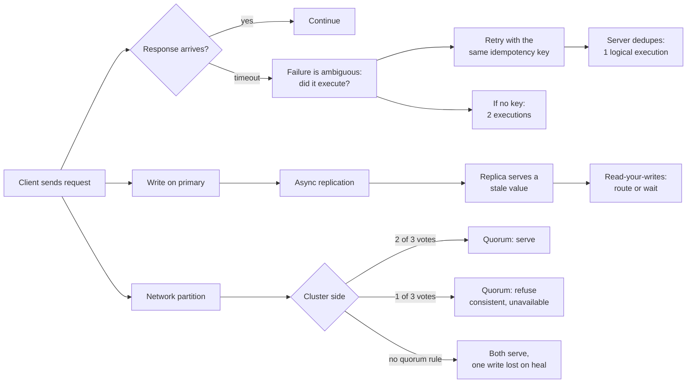

# Distributed Systems

## 1. Learning Objectives

By the end of this lesson you will be able to:

- Explain why a client that times out cannot distinguish "failed" from "slow," and show
  the duplicate execution that follows when it retries.
- Demonstrate replica lag: the same committed value read from two nodes at the same moment,
  returning different answers.
- Compare a partitioned cluster with last-writer-wins against majority quorum, and state
  precisely what quorum gives up on the minority side.
- Name the three guarantees a system actually has to choose between under partition (CAP)
  and connect each choice to one of the executed probes.
- Design the minimum recovery mechanisms these failures demand: idempotency keys,
  replication lag awareness, and quorum rules.

## 2. Prerequisites

- Completed ARCH-15 (event-driven architecture): its idempotency key reappears here as the
  only defense against the timeout-retry duplicate.
- Java 21+ (`javac -version`); all probes are single-file simulations of network behavior —
  real sockets would add noise, not meaning.
- Comfort with the idea that "the network is not reliable" as a design input, not a complaint.

## 3. Introduction

A distributed system is one where the failure of a link you cannot see can corrupt the
answer you already trust. Everything in this lesson follows from one fact: **a request and
its response are two independent events**, and either can be lost. The caller that loses the
response has no idea whether the work happened — so it retries, and the work happens twice.
The replica that has not yet received your write will confidently answer with yesterday's
value. The cluster that splits into two halves will let both halves accept the same write
and then quietly discard one when they heal.

None of these are exotic failure modes; they are the default behavior of systems built the
normal way. The probes simulate each one deterministically so the numbers — `executed 2
times for 1 logical request`, `replica still says 100 (primary=150)`, `side C has 1/3 votes
→ write rejected` — can be reasoned about instead of imagined.

## 4. The Problem It Solves

The problem is that **the network erases causality between a decision and its observation**.
Three measured symptoms:

```text
P1: after commit, replica still says 100 (primary=150)
P2: after heal: x=2 wins -> side-AB's acknowledged write x=1 is GONE
P3: server executed 'charge' 2 times for 1 logical request
```

Each is a *silent* wrong answer: the stale read returns successfully, the lost write is
acknowledged, the duplicate charge succeeds. No exception reaches the caller in any of the
three. That silence is the problem distributed systems engineering exists to solve — a
single-node program's crash is loud; a distributed one's most damaging failures are quiet.

## 5. Core Concepts

### P1: replication lag and read-your-writes

```text
--- P1 write to primary, read from lagging replica
ok   stale-read after commit, replica still says 100 (primary=150)
ok   after-sync after replication, replica says 150
P1: the same query, same second, two nodes, two answers -> a retry may read its own write backwards
```

The write is acknowledged, then a read from the replica returns the old value — including,
in a retry loop, to the client that just wrote it. The usual mitigations are all forms of
*directing* the read: read-your-writes consistency (route the next read to the primary or to
a replica known to have caught up), session stickiness, or waiting for an ack'd replication
offset. The probe shows why waiting cannot be skipped: the lag exists between two lines of
output.

### P2: partition — last-writer-wins loses acknowledged writes; quorum refuses them

```text
split-brain: side-AB wrote x=1 (no quorum needed) | side-C wrote x=2 (no quorum needed)
after heal: x=2 wins (last write on the merged log) -> side-AB's acknowledged write x=1 is GONE
ok   quorum-AB-serves side AB has 2/3 votes -> write accepted
ok   quorum-C-rejected side C has 1/3 votes -> write rejected with unavailable (consistent, not served)
```

Both stories end with one side's write not surviving; the difference is whether the client
was *told*. Last-writer-wins returns success and later discards the value; quorum returns
`unavailable` immediately and the client knows it must retry elsewhere. This is CAP made
concrete: during the partition you may be consistent (C: refuse) or available (A: serve and
hope), and the third letter — partition tolerance — is not optional, because the partition
happened regardless of your preference.

### P3: timeouts make failure ambiguous, and retries make it duplicated

```text
ok   timeout caller gave up after 100ms while the server was still working
ok   duplicate-execution server executed 'charge' 2 times for 1 logical request
P3: 'exactly once' cannot be promised by the network - only idempotency keys make the retry safe
```

The server did not fail — it was merely slower than the caller's patience, and the work
completed anyway. From the caller's side the two cases (failure before execution / success
after timeout) produce identical information: no response. So "exactly once" cannot be a
network guarantee; at-most-once loses work, at-least-once duplicates it. The engineering
answer is at-least-once delivery plus an idempotency key so the duplicate is detectable —
ARCH-15's `seen` set, now justified by the failure it exists for.

## 6. How It Works



## 7. Practical Examples

### Reading your own write backwards

```java
primary.put("balance", "150");            // write committed
// replication happens one step later
String stale = replica.get("balance");    // "100" — acknowledged, then contradicted
```

Two lines of code produce a support ticket ("I deposited 50 and the app took it away").

### Quorum as a two-line rule

```java
int abVotes = 2, cVotes = 1;
boolean abOk = abVotes >= 2;    // side AB: write accepted
boolean cOk  = cVotes >= 2;     // side C: write rejected with unavailable
```

A majority requirement is cheap to state and expensive to ignore: it converts a silent loss
into a visible refusal.

### The retry that doubles the charge

```java
caller.join(100);                    // client timeout while the server sleeps 300ms
h.handle("charge");                  // the retry
Thread.sleep(250);                   // the abandoned first execution lands anyway
// executed == 2
```

With an idempotency key the handler would have seen a repeat of `charge` and returned the
original result — the fix is a seen-set, not a better network.

## 8. Real-World Applications

- **Payment and webhook retries.** Every serious payment API retries with a client-supplied
  idempotency key — P3 is their reason for existing.
- **Read replicas with lag budgets.** Databases advertise replication lag; read-your-writes
  routing is how applications keep a user's own edits visible — P1's stale read.
- **Quorums in real stores.** Cassandra's `W + R > N`, etcd/Raft's majority writes, and
  ZooKeeper's votes are P2's rule with production engineering around it.
- **Exactly-once *effects*.** Queue systems promise at-least-once; applications get
  effectively-once by deduplicating — which is why the seen-set appears in every serious
  consumer.
- **Multi-region deployments.** A region split from the rest either refuses writes or
  accepts a possible later loss; P2 is the decision every multi-region design makes explicitly.

## 9. Common Mistakes

- **Retrying without a key.** Every retry path that does not carry an idempotency key is a
  duplicate-execution bug waiting for a slow afternoon — P3's `executed 2 times`.
- **Treating a timeout as a failure.** It is an *unknown*; the two are different states with
  different correct responses (retry-with-key vs no action).
- **Assuming replicas are current.** "Read from a replica for scale" silently gives up
  read-your-writes; the staleness window is a product decision, not an implementation detail.
- **Choosing last-writer-wins by default.** It is often chosen because it needs no vote —
  the cost is the `x=1 is GONE` line, paid only under partition, when it is hardest to debug.
- **Believing "our cluster never partitions."** CAP is not about choosing to partition; the
  network partitions you. The only choice is which guarantee you sacrifice when it does.
- **Testing only the happy latency.** These probes are deterministic simulations because the
  failures are timing-dependent; production chaos tests exist for the same reason.

## 10. Best Practices

- Make every mutating request carry an idempotency key and deduplicate on it — before
  optimizing anything else.
- Read-your-writes for any flow where a user sees their own write back; document the lag
  window you accept elsewhere.
- Decide your quorum rule on paper: votes required for read and write, and what happens on
  the minority side — then fail visibly (`unavailable`) rather than silently.
- Log ambiguous outcomes as a distinct state (`unknown`, not `failed`) so retries are
  auditable.
- Measure replication lag and alert on it; a stale read is only safe while lag is bounded.
- Prefer designs where recovery is automatic: a retried request must be safe *by default*.

## 11. Limitations and Trade-Offs

- **The probes simulate, they do not carry packets.** Single-process Java makes the logic
  deterministic and readable; real networks add partitions, reorderings, and partial
  failures the simulation only represents.
- **Quorum costs availability.** Every refusal on the minority side is a user who could have
  been served; systems that prefer availability (AP) accept data loss instead — neither
  choice is free.
- **Idempotency keys need storage and expiry.** The seen-set must outlive retries but not
  grow forever; getting that window wrong is a subtle bug.
- **Lag handling complicates reads.** Sticky routing and versioned reads are extra machinery
  that most applications do not need until they scale horizontally.
- **Exactly-once across systems remains an approximation.** Keyed dedup works within one
  service's store; across a chain of services you are still composing at-least-once hops.

## 12. Practical Exercises

### Introductory

1. Reproduce P1: show the stale read and the post-sync read; state which product flows break
   on the stale one.
2. Reproduce P3: run the timeout-retry and report the execution count; then add a seen-set
   and show the count of *applied* effects stays at 1.
3. In your own words, explain why the caller in P3 cannot tell the two cases apart even
   though the server behaved differently.

### Intermediate

4. Reproduce P2: compute which side serves under a 2-of-3 quorum in a 5-node cluster split
   3/2, and state which side is refused in each split you can construct.
5. Extend P1 with a read-your-writes policy: after writing, the next read goes to the
   primary; execute a sequence of writes/reads and show the stale answer disappears.
6. Simulate a lost *response* (not request): the write applies but the ack is dropped —
   show what a retry with and without a key does.

### Independent problem-solving

7. Design the idempotency store for a service that retries for up to 24 hours: key format,
   size bound, expiry, and behavior on restart. Execute a simulation of the crash window
   between apply and ack.
8. Take a real system you run and determine its actual position on P2's trade: what happens
   to writes during a partition today? Cite the configuration or code that proves it.
9. Argue that CAP is over-cited: describe a scenario where the interesting choice is not
   C-vs-A but latency, durability, or operational complexity — and show which of this
   lesson's probes still applies to it.

## 13. Knowledge Check

1. In P1, why is the stale read not "a bug in the replica"?
2. What is the concrete difference between last-writer-wins and quorum on the minority side,
   in terms of what the *client is told*?
3. Why does P3's server behavior (slow, not broken) make the situation worse, not better?
4. Which letter of CAP does each of P2's two stories sacrifice, and why is P not a choice?
5. Where exactly does P3's duplicate go away — and what new resource does that fix require?

<details>
<summary>Answers</summary>

1. Because lag is the designed behavior of asynchronous replication; the bug would be in
   serving the stale value to a client that just wrote, without any lag policy.
2. Last-writer-wins acknowledges both writes and later discards one; quorum refuses the
   minority write immediately, so the client learns it must retry elsewhere.
3. Because a failure would at least be reportable; slowness produces the same observable
   state as success-then-lost-response, so the caller must assume execution and retry with
   a key.
4. LWW sacrifices consistency (a known write is lost) and quorum sacrifices availability
   (the minority side refuses). P is not a choice: partitions happen; the system must
   behave somehow while one exists.
5. In the consumer's dedup check (seen-set keyed by the request's idempotency key) — it
   requires durable storage that survives restarts and outlives the retry window.

</details>

## 14. Completion Criteria

You have completed this lesson when:

- [ ] P1 prints `replica still says 100 (primary=150)` and you can name the mitigation you would use.
- [ ] P2's split-brain story and quorum results reproduce, and you can say which guarantee each gives up.
- [ ] P3 prints `server executed 'charge' 2 times for 1 logical request`, and the version
      with a key applies one effect.
- [ ] You can explain at-least-once vs at-most-once vs effectively-once in one sentence each.
- [ ] The mermaid diagram in Section 6 parses.

## 15. Summary

Three quiet failures, each simulated and printed: a replica contradicting an acknowledged
write, a partitioned cluster discarding an acknowledged write on heal, and a timeout-retry
executing one logical request twice. None raises an exception — that silence is the problem.
The responses are the classic three: lag-aware read routing for the first, a quorum rule
that trades minority availability for consistency in the second, and an idempotency key
plus durable dedup in the third. CAP is what P2 makes visible: partitions are not a choice,
only your behavior during them is.

## 16. Next Steps

- ARCH-17 `microservices.md` — these failures across service boundaries, where a partial
  commit needs a saga and every hop costs latency.
- ARCH-18 `scalability-and-reliability.md` — caching, redundancy, and retry budgets, which
  are the load-side counterparts of this lesson's correctness guarantees.
- Revisit ARCH-15: the seen-set you met as good practice is now the only answer to P3.
