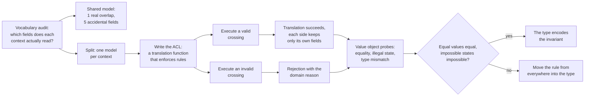

# Domain-Driven Design

## 1. Learning Objectives

By the end of this lesson you will be able to:

- Identify when two parts of a system are speaking the same words with different meanings
  (a shared model serving two bounded contexts) and measure the coupling it creates.
- Draw a context boundary and place a translation (anti-corruption layer) on it, enforcing
  that context's rules at the crossing point.
- Design a value object whose type makes illegal states uncompilable or unconstructible, and
  show equality working without an id field.
- Distinguish an entity (identity-bearing) from a value (attribute-bearing) using executed
  behavior rather than definitions.
- Recognize the parts of DDD that are modeling conversations first and code second — and
  where this lesson's code probes do and do not reach.

## 2. Prerequisites

- Completed ARCH-09 (separation of concerns) and ARCH-13 (clean architecture): bounded
  contexts are SoC's "reasons to change" given a name and a boundary.
- Java 21+ (`javac -version`); the probes use records and plain `javac`, no build tool.
- Willingness to read domain vocabulary carefully — most of this lesson is about words.

## 3. Introduction

Domain-Driven Design has a reputation for being heavy: ubiquitous language, aggregates,
event storming, strategic patterns. Strip the vocabulary and one idea does most of the
work — **model each part of the problem in its own language, and translate deliberately at
the boundaries**. Where two teams say "Order" and mean different things, a single shared
class forces their vocabularies into one shape, and the cost is countable: fields nobody in
one context uses, reviews both contexts must attend, a rename that ripples. This lesson
measures exactly that (P1), then builds the alternative — two models and a translation
point that enforces each context's rules — and executes the crossing.

The second half moves from strategic to tactical: value objects. A `Money` that cannot be
negative, cannot mix currencies, and equals another `Money` with the same attributes is not
a style preference; it is a set of failed constructions you can watch happen.

## 4. The Problem It Solves

The problem is **vocabulary collapse**: one table, one class, one "Order" stretched across
contexts that each need a different slice of it. The probe prints the shape of that stretch:

```text
shared model: fields both contexts must agree on = 6 -> [id, status, total, shopStatus, warehouseStatus, weightKg] (real overlap=1, accidental coupling=5)
shared model: a change to any field forces reviews in both contexts
```

Six fields on the shared class, but only **one** (`id`) is genuinely used by both contexts:
five exist because a catalog vocabulary and a fulfillment vocabulary were forced into one
declaration. Every one of the six is a field whose change must be reviewed by both sides,
and every one is a rename that cannot happen without coordinating across the boundary. The
problem DDD addresses is not "classes are too big"; it is that the *model has stopped
matching any single speaker's understanding of the domain*, and the mismatch shows up as
cross-team coordination cost per change.

## 5. Core Concepts

### Bounded contexts: one word, two models, a boundary

The alternative to the shared model is two models, each consistent with the vocabulary of
its own context, plus an explicit crossing:

```text
boundary: CatalogOrder[id=A-1, state=PAID, total=90.0] -> FulfillmentOrder[id=A-1, shopStatus=PAID, warehouseStatus=QUEUED, weightKg=0.4]
boundary rule enforced: not shippable yet: DRAFT
each context changed independently: catalog has no warehouseStatus, fulfillment has no total
```

Three properties are visible in those lines. The translation is a *function* you can call
and test (`toFulfillment`). The boundary **enforces the source context's rule**: a `DRAFT`
order crossing into fulfillment is refused with the reason stated, rather than entering as a
half-valid row that a downstream system must discover. And each model is now smaller than
the shared one: the catalog's class has no `weightKg`, the fulfillment record has no `total`,
so five of the six accidental fields are gone from both.

### The anti-corruption layer

The translation function is the anti-corruption layer (ACL): it is the only code allowed to
know both vocabularies. Naming it matters operationally — when the catalog renames
`PAID` to `SETTLED`, exactly one function changes. Without an ACL, that rename is a grep
across every context that ever imported the shared model.

### Ubiquitous language (the part code cannot prove)

The words in `CatalogOrder` — `state`, `total`, `shippable` — must be the words the catalog
team uses in conversation and in the product. The probe cannot verify this; what it can
show is the *consequence* of the language being consistent: the translation reads like a
domain sentence ("not shippable yet: DRAFT"). The lesson is honest about the boundary of
executed evidence here: DDD's strategic half is a modeling discipline validated by whether
two people can discuss a change without translating, and no `main()` runs that test.

### Value objects: equality by value, illegal states rejected

```text
--- P2 value object: identity, equality, and illegal states are impossible
two equal amounts are equal objects: true (no id field)
illegal state rejected: negative money: -1
cross-currency add rejected: currency mismatch: EUR vs USD
sum = Money[cents=9500, currency=EUR] (rounded to 95.00 EUR)
```

A record's generated `equals` compares attributes, so two 90-euro amounts are interchangeable
— correct for money, wrong for an order (which keeps its identity even if every field later
matched another order). The two rejected constructions are the point: `-1 EUR` and a
cross-currency addition do not become wrong results, they become exceptions thrown at the
boundary of construction, before any code can compute with them.

## 6. How It Works



## 7. Practical Examples

### The shared model and its cost

```java
public class SharedOrder {          // one class, two vocabularies
    String id, status, shopStatus, warehouseStatus, invoiceNumber;
    double total, weightKg;
}
```

`SharedNeeds` counts each context's used fields, forms the union, and reports the overlap.
The output in Section 4 is the whole argument: `real overlap=1, accidental coupling=5`.

### Two models and the translation

```java
public record CatalogOrder(String id, String state, double total) {
    boolean shippable() { return state.equals("PAID"); }
}

public record FulfillmentOrder(String id, String shopStatus, String warehouseStatus, double weightKg) { }

public class AtBoundary {
    static FulfillmentOrder toFulfillment(CatalogOrder c) {
        if (!c.state().equals("PAID")) throw new IllegalStateException("not shippable yet: " + c.state());
        return new FulfillmentOrder(c.id(), c.state(), "QUEUED", 0.4);
    }
}
```

The ACL is seven lines, and both probe runs (valid `PAID`, invalid `DRAFT`) execute them
directly. Nothing else in the system knows that `state` and `shopStatus` are related.

### A value object that cannot be misused

```java
public record Money(long cents, String currency) {
    public Money {
        if (cents < 0) throw new IllegalArgumentException("negative money: " + cents);
        if (!currency.equals("EUR") && !currency.equals("USD")) throw new IllegalArgumentException("unknown currency: " + currency);
    }
    public Money plus(Money o) {
        if (!o.currency.equals(currency)) throw new IllegalArgumentException("currency mismatch: " + currency + " vs " + o.currency);
        return new Money(cents + o.cents, currency);
    }
}
```

The compact constructor makes every construction path validate — there is no factory to
forget, no builder to bypass. Amounts are stored as integer cents, so the printed sum
(`Money[cents=9500, currency=EUR]`) is exact.

## 8. Real-World Applications

- **Separate "order" per domain.** Commerce platforms routinely model cart, checkout, and
  fulfillment orders as distinct types with translations — the P1 split, at production scale.
- **Money as a value object.** Banking ledgers use integer minor units plus a currency, and
  reject mixed-currency arithmetic at the type — P2's `Money` is the minimal version.
- **Anti-corruption layers over integrations.** When a system talks to a third-party API,
  an ACL keeps the vendor's vocabulary out of your domain; the translation function is where
  that quarantine lives.
- **Event storming → contexts.** Teams map domain events on a wall and discover boundaries
  where the vocabulary changes; the probe's two-context split is what that exercise produces
  in code.
- **Validation at the boundary.** Rejecting a `DRAFT` order at translation mirrors real
  pipeline gates (payment confirmed before fulfillment is allowed to start).

## 9. Common Mistakes

- **A shared "core" model that silently re-merges the contexts.** Extracting `SharedOrder`
  into a common module compiles and feels DRY; P1's `accidental coupling=5` is the counter-
  argument — DRY across different vocabularies is coupling with a nicer name.
- **Anemic value objects.** A `Money` class with public mutable fields and getters/setters
  has the type's name but not its guarantee; the invariant must live in construction.
- **Validation in the controller instead of the type.** Rules enforced far from the value
  are rules some other caller will skip; the compact constructor cannot be skipped.
- **Equality confusion.** Entities compared by value look equal after unrelated field edits;
  values compared by identity fail a plain `equals`. Pick per kind, and say which kind each
  type is.
- **Translating at random places.** If every service calls `toFulfillment` inline, the ACL
  is not a layer but a helper; consolidation is what makes renames single-file.
- **Pretending code proves the language.** The probe executes translations, not conversations;
  the ubiquitous-language half is validated by whether domain experts recognize the model.

## 10. Best Practices

- Start every split with the vocabulary audit: list each context's *used* fields (P1's first
  line) before drawing any boundary.
- Put all knowledge of both vocabularies in exactly one translation module and test it with
  both valid and invalid crossings.
- Model amounts as integer minor units + currency; never floating point, never nullable currency.
- Give each type an explicit kind — entity (identity) or value (attributes) — and let that
  decide `equals`.
- Keep rejection messages in domain language (`not shippable yet: DRAFT`); they surface in
  logs and support tickets.
- Re-run the audit when a context's field list grows: five new fields used by one context
  are a signal the boundary moved.

## 11. Limitations and Trade-Offs

- **Duplication is real.** Two models mean two places where "an order has an id" lives; the
  bet is that context-private fields (five of six here) outweigh that.
- **Translation code that never stops growing.** Every field that crosses becomes ACL logic;
  if the ACL approaches the size of the shared model, the boundary is probably wrong.
- **Value objects add ceremony for one-use data.** A throwaway script does not need `Money`;
  the type pays for itself only when invariants must hold everywhere.
- **Over-modeling small domains.** DDD's strategic apparatus earns its keep at a certain
  size and team count; below that, plain functions and a couple of records are faster.
- **The probes measure structure, not understanding.** `accidental coupling=5` is a proxy for
  coordination cost; the real cost is human and only observable in how a team works.

## 12. Practical Exercises

### Introductory

1. Reproduce P1: write the two context field lists from a system you know, form the shared
   class, and report overlap vs accidental coupling.
2. Reproduce P2: build `Money`, then attempt construction of a negative amount and a
   cross-currency addition. Paste both rejection messages.
3. List five classes in your current project and label each entity or value, with the one
   sentence that decides it.

### Intermediate

4. Split P1's shared model: write both context models and the ACL, and execute one valid and
   one invalid crossing.
5. Extend `Money` with `minus` and a `times(int)` — show what new invalid inputs the type
   still rejects for free.
6. Take a class with a public setter that violates an invariant and move the check into
   construction; show a caller that previously could construct the invalid state now failing.

### Independent problem-solving

7. Model two contexts that share a word in your domain (e.g., "account" in billing vs
   support) with separate models and an ACL, then argue where the boundary should sit if a
   third context arrives.
8. Design the translation between a `CatalogOrder` and an event `OrderPlaced` — including
   which context owns the event name — and execute both directions.
9. Critique DDD for a two-week, two-person project: which probes would still be worth
   running, which practices would you drop, and what evidence supports your choice?

## 13. Knowledge Check

1. What does `real overlap=1, accidental coupling=5` measure, and what human cost does it proxy?
2. Why is the rejection in `toFulfillment` an anti-corruption concern rather than mere validation?
3. In P2, why do two equal `Money` values compare equal while two identical-looking orders
   should not?
4. What can the probes in this lesson not verify about ubiquitous language?
5. When does splitting one model into two make a system *worse*?

<details>
<summary>Answers</summary>

1. How many field names both contexts genuinely use (1: `id`) versus fields present only
   because one class serves two vocabularies (5); it proxies the cross-team coordination and
   review cost of any change to the shared class.
2. Because it decides what the source context's words *mean* when they enter another
   vocabulary — a `DRAFT` order has no fulfillment meaning, so the ACL refuses the concept,
   not merely a bad value.
3. Money is a value: identity *is* its attributes. An order is an entity: identity survives
   attribute changes, so equality must be by id.
4. Nothing about whether real speakers actually use those words — the probes execute
   translations, not conversations; that half is validated with domain experts.
5. When the two contexts genuinely change together and share most of their fields — the split
   then buys duplicated models plus translation cost for no coordination savings.

</details>

## 14. Completion Criteria

You have completed this lesson when:

- [ ] You can run the vocabulary audit and explain every number it prints.
- [ ] P1's shared-model output (`real overlap=1, accidental coupling=5`) and P2's two
      rejections (`negative money`, `currency mismatch`) reproduce on your machine.
- [ ] You have written an ACL that both accepts a valid crossing and refuses an invalid one
      with a domain-language reason.
- [ ] You can classify any class as entity or value with a one-sentence justification.
- [ ] You can name what this lesson's probes did not prove about DDD.
- [ ] The mermaid diagram in Section 6 parses.

## 15. Summary

The lesson's measured claim: a class shared by two contexts carried six fields of which
only one was genuinely shared — five accidental fields, six reviews per change. The
alternative executed here is two models plus a translation function that enforces each
context's rules at the crossing (`not shippable yet: DRAFT`), leaving each side with only
its own vocabulary. The tactical half, value objects, was shown by construction: equal
attributes are equal values, and negative money or mixed currencies never come into
existence. DDD's strategic half — the language itself — remains a human discipline that the
probes can only illustrate, and the lesson says so.

## 16. Next Steps

- ARCH-15 `event-driven-architecture.md` — what happens when contexts communicate by
  events instead of calls: duplicate delivery, ordering, and the idempotent consumer.
- Revisit ARCH-13: the ACL sits in the outer ring of a clean architecture; the two lessons
  describe the same boundary from different sides.
- Revisit batch 10's `er-diagrams.md` — an ERD drawn per bounded context is the persistent
  form of the P1 split.
