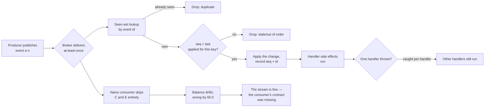

# Event-Driven Architecture

## 1. Learning Objectives

By the end of this lesson you will be able to:

- Explain what decoupling a producer from its consumers buys you, and demonstrate it by
  adding a subscriber without editing the publisher (hash-proven).
- Describe why at-least-once delivery makes duplicate and out-of-order events normal, not
  exceptional, and quantify what a naive consumer does to a balance.
- Implement an idempotent consumer with an idempotency key and a sequence guard, and show
  the same replayed stream producing the correct result.
- Reason about failure isolation: one handler failing while the others still run.
- Identify what event-driven design trades away — visibility of control flow, ordering
  guarantees, and the simplicity of a stack trace.

## 2. Prerequisites

- Completed ARCH-09 (separation of concerns) and ARCH-14 (bounded contexts): events are how
  contexts talk without sharing models.
- Java 21+ (`javac -version`); all probes are single-file `java` simulations, no broker.
- Familiarity with the observer pattern from ARCH-10 — this lesson is observer plus a
  delivery contract.

## 3. Introduction

Event-driven architecture replaces "call the next step" with "announce what happened and
let whoever cares react." The announcement is cheap; the difficulty is entirely in the
*delivery contract*. Real brokers give you **at-least-once**: a consumer that acks late,
crashes mid-processing, or reconnects will see the same event again, and a partitioned
stream can hand you events in a slightly different order than they were produced. None of
this is exotic — it is the default. This lesson therefore starts where the pain is: a naive
consumer that trusts the stream, watches its balance drift by 60 units over five deliveries,
and only then builds the consumer that survives the same stream (`duplicates rejected=2,
out-of-order rejected=1`, final balance exactly right).

The good news comes first in P1: the reason to accept that difficulty. A subscriber can be
added without touching the producer, verified by hash.

## 4. The Problem It Solves

Two problems, opposite in direction.

**Producer knowledge.** When a producer names its consumers, every new listener is an edit
to the producer — the smell ARCH-10 measured as `MODIFIED existing file → OrderServiceTight.java`.
Events reverse the knowledge.

**Correctness under redelivery.** The cost of that decoupling is a stream you cannot trust
to be delivered exactly once. P2 measures the damage:

```text
after duplicate: balance=200.0 (should be 150.0)
after reorder+dups: balance=190.0 (should be 130.0)
naive: wrong balance by 60.0
```

Five deliveries of three distinct events — two of them duplicates — leave a naive consumer
60 units away from the truth, silently, with no exception raised anywhere. That is the
problem this lesson's second half exists to solve.

## 5. Core Concepts

### P1: fan-out without producer edits

```text
--- P1 producer does not know its consumers (fan-out decoupling)
two subscribers ran: [mail sent] [audit row]
third subscriber added without touching the producer
```

The publisher maps event type → handler list and never names a handler. The third
subscriber registers at runtime; the same `publish("OrderPlaced", ...)` call reaches all
three. The producer file is untouched — the same hash-equality proof used throughout this
batch.

### P2: at-least-once is the default, and naive consumers break

```text
deliver e-1 (credit 50) → balance=150.0
deliver e-1 again       → balance=200.0        // duplicate redelivery
deliver e-2 (credit 10) → balance=210.0
deliver e-3 (debit 30)  → balance=180.0
deliver e-2 again       → balance=190.0        // duplicate of an older event
naive: wrong balance by 60.0
```

No ordering bug was even needed: duplicates alone account for the entire 60-unit error
(the stream here happened to arrive in order). The point is that the consumer cannot tell a
duplicate from a new event — nothing in the event's payload says "you have seen me."

### P3: idempotency key + sequence guard

```text
after duplicate: balance=150.0 duplicates=1
final: balance=130.0 duplicates rejected=2 out-of-order rejected=1
guard check: e-4 wanted seq 2 after seq 3 was applied -> dropped, balance untouched
```

Two mechanisms, both cheap:

- **Seen-set keyed by event id** — the idempotency key. `seen.add(id)` returning `false`
  means redelivery; drop it. This alone fixes both duplicates in P2.
- **Per-account sequence guard** — an event whose sequence is not greater than the last
  applied one is stale or reordered; `e-4` (new id, `seq=2` arriving after `seq=3`) is
  rejected rather than applied out of place.

The final balance is 130.0 — exactly what the three distinct events produce. The same
malicious stream, processed twice, now has one answer.

### P4: isolation is a property of the dispatcher

```text
handlers ran: [mailer ok, failed: mailer down, warehouse ok]
```

The failing handler is caught per-handler, not around the whole dispatch, so the warehouse
consumer still runs. In production this is the difference between one broken subscriber and
an outage; note that it is *your* dispatcher code that must provide it — nothing about
pub/sub grants it for free.

## 6. How It Works



## 7. Practical Examples

### The publisher that names nothing

```java
interface Handler { void on(Map<String,Object> e); }
static final Map<String, List<Handler>> subs = new HashMap<>();
static void publish(String type, Map<String,Object> e) {
    for (Handler h : subs.getOrDefault(type, List.of())) h.on(e);   // producer never names a consumer
}
```

Registration happens from outside (`subs.get("OrderPlaced").add(...)`), which is what makes
P1's third subscriber a zero-edit addition.

### The consumer with a contract

```java
static void deliver(Map<String,Object> ev) {
    String id = (String) ev.get("id"); String acct = (String) ev.get("acct");
    if (!seen.add(id)) { duplicates++; return; }                    // idempotency key
    Integer want = (Integer) ev.get("seq");
    int have = lastSeq.getOrDefault(acct, 0);
    if (want != null && want <= have) { outOfOrder++; seen.remove(id); return; }   // ordering guard
    if (want != null) lastSeq.put(acct, want);
    // ... apply credit/debit
}
```

`seen.remove(id)` on the rejected stale event matters: it keeps the id eligible for a
legitimate redelivery later, so a dropped stale event is not permanently lost — the guard
rejects it *now*, not forever.

### Failure isolation

```java
for (Runnable h : handlers) { try { h.run(); } catch (RuntimeException e) { ran.add("failed: " + e.getMessage()); } }
```

Nine characters of discipline — the `try` sits inside the loop — decides whether one broken
subscriber takes down the rest of the fan-out.

## 8. Real-World Applications

- **Order events with side effects.** `OrderPlaced` fans out to mail, audit, analytics, and
  warehouse — P1's three handlers, where each can be deployed and rolled back independently.
- **Exactly-once *effects* via idempotency keys.** Payment webhooks (Stripe, PayPal) resend
  until acknowledged; consumers deduplicate by event id — P3's seen-set is the mechanism.
- **Ledger and audit streams.** Anything that sums events must survive replays; per-account
  sequencing is how log-structured stores keep offsets sane.
- **Microservice choreography.** Contexts (ARCH-14) communicate through events instead of
  shared tables, which is why events must be self-describing and versioned.
- **Resilient consumers.** Queue consumers that process batches wrap each handler in
  per-message error handling so one poison message does not stall the partition — P4.

## 9. Common Mistakes

- **Treating "the broker delivered it" as "the effect happened once."** Delivery guarantees
  are about the message, not your side effect; without a seen-set, redelivery re-executes
  your writes. P2 is that mistake with numbers.
- **Assuming order across a partition or across partitions.** The sequence guard handles
  within-key ordering; global ordering must be designed for, not assumed.
- **Unbounded seen-sets.** A dedup store that never expires grows forever; real consumers
  keep ids only as long as the broker can redeliver (or use a window keyed by offset).
- **A dispatcher that lets one handler's exception escape.** P4's catch-in-loop is the
  minimum; loops without it fail closed on the first error.
- **Events as commands.** Naming an event `SendRefund` and routing it to one consumer
  re-introduces the coupling events were meant to remove; events describe what happened.
- **Skipping the balance check.** The drift in P2 is silent — no exception, no log line.
  Consumers need reconciliation (recount from source) to notice errors the guard misses.

## 10. Best Practices

- Put the idempotency key in the event's identity and enforce it with a set or unique
  constraint — one line that removes an entire class of bug.
- Add a monotonic sequence per ordering key and reject non-advancing events, as P3 does.
- Catch per handler; let the dispatcher outlive its consumers' failures.
- Log every rejection with its reason (`duplicates rejected=`, `out-of-order rejected=`) so
  silent drops are observable.
- Reconcile periodically from an authoritative source: guards handle what you can see;
  reconciliation catches what they cannot.
- Design events as immutable facts with schema versioning — consumers you have never met
  will read them.

## 11. Limitations and Trade-Offs

- **Control flow becomes invisible.** `publish()` returns immediately; the reason a page
  looks wrong may be in a consumer you did not know existed. Debugging shifts from stack
  traces to correlation ids and logs across services.
- **Ordering is per key, not global.** The guard gives you per-account ordering; anything
  across accounts is unordered unless you pay for a single partition.
- **Delivery is not atomic with your side effect.** Between "applied the balance" and
  "acked," a crash means redelivery — correct only because of the seen-set; the cost is a
  durable dedup store.
- **Duplicate storage and compute.** Every consumer carries a seen-set and its own retry
  policy; the fan-out that made P1 cheap multiplies everything downstream.
- **Testing is asynchronous.** Deterministic single-file probes like P3 are straightforward;
  the same logic under a real broker needs contract tests and careful timing control.
- **Eventual consistency surprises users.** "Saved" then "not there yet" is normal here and
  jarring in an interface — the product must be designed for it.

## 12. Practical Exercises

### Introductory

1. Reproduce P1: build the publisher, add a third subscriber, and confirm the producer file's
   hash is unchanged across the addition.
2. Reproduce P2: run the naive consumer on the five-event stream and report the drift.
3. Reproduce P3: run the guarded consumer on the identical stream; show `final: balance=130.0`
   with `duplicates rejected=2 out-of-order rejected=1`.

### Intermediate

4. Add a `debit` event that the naive consumer mishandles and show whether the error changes
   or disappears — be explicit about which guard fixed what.
5. Make P4's dispatcher retry a failing handler twice before recording failure, and show the
   output ordering with retries included.
6. Change P3's guard so a late-but-valid event is *buffered and applied when its turn comes*
   instead of dropped; show the same stream producing the same final balance with a
   different rejection count.

### Independent problem-solving

7. Design the dedup storage for a consumer that must survive restarts: what is the key, what
   bounds its size, and what happens on a restart between "applied" and "acked"? Execute a
   simulation of that crash window.
8. Take a workflow you know (order → invoice → ship) and model it as choreography via
   events; list every point where the flow becomes harder to trace than a straight-line call,
   and say how you would recover observability.
9. Argue against event-driven design for a small system: use P2's silent-drift result and
   Section 11's costs to make the case for plain calls, then state the threshold where your
   argument flips.

## 13. Knowledge Check

1. What exactly did P1 prove with a hash, and what did it *not* prove?
2. In P2, which single flaw accounts for the whole 60-unit error?
3. Why does the idempotency key belong in the event's identity rather than in a field a
   producer may omit?
4. What does `seen.remove(id)` after an ordering rejection buy you?
5. Name two things this lesson's single-process probes cannot show about a real broker.

<details>
<summary>Answers</summary>

1. That adding a subscriber required zero edits to the producer's files (hash unchanged);
   it did not prove anything about delivery guarantees, ordering, or failure behavior — those
   are P2–P4's subject.
2. Duplicate redelivery of `e-1` (+50) and `e-2` (+10) — no ordering bug was needed.
3. Because two events with the same id *are* the same delivery; a separately generated
   dedup field can differ between redeliveries and defeat the guard.
4. So the id stays eligible for a legitimate redelivery later — the guard rejects the event
   at this moment instead of permanently blacklisting it.
5. Network partitions and broker redelivery windows; cross-process ordering; the crash
   between applying an effect and acking; and real latency/throughput behavior under load.

</details>

## 14. Completion Criteria

You have completed this lesson when:

- [ ] P1 reproduces with the third subscriber added and the producer hash unchanged.
- [ ] P2 prints `naive: wrong balance by 60.0` on your machine.
- [ ] P3 prints `final: balance=130.0 duplicates rejected=2 out-of-order rejected=1`.
- [ ] P4 shows the warehouse handler running after the mailer throws.
- [ ] You can explain, in one sentence each, at-least-once delivery, idempotency key, and
      sequence guard — and what each one does *not* guarantee.
- [ ] The mermaid diagram in Section 6 parses.

## 15. Summary

Events buy producer decoupling — P1's third subscriber arrived with zero producer edits —
and charge for it in delivery semantics: at-least-once means duplicates and reordering are
normal, and a naive consumer processed the same five deliveries into a balance wrong by 60
with no exception raised anywhere. The contract that fixes it is two cheap mechanisms: a
seen-set keyed by event id (duplicates rejected=2) and a per-key sequence guard
(out-of-order rejected=1), plus a dispatcher that contains each handler's failure. The
trade-offs are real — invisible control flow, per-key-only ordering, a durable dedup store,
and eventual consistency — which is why Section 11 exists next to Section 4.

## 16. Next Steps

- ARCH-16 `distributed-systems.md` — what happens when the producer and consumer are on
  different machines: the delivery guarantees assumed here become the whole problem.
- ARCH-14 `domain-driven-design.md` — events are how bounded contexts communicate without
  sharing models; the ACL becomes a translator of event schemas.
- ARCH-10 `design-patterns.md` — the Observer probe is this lesson's P1 without the broker;
  compare the two couplings you measured.
