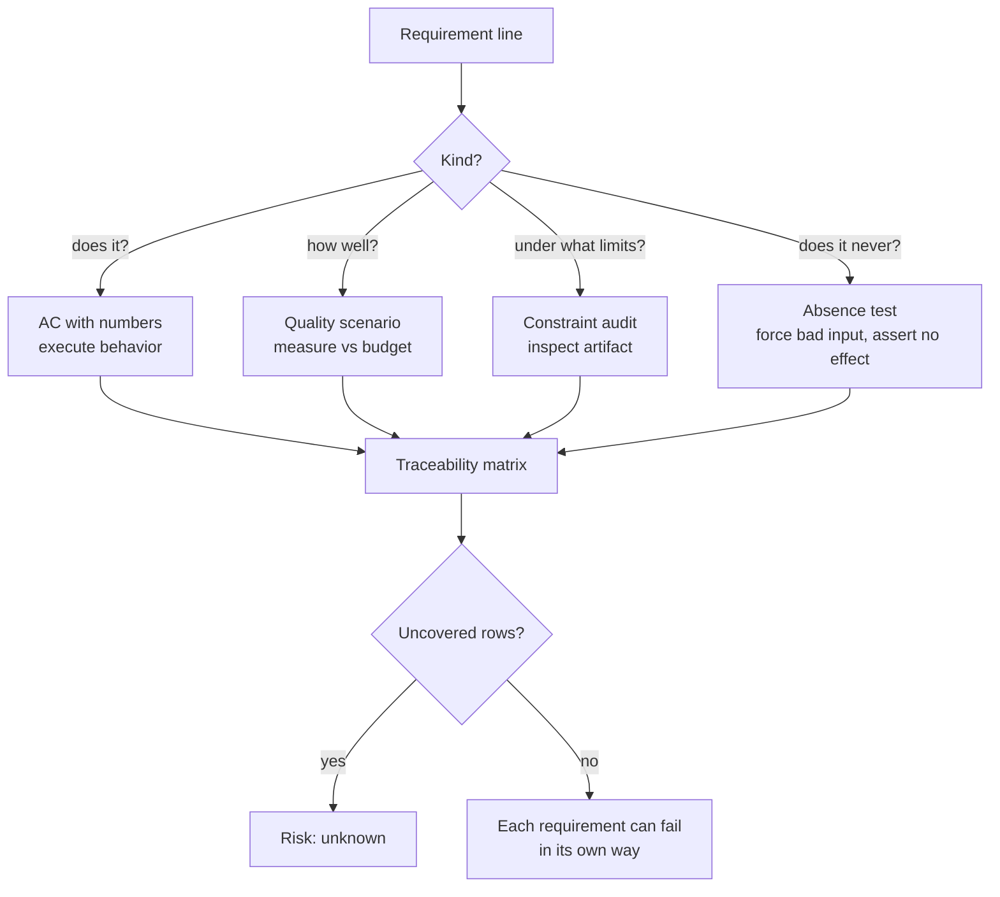

# Functional and Non-Functional Requirements

## 1. Learning Objectives

After this lesson you can:

- [ ] Classify any requirement line as functional, non-functional, constraint, or
      off-requirement, and say which verification can make it fail
- [ ] Rewrite a vague quality claim ("fast") as a **measured budget** and execute both
      outcomes — executed: same code, budget 50000 → `NFR1 PASS: 480us within budget`
      exit 0, budget 100 → `NFR1 FAIL: 463us exceeds budget 100us` exit 1
- [ ] Specify a non-functional requirement as a **quality-attribute scenario** (stimulus,
      environment, artifact, response, response measure) instead of an adjective
- [ ] Diagnose measurement methodology from the numbers themselves — executed: the same
      1000-line workload reports `1424us` cold (no warmup) and `463us` warmed, and say
      which number a budget should compare against
- [ ] Write an off-requirement ("must never") as a test that asserts *absence* —
      executed: the traceability run's `row FR2 covered-by bad-code-throws …
      IllegalArgumentException: bad code`
- [ ] Build the FR/NFR → evidence matrix and read its uncovered list — executed:
      `traceability: 5/5 … uncovered: []`

*Provenance: all transcripts are **executed on the authoring machine** — the `orderdesk`
mini-repo (Java 25) and two probes (`ReqLab.java`, `BudgetProbe.java`) in the same lab.
The microsecond values are this machine's; the budgets and the pass/fail structure are
the lesson.*

## 2. Prerequisites

- [Requirements Engineering](requirements-engineering.md) — the four kinds and the
  validation loop this lesson goes deeper on.
- [The Complete Development Process](the-complete-development-process.md) — stage 8
  (non-functional targets) and stage 14 (test strategy) are this lesson's home in the
  process.

## 3. Introduction

Functional requirements say **what**; non-functional requirements say **how well**. Teams
write the first carefully and the second poetically — "the system shall be fast, secure,
and scalable" — and then discover that poetry cannot fail a build. This lesson's premise:
**a non-functional requirement is a hypothesis with a number attached, and its whole
purpose is to be measured and possibly refuted.** Everything here is executed twice —
once against a budget the system meets, once against a budget it misses — because an NFR
you have never seen *fail* is a comment, not a requirement.

## 4. The Problem It Solves

Before budgets: quality was argued at release. "Is it fast enough?" "It felt fast on my
machine." The argument has no winner because neither side brought a number. The failure
mode is worse than a delayed release — it is *shipping a belief*. A budget flips the
conversation from opinion to record: `463us exceeds budget 100us` is not discussable in
the same way "it feels sluggish" is. The OrderDesk lab carries NFR1 precisely this way:
`1000-line total: 1424us (NFR1 budget 50000us)` — a claim that can be checked by
anyone who runs the command.

## 5. Core Concepts

### The four kinds, revisited with routing

| Kind | Question | Example | Verification | Failure looks like |
|---|---|---|---|---|
| Functional | does it? | FR3: percent before tax | execute behavior | wrong value, exception |
| Non-functional | how well? | NFR1: < 50ms per total | measure vs budget | measurement exceeds budget |
| Constraint | under what limits? | single-threaded, no DB | inspect artifact/process | a forbidden thing exists |
| Off-requirement | does it never? | bad code never mutates order | test the absence | forbidden effect observed |

The subtle one is the last: functional tests assert presence (the right thing happened),
so absence needs a different test shape — force the bad input, then assert the state
*did not* change. The traceability run executes this shape for FR2's off-requirement:
the engine throws `bad code` and the order state is untouched.

### Quality-attribute scenarios

"Fast" becomes specifiable by decomposing it into five parts:

1. **Stimulus** — what arrives (a 1000-line order total request)
2. **Environment** — when/where (normal operation, single-threaded — the constraint)
3. **Artifact** — what is affected (the total computation)
4. **Response** — what happens (result returned)
5. **Response measure** — the number (avg < 50000us)

Miss part 5 and you have prose; miss part 2 and you have a budget nobody can reproduce
("fast" during a backup is a different claim). NFR1 as recorded in `REQUIREMENTS.md`
is: `total computed for 1000-line order in < 50ms (single-threaded)` — stimulus,
environment and measure, all three.

### The budget is a contract with a threshold, not a target

A budget's value is that it can be *missed*. The probe makes both sides executable —
identical code, one parameter:

```
$ java -cp out BudgetProbe 50000
measure: 1000-line total avg 480us, budget 50000us, result 10700.0
NFR1 PASS: 480us within budget 50000us          (exit 0)

$ java -cp out BudgetProbe 100
measure: 1000-line total avg 463us, budget 100us, result 10700.0
NFR1 FAIL: 463us exceeds budget 100us           (exit 1)
```

Note the honest detail: the *faster* run (463us) is the one that **fails**, because the
budget — not the code — decides. A budget nobody can meet is as useless as no budget:
it fails for the wrong reason and trains people to ignore red.

### Measurement methodology is part of the requirement

The same workload in two probes:

```
NfrCheck (no warmup):   1000-line total: 1424us (NFR1 budget 50000us)  → NFR1 PASS
BudgetProbe (warmed):   1000-line total avg 463us, budget 50000us      → NFR1 PASS
```

3× difference, same code, same machine — the difference is JIT warmup. Whose number is
"the" latency? Neither, until the procedure says so: **the measurement procedure (warmup,
sample count, aggregation) is part of the NFR**. A budget without a procedure is
reproducibly unreproducible. In practice: define steady-state (warm up first), sample
(count of iterations), aggregate (avg or p95 — p95 for tails, avg only when distribution
is tight), and pin the environment (the constraint row).

### Functional requirements need acceptance criteria, not descriptions

FR lines are cheap to write and easy to fake: "total = sum − discount + tax" reads fine
until the discount's ordering relative to tax is unspecified (the FR3 story). The
function of an AC is to pin each under-specified operation with a number — hence
`ACC3: … THEN 19.26`, hand-computed and then *executed* (`ok acc-eu-discount10 got
19.26 want 19.26`).

## 6. How It Works

From requirement line to failing-or-passing check:



Read the routing, not the boxes: the kind determines the *shape of the check*, and a
requirement with the wrong shape's check is uncovered in everything but the matrix's
ink. The matrix at the end is only honest if each row's check was built for its kind.

## 7. Practical Examples

**Example 1 — the budget, both outcomes (executed)**

```java
// BudgetProbe.java — the whole contract in six lines
long t0 = System.nanoTime();
double r = 0;
for (int i = 0; i < 100; i++) r = OrderTotal.compute(lines, 0, "EU", 0);
long us = (System.nanoTime() - t0) / 100 / 1000;
System.out.println("measure: 1000-line total avg " + us + "us, budget " + budget + "us");
if (us > budget) { System.out.println("NFR1 FAIL ..."); System.exit(1); }
```

- The important lines: warmup before timing, 100 samples, average, exit code carries
  the verdict — so CI can gate on it.
- **Executed output:** the two runs in section 5 (PASS exit 0 / FAIL exit 1).
- **How to run it:** `javac -cp out -d out BudgetProbe.java && java -cp out BudgetProbe 50000`
  then the same with `100`.
- **Assumptions:** Java 25 on the authoring machine; your microseconds differ, the
  pass/fail structure does not.

**Example 2 — off-requirement as an absence test (executed)**

```java
try { OrderTotal.compute(List.of(10.0), -1, "EU", 1); ok("FR2", false, "-> no exception"); }
catch (IllegalArgumentException e) { ok("FR2", true, "-> IllegalArgumentException: " + e.getMessage()); }
```

- What the important line does: injects the bad code, requires the rejection — the
  assertion is on the *refusal*, and because the engine throws before mutating, the
  "order unchanged" half is structural.
- **Executed output:**

```
row FR2 covered-by bad-code-throws (FR2 bad code rejected)
ok   FR2 -> IllegalArgumentException: bad code
```

**Example 3 — determinism as a measurable NFR (executed)**

NFR2 ("same order always yields the same total") is measured by *rerunning and counting
distinct results*:

```
ok   NFR2 -> 10000 reruns, distinct results = 1
```

- Why this shape: determinism has no threshold — its budget is `distinct == 1`. Some
  NFRs are exactness claims, and their measure is equality, not tolerance.

## 8. Real-World Applications

Budgets are how SLOs, capacity plans, and performance regressions become discussable:
web teams keep p95 latency budgets in the test suite; mobile apps budget cold-start
seconds because a store rating depends on it; data pipelines budget row-throughput
because downstream SLAs compound. Paired with: continuous profiling and load testing
(the measurement), the requirement IDs from ARCH-04 (the target), and CI gating (the
verdict — without a gate, the budget is again just text).

## 9. Common Mistakes

| Mistake | Why it happens | How to recognize it | How to prevent it |
|---|---|---|---|
| Quality adjective filed as done | no measurement built | "fast/secure/scalable" with no number | demand response measure before acceptance |
| Budget without procedure | number copied from a blog | wildly different values per run | specify warmup, samples, aggregation, machine |
| Unmeetable budget | goal and budget conflated | fails even when optimized | pilot the budget; adjust with recorded justification |
| NFR tested once at the end | measurement feels separate | first perf test happens pre-release | run budgets in CI from day one (small, cheap ones) |
| Absence tested by presence tests | default test shape | "unknown code" case not covered | write the forced-bad-input test explicitly |
| Matrix green, kind wrong | row-level view only | NFR "covered" by a unit test of code | check each row's *shape* matches its kind |

## 10. Best Practices

- **Budgets in the requirements file, not the wiki** — `REQUIREMENTS.md` holds NFR1
  verbatim, so document and check travel together (worked example's layout).
- **Gate only what you're ready to fail on.** The worked example gates NFR1 in CI-style
  runs; an always-red gate is deleted within a week. Start advisory, tighten to blocking.
- **Warm up before measuring, always say you did.** The 1424us-vs-463us gap is the
  argument; record the procedure next to the number.
- **One kind per line.** "The API shall respond quickly under load (p95 < 200ms)" is a
  fine sentence but two rows in the matrix — behavior and latency fail differently.
- **Version budgets with code.** A loosened budget is a decision; commit it like one
  (the change-control loop from ARCH-04).

## 11. Limitations and Trade-Offs

- Local budgets don't compose: 10 calls each within budget can jointly miss an
  end-to-end budget — system-level NFRs need measurement at the system boundary.
- Microbenchmarks lie by omission (allocation, GC, contention, cold start). The single-
  threaded constraint on NFR1 is *stated* precisely so the measurement's limits are
  known; remove the constraint and the probe measures something else.
- Some NFRs (usability, accessibility) survive only partially as numbers; audits and
  expert review remain the verification, with the budget covering the mechanical part.
- Measurement costs runtime in CI — keep the gated set small and fast; deep profiling
  belongs to scheduled runs, not every commit.

## 12. Practical Exercises

### Introductory

1. **Exercise 5.1** — Take these three lines and route each: "the report loads in under
   2 seconds," "the export includes CSV," "the app never logs passwords," "built with
   the client's approved library." **Completion criteria:** kind + verification column
   filled, and you can name the exact test shape for each.
2. **Exercise 5.2** — Give NFR1 a second budget your machine actually fails (derive it
   from your own measurement ×0.2), run the probe, and capture the FAIL exit code.
   **Completion criteria:** transcript with `FAIL` and exit 1, plus the measured value.

### Intermediate

3. **Exercise 5.3** — Rewrite one adjective-quality requirement as a full
   quality-attribute scenario, then implement its measurement and commit both.
   **Completion criteria:** all five scenario parts present; the measurement runs and
   prints a pass/fail with a number.
4. **Exercise 5.4** — Take your project's three worst NFRs and give each the right
   measure shape: threshold, equality (`distinct == 1`), or absence. Run them all.
   **Completion criteria:** one command produces one verdict per NFR, exit code correct.

### Independent problem-solving

5. **Exercise 5.5** — A stakeholder wants "the dashboard must feel instant." Produce the
   interview questions that extract the missing scenario parts, the budget you'd propose
   and its pilot measurement, and the sentence explaining why a goal (feel instant) and a
   budget (p95 < 400ms on a mid-tier laptop) are different objects.
   **Completion criteria:** a proposed NFR line with all five parts, a pilot number, and
   a recorded reason the budget is what it is.

*Solutions: attempt first. They live in `solutions/` of this subject.*

## 13. Knowledge Check

1. Your latency budget passes locally and fails in CI, consistently. What do you inspect
   first, and which lesson's concept governs? … *The measurement procedure — machine,
   warmup, load (environment part of the scenario); two environments = two budgets, or
   one budget with both environments stated.*
2. Why can a green traceability matrix still hide an unbuilt NFR? … *Row coverage says a
   check exists, not that its shape fits the kind — an NFR "covered" by a behavior unit
   test never compares a measurement to a budget.*
3. When is a threshold the wrong measure and equality the right one? … *When the claim is
   exactness (determinism, idempotency): tolerances hide bugs that equality exposes —
   `distinct results = 1` has no acceptable drift.*

## 14. Completion Criteria

Observable evidence that you have understood this lesson:

- [ ] You can route any requirement line to its verification shape without hesitation
- [ ] You have run a budget probe through both outcomes and captured both exit codes
- [ ] You can name all five quality-attribute scenario parts for one real system
- [ ] You can explain the 1424us-vs-463us gap and what a budget must say about it
- [ ] You have written one absence test whose assertion is on the refusal

## 15. Summary

- Functional → execute; non-functional → measure; constraint → inspect; off-requirement
  → force-and-assert-absence.
- An NFR without a response measure is prose; without a procedure it's unreproducible.
- Budgets must be reachable: the 463us/100us FAIL shows the budget deciding, not the code.
- Warmup and sampling change the number by 3× — the procedure is part of the requirement.
- Exactness claims measure equality (`distinct == 1`), not tolerance.

## 16. Next Steps

- Next lesson: [Use Cases and UML](use-cases-and-uml.md) — modeling the journeys these
  requirements describe, with diagrams that validate.
- Practice: [exercise set](exercises/README.md)
- Where it is applied: [Project 07](../20-PROJECT-LABORATORY/README.md) — give its first
  milestone one budget and one absence test, both executed.
