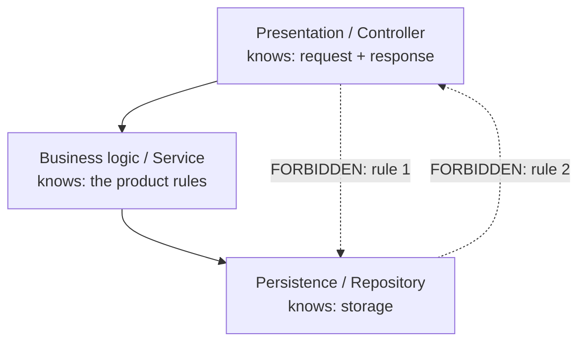

# Layered Architecture

## 1. Learning Objectives

After this lesson you can:

- [ ] Draw the default layer stack and state the one rule it exists to enforce — that
      dependencies point in one direction — and check it mechanically — executed:
      `lint rule 1 (controller must not use persistence): violations=1` and `rule 2 …
      violations=1` in the tangled design vs `0` and `0` in the layered one
- [ ] Locate a presentation-only change and prove the other layers did not move —
      executed: `layered: presentation-only change -> 1 file edited
      (OrderController.java); service and repository hash unchanged`, response
      `layered response: 42.00 EUR`
- [ ] State what a tangled file costs at the same change — executed: `files edited=1 but
      concerns disturbed=3 markers inside that file`
- [ ] Explain layering's second payoff, testability, with a run rather than a claim —
      executed: `layered: service test ran with zero infrastructure imports = 42.00`
      versus `tangled: same test -> Exception … NullPointerException: Cannot invoke
      "java.sql.Connection.prepareStatement(String)" because "<parameter2>" is null`
- [ ] Decide when layers are the wrong granularity, and what to reach for instead
      ([modular monoliths](modular-monoliths.md), [clean architecture](clean-architecture.md))

*Provenance: all transcripts are **executed on the authoring machine** —
`layered-probes.sh` (three sections: a two-rule dependency lint over both designs, a
before/after `sha256sum` around a presentation change, and an executed unit test in each
design). Java 25, no dependencies beyond the JDK; the lint is a `grep` over imports and
type references, which is how the cheap version of an architecture test works.*

## 2. Prerequisites

- [Separation of Concerns](separation-of-concerns.md) — the principle this is the
  default structure for.
- [SOLID Principles](solid-principles.md) — dependency direction (DIP) is the rule being
  enforced here, one level up.
- [Design Patterns](design-patterns.md) — repository and strategy are the pieces the
  layers are made of.
- [11-BACKEND-ENGINEERING](../11-BACKEND-ENGINEERING/README.md) — you have already built
  this stack; this lesson is about the boundary, not the code.

## 3. Introduction

Layered architecture is the boring default of server-side software — presentation on top,
business rules in the middle, persistence at the bottom — and boring is the compliment.
Its value is not elegance; it is that **one rule, stated once, is checkable**: a layer
may call the layer below it and nothing else. Everything teams want from "clean
architecture" in the small — a change that lands in one place, a business rule you can
test without a database, a swap of one detail for another — follows mechanically from
that single direction. This lesson treats the layers as an *executable claim*: two rules,
counted as violations before and after; a change request, hashed around; a unit test,
run in both designs.

## 4. The Problem It Solves

Without a direction, the codebase develops **cycles and shortcuts**. The probe's tangled
design is the honest miniature: the controller imports `java.sql` and writes its own
`select` — a shortcut that works fine in a demo — and the repository calls back into the
controller, closing a cycle. The cost does not appear at write time; it appears at three
later moments, all executed here. (1) Every rule change now sits in a file that also
holds SQL and HTTP: `concerns disturbed=3 markers`. (2) You cannot run the rule in
isolation: the test dies with `NullPointerException … because "<parameter2>" is null`,
because the only path to the business logic runs through a live `Connection`. (3) Nobody
can tell which imports are mistakes, because nothing says what is forbidden — hence the
lint counts `1` and `1` violations in the tangled design and `0`/`0` in the layered one.

## 5. Core Concepts

### The stack and its single rule

```text
presentation   knows: what the caller sent, what to send back
business logic knows: the rules of the product
persistence    knows: storage
```

**Rule:** *dependencies point downward only.* Presentation may call business logic;
business logic may call persistence; nothing calls upward, and nobody skips a layer. Each
layer's job is stated in one sentence (from the [Separation of Concerns](separation-of-concerns.md)
sentence test), and the sentences do not overlap.

### The layers are about *knowledge*, not about folders

The test is not "is it in a directory called `service`?" but "what does this file know?".
The tangled controller knows a table name and a SQL dialect; that is persistence
knowledge sitting in the presentation layer — which is exactly what lint rule 1 detects
(`import java.sql` in the controller). A folder-per-layer project where controllers still
build SQL has the same violations; the grep would say so.

### Enforcement: count the violations

Java will not stop an upward call, so the check is an assertion you run — the cheap
version is a pattern over imports and type references, the serious version an architecture
test (ArchUnit-style) in the test suite. Executed here:

```text
--- P1 dependency direction: two rules, counted as lint violations
tangled: compiles (Java does not enforce layers)
lint rule 1 (controller must not use persistence): violations=1
lint rule 2 (repository must not use presentation): violations=1
--- P1b same two rules against the layered design
layered: compiles
lint rule 1 (controller must not use persistence): violations=0
lint rule 2 (repository must not use presentation): violations=0
```

Note the first line: the tangled design *compiles*. Compilation is not a boundary check,
and neither is a directory layout. A number that can be printed in CI is.

### Change locality: hash everything that should not move

The currency-suffix change request ("show totals with a currency suffix") is applied to
the layered design, then the files below it are re-hashed:

```text
layered response: 42.00 EUR
layered: presentation-only change -> 1 file edited (OrderController.java); service and repository hash unchanged
```

The same request in the tangled design lands in the one file that holds everything:

```text
tangled: same change request -> presentation, persistence and query string all live in the one file that had to change
tangled: files edited=1 but concerns disturbed=3 markers inside that file
```

Both designs edited one file — this is the same lesson as [SOLID](solid-principles.md)'s
SRP probe: **the diff's size is not the cost; the number of concerns the diff puts in
doubt is.**

### Testability: the layer that can be executed alone

```text
layered: service test ran with zero infrastructure imports = 42.00
layered test: infrastructure types referenced = 0
tangled: same test -> Exception in thread "main" java.lang.NullPointerException: Cannot invoke "java.sql.Connection.prepareStatement(String)" because "<parameter2>" is null
tangled: reaching the business rule needs a live JDBC Connection (and, in a real app, an HTTP request)
```

This is the practical reason most teams adopt layers at all: the rule becomes a function
you can call. The tangled test *compiled* and then failed at the first line of execution —
the business rule was reachable only through infrastructure that a unit test does not
have. Test strategy and architecture are the same decision viewed from two sides.

## 6. How It Works

The direction rule turns into a checkable flow:



The solid arrows are the design; the dashed arrows are what the lint counts. Read it as
an instrument panel: `violations=0/0` means the structure is as claimed, any non-zero
value names the file that broke it. The forbidden arrows are not theoretical — the
tangled design exhibits both, and the lint finds them in one grep.

## 7. Practical Examples

**Example 1 — the layered triple, complete**

```java
public class OrderController {
    private final OrderService service;
    public OrderController(OrderService service) { this.service = service; }
    String total(String id) { return service.totalFor(id); }
}

public class OrderService {
    private final OrderRepository repo;
    public OrderService(OrderRepository repo) { this.repo = repo; }
    String totalFor(String id) { return repo.findTotal(id); }
}

public class OrderRepository {
    String findTotal(String id) { return "42.00"; }   // storage detail stays here
}
```

- What the important lines do: each constructor takes the layer *below* — that parameter
  list is the dependency arrow, made visible and injectable (DIP at layer scale).
- **Expected output:** `layered response: 42.00 EUR` after the change in Example 2.
- **How to run it:** `bash layered-probes.sh` (sections P1b, P2, P3).
- **Assumptions:** bash, JDK 25; the repository returns a canned value so the probe needs
  no database — the point under test is the *structure*, not storage.

**Example 2 — the tangled counterpart, and what the lint sees**

```java
import java.sql.*;

public class OrderController {                 // layer 1 reaching straight to layer 3
    String total(String id, Connection c) throws Exception {
        try (PreparedStatement p = c.prepareStatement("select total from orders where id=?")) {
            p.setString(1, id);
            try (ResultSet r = p.executeQuery()) { return r.next() ? r.getString(1) : null; }
        }
    }
}
```

- Two violations in one file: it knows persistence (rule 1) and it *is* the presentation,
  the business rule and the query — which is why the change request disturbed `3 markers`.
- **Expected output:** `lint rule 1 … violations=1`, `concerns disturbed=3`.
- **How to run it:** sections P1 and P2 of the same script.

**Example 3 — the lint as a two-line check you can keep**

```bash
# rule 1: presentation must not reference persistence
grep -l 'import java.sql' src/**/controller/*.java && echo "VIOLATION" || echo "0 violations"
```

- What it does: the same assertion the probe runs, in the shape a CI job would use. The
  real version belongs in the test suite (an architecture test) so it fails the build.
- **Expected output:** `0 violations` on the layered design, `violations=1` on the
  tangled one — as executed in P1/P1b.

## 8. Real-World Applications

- **Web backends**, where controllers translate HTTP, services own rules and repositories
  own SQL — the structure the batch-13 backend lessons built, and the shape Spring's
  layered idioms assume.
- **Keeping framework types out of rules**, so a change of web framework or ORM touches
  one layer: the import count is the measurement.
- **Test suites**, where the service layer runs in milliseconds without a container —
  directly enabling the integration-test pyramid you will meet in
  [14-TESTING-AND-QUALITY](../14-TESTING-AND-QUALITY/README.md).
- **Team ownership**, where each layer is a reviewable surface with a one-sentence job;
  the lint gives reviewers an objective answer to "is this allowed here?".
- **Migrations**, replacing persistence (a new database, an API instead of a table) by
  rewriting one layer and hashing the others.

## 9. Common Mistakes

| Mistake | Why it happens | How to recognize it | How to prevent it |
|---|---|---|---|
| Layers as folders, not knowledge | structure copied from a template | `service/` classes building SQL strings | enforce the *import* rule, not the directory rule |
| Skipping a layer for speed | "it's just one query" | controller calls the repository directly (rule 1 fires) | make the lint run in CI; make the shortcut visible |
| Anemic "service" pass-throughs | rules applied mechanically | services that only forward to the repository | collapse layers that add no decision; keep the rule where the decision is |
| Business logic needing context objects | services parameterized by HTTP types | the unit test cannot construct the service | pass plain values down, build framework objects only at the top |
| Layers with no variation inside them | premature structure | every layer has exactly one implementation and one caller, always | wait for a real second reason — see [modular monoliths](modular-monoliths.md) for the next scale |
| One giant "domain" layer | overcorrection | a domain package importing everything | lint rules apply to *every* pair of layers, not just the top |

## 10. Best Practices

- **Write the rules as tests, not prose.** The probe's two greps are a complete first
  version; an ArchUnit-style test makes them fail the build.
- **Hash what should not move** after any refactor — the `sha256sum` before/after is a
  two-line proof that the change stayed in its layer.
- **Keep framework types at the edge.** `javax.servlet`, `jakarta`, `java.sql` appearing
  anywhere except the top and bottom layers is a countable smell (P3's `infrastructure
  types referenced = 0`).
- **Construct the stack explicitly** in one composition root — the three constructors
  above are the whole wiring, which is what makes the dependency direction readable.
- **Test each layer in its own idiom**: services with fakes for repositories (executed),
  repositories against a real database (in the integration lessons).
- **State the direction once, in the README of the codebase**, and let the lint be its
  enforcement — a rule nobody can check becomes a rule nobody follows.
- **Re-run the lint when a layer is added**; direction rules are only total if they cover
  every pair.

## 11. Limitations and Trade-Offs

- **Layers can be the wrong granularity.** When you have two independent business areas
  that each want their own stack, slicing horizontally first produces a system where one
  feature's change crosses three layers anyway. The alternative — module boundaries
  *around* each area — is [modular monoliths](modular-monoliths.md).
- **Pass-through layers are real overhead.** A controller that only forwards and a service
  that only forwards are two jumps of indirection; sometimes the rule legitimately lives
  next to its caller. The lint cannot tell you this; the sentence test can.
- **Rule 1's lint is heuristic.** `grep 'import java.sql'` misses reflection, string-built
  SQL, and dependencies pulled through a helper. It is a smoke detector; an architecture
  test over class references is the stronger version.
- **Cross-cutting concerns still cut across** — logging, transactions and validation need
  every layer; layering does not place them (see the three options in
  [Separation of Concerns](separation-of-concerns.md)).
- **Performance-sensitive paths may need shortcuts**, e.g. a read model that skips the
  service layer on purpose. Make the exception explicit — one annotated file beats a
  silent rule violation.
- **Nothing here addresses deployment.** Layers are a source structure; whether they ship
  together or apart is the next lesson's question.

## 12. Practical Exercises

### Introductory

1. **Exercise 11.1** — Run `layered-probes.sh` and report, for each design, the two lint
   counts, the file list of the currency change, and the outcome of the service test.
   **Completion criteria:** a 2×5 table (design × measurement) whose every cell comes
   from the transcript.
2. **Exercise 11.2** — Write the two lint rules as shell commands of your own that would
   also catch a repository importing a controller.
   **Completion criteria:** commands that print `0 violations` on `layered/` and a
   non-zero count on `tangled/`, with both outputs shown.

### Intermediate

3. **Exercise 11.3** — Move the currency change into the *service* layer instead of the
   controller, then into the repository.
   **Completion criteria:** three runs showing where the edit landed each time, the
   hashes of the untouched layers in each, and one sentence on which placement you would
   defend in review (formatting is presentation; a stored currency column is persistence).
4. **Exercise 11.4** — Add a fourth layer (`domain` between service and persistence) and
   extend the lint to all adjacent pairs.
   **Completion criteria:** all six ordered pairs have a stated rule, violations printed
   for both designs, and the count of files that now pass through each request.

### Independent problem-solving

5. **Exercise 11.5** — Take a real codebase you know and determine whether its layers are
   *knowledge* boundaries or *folder* boundaries: design the measurement (imports?
   type references? change history?), run it, and report.
   **Completion criteria:** a number per layer pair, a list of the specific violations
   found with file names, and a recommendation — fix, accept as an explicit exception, or
   restructure — for each violation, decided before you look at how hard the fix would be.

*Solutions: attempt first. They live in `solutions/` of this subject.*

## 13. Knowledge Check

1. The tangled design compiled cleanly. What does that tell you about compiler checks as
   architecture enforcement? … *Nothing about boundaries: Java enforces visibility, not
   dependency direction. Both designs compiled; only the lint separated them
   (`1/1` vs `0/0`).*
2. Both designs edited exactly one file for the currency change. Why is the layered one
   cheaper? … *Because of what the change put in doubt: `service and repository hash
   unchanged` means nothing else needed re-verification, while the tangled file held
   `3 markers` — presentation, persistence and the query — so all three re-enter scope.*
3. Why did the tangled test compile but fail at runtime? … *`java.sql.Connection` exists
   on the classpath, so the call type-checks; what a unit test lacks is a live connection —
   hence `NullPointerException … "<parameter2>" is null`. Layering's testability claim is
   about where the rule sits, not about types compiling.*
4. When would you deliberately allow a layer-skipping call? … *For a measured
   performance reason on a hot path, made explicit (an annotated, documented exception),
   so the lint's total rule stays meaningful everywhere else.*

## 14. Completion Criteria

Observable evidence that you have understood this lesson:

- [ ] You ran `layered-probes.sh` and can quote both lint counts, both change-landing
      lines and both test outcomes
- [ ] You can state the one rule and the two forbidden arrows it implies
- [ ] You can distinguish a folder boundary from a knowledge boundary, and name the
      measurement that tells them apart
- [ ] You can explain why `concerns disturbed=3` matters more than `files edited=1`
- [ ] You can name one situation where a flat or modular design beats a layer stack

## 15. Summary

- One rule: dependencies point downward — and it is checkable as a count of violations.
- Executed: tangled `1/1` violations vs layered `0/0`; Java's compiler will not help you.
- A presentation-only change kept `service and repository hash unchanged`; the tangled
  equivalent put `3 markers` in doubt.
- Testability is the same claim: `42.00` from a test with `0` infrastructure imports,
  versus a `NullPointerException` on the only path through the tangled code.
- Layers are the default, not the destination — module boundaries are the next scale.

## 16. Next Steps

- Next lesson: [Modular Monoliths](modular-monoliths.md) — same single-deployable
  simplicity, boundaries drawn around business areas instead of technical kinds.
- Practice: [exercise set](exercises/README.md).
- Where it is applied: [Project 07 — Architecture Decision Record](../20-PROJECT-LABORATORY/README.md),
  where a layering claim arrives with the lint output that backs it.
