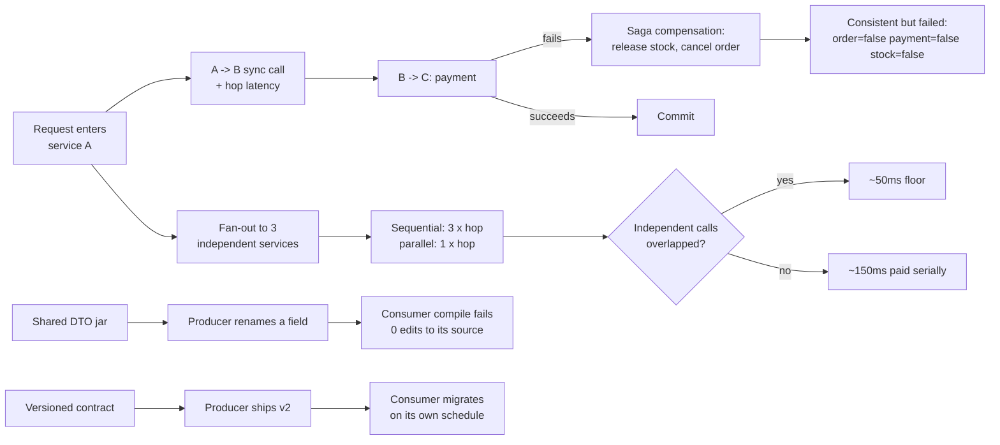

# Microservices

## 1. Learning Objectives

By the end of this lesson you will be able to:

- Explain why a multi-service transaction cannot be rolled back atomically, and execute a
  saga whose compensation leaves every service consistent after a mid-flow failure.
- Measure the latency cost of each synchronous hop between services and compare sequential
  fan-out against parallel fan-out on real timings.
- Demonstrate the deploy-time coupling a shared compile-time contract creates — an untouched
  consumer failing to compile after a producer-side rename — and contrast it with a
  consumer-owned, versioned contract.
- Decide when a feature belongs in one service rather than several, using the measured costs
  (partial failure, hop latency, contract churn) as the argument.
- Describe what microservices optimize for — independent deployability and team autonomy —
  and what they tax you for achieving it.

## 2. Prerequisites

- Completed ARCH-16 (distributed systems): its timeout/duplicate and quorum results are the
  environment microservices run inside.
- Completed ARCH-12 (modular monoliths): start there; this lesson is about when *not* to.
- Java 21+ (`javac -version`); probes are single-file simulations plus a real three-file
  compile experiment for the contract probe.

## 3. Introduction

Microservices are frequently sold as "small services," but size is not the point — the
point is **a deployment boundary per team**, so that one team can ship without coordinating
a release train. Everything painful about them follows from that boundary: a function call
becomes a network request, a transaction becomes a saga, a type becomes a contract, and a
stack trace becomes a correlation-id hunt. This lesson keeps three of those costs executable:

1. A payment that fails after an order commits — with and without compensation (P1).
2. Three hops of 50 ms each — sequential versus parallel, measured on a wall clock (P2).
3. A rename in a shared type — the consumer's source untouched, the compile still red (P3).

The argument of the lesson is not "services are bad" but "these are the numbers you are
trading for independent deploys — run them before you split anything."

## 4. The Problem It Solves

The problem microservices solve is **coordination cost between teams**: when one codebase
must be released as a unit, every team pays for every other team's release. The problem
they create is that the data's consistency now has to survive the network:

```text
no saga:    order=true payment=false stock=true -> money lost? no; goods held? yes; order visible? yes -> inconsistent
ok   saga-clean after compensation: order=false payment=false stock=false -> consistent, just failed
```

Without a coordinating mechanism, a failure two hops in leaves three services each in a
locally-valid, globally-wrong state. The saga — compensating actions instead of a global
rollback — is the standard answer, and P1 shows both its power (all three flags return to a
consistent tuple) and its honest caveat: compensation is itself a message that can fail.

## 5. Core Concepts

### P1: sagas replace atomicity with compensation

```text
--- P1 no saga vs saga with compensation
no saga:    order=true payment=false stock=true ... -> inconsistent
ok   saga-clean after compensation: order=false payment=false stock=false -> consistent, just failed
ok   saga-note compensation is another message, not a rollback - it can fail too
```

There is no two-phase commit across these services because blocking a distributed lock
through a network outage is how systems stop serving users. Instead each step registers its
undo (`cancel order`, `release stock`), and a later failure triggers the undos in reverse.
The final line is the discipline part: `refund` can itself fail, so a saga needs its own
retry/dead-letter story — compensation shrinks the failure surface, it does not delete it.

### P2: every hop is a latency tax, unless you overlap it

```text
ok   parallel-faster sequential=151ms parallel=62ms (3 x 50ms calls)
P2: each hop the architect adds is paid serially unless the calls are independent
```

Three independent 50 ms calls take 151 ms when chained and 62 ms when overlapped — nearly
the single-call floor of 50 ms plus scheduling overhead. The design implication is blunt:
serial dependency between services is paid by the user on every request, and the fix for
independent calls is concurrency, while the fix for *dependent* calls is fewer services in
that path. (The numbers also show network hops are ~50 ms in the real world only when you
choose them to be; the lesson's sleeps stand in for the round trips a deployment actually adds.)

### P3: a shared type couples deployments, not just builds

```text
P3a: producer + consumer compile against the shared type
P3b: shared type renamed -> consumer broken with ZERO edits to its source:
InvoiceService.java:1: error: cannot find symbol
  symbol:   variable total
  location: variable o of type Order
P3c: consumer-owned contract -> the producer's rename compiles clean, consumer redeploy count = 0
```

This one is a genuine `javac` experiment, not a simulation: the producer migrates
`total` → `amountTotal` in the shared class, and the consumer — whose source nobody
touched — stops compiling. Two services that share a DTO jar therefore ship together,
which is the release train microservices were supposed to escape. P3c shows the
alternative: the consumer owns its own copy of the contract, the rename compiles clean,
and the cost moves to where it belongs — deliberate, scheduled migration between versions.

## 6. How It Works



## 7. Practical Examples

### The saga, in code

```java
boolean order = placeOrder();          // step 1
boolean payment = charge(order);       // step 2
if (!payment) {
    cancelOrder(order);                // compensate step 1
    releaseStock(order);               // ... in reverse
}
// invariant: never order=true with payment=false
```

Each `if` is a place the flow can end; the invariant being protected is that no service
believes the transaction succeeded when another knows it failed.

### Parallel fan-out

```java
ExecutorService ex = Executors.newFixedThreadPool(3);
List<Future<Long>> fs = new ArrayList<>();
for (int i = 0; i < 3; i++) fs.add(ex.submit(() -> call(50)));
for (Future<Long> f : fs) f.get();     // wait for all: 151ms -> 62ms
```

The structure — submit all, then join all — is the whole difference between the two
timings in P2.

### The contract experiment

```java
// shared type, after the producer's rename
public class Dtos { public static class Order { public String id; public double amountTotal; } }

// consumer, untouched since P3a
public class InvoiceService { String label(Dtos.Order o) { return "inv-" + o.id + " @ " + o.total; } }
// → error: cannot find symbol  variable total
```

and the consumer-owned variant:

```java
class ConsumerOrder { String id; double total; }        // consumer-owned copy of v1
class InvoiceService { String label(ConsumerOrder o) { ... } }
```

## 8. Real-World Applications

- **E-commerce checkout.** Order, payment, and inventory as separate services coordinated
  by a saga — P1's exact shape, usually with an outbox and a dead-letter queue for the
  compensation failures.
- **API gateways calling BFFs.** A page that fans out to several services runs P2's
  parallel fan-out; gateway timeout budgets are derived from the summed serial case.
- **Shared library hell.** Teams that publish internal DTO jars discover P3b at the worst
  possible time; large organizations respond with schema registries and consumer-driven
  contracts (Pact) to make the coupling explicit and versioned.
- **Strangler migrations.** Incremental extraction from a monolith works when each extracted
  service owns its contract — the P3c pattern applied during a rewrite.
- **Mobile/backend versioning.** Mobile clients cannot be force-upgraded, so APIs must
  accept old and new fields — the same discipline as consumer-owned contracts, at the
  network edge.

## 9. Common Mistakes

- **Splitting before measuring.** If P2's serial 151 ms or P3's shared-jar rebuild would
  surprise you, the split is a guess — start from ARCH-12's modular monolith where these
  boundaries exist as code discipline, not network calls.
- **Distributed transactions by default.** Reaching for two-phase commit across services
  reintroduces blocking failure modes that sagas exist to avoid.
- **Forgetting compensation failure.** `saga-note` is the whole warning: an undo that can
  fail needs retries, alerting, and an operator path.
- **Chatty services.** A design that needs dozens of synchronous hops per request pays P2's
  tax dozens of times; merge the services until the call graph is shallow.
- **Sharing DTOs "for convenience."** The convenience is a release train — P3b's error
  appears precisely when you least want a joint deploy.
- **Ignoring the operational cost.** Each service adds deployment, observability, and
  failure-injection work; the probes measure three of the costs, not all of them.

## 10. Best Practices

- Run P1's saga shape on paper for every multi-service write: what is each step's undo, and
  who retries it when it fails?
- Overlap independent calls (P2's submit-all/join-all) and set per-hop timeout budgets from
  the user-facing budget backwards.
- Own your contracts: version them, never compile against another team's internal jar —
  P3c's `redeploy count = 0` is the acceptance criterion.
- Keep the synchronous path shallow; move anything not needed for the response onto events
  (ARCH-15).
- Require idempotency keys on every cross-service write — ARCH-16 P3 applies to every hop here.
- Start with a modular monolith and split only when a measured cost (release coupling,
  scaling, team autonomy) demands a boundary.

## 11. Limitations and Trade-Offs

- **The probes simulate services in one process.** They capture the logical costs — partial
  failure, hop latency, contract coupling — not real serialization, TLS, or DNS costs, which
  make every hop heavier than the simulation's `Thread.sleep`.
- **Compensation is not rollback.** Business side effects (an email sent, a physical item
  shipped) may be impossible to undo; sagas cover reversible steps only.
- **P2's parallelism has its own cost.** Fan-out multiplies failure modes and makes partial
  timeouts the common case; 62 ms is the happy path.
- **Versioned contracts drift.** P3c's copies can silently diverge; consumer-driven contract
  tests are needed to keep them honest — discipline, not tooling, does that.
- **Operational burden is unmeasured here.** Deployment pipelines, tracing, on-call rotation,
  and data ownership per service often dominate the engineering cost the probes show.
- **Microservices do not fix a bad domain model.** ARCH-14's bounded contexts come first;
  services are how contexts get deployed, not how they get discovered.

## 12. Practical Exercises

### Introductory

1. Reproduce P1: run both branches and state, for each service, what an operator would have
   to clean up manually in the no-saga case.
2. Reproduce P2: confirm `sequential=151ms parallel=62ms` on your machine, then run with
   6 calls and 12 calls; chart the growth of each mode.
3. Reproduce P3a–P3c: run the rename experiment and paste the consumer's compile error.

### Intermediate

4. Add a second failure point to P1's saga (compensation itself fails once, then succeeds)
   and show the final state after retries.
5. Convert P2's fan-out to a service mesh style budget: with a 100 ms total budget, what is
   the maximum serial hops, and what happens to parallel calls when one takes 80 ms?
6. Extend P3 with a versioned schema: producer ships v2 alongside v1 and the consumer
   compiles against v1 until migrated — show both compiling simultaneously.

### Independent problem-solving

7. Take a feature your team wants to build and decide, using P1–P3's numbers, whether it is
   a new service, a new module in an existing service, or an event consumer. Defend the
   choice with the measured costs.
8. Design the saga for a real workflow in your system (refunds, cancellations, exports):
   list each step, its compensation, who invokes it, and what happens when the compensation
   fails twice.
9. Argue the opposite position: make the strongest possible case that your current system
   would be better off as microservices, then state what evidence would falsify that case.

## 13. Knowledge Check

1. Why does P1's saga end "consistent, just failed" rather than "rolled back"?
2. In P2, which part of the 151 → 62 ms improvement comes from parallelism alone, and what
   would still be serial after you parallelize?
3. What exactly broke in P3b, given that no consumer source file was edited?
4. Name two things the microservices probes deliberately did not measure.
5. When is a modular monolith the right answer despite this lesson existing?

<details>
<summary>Answers</summary>

1. Because compensation achieves an equivalent end state through messages, not a database
   rollback — the data is consistent, but the work happened and was undone (and the undo
   itself can fail).
2. Overlapping the three independent 50 ms calls removes the waiting; each individual hop's
   latency and any genuinely dependent call (payment after order creation) remain serial.
3. The shared contract type it compiles against changed — the consumer depended on the
   producer's field name at compile time, so a rename in shared code breaks untouched sources.
4. Real network/serialization/TLS costs, and the operational burden (deployment pipelines,
   tracing, on-call, data ownership).
5. When the coordination, contract, and operational costs above exceed the release-coupling
   problem you are trying to solve — small teams, few boundaries, no independent scaling
   need.

</details>

## 14. Completion Criteria

You have completed this lesson when:

- [ ] P1's both branches reproduce and you can name each service's cleanup in the no-saga case.
- [ ] P2's `sequential=151ms parallel=62ms` reproduces on your machine.
- [ ] P3b's `error: cannot find symbol` appears from an untouched consumer source, and
      P3c compiles clean after the switch.
- [ ] You can write the saga for a real workflow including what happens when a compensation fails.
- [ ] You can state the three measured taxes (partial failure, hop latency, contract coupling)
      and when you would pay them willingly.
- [ ] The mermaid diagram in Section 6 parses.

## 15. Summary

Microservices buy independent deploys at three measured prices: a partial failure that needs
a saga with compensations that can themselves fail (`order=false payment=false stock=false`),
synchronous hops that cost 151 ms serial versus 62 ms overlapped for the same three calls,
and a shared contract whose rename produced `cannot find symbol` in a consumer nobody
edited. Each probe is a decision input: split only when the coordination cost you escape
is larger than these taxes, and start from a modular monolith where the same boundaries
exist without the network.

## 16. Next Steps

- ARCH-18 `scalability-and-reliability.md` — the load-side version of these costs: caching,
  redundancy, and retry budgets.
- ARCH-12 `modular-monoliths.md` — the starting point this lesson argues for.
- ARCH-16 `distributed-systems.md` — the failure environment every hop in this lesson runs inside.
