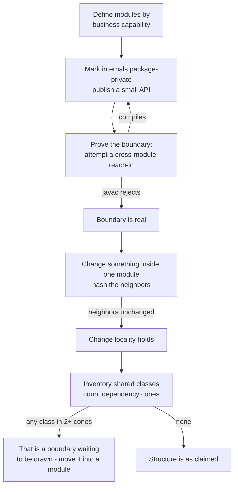

# Modular Monoliths

## 1. Learning Objectives

After this lesson you can:

- [ ] Explain what a modular monolith is — one deployable, several modules with real
      boundaries — and what it deliberately does *not* buy you (no independent deployment,
      no network isolation)
- [ ] Make a module boundary enforceable **inside one process** and prove the compiler is
      the one enforcing it — executed: `P1b: boundary enforced by the compiler -> error:
      InvoiceCalculator is not public in billing; cannot be accessed from outside package`
- [ ] Show that a change inside one module leaves the others byte-identical — executed:
      `P2: tax rule changed inside billing -> shop/OrderApi.java hash unchanged` and
      `0 files outside billing modified (shop untouched)`
- [ ] Measure the alternative's cost — a shared "common" module both feature teams must
      edit — executed: `Common is in 2 feature dependency cones` and the format change
      landing in `both features recompile and retest (count=2)`
- [ ] Decide where module seams should go (by business capability, not by technical kind)
      and how to prevent a `Common` dumping ground from forming
- [ ] Argue the case *against* microservices for a given system, in economic terms, using
      the measurements above

*Provenance: all transcripts are **executed on the authoring machine** —
`modular-probes.sh` (three sections: compiler-enforced cross-module access, a `sha256sum`
comparison across module boundaries after an internal change, and the shared-module
anti-pattern counted by dependency cones). Java 25 packages, single `javac` invocation —
one artifact, exactly as the design claims.*

## 2. Prerequisites

- [Layered Architecture](layered-architecture.md) — layers separate by technical kind;
  modules separate by business area. You need both ideas to see the difference.
- [Separation of Concerns](separation-of-concerns.md) — the change-landing test this
  lesson applies at module scale.
- [Design Patterns](design-patterns.md) — the repository seam is what keeps a module's
  internals private.
- [11-BACKEND-ENGINEERING](../11-BACKEND-ENGINEERING/README.md) — the application you
  would apply this to.

## 3. Introduction

A modular monolith is a system that **ships as one artifact and is built as several**.
The deployment story stays trivial — one process, one database, one rollback — while the
source story gains the thing layered architecture alone cannot give you: boundaries
between *business areas*. The layers cut the system horizontally (presentation, rules,
storage); modules cut it vertically (`billing`, `shop`, `catalog`), and inside each
module the layers still apply. The idea's appeal is that it buys most of the discipline
of microservices — explicit interfaces, independent change, reviewable ownership — while
refusing their bill: the network, the distributed transactions, the second deployment
pipeline. This lesson makes the claim executable: the boundary here is enforced by
`javac` itself, not by convention.

## 4. The Problem It Solves

The failure a module boundary prevents is **accretion into shared space**. Left alone,
two feature teams converge on a `Common`/`Utils` module: it is faster to add there than
to negotiate a seam, and for months it works. Then a change to `money()` lands in a class
both features depend on, and the probe measures what that costs:

```text
P3: Common is in 2 feature dependency cones
P3: 'money format' change in the shared module -> both features recompile and retest (shared class is in BOTH dependency cones)
P3: classes depending on Common: FeatureA.java FeatureB.java (count=2)
```

Neither feature's behavior changed, yet both are now in the test set. Multiply by a year
of additions to `Common` and you have a system where no change is local — which is the
condition that makes teams conclude "we need services", usually *after* the shared module
has made the split unaffordable. A module boundary is the intervention that keeps each
change inside its own dependency cone while the system is still small enough to move.

## 5. Core Concepts

### One artifact, many boundaries

The design has three claims, and the probe checks each:

| Claim | How it is checked | Executed result |
|---|---|---|
| Modules talk only through public APIs | let `shop` try to reach a package-private `billing` class | `error: InvoiceCalculator is not public in billing; cannot be accessed from outside package` |
| A change stays inside its module | hash files outside the module before/after | `shop/OrderApi.java hash unchanged`, `0 files outside billing modified` |
| No shared grab-bag exists | count which dependency cones a shared class sits in | `Common … count=2` |

### Java packages as the enforcement mechanism

Inside one JVM you still get a real boundary: a `package-private` class in `billing` is
invisible to `shop`. The compiler refuses the reach-in:

```text
P1a: cross-module call through the PUBLIC api compiles
P1b: boundary enforced by the compiler -> .\shop\SneakyShop.java:2: error: InvoiceCalculator is not public in billing; cannot be accessed from outside package
P1c: design restores (compile clean) with the reach-in removed
```

This is the whole argument for the pattern over "just organize your folders": the cost of
crossing the boundary is a **build failure with a file name**, which means the rule does
not depend on anyone remembering it. The same trick scales: package visibility for the
same artifact, separate builds for separate services.

### The seam is the module's API, not its data

`BillingLedger.charge(order, amount)` is the module's entire contract with the outside
world; `InvoiceCalculator` is not. With one shared database, the corresponding discipline
is **each module owns its tables** — no other module reads them directly, even though
every module physically could. The probe's compiler check models the stronger version of
that rule (the database equivalent is schema ownership plus a repository-only access
policy).

### Change locality: hash the neighbor

```text
P2: tax rule changed inside billing -> shop/OrderApi.java hash unchanged
P2: 0 files outside billing modified (shop untouched)
```

A tax-rule change is a `billing` concern; the hash proves `shop` was neither edited nor
recompiled-by-need. Combined with the [layered lesson's](layered-architecture.md) interior
check (`service and repository hash unchanged`), you get the full claim at both scales:
**changes land where their concerns live, at module level and inside the module.**

### The economics: what you are *not* buying

A modular monolith deliberately leaves these on the table, and saying so is part of the
decision: no independent deployment of one module, no process-level isolation between
modules, no per-module scaling, no language freedom. What it leaves on the table is
precisely what most systems do not need yet — and what a distributed system would charge
for daily.

## 6. How It Works

The probe sequence mirrors the adoption sequence a real team would run:



`C` and `G` are the two audits worth automating: the first is a build error waiting to
happen (or a test that compiles the reach-in and asserts failure), the second is a grep
over imports that flags any type appearing in more than one module's cone.

## 7. Practical Examples

**Example 1 — the boundary that the compiler keeps**

```java
// billing/BillingLedger.java   - public: the module's real API
package billing;
public class BillingLedger {
    public String charge(String order, double amount) { return record(order, amount); }
    private String record(String o, double a) { return "charged " + o + " " + a; }
}

// billing/InvoiceCalculator.java  - package-private: internal detail of billing
package billing;
class InvoiceCalculator {
    double tax(double net) { return net * 0.2; }
}
```

The outside attempt:

```java
package shop;
import billing.InvoiceCalculator;          // <-- the boundary violation
public class SneakyShop {
    double cheat(double net) { return new InvoiceCalculator().tax(net); }
}
```

- What the important lines do: `public` marks the seam; `class` (no modifier) makes the
  second type a module-private detail that `shop` cannot name.
- **Expected output:** `error: InvoiceCalculator is not public in billing; cannot be
  accessed from outside package`.
- **How to run it:** `bash modular-probes.sh` (section P1; the script removes the
  violating file and recompiles to show the design is clean again — `P1c`).
- **Assumptions:** bash, JDK 25; all sources compiled in one `javac` invocation, one
  artifact, which is the point.

**Example 2 — an internal change with external hashes**

```bash
sha256sum shop/OrderApi.java > before-shop.txt
# edit billing/InvoiceCalculator.java: net * 0.2 -> net * 0.19
sha256sum shop/OrderApi.java > after-shop.txt
cmp -s before-shop.txt after-shop.txt && echo "0 files outside billing modified"
```

- What it does: hashes only the *neighbour* module — the module you changed is expected
  to differ, so it is excluded by construction.
- **Expected output:** `P2: 0 files outside billing modified (shop untouched)`.
- **How to run it:** section P2.

**Example 3 — the shared class, counted**

```java
public class Common {
    public static String money(double v) { return String.format("%.2f", v); }
}
// FeatureA.label()  -> "A total " + Common.money(10)
// FeatureB.label()  -> "B total " + Common.money(10)
```

- The count (`count=2`) is the measurement: one class, two dependency cones, so any edit
  to it puts both features in the test set — the opposite of Example 2's result.
- **Expected output:** `Common is in 2 feature dependency cones` … `count=2`.
- **How to run it:** section P3.

## 8. Real-World Applications

- **Growing products** past the point where one team can hold the whole system, before
  the point where deployment or scaling forces a split — the pattern's native habitat.
- **Multi-tenant or multi-domain backends** where `billing`, `catalog` and `identity`
  change for genuinely different reasons.
- **The honest pre-microservice step**: teams that first modularize a monolith discover
  which seams are real (from the compiler and the dependency-cone audits) *before* paying
  to make them network boundaries.
- **Monorepos with several teams**, where package visibility plus an architecture test
  gives each team a reviewable territory.
- **Regulatory or audit boundaries**, where one area's code and data must be separable on
  demand — a public API and owned tables are the precondition either way.

## 9. Common Mistakes

| Mistake | Why it happens | How to recognize it | How to prevent it |
|---|---|---|---|
| Modules by technical kind | layers re-labelled as modules | `ui/`, `services/`, `db/` "modules" | cut by business capability; layers stay *inside* each module |
| Everything public | fear of the compiler error | no package-private types anywhere | default to package-private; publish deliberately |
| The `Common` dumping ground | speed beats negotiation | a class in 2+ dependency cones (P3's `count=2`) | name an owning module or refuse the addition |
| Cross-module SQL | one shared schema, no ownership rule | any module's repository reading another's tables | one schema owner per module; access via the module API |
| Circular module imports | features that "need" each other | `A imports B` and `B imports A` in the lint | extract the shared concept into its own module, or merge the two |
| Calling it microservices-lite | premature vocabulary | nobody has paid a network cost yet, so nobody has earned the term | name what you actually have: one artifact, enforced seams |
| Splitting before any pain | structure for its own sake | modules nobody can distinguish by change history | run the dependency-cone audit first; draw seams where changes already diverge |

## 10. Best Practices

- **Cut by business capability.** Ask "which team could own this end to end?" — if the
  answer spans two modules, one boundary is wrong.
- **Publish APIs, hide the rest.** `public` is a decision with a cost; make it only where
  a real cross-module conversation exists (`P1a` compiles because `BillingLedger` was
  chosen, `P1b` fails because `InvoiceCalculator` was not).
- **Hash neighbours after every internal change** — the two-line check from `P2` belongs
  in the release checklist or the PR template.
- **Automate the cone audit**: a script that lists every type imported by more than one
  module is the early warning for `Common` forming.
- **Keep one database but own tables per module**, and forbid joins across ownership —
  the data-side equivalent of `P1b`.
- **State what you are not buying** (no independent deploys, no isolation) in the ADR, so
  the decision is revisited for the right reasons.
- **Re-run the audit when a second team arrives** — module seams are calibrated to how
  people work, not only to the code.

## 11. Limitations and Trade-Offs

- **One deployable is also one blast radius.** A bad migration or a runaway allocation
  takes the whole system down; layers do not change that, and no package-private class
  will.
- **Scaling is all-or-nothing.** You cannot run `billing` on three instances and `shop`
  on one; horizontal scaling duplicates everything.
- **Compiler enforcement stops at the source boundary.** It says nothing about runtime
  coupling (shared threads, static state) or data coupling (shared tables) — those need
  their own audits.
- **The shared database invites shortcuts.** Unlike separate services, nothing physical
  stops a query against another module's tables; discipline and review must.
- **Boundaries can ossify.** A wrong seam is as expensive as none — with the added cost
  that everyone believes it. Revisit when the dependency-cone audit shows changes
  repeatedly crossing the same boundary.
- **A modular monolith is not a step you must outgrow.** Many systems are correct to stay
  here permanently; the decision criteria are operational (deployment frequency, scaling
  needs, team autonomy), not aesthetic.

## 12. Practical Exercises

### Introductory

1. **Exercise 12.1** — Run `modular-probes.sh` and, from the transcript alone, list the
   three claims and the line that proves each.
   **Completion criteria:** three pairs of (claim, executed output line) with no
   interpretation added.
2. **Exercise 12.2** — Make `InvoiceCalculator` public and re-run the probe.
   **Completion criteria:** `P1b` now compiles, and you can say precisely which security
   or encapsulation property was lost — with the output that changed quoted.

### Intermediate

3. **Exercise 12.3** — Extend the probe to a third module (`shipping`) that imports
   `billing`'s public API only, then attempt a reach-in from `billing` into `shipping`.
   **Completion criteria:** the compiler error (or its absence) reported, a stated rule
   for allowed dependency directions *between* modules, and the lint output for all
   ordered pairs.
4. **Exercise 12.4** — Take the `Common` class from P3 and move `money()` into whichever
   module should own it, leaving `legacyNote()` where it belongs.
   **Completion criteria:** the cone count drops to `1` for each function, both features'
   tests still pass, and you can name the rule you used to decide ownership.

### Independent problem-solving

5. **Exercise 12.5** — Your team has been asked to "go microservices". Produce the
   analysis: for each module boundary you would draw, report the current dependency-cone
   data, the deployment coupling, the data coupling, and what each boundary would cost as
   a network hop — then recommend one of: keep as-is, modularize, or split a *specific*
   bounded part.
   **Completion criteria:** a recommendation with numbers (cones, change counts,
   deployment frequency) gathered before the recommendation, plus the one sentence you
   would say in the meeting about what microservices would cost this system *now*.

*Solutions: attempt first. They live in `solutions/` of this subject.*

## 13. Knowledge Check

1. The probe compiled everything in a single `javac` invocation. Why does that matter to
   the argument? … *Because it proves the boundary was enforced inside one artifact — no
   build separation, no module system, no network. If package visibility holds under
   those conditions, the enforcement is not an artifact of tooling setup.*
2. `P2` hashed only `shop/OrderApi.java`, not `billing`'s files. Why? … *The module under
   change is expected to differ; the claim under test is about the neighbours — `0 files
   outside billing modified`. Hashing everything would make the comparison useless.*
3. What is the earliest signal that `Common` is forming in your codebase? … *A type
   imported by two or more modules' dependency cones — the grep version of `count=2`,
   before any change request has been mis-landed.*
4. "Our modules are separate directories, so we already have this." What evidence would
   you ask for? … *A reach-in attempt that fails (or a lint over cross-directory imports),
   and a hash around an internal change. Directories enforce nothing; the probe's
   `error: … cannot be accessed from outside package` is the evidence that means something.*

## 14. Completion Criteria

Observable evidence that you have understood this lesson:

- [ ] You ran `modular-probes.sh` and can quote the compiler error, the neighbour hash
      result and the cone count
- [ ] You can list the three claims and how each was checked
- [ ] You can explain what a modular monolith deliberately does not buy, and why that is
      usually the right trade
- [ ] You can name the two audits worth automating and say what a failure of each means
- [ ] You can argue the boundary question for a system you know, in economic terms

## 15. Summary

- One artifact, several modules: boundaries by business capability, layers still inside
  each module.
- The boundary is enforced by `javac`: `InvoiceCalculator is not public in billing …
  cannot be accessed from outside package`.
- Change locality is a hash: `shop/OrderApi.java hash unchanged`, `0 files outside
  billing modified`.
- The anti-pattern is measurable: `Common … count=2` means one edit, two test suites.
- What you are not buying (independent deploys, isolation) belongs in the decision record.

## 16. Next Steps

- Next lesson: [Clean Architecture](clean-architecture.md) — dependency direction as a
  whole-system rule, and when its ceremony pays.
- Practice: [exercise set](exercises/README.md).
- Where it is applied: [Project 07 — Architecture Decision Record](../20-PROJECT-LABORATORY/README.md),
  where this analysis *is* the deliverable for a "should we split?" question.
