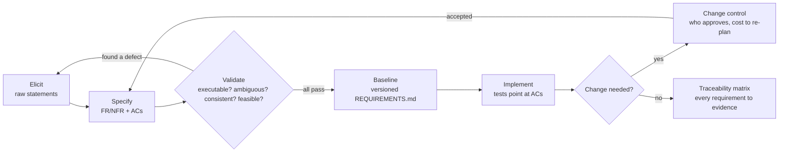

# Requirements Engineering

## 1. Learning Objectives

After this lesson you can:

- [ ] Run the elicitation → specification → validation → change-management loop and say
      what artifact each step produces (the OrderDesk `REQUIREMENTS.md` is the artifact
      this lesson executes against)
- [ ] Turn a written acceptance criterion into an **executable** check — executed: an AC
      parser read both criteria out of `REQUIREMENTS.md`, ran them against the engine,
      `AC SUMMARY: 2 criteria parsed … 2 passed`
- [ ] Detect an ambiguous requirement by **running its two readings** — executed: FR1's
      "tax by region" read as buyer-region and as shop-region gives
      `reading=buyer -> 21.4, reading=shop -> 20.0 DELTA=1.4`
- [ ] Build a traceability matrix that ends uncovered-free — executed:
      `traceability: 5/5 requirements mapped to at least one executed check; uncovered: []`
- [ ] Separate the four requirement kinds (functional, non-functional, constraint,
      off-requirement) and route each to the verification that can actually fail
- [ ] Manage change without lying: baseline, version, and re-point traceability when a
      requirement changes mid-build (the FR3 commit pair in the worked example's history)

*Provenance: every transcript below is **executed on the authoring machine** — the
`orderdesk` mini-repo (Java 25) from lessons ARCH-02/03, plus a probe (`ReqLab.java`) in
the same lab directory. Your numbers may differ; the shapes are the lesson.*

## 2. Prerequisites

- [The Complete Development Process](the-complete-development-process.md) — stages 5–6
  (elicitation and validation) are this lesson opened up.
- [Software Development Life Cycle](software-development-life-cycle.md) — where the
  requirements baseline sits between iterations.
- [Programming Fundamentals](../02-PROGRAMMING-FUNDAMENTALS/README.md) — you must have
  written code to judge whether a requirement is testable.

## 3. Introduction

A requirement is **a statement of what the system must do, precise enough to be judged
true or false**. Most software waste traces back to statements that fail the "judged
true or false" half: "the checkout should be fast," "the report should be accurate,"
"the system shall be secure." Requirements engineering is the discipline of getting
statements to the point where disagreement is impossible — before code makes the
disagreement expensive.

The discipline has four moves: **elicit** (find out what's needed, from people who often
can't say it directly), **specify** (write it so it can be checked), **validate** (check
the writing itself, before building), **manage change** (when reality disagrees, record
the disagreement). This lesson executes all four against the OrderDesk example.

## 4. The Problem It Solves

The classic failure: a team ships exactly what the document said, and it's wrong. The
document said "total = subtotal + tax"; the law said "discounts apply before tax." Both
sides were correct about what was written — nobody validated the *writing* against
reality. Requirements engineering exists because **the cheapest defect to fix is the one
caught in the text**: no recompile, no migration, no apology. The worked example already
paid this dividend twice — `stage 6: validation caught ACC arithmetic error (20.00 x
1.07 = 21.40, not 18.70)` and again in iteration 2 (`19.27 → 19.26`) — both before
their features were built.

## 5. Core Concepts

### The four requirement kinds

| Kind | Answers | Example from OrderDesk | Can only be verified by |
|---|---|---|---|
| Functional | *What does it do?* | FR1: total = sum − discount + tax | executing the behavior |
| Non-functional | *How well does it do it?* | NFR1: 1000-line total < 50 ms | measuring under a budget |
| Constraint | *What must be true around it?* | single-threaded, Java 25, no DB | inspecting the artifact/process |
| Off-requirement | *What must it NOT do?* | unknown code never mutates the order | testing the absence directly |

Mixing kinds is the first smell: "the system shall be fast" filed as functional can
never be "done," because functional checks assert *behavior* and this asserts *quality*.
Routing each kind to its verification column above is half the job of this lesson.

### Elicitation: where requirements come from

Nobody hands you the truth. You extract it from five sources, in descending order of
reliability:

1. **Observation** — watch the current process; people under-describe what they do.
2. **Structured questions** — to stakeholders, with concrete scenarios: "what happens
   when the code is expired?" beats "what do you need?"
3. **Prototypes and examples** — show two totals side by side; disagreement becomes
   visible when words failed.
4. **Documents** — laws, contracts, existing specs; authoritative but often ambiguous
   in exactly the places software cares about.
5. **Invention** — for genuinely new products, requirements are *proposed*, then
   validated; there is no source to interview.

### Validation: checking the writing, not the system

Validation asks "did we write down the right thing?" — distinct from verification
("did we build what we wrote down"). Four techniques, all executed in this lesson:

- **Executability** — write the acceptance criterion so a program can run it (P1 below).
- **Ambiguity probing** — take each noun that could have two referents, instantiate both,
  compute both (P2). If the outputs differ, the sentence is ambiguous.
- **Consistency checking** — two requirements that cannot both hold (FR3's "discount
  before tax" versus an old ACC that assumed after-tax discounting).
- **Feasibility check** — the budget test: can any implementation satisfy NFR1? (ARCH-05)

### Traceability: the link from requirement to evidence

A **traceability matrix** records, for every requirement, the artifact that proves it —
test name, review, or measurement. Its worth shows up when a requirement *changes*:
the matrix tells you exactly which evidence is now stale. Uncovered rows are unknown
risk, printed as such: `uncovered: []` is the goal state (P3).

### Baseline and change

A **baseline** is a version of the requirements that is frozen for an iteration; after
that, changes go through **change control**: who may approve, what it costs to re-plan.
The worked example shows the mechanics without ceremony — FR3 arrived as a commit pair
(`stage 5-6: FR3 elicited, ACC3 hand-computed …` then, after validation, the corrected
`19.27 → 19.26`), and the old behavior kept working because its ACs still ran.

## 6. How It Works

The loop, with its artifacts:



Key elements: validation is a **gate with a loop back to elicitation** — a defect found
in text returns to text, never to code. Traceability is not produced at the start; it is
maintained as implementation proceeds, which is why its clean state (`uncovered: []`) is
an achievement rather than an input.

## 7. Practical Examples

**Example 1 — acceptance criteria become executable (P1)**

The probe parses `REQUIREMENTS.md` with two patterns (the AC lines are structured
`GIVEN … WHEN … THEN <number>`), constructs the inputs, and calls the engine:

```java
Pattern p1 = Pattern.compile("ACC\\d*: GIVEN (\\d+) lines of ([0-9.]+) in (\\w+) region, "
        + "WHEN total is computed, THEN ([0-9.]+)");
// ... build lines, call OrderTotal.compute, compare to the THEN value
```

- The important part: the *document* is the source of the test, so a document that
  stops matching reality fails the run instead of hiding in a wiki.
- **Executed output:**

```
--- P1 acceptance criteria executed against the engine
ok   acc-eu-2lines got 21.4 want 21.4
ok   acc-eu-discount10 got 19.26 want 19.26
AC SUMMARY: 2 criteria parsed from REQUIREMENTS.md, executed, 2 passed
```

- **How to run it:** `javac -cp out -d out ReqLab.java && java -cp out ReqLab`
- **Assumptions:** Java 25, lab layout from ARCH-02 (`orderdesk/REQUIREMENTS.md`).

**Example 2 — ambiguity made visible by executing both readings (P2)**

FR1 says "tax by region" without naming whose region. The probe executes both readings
on the *same order*:

```java
double readingA = OrderTotal.compute(lines, 0, "EU", 0); // buyer's region
double readingB = OrderTotal.compute(lines, 0, "US", 0);  // shop's region
```

- What the important lines do: identical inputs, one free parameter — the referent of
  "region" — and the engine computes what each reading implies.
- **Executed output:**

```
--- P2 FR1 "tax by region": whose region? two readings executed
ok   readingA-buyer-region = 21.4
ok   readingB-shop-region = 20.0
ambiguous-fr1-region: reading=buyer -> 21.4, reading=shop -> 20.0 DELTA=1.4
ok   divergence-detected the requirement is ambiguous: the two readings disagree by 1.4
```

- **The lesson in the capture:** the delta (1.40 on a 20.00 order — 7% of revenue on
  every EU sale) is the *cost of not asking*. One clarifying question, one sentence of
  rewritten requirement, versus a wrong tax filed and refunded later.

**Example 3 — traceability with zero uncovered rows (P3)**

```
row FR1 covered-by acc-eu-2lines (FR1 total formula)
row FR2 covered-by bad-code-throws (FR2 bad code rejected)
row FR3 covered-by acc3-discount10 (FR3 percent before tax)
row NFR1 covered-by NfrCheck (NFR1 1000-line budget)
row NFR2 covered-by determinism (NFR2 determinism)
traceability: 5/5 requirements mapped to at least one executed check; uncovered: []
REQ-LAB ALL PASS
```

- What matters: the matrix is *printed by code*, not maintained by hand — a hand-built
  matrix rots; a generated one fails loudly when a requirement lacks evidence.

## 8. Real-World Applications

Requirements engineering is the difference between contracts that survive contact with
lawyers and tickets that survive contact with QA. In practice: regulated domains (medical
devices, aviation) require formal traceability because a missing link is a legal defect;
product teams use lighter versions — every user story carries acceptance criteria, every
API change carries a changelog entry, every NFR carries a dashboards's alert threshold.
Paired with: test automation (the executable AC *is* a test), ADRs (ARCH-02's stage 10)
for the design decisions requirements provoke.

## 9. Common Mistakes

| Mistake | Why it happens | How to recognize it | How to prevent it |
|---|---|---|---|
| Solution disguised as requirement | stakeholder says "add a dropdown" | requirement contains UI nouns, not outcomes | ask "what does that let you do?" once more |
| Vague quality words | nobody computed a budget | "fast," "secure," "scalable" with no number | force every NFR into compare(measured, budget) |
| Undocumented ambiguity | English is ambiguous | two readers implement different things | run both readings; if outputs differ, split the sentence |
| Requirements verified only by reading | reading is free | "reviewed ✓" as sole evidence | every AC must be executable or explicitly manual |
| Hand-maintained traceability | matrices feel bureaucratic | a change landed, matrix untouched | generate the matrix from the tests |
| Changing requirements silently | change control feels slow | code behavior diverges from document | baseline + version; un-rebased changes are bugs |

## 10. Best Practices

- **Write ACs as GIVEN/WHEN/THEN with numbers.** A number can be wrong (the stage-6
  catch) — a phrase like "a reasonable total" cannot even be wrong. Rule stops applying:
  exploratory phases where the number doesn't exist yet — then mark it TBD, never silent.
- **Each requirement has exactly one ID** (FR1, NFR1). Chat references IDs; tests
  reference IDs; the matrix keys off IDs.
- **Off-requirements deserve first-class status.** "Unknown code never mutates the
  order" is a requirement whose test is easy to forget precisely because it asserts
  absence.
- **Validate in the same artifact as specification.** Keeping ACs in the doc that also
  holds the prose prevents the two copies from drifting.
- **Prefer small baselines.** A baseline you can re-validate in one run is one you'll
  actually re-validate after each change.

## 11. Limitations and Trade-Offs

- Executable ACs assume a computable specification; UI judgment, brand tone, and legal
  compliance resist this and need human review paths — pretend otherwise and you get
  tests that assert nothing.
- Elicitation has diminishing returns: you cannot interview your way to certainty in a
  novel market; ship a thin slice and let *use* elicit the rest (ARCH-03's iteration 2).
- Traceability has a real cost — it pays in regulated or long-lived systems and mostly
  not in one-weekend apps. Start with the matrix only when a change's blast radius
  exceeds your memory.
- Over-specification freezes decisions that experimentation would improve; a hard
  requirement should survive contact with a prototype, or it wasn't a requirement.

## 12. Practical Exercises

### Introductory

1. **Exercise 4.1** — Take one feature of an app you use daily and write 3 functional
   requirements, 2 non-functional, 1 constraint, and 1 off-requirement, each with an ID.
   **Completion criteria:** a peer can sort each line into the four kinds without
   disagreeing, and every line can be judged true/false.
2. **Exercise 4.2** — Write two acceptance criteria in GIVEN/WHEN/THEN with concrete
   numbers, then implement them as a runnable check against your own code.
   **Completion criteria:** the run prints pass for both, and changing the implementation
   makes exactly one fail.

### Intermediate

3. **Exercise 4.3** — Take a requirement with a vague noun ("account," "recent,"
   "high volume") and execute the ambiguity probe: instantiate two readings and show
   different outputs. **Completion criteria:** a transcript showing both readings'
   outputs and a delta, plus the one-sentence rewrite that eliminates it.
4. **Exercise 4.4** — Generate a traceability matrix for your project's current
   requirements from the test suite itself. **Completion criteria:** printed matrix with
   every requirement mapped, or a printed `uncovered` list you then triage.

### Independent problem-solving

5. **Exercise 4.5** — A stakeholder says: "Users should be able to export their data
   quickly, in whatever format makes sense, without breaking anything." Produce the
   elicitation question list, the rewritten requirements, the ambiguity probes you would
   run, and the validation plan — as if you had one 30-minute interview.
   **Completion criteria:** every vague term from the original sentence has either a
   number, a closed choice, or an explicit open question marked for the stakeholder.

*Solutions: attempt first. They live in `solutions/` of this subject.*

## 13. Knowledge Check

1. An AC passes for the wrong reason — the assertion is vacuous (e.g., checks `!= null`
   on a value that's always set). Traceability shows the row covered. Which discipline
   catches this, and where should it sit in the loop? … *Validation of the writing:
   executable ≠ meaningful; add mutation thinking — deliberately break the code and
   require the AC to go red before trusting the green.*
2. What happens to the traceability matrix when FR3 is added mid-iteration? … *Only its
   new row is added plus the changed behavior's rows are re-pointed — the matrix's value
   is precisely that it names which evidence went stale.*
3. When would you *not* formalize requirements this way? … *Novel markets, spikes, and
   throwaway prototypes — where the cost of writing the formal text exceeds the cost of
   being wrong, and learning outranks correctness.*

## 14. Completion Criteria

Observable evidence that you have understood this lesson:

- [ ] You can classify any requirement line into the four kinds and name its verification
- [ ] You can turn a prose sentence into a GIVEN/WHEN/THEN AC with numbers, from memory
- [ ] You have executed an ambiguity probe and shown a non-zero delta
- [ ] You can generate a traceability matrix and drive `uncovered` to empty
- [ ] You can explain why "reviewed ✓" is not verification, with an example

## 15. Summary

- A requirement is judged true/false or it isn't a requirement yet.
- Four kinds route to four different verifications — behavior, measurement, inspection,
  absence-tests.
- Validation checks the *writing*: executability, ambiguity (run both readings),
  consistency, feasibility.
- Traceability is generated evidence, not a hand-maintained table; `uncovered: []` is
  the goal state.
- The cheapest defect remains the one caught in the text — the worked example caught
  two, before their code existed.

## 16. Next Steps

- Next lesson: [Functional and Non-Functional Requirements](functional-and-nonfunctional-requirements.md)
  — turning "fast, secure, scalable" into budgets that can fail.
- Practice: [exercise set](exercises/README.md)
- Where it is applied: [Project 07](../20-PROJECT-LABORATORY/README.md) — write the
  requirements for its first milestone before building it, then execute your ACs.
