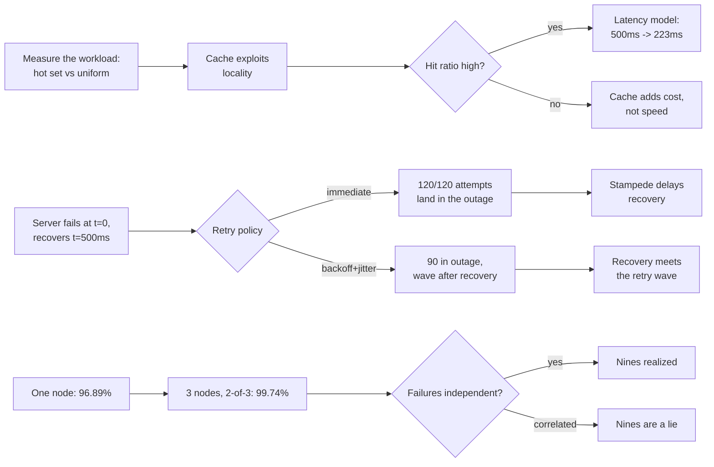

# Scalability and Reliability

## 1. Learning Objectives

By the end of this lesson you will be able to:

- Measure a cache honestly: hit ratio for a hot-set workload versus a uniform one, and the
  average latency each produces under an explicit cost model.
- Explain why immediate retries turn an outage into a stampede, and execute exponential
  backoff with jitter to show attempts landing after recovery instead of during the outage.
- Compute and simulate the availability lift from single-node to 2-of-3 majority redundancy,
  and state the independence assumption it rests on.
- Distinguish scalability (serving more load) from reliability (staying correct while
  things fail) and map each probe to one of the two.
- Recognize that each mechanism here is a trade: cache memory and staleness, retry budget
  and recovery time, redundancy and cost.

## 2. Prerequisites

- Completed ARCH-16 (distributed systems): timeouts and duplicates are the failures these
  mechanisms respond to.
- Java 21+ (`javac -version`); probes are single-file simulations with fixed random seeds,
  so the printed numbers are reproducible on your machine.
- Basic comfort with percentages as probabilities — availability here is a measured fraction
  of simulated time, not a marketing figure.

## 3. Introduction

A system scales when adding load does not require rewriting it, and it stays reliable when
individual parts of it fail without the whole failing. The two properties are usually paid
for with the same three instruments, which this lesson executes one probe at a time:

1. **A cache** — trade memory and staleness for latency (P1: `56.5% hit ratio, avg
   500ms → 223ms` — and then the same cache at `5.2%` on a workload without locality).
2. **Retries with backoff** — trade recovery time for stampede avoidance (P2: same 120
   attempts, `120 → 90` landing during the outage, with attempts continuing past recovery).
3. **Redundancy** — trade machines for uptime (P3: `96.89% → 99.74%` for three nodes with
   a majority rule).

The pattern across all three: each is easy to add, easy to add *wrongly*, and its failure
mode is silent — a cold cache, a retry storm, and a correlated failure all look like "the
system is slow today."

## 4. The Problem It Solves

The problem is that **load and failure are both non-linear**. A cache that works beautifully
in the benchmark collapses on real traffic that lacks locality; a retry that saves one
request, multiplied by 30 clients, buries the recovering server; one extra nine of
availability costs an entire additional machine's worth of redundancy. The measured lines:

```text
LRU(50):   hits = 5650/10000 -> hit ratio = 56.5%, avg latency = 223.2ms
uniform workload on the same LRU(50): hit ratio = 5.2%
naive:    120 requests, all retries sent before t=300ms -> every retry lands while the server is down
backoff:  120 requests, 90 arrived during the outage, later attempts spread past recovery
single node:             96.89%
3 nodes, majority (2/3): 99.74%
```

Each mechanism's benefit is conditional — on workload locality, on timing, on independent
failures — and each condition is checkable with a probe like these.

## 5. Core Concepts

### P1: a cache is only as good as the workload's locality

```text
no cache:  avg latency = 500.0ms (10000 requests x 50ms)
LRU(50):   hits = 5650/10000 -> hit ratio = 56.5%, avg latency = 223.2ms
uniform workload on the same LRU(50): hit ratio = 5.2%
```

Ten thousand requests over a 1000-key space where 20 keys draw 70% of the traffic: a
50-entry LRU covers the hot set and delivers a 56.5% hit ratio, cutting modeled average
latency from 500 ms to 223 ms (hit = 1 ms, miss = 50 ms — a stated model, not a stopwatch).
Then the same cache, the same code, on uniform traffic: 5.2%. Nothing about the cache
changed; the workload's *locality* is the real asset, and the cache merely exploits it.
Measure your workload before quoting a hit ratio.

### P2: immediate retries are a stampede with good manners

```text
naive:    120 requests, all retries sent before t=300ms -> every retry lands while the server is down (recovers at t=500ms)
backoff:  120 requests, 90 arrived during the outage, later attempts spread past recovery
ok   backoff-spreads same 120 attempts, but only 90 land during the outage vs 120 for immediate retries
ok   recovery-reached backoff attempts continue after recovery; the retry budget outlasts the outage
```

Thirty clients, four attempts each, a server that recovers at t=500 ms. The naive policy
spends all 120 attempts before t=300 ms — every single one against a down server — while
exponential backoff (100/200/400 ms with ±25% jitter) puts 90 attempts in the outage window
and sends the last wave after t=500 ms, where it can actually succeed. Two things the
jitter does that plain backoff does not: it prevents the retries from re-synchronizing
into a second stampede at each interval, and it spreads arrivals across the recovery moment.

### P3: redundancy buys nines — if failures are independent

```text
single node:             96.89%
3 nodes, majority (2/3): 99.74%
ok   majority-helps redundancy lifts availability 96.89% -> 99.74%
```

Simulating 100,000 ticks where each node is independently up 97% of the time: one node
serves 96.89% of ticks; a 2-of-3 majority serves 99.74%. The mechanism is combinatorial —
two nodes must be down simultaneously for the cluster to fail, and independent probabilities
multiply. The caveat printed in the probe (`only if failures are independent`) is the whole
engineering problem in one clause: racks, regions, and deploys correlate failures, which is
exactly where real outages come from.

## 6. How It Works



## 7. Practical Examples

### The cache probe's shape

```java
LinkedHashMap<Integer,Boolean> lru = new LinkedHashMap<>(50, 0.75f, false) {
    protected boolean removeEldestEntry(Map.Entry<Integer,Boolean> e) { return size() > 50; }
};
int hits = 0;
for (int k : workload) if (lru.put(k, true) != null) hits++;   // put returns null on insert
```

The `LinkedHashMap` access-order flag is the whole LRU: a five-line cache whose hit ratio
can be measured exactly the way P1 measures it.

### Backoff with jitter

```java
int step = (int) (TIMEOUT * Math.pow(2, r - 1));            // 100, 200, 400
t += (int) (step * (0.75 + rnd.nextDouble() * 0.5));        // ±25% jitter
```

Cumulative waiting with jitter is what separates a retry budget from a retry loop.

### Majority availability

```java
if ((a ? 1 : 0) + (b ? 1 : 0) + (c ? 1 : 0) >= 2) majorityUp++;   // 2 of 3
```

A majority rule is simultaneously the availability mechanism of P3 and the consistency
mechanism of ARCH-16's quorum — the same line of code serving two lessons.

## 8. Real-World Applications

- **CDNs and application caches.** Hot-key behavior is why CDNs work for news and struggle
  for long-tail archives; P1's hot/uniform contrast is the sizing question behind every
  cache deployment.
- **Exponential backoff with jitter** is mandated by major APIs (AWS, Google) precisely to
  prevent P2's synchronized retry storms during incidents.
- **Multi-AZ and multi-region failover.** P3 is the arithmetic behind "three availability
  zones," and the correlated-failure caveat behind every region-wide outage.
- **Auto-scaling.** Scaling out treats capacity as a reliability mechanism; the same
  locality questions decide whether a bigger fleet needs a bigger cache.
- **SLA math.** 99.74% ≈ ~2.2 hours of downtime per year vs 96.89% ≈ ~11 days — the units
  SRE teams actually budget in.

## 9. Common Mistakes

- **Quoting a hit ratio without the workload.** P1's cache is 56.5% or 5.2% depending
  entirely on locality; a benchmark without a representative key distribution proves nothing.
- **Unbounded or synchronized retries.** Immediate retries (or backoff without jitter)
  concentrate load exactly when the system can least absorb it — P2's 120/120 line.
- **Retrying past a deadline.** Attempts that must all fail before the user's timeout just
  consume capacity; the retry budget has to fit inside the caller's budget.
- **Treating redundancy as free nines.** Without independent failures (shared power, shared
  config, one bad deploy), P3's multiplication does not apply and 99.74% becomes 96.89% again.
- **Optimizing the cache's eviction policy before knowing the workload.** LRU vs LFU
  differences are noise next to the hot/uniform gap.
- **Confusing scaling with reliability.** More capacity does not make a correctness bug rarer;
  the two need different mechanisms — this lesson's probes cover both but do not substitute
  for each other.

## 10. Best Practices

- Measure the workload first (hit ratio, key skew, request concurrency), then choose the
  mechanism, then re-measure — P1's structure, twice.
- Always exponential backoff with jitter, always capped by the caller's deadline, always
  with a maximum attempt count.
- Design for independent failures: spread replicas across fault domains and deploy in
  waves, or P3's nines evaporate.
- Put a number on every claim: hit ratio with its workload, availability with its
  simulation window, latency with its cost model stated.
- Load-test the recovery path, not just steady state — the interesting behavior in P2
  happens between t=0 and t=500.
- Treat cache staleness as a product decision: what may a user see that is out of date, and
  for how long?

## 11. Limitations and Trade-Offs

- **The latencies are a model, not a stopwatch.** 1 ms/50 ms are stated constants so the
  arithmetic is auditable; real latency distributions have tails the model does not show.
- **The simulation is single-process.** Real caches contend for memory, real retries contend
  for connections, and real nodes fail together in ways independent random draws cannot.
- **LRU(50) is toy-sized.** The lesson's cache is 50 entries so the probe is readable;
  production sizing changes the constants, not the shape of the locality argument.
- **Backoff trades latency for survival.** A client that waits 400 ms before its last
  attempt serves that user worse — the policy optimizes the system, not the individual request.
- **Redundancy triples cost for ~3 nines.** P3 shows the benefit; the machines, licenses,
  and operational surface are the unmeasured bill.
- **Availability ≠ correctness.** A majority cluster can be up and still serve stale reads
  if reads do not take the quorum path — the guarantee has to be specified per operation.

## 12. Practical Exercises

### Introductory

1. Reproduce P1: confirm `hit ratio = 56.5%` and `avg latency = 223.2ms`, then change the
   hot-set size (20 → 100 keys) and report how the ratio moves.
2. Reproduce P2: confirm `120 → 90` during the outage, then remove the jitter and describe
   what happens to the arrival pattern (run it and see).
3. Reproduce P3: confirm `96.89% → 99.74%` and convert both to hours of downtime per year.

### Intermediate

4. Vary P1's cache size (10, 50, 200, 500) against the hot workload; find the point of
   diminishing returns and explain it from the hot-set size.
5. Extend P2 with a caller deadline of 400 ms: which backoff attempts are actually
   permitted, and how many land after recovery?
6. Make P3's failures correlated (both nodes in a "rack" fail together 50% of the time)
   and show the majority availability drop.

### Independent problem-solving

7. Take a real service's traffic sample (or a plausible synthetic one), size a cache from
   P1's method, and defend the size with the measured hit ratio — including the workload
   statement that makes the number meaningful.
8. Design the retry policy for a dependency with a p99 of 2 s and a caller budget of 5 s:
   attempts, delays, jitter, and what happens to the system-wide load during an incident.
9. Argue that your system does not need more redundancy but better recovery: measure what
   P3's numbers would say about your current topology, and identify which correlated-failure
   mode would invalidate them.

## 13. Knowledge Check

1. Why does the same cache produce 56.5% and 5.2%?
2. What do the jittered backoff's two effects — spread and shape — each prevent?
3. In P3, what exactly does "independent" mean, and name one real-world correlation that
   would break the result?
4. Which probe addresses scalability and which addresses reliability, and is any probe
   about both?
5. What must accompany a claimed hit ratio for it to be meaningful?

<details>
<summary>Answers</summary>

1. Because cache effectiveness comes from locality: the hot-set workload reuses 20 keys
   (70% of traffic) that fit in 50 entries; uniform traffic almost never reuses a key
   before eviction.
2. Spreading prevents retries from re-synchronizing into a second stampede at each interval;
   the exponential shape (the growing delays) prevents the retry wave from being a single
   concentrated burst and lets attempts reach past recovery.
3. One node's failure gives no information about another's; correlated examples: shared rack
   power, one bad deploy rolled out to all three, a shared configuration or dependency.
4. P1 (latency under load) and P2 (surviving an incident) are primarily scalability/traffic
   behavior; P3 is reliability; P2 is arguably both, since retry storms during an outage
   affect capacity.
5. Its workload: key distribution, working-set size, and the cost model (hit/miss latencies)
   it was computed under.

</details>

## 14. Completion Criteria

You have completed this lesson when:

- [ ] P1 reproduces both `56.5%` and `5.2%` and you can predict which way a workload change
      moves them.
- [ ] P2 reproduces `120 → 90` and you can state why the backoff wave reaches past t=500 ms.
- [ ] P3 reproduces `96.89% → 99.74%` and you can name a correlation that invalidates it.
- [ ] You can express both availability figures as downtime per year.
- [ ] Each probe's stated assumptions (cost model, jitter range, independence) are things
      you could restate without looking.
- [ ] The mermaid diagram in Section 6 parses.

## 15. Summary

Three mechanisms, each measured with its condition attached: a cache turns locality into
`56.5%` hits and a 500 → 223 ms latency drop, and collapses to `5.2%` without locality;
jittered exponential backoff keeps 30 of 120 retry attempts out of a 500 ms outage window
and delivers a wave after recovery, where immediate retries waste all 120; and 2-of-3
majority redundancy lifts simulated availability from 96.89% to 99.74% only while failures
stay independent. The lesson in all three: the mechanism is the easy part — the workload,
the timing, and the failure model are the actual engineering, and each deserves its own probe.

## 16. Next Steps

- ARCH-19 `technical-debt.md` — the load-side counterpart on the *code* side: metrics that
  quantify a mess, the bug that escapes an untested design, and an interest curve for
  postponing the fix.
- ARCH-16 `distributed-systems.md` — P2's retries are the mitigation for P3's timeout
  ambiguity; read them together.
- ARCH-17 `microservices.md` — every hop in its fan-out is a latency budget this lesson's
  P2 arithmetic applies to directly.
