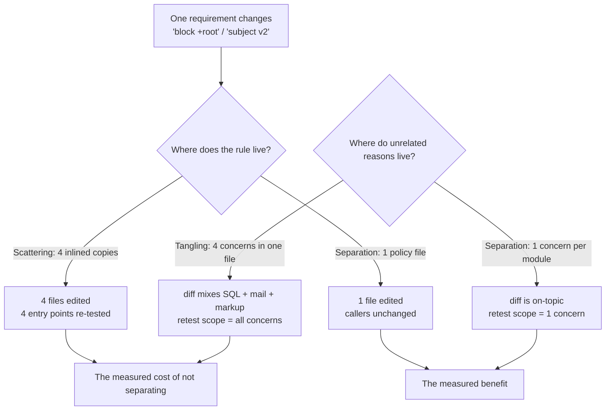

# Separation of Concerns

## 1. Learning Objectives

After this lesson you can:

- [ ] Name a file's concerns by reading it, using two opposites: **tangling** (several
      reasons to change in one file) and **scattering** (one reason spread over many) —
      executed: `OrderPage.java` counts `4 (presentation, persistence, notification,
      pricing)` with imports from three foreign layers
- [ ] Execute the scattering measurement: one validation rule inlined at four entry
      points, then one change request — executed: `files edited: CliSignup.java
      NightlyImport.java SupportTool.java WebSignup.java` versus the same requirement in
      one policy file: `files edited: EmailPolicy.java`
- [ ] State the cost of scattering as retest scope and read it from the count —
      executed: `copies of the validation rule: 4 files, 4 occurrences` vs `1 file(s)`
- [ ] Decide where a *cross-cutting* concern (logging, validation, transactions) belongs
      when every layer needs it but no layer owns it
- [ ] Diagnose a leak: a concern's data or dependency surfacing where it does not belong,
      and name the boundary that should have contained it
- [ ] Apply the two tests for a good boundary — *does a likely change touch one module?*
        and *can I state each module's job in one sentence?*

*Provenance: all transcripts are **executed on the authoring machine** — `soc-probes.sh`
(three probes: duplicated rule across four entry points, the same requirement centralized,
and a tangling count over one file's source text) plus the `P5` responsibility counter
from `solid-probes.sh` (`retest scope: 4 concerns` → `retest scope: 1 concern`).*

## 2. Prerequisites

- [Clean Code](clean-code.md) — function-level readability, the smaller scale of the same
  idea.
- [SOLID Principles](solid-principles.md) — the module-level rules this principle
  generates; read that lesson next, or this one first if you prefer the principle before
  the rules.
- [Layered Architecture](layered-architecture.md) — the concern boundary you have already
  met: presentation, business logic, persistence.
- [04-JAVA-PROGRAMMING](../04-JAVA-PROGRAMMING/README.md) — the probes are Java.

## 3. Introduction

"Separation of concerns" is the oldest sentence in this subject's lineage — Dijkstra's
1974 remark that we identify separately treatable subjects because our minds cannot hold
a whole program at once — and the easiest to nod along with. This lesson makes it
measurable. A concern is *a subject that changes for its own reason*: the tax rule
changes because finance said so; the email wording changes because marketing said so;
neither change should have opinions about the other. Two failure shapes follow, and they
are opposites: **tangling** puts unrelated reasons in one file, so every change reopens
every concern; **scattering** puts one reason in many files, so every change reopens all
of them at once. Both are counted here with executed probes, and the count is the whole
argument.

## 4. The Problem It Solves

The concrete failure is a small change with an outsized blast radius. Probe P1 inlines an
identical validation rule at four entry points — web signup, CLI signup, nightly import,
support tool — because each was written independently and copying was fastest. The rule
then changes once ("`+root` addresses are also blocked"), and the design's opinion shows
up as a file list:

```text
tangled design compiles (4 entry points)
copies of the validation rule: 4 files, 4 occurrences
tangled: after the single-rule change request, files edited: CliSignup.java NightlyImport.java SupportTool.java WebSignup.java
tangled retest scope: every entry point that inlined the rule
```

Four edits for one requirement, and — the part that actually hurts — four entry points to
re-test, each of which can now be broken in a different way. Miss one file and the system
holds two policies at once, which is the characteristic bug of scattered designs: not a
crash but an **inconsistency**. The opposite failure, tangling, is quieter: probe P3 finds
four concerns in one `OrderPage.java`, so a change to the receipt wording drags SQL and
mail into the same diff.

## 5. Core Concepts

### Concern, tangling, scattering

- **Concern** — a subject that changes for its own reason (`validate`, `price`, `persist`,
  `notify`; `presentation`, `persistence`, `notification`, `pricing`).
- **Tangling** — one artifact holds several concerns. Measured by counting reasons to
  change in a file: `reasons to change in OrderPage.java: 4`.
- **Scattering** — one concern lives in several artifacts. Measured by counting copies:
  `4 files, 4 occurrences` of the same rule.

They fail differently. Tangling makes every change to *this* file expensive. Scattering
makes every change to *that concern* expensive — and makes the concern's own invariant
("the rule is applied everywhere") unenforceable, because there is no single place to
state it.

### The two boundary tests

A module boundary is good when both hold:

1. **The change test** — a likely change touches one module. This is the probe's file
   list; `EmailPolicy.java` alone is a pass, four files is a fail.
2. **The sentence test** — you can state the module's job in one sentence without using
   "and". `EmailPolicy`: "decides whether an email address is acceptable." `OrderPage`:
   "renders, queries, emails, and prices" — the conjunction is the smell.

Neither test is sufficient alone: a tiny module can be trivially separable and still be
in the wrong layer (the leak question below).

### Cross-cutting concerns need a third answer

Validation, logging, transactions and authorization are needed *by every layer* but owned
*by none* — after separating, you have moved the problem, not solved it. Three honest
options, in the order teams should consider them:

| Option | Shape | Pay when |
|---|---|---|
| A named policy module | `EmailPolicy` called by each entry point (probe P2) | callers must remember to call it |
| Decorator/interceptor | the framework applies it around every call | the framework's ordering rules become your model |
| Aspect/weaving | the concern is attached at build/runtime | tooling and debugging get harder; the mechanism is invisible |

Probe P2 is option A, and its evidence is the file list: `files edited:
EmailPolicy.java` — one place to state the rule, four callers that pass unchanged inputs.

### Leaks: a concern escaping its boundary

A leak is when one concern's details become another's dependency — SQL in a UI class,
mail types in a pricing module, HTTP status codes inside a domain rule. P3's count detects
one form mechanically: the imports reveal it —

```text
classes imported for foreign concerns: java.sql. java.util. javax.mail.
```

A presentation file importing `java.sql` and `javax.mail` means the file's *reason to
change* now includes the database schema and the mail API's version. That is the
operational definition: **a leak is a new reason to change that belongs to someone else.**

### The relationship to SOLID

SOLID is this principle expressed as five module-level rules: SRP is the no-tangling rule
(one concern per responsibility), OCP and DIP are no-scattering rules about where a rule
lives (in a new file, behind an abstraction), LSP and ISP govern whether the seams
themselves hold. If you remember only the parent idea: **separate so that a change lands
once; invert so that it lands in a new file rather than an edited one.**

## 6. How It Works

Both failure shapes are the same experiment viewed from two sides — apply one change
request, count what it disturbs:



The two counts — files edited for a *known* change, and concerns held by a file you are
about to edit — are the two tests above made executable. Neither needs a benchmark: the
lists are printed by the script.

## 7. Practical Examples

**Example 1 — scattering: four copies, one rule**

The tangled design (probe P1), each entry point carrying its own copy:

```java
public class WebSignup {
    // @concern validate (copy 1 of 4)
    static boolean valid(String email) {
        return email != null && email.contains("@") && email.length() > 5 && !email.startsWith("root");
    }
    String handle(String email) { return valid(email) ? "created(web)" : "rejected(web)" ; }
}
```

The separated design (probe P2):

```java
public class EmailPolicy {
    // @concern validate (single copy)
    static boolean valid(String email) {
        return email != null && email.contains("@") && email.length() > 5 && !email.startsWith("root");
    }
}

public class WebSignup {
    String handle(String email) { return EmailPolicy.valid(email) ? "created(Web)" : "rejected(Web)"; }
}
```

Executed, both designs, the same change request:

```text
separated design compiles (4 entry points, 1 rule)
copies of the validation rule: 1 file(s)
separated: after the same change request, files edited: EmailPolicy.java
separated retest scope: the policy file only (its 4 callers pass the same inputs unchanged)
```

- What matters: the *behavior* is identical — four entry points still validate — and the
  edit count moved from 4 to 1 without changing a single `handle` body.
- **Expected output:** both blocks above, in one run of the script.
- **How to run it:** `bash soc-probes.sh` (creates both designs in a scratch directory,
  compiles them, applies the rule change with `sed`, recompiles, and greps the result).
- **Assumptions:** bash, JDK 25, `sed`/`grep` from the platform.

**Example 2 — tangling: one file, four reasons**

```java
import java.sql.*; import java.util.*; import javax.mail.*;

public class OrderPage {
    // @concern presentation: render the total row
    String render(double total) { return "<td>" + String.format("%.2f", total) + "</td>"; }
    // @concern persistence: load the order
    String load(Connection c, String id) throws Exception { /* ... */ }
    // @concern notification: email the receipt
    void mail(String to, String body) throws Exception { /* ... */ }
    // @concern pricing: tax rate lookup
    double taxFor(String region) { return region.equals("EU") ? 0.07 : 0.0; }
}
```

Executed count (source-text analysis; not compiled — `javax.mail` is not on this
machine's classpath):

```text
reasons to change in OrderPage.java: 4 (presentation, persistence, notification, pricing)
classes imported for foreign concerns: java.sql. java.util. javax.mail.
```

- The four `@concern` markers are the probe's inventory; the imports are corroboration —
  a file that imports three layers' APIs has three layers' reasons to change.
- **How to run it:** the P3 section of the same script.

**Example 3 — retest scope as the operational number**

From the SRP probe (P5 in `solid-probes.sh`), one concern per file versus four in one:

```text
both designs compile
SRP: change landed in monolith (1 file) -> that file holds 4 concerns -> retest scope: 4 concerns
SRP: change landed in split   (1 file) -> that file holds 1 concern(s) -> retest scope: 1 concern
```

- Note that *both* designs compile and *both* changes are one file: separation is not
  measured by the diff's file count but by how much of the system the diff puts in doubt.
- **How to run it:** `bash solid-probes.sh`, section P5.

## 8. Real-World Applications

- **Layered backends**, where the layer boundaries you met in
  [11-BACKEND-ENGINEERING](../11-BACKEND-ENGINEERING/README.md) are exactly this principle
  applied to a whole application: controllers never build SQL, repositories never know
  HTTP status codes.
- **Cross-cutting framework features** — Spring's interceptors, middleware chains, Python
  decorators — are all machinery for applying one concern uniformly *without* scattering
  it: the second table row above, implemented.
- **Money and pricing rules**, where a tax rate duplicated across checkout, invoices and
  reports is a financial risk, not a style issue: probe P1 is that bug.
- **Frontend state**, where a data source copied into five components (scattering) or a
  component doing fetching, styling and validation at once (tangling) both show up as the
  same symptom: a simple change touching twenty files.
- **Incident review**, where "why did this small change break three things?" is almost
  always an answerable question about these counts.

## 9. Common Mistakes

| Mistake | Why it happens | How to recognize it | How to prevent it |
|---|---|---|---|
| Separating too early — one-class-per-method | principle applied before there are two reasons | modules with one function and one caller, navigation cost up | wait for the second reason to change; make the boundary earn its file |
| Separation by *technique* rather than by *reason* | "all classes here, all SQL there" | a change still lands in 3 files, just different ones | apply the change test with a real change request |
| Copying a rule "just for now" | speed, fear of coupling | `grep -r` finds 3+ identical bodies | one policy module (probe P2); duplication is a debt with a named creditor |
| Believing a layer split removed tangling | structure confused with concerns | a "controller" that also prices and mails | count `@concern` markers, not directory names |
| Ignoring cross-cutting concerns | they fit nowhere neatly | validation logic duplicated *after* the split | choose one of the three options deliberately and write it down |
| Confusing an abstraction with a boundary | interface per concern, but no change test | seam exists, change still touches 3 files | run the change test; if the count did not drop, the seam bought nothing |

## 10. Best Practices

- **Name the reason to change before you draw the box.** If you cannot list the reasons,
  you cannot group them — start from the change requests you expect (the probes' "block
  `+root`" is exactly that input).
- **Count copies of any invariant-bearing rule.** A rule asserted in four places will be
  edited in three of them (probe P1's fourth file is the one that usually ships stale).
- **Keep the leak detector as a grep.** `grep -rn "java.sql" src/ui` style checks catch
  boundary violations mechanically; P3's import list is that check in miniature.
- **State each module's job in one sentence, without "and".** The sentence test fails
  cheaply, on paper, in review.
- **Put cross-cutting concerns behind one of the three options** and say which — the
  difference between a policy call and an interceptor is a real design decision, not an
  implementation detail.
- **Re-run the change test after every restructure.** The probes are scripts; the point of
  writing them as scripts is that the claim stays checkable as the design drifts.
- **Accept duplication deliberately when the two copies are expected to diverge** — two
  validation rules that look identical today but belong to different products are not one
  concern. Say so in a comment at both sites so the next reader does not "fix" it.

## 11. Limitations and Trade-Offs

- **Separation adds indirection and files.** Moving the rule to `EmailPolicy` costs a
  hop and a file; for a rule with one entry point, inlining was the right design. The
  count only starts paying at two or more sites — which is why the probes use four.
- **Some changes legitimately cross concerns.** A rename that touches every layer is not
  a failure of separation; the change test is about *domain* requirements, not mechanical
  edits. Judging a boundary by its worst case leads to premature distribution.
- **Concerns are not objectively given.** Whether "receipt email formatting" is part of
  notification or part of pricing is a judgement made by whoever draws the boundary; two
  competent teams produce different boxes for the same system.
- **The counts are shallow.** `4 concerns` from `grep -c` cannot see that two markers are
  the same concern, or that a concern is split across two files. It is a smoke detector
  for the pattern in this lesson, not a general design metric.
- **Over-separation has a name and a cost**: shotgun navigation, where reading one flow
  means opening eight files. The sentence test applied *in reverse* (do these modules
  always change together?) keeps that in check.
- **Nothing here establishes correctness.** Separation makes a change land once; it says
  nothing about whether the change is right. That is still a test's job.

## 12. Practical Exercises

### Introductory

1. **Exercise 9.1** — Run `soc-probes.sh` and, from its output only, fill in: the change
   request, the files edited in each design, and the retest scope of each.
   **Completion criteria:** a two-row table whose every cell is a string that appears in
   the transcript, plus the command you used to reproduce it.
2. **Exercise 9.2** — Take a file you have written and count its `@concern` markers using
   probe P3's method (comment each distinct reason to change).
   **Completion criteria:** the count, the list of reasons, and the sentence you would use
   to describe that file — noting whether it contains "and".

### Intermediate

3. **Exercise 9.3** — Take one scattered rule you can find in this repository (search for
   a duplicated expression) and centralize it as probe P2 does.
   **Completion criteria:** before/after `grep -r` counts of the duplicated text, proof
   that every caller still passes its original test, and the single file the change now
   lands in.
4. **Exercise 9.4** — For each of the three cross-cutting options in the table, write the
   same validation rule (add the `+root` rule) as a policy call, a decorator, and an
   interceptor of your choosing.
   **Completion criteria:** all three execute the same rule for all four entry points, and
   you can state one concrete cost each option imposes (forget-to-call, ordering
   dependence, tooling opacity).

### Independent problem-solving

5. **Exercise 9.5** — You are handed a 3000-line module that reports four change reasons
   and is imported by the whole system. Design the investigation that decides whether to
   split it: what do you measure, in what order, what result says "split", and what result
   says "leave it"?
   **Completion criteria:** a written plan with thresholds fixed *before* looking at the
   data (for example: split only if at least two of the four reasons have distinct change
   histories and each would touch under 200 lines), plus one executed step of it — the
   actual count and history sample for the module you chose.

*Solutions: attempt first. They live in `solutions/` of this subject.*

## 13. Knowledge Check

1. Probe P1 printed four edited files and probe P2 printed one. Which design has *more*
   code? What does that tell you about using line count as a quality metric? … *P2 has
   one extra file and a call at each site; totals are close. The difference the probes
   care about is a change's blast radius, which line count does not measure — a smaller
   design can still scatter a rule.*
2. "We separated the layers, so the concern is separated." When is this false? … *When a
   change still lands in several layers because the concern was duplicated inside each
   one. Directories are structure; the counts (`4 files, 4 occurrences`) are the
   evidence.*
3. When would you deliberately keep two identical-looking copies of a rule? … *When they
   belong to different concerns and are expected to diverge — different products,
   different regulation. The test is whether one change request should move both; if not,
   unifying them creates the coupling you were avoiding.*
4. Why can't `grep -c '@concern'` decide a boundary for you? … *It counts markers, not
   meaning: it cannot tell whether two markers change together (one concern split in two)
   or independently (two concerns). It detects the pattern; the change test decides.*

## 14. Completion Criteria

Observable evidence that you have understood this lesson:

- [ ] You ran `soc-probes.sh` and can point to both file lists in its output
- [ ] You can define tangling and scattering with their opposites and give an example of
      each from executed output
- [ ] You can read a file's import list and say what new reasons to change it admits
- [ ] You can name the three options for a cross-cutting concern and the cost of each
- [ ] You can apply both boundary tests to a module you own and report the numbers

## 15. Summary

- A concern is a reason to change; separation is the claim that a change lands once.
- Scattering is measured by copies (`4 files, 4 occurrences` → four edits, four retests);
  tangling by reasons in one file (`reasons to change … 4`).
- Cross-cutting concerns need an explicit third answer: policy module, interceptor, or
  weave — chosen, not stumbled into.
- A leak is a borrowed reason to change; the import list detects it mechanically.
- The two boundary tests — change lands in one module, job stated in one sentence — are
  cheap enough to run in review.

## 16. Next Steps

- Next lesson: [Design Patterns](design-patterns.md) — the named, reusable shapes that
  separate specific pairs of concerns, each with the smell that calls for it.
- Practice: [exercise set](exercises/README.md).
- Where it is applied: [Project 07 — Architecture Decision Record](../20-PROJECT-LABORATORY/README.md),
  where a boundary claim must arrive with the file counts that support it.
