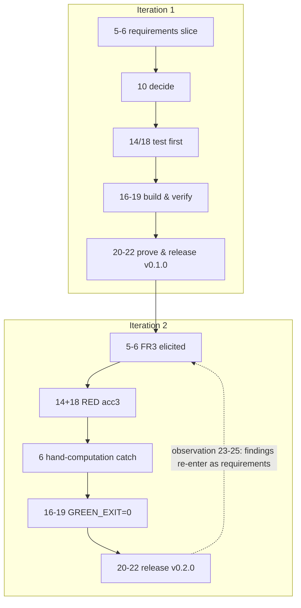

# Software Development Life Cycle

## 1. Learning Objectives

After this lesson you can:

- [ ] Compare the major life-cycle models — waterfall, iterative/incremental, spiral,
      agile (Scrum/XP), lean, continuous — by *where they place feedback and who may
      trigger it*, not by their marketing
- [ ] Read a real project's life cycle off its history — executed: the OrderDesk repo's
      14 commits and 2 release tags (`v0.1.0`, `v0.2.0`), iteration 2 running the whole
      cycle compressed into five commits
- [ ] Map the 26 stages of [the complete development process](the-complete-development-process.md)
      onto one iteration and say which stages compress and which never do
- [ ] Choose a cadence and defend it: what fits in an iteration, what a release means,
      and what "done" is measured against
- [ ] Explain why tooling cannot skip a stage — executed: `git commit` happily created
      two commits while the harness was still failing; only explicit verification caught
      it, which is the entire argument for mechanizing stage 18 in CI
- [ ] Diagnose a process from its evidence: ceremony with no artifact, releases without
      tests, iterations that never release

## 2. Prerequisites

- [The Complete Development Process](the-complete-development-process.md) — the 26
  stages this lesson schedules.
- [Developer Tools](../03-DEVELOPER-TOOLS/terminal-fundamentals.md) — the executed trace
  is `git log` and `git tag`.

*Provenance: all transcripts below are **executed on the authoring machine** — the same
`orderdesk` mini-repo as the previous lesson (Java 25, `git`), extended through a real
second iteration with two releases. One capture in this lesson is a **failure of process,
kept in**: the false-green commits of iteration 2, because it teaches more than a clean
run would.*

## 3. Introduction

The 26 stages answer *what must happen*. The life cycle answers a different question:
**when, how often, in what order, and triggered by whom** — for a team, over months. A
life-cycle model is not a religion (waterfall vs agile is a tired fight); it is a
schedule for feedback. Every model in this lesson can be described by three answers:
How long is one cycle? What is the evidence that closes it? Who may start the next one?

## 4. The Problem It Solves

Without a cycle, a project has two failure modes. **The long dark:** eighteen months of
building with feedback only at the end — you ship wrong and discover it as revenue loss.
**The shapeless churn:** constant activity with no closing criterion — you ship often but
cannot say whether anything is finished, tested, or safe. The life cycle exists so that
feedback arrives *predictably*, every cycle ends with *evidence*, and the next cycle starts
from *something real* rather than from optimism.

## 5. Core Concepts

### The models, described by feedback

| Model | Cycle length | Feedback trigger | Where it fails |
|---|---|---|---|
| Waterfall | once, whole project | end of project | first contact with reality is expensive |
| Iterative/incremental | weeks, per increment | end of each increment | needs discipline to *not* skip increments |
| Spiral | per risk analysis | each risk iteration | heavy; needs real risk skills |
| Scrum | sprint, fixed | sprint review | ceremonies without artifacts become theater |
| XP | release + iteration | continuous (CI, pairing) | assumes continuous testing is always on |
| Lean | as needed | from observable flow | demands you can actually *see* the flow |

The axis that matters: **how long can you be wrong before something tells you.**
Waterfall: months. Scrum: two weeks. XP with CI: minutes. The models differ less in
*bureaucracy* than in this number.

### One iteration = the whole 26 stages, compressed

An iteration is not "some coding" — it is a **full pass** of the process at reduced
volume: elicitation (5) for the increment's slice, validation (6) of its criteria, a
design decision or two (10–12), a test written first (14/18), code-review-verify (16–19),
a budget check (20), acceptance (21), release (22). Stages 23–26 run *across* iterations
(observation is continuous) but their findings re-enter the next iteration's stage 5.

### Cadence, releases, and "done"

- **Iteration** = a feedback period with a closing criterion (evidence, not date alone).
- **Release** = a version others can run (`git tag v0.1.0` — one line, permanent meaning).
- **Done** = artifact exists and its check passes. A cycle that ends with "mostly
  finished" has not ended; it has paused.

### Mechanizing the gate: why CI exists

The executed failure below is the argument: a human (or a shell) that forgets to run the
tests will commit broken states, and `git` will not object. A CI pipeline *is* stage 18
made unavoidable — every push gets the red/green answer, and the release step (22) is
gated on it. The model changes no stage; it changes who remembers.

## 6. How It Works



**Executed iteration 2** — the whole cycle in five commits:

```
de2162e iteration 2 stage 5-6: FR3 elicited, ACC3 hand-computed (… 19.27 rounded)
02b99bd iteration 2 stage 14+18: ACC3 test RED (percent discount not implemented)
2599d3e iteration 2 stage 6: hand computation caught drafter error (19.27 -> 19.26; 18.00 x 1.07 is exact)
33594d0 iteration 2 stage 16-19: FR3 implemented, ACC3 + regression + NFR1 green (GREEN_EXIT=0)
f023c2d iteration 2 stage 20-22: v0.2.0 released
```

```
$ git tag
v0.1.0
v0.2.0
```

Read the red capture inside it:

```
Exception in thread "main" java.lang.AssertionError: acc3: got 21.4 want 19.27
RED_EXIT=1
```

— a test written *before* the feature, failing for exactly the right reason (feature
absent), then corrected by the stage-6 hand computation (the drafted ACC3 was wrong;
18.00 × 1.07 = 19.26 exactly), then green:

```
ok acc3-percent-discount = 19.26
ALL PASS
ok acc-eu-2lines = 21.4
ok unknown-region-no-tax = 5.0
NFR1 PASS            (683us < 50000us)
GREEN_EXIT=0
```

## 7. Practical Examples

**Example 1 — the executed cycle, and the failure kept in**

During iteration 2, two commits were created *while the harness was still red* — once
because a `sed` patched the assertion's message but not its comparison (`got 19.26 want
19.26` — the number compared was still `19.27`), so `GREEN_EXIT=1` yet the commit claiming
green went in anyway. `git commit` does not run your tests. The fix in the moment:
`git reset --hard` the false commits, verify `GREEN_EXIT=0` *first*, then commit.

- **What the incident teaches:** the life cycle's stage-18 gate must be mechanical. A
  process that depends on a human remembering to check an exit code has the failure rate
  of humans remembering things.
- **How to run it yourself:** make your CI fail once on a red test you try to push; feel
  how the gate changes behavior.

**Example 2 — ceremony vs evidence, from the same repo**

Each commit message above names its stages — that is the process *auditable*. Compare a
team whose sprint board says "done" with no green run attached: same claim, no evidence.
The executable difference between the two life cycles is one command: does the closing
artifact exist (`git log` here, a CI run URL in a real team)?

**Example 3 — choosing cadence from risk**

OrderDesk's iteration took minutes because a defect costs one mispriced order; a payments
ledger's iteration takes days because stage 20's review (fraud, reconciliation) is the
expensive part. Cadence follows *the cost of being wrong per cycle*, not fashion — a
one-week sprint for a payment change is not "fast," it is under-reviewed.

## 8. Real-World Applications

Professional cadences are this pattern with names: a sprint *review* is stage 21's
audience, a *release train* is stage 22's schedule, `main`-branch CI is stage 18's
mechanization, a *definition of done* is stage 14's test strategy written per-increment,
and the retrospective is stage 25 aimed at the process itself. Teams get in trouble when
the ceremony survives but the evidence doesn't — the same failure the register of this
repo guards against (every checked entry names its executed evidence).

## 9. Common Mistakes

| Mistake | Why it happens | How to recognize it | How to prevent it |
|---|---|---|---|
| Iteration = timebox only | calendar discipline substituted for outcome | sprint ends, demo has nothing working | closing criterion = evidence, date is a limit |
| "Done" without green | commit tooling doesn't enforce it | broken code on main | CI gate on stage 18, release gated on CI |
| Releasing only at the end | fear of shipping | 14 months, one tag | a tag per increment, even internal |
| Skipping stage 6 in the hurry | requirements feel done | contradictions found in prod | hand-compute every ACC once |
| Retros without changes | theater | same complaint three retros running | one process change per retro, tracked |
| Model shopping | blame-shifting | reorg every year, same failures | fix the feedback latency, not the labels |

## 10. Best Practices

- **Define the closing evidence before starting the iteration.** If you can't name what
  will prove the cycle closed, you've named a meeting, not an iteration.
- **Gate releases mechanically.** `git tag` after green, enforced by CI — never by
  memory. The executed false-green incident is the case study.
- **Keep the cycle's compression honest:** compressed stages still produce *some*
  artifact (a paragraph-ADR, a one-line ACC). A stage with zero artifact is skipped, not
  compressed.
- **Measure feedback latency** as your process's primary metric: how long from defect
  introduction to its discovery. Every model in section 5 can be ranked by this number
  alone.
- **Change one thing per cycle** when improving the process — otherwise you cannot tell
  which change worked. *Stops applying during a genuine crisis,* when the change is
  imposed by the incident and evaluated at its postmortem.

## 11. Limitations and Trade-Offs

- **Models describe scheduling, not quality.** A daily iteration on a product with no
  tests delivers wrong things fast; the 26 stages' *effects* are independent of cadence.
- **Short cycles have setup costs** — automation, environments, review bandwidth —
  which is why the first improvement is always stage-18 mechanization, not more sprints.
- **Some work doesn't fit increments** (a migration, a research spike); it runs one long
  iteration with internal checkpoints — the model bends, the closing-evidence rule does not.
- **The executed example is solo.** Two of the model's hardest parts — review (17) and
  acceptance (21) — are *social*, and this trace has no second human; that gap is real and
  the exercises make you supply it.
- **Tags are not deployment.** `v0.2.0` proves a releasable artifact existed, not that it
  reached users; subjects 16–17 own that half.

## 12. Practical Exercises

### Introductory

1. **Exercise 3.1** — read the 14-commit trace and label every commit with its phase
   (I–V) and iteration number; then state the cycle boundary evidence for each of the two
   iterations.
   **Completion criteria:** the labeled table plus the two closing artifacts (the v0.1.0
   and v0.2.0 tags with their CHANGELOG lines).
2. **Exercise 3.2** — reproduce iteration 2 on your own code: a new criterion written and
   hand-checked, a test that goes red *before* the feature, then green, then a tag.
   **Completion criteria:** five captures matching the lesson's pattern (REQ commit,
   RED with exit 1, correction if your arithmetic needed one, GREEN with exit 0, tag).

### Intermediate

3. **Exercise 3.3** — reproduce the false-green failure deliberately: run `git commit`
   while your tests fail, watch it succeed, then make the case (one paragraph) for why
   the gate must be mechanical — and wire a pre-commit or CI check that prevents it.
   **Completion criteria:** the false commit's hash, the same push blocked by your gate,
   and the gate's config file.
4. **Exercise 3.4** — for a team you know (or one you imagine), choose a model and
   cadence by *feedback latency*: state the defect-introduction-to-discovery time under
   the current process and under your proposal, with the mechanism that produces each.
   **Completion criteria:** two numbers, the mechanism for each, and the single change
   that would most reduce the gap.

### Independent problem-solving

5. **Exercise 3.5** — design the life cycle for a two-person team shipping a mobile app
   monthly for a year: cycle length, closing evidence per cycle, release policy, what
   stage 23–25 looks like continuously, and how an incident re-enters the cycle. Then run
   one month for real on a personal project.
   **Completion criteria:** the written design plus one executed cycle with its evidence
   chain intact — requirements slice, red/green, gate config, tag — and a retrospective
   note naming exactly one process change for next month.

*Solutions: attempt first. They live in `solutions/` of this subject.*

## 13. Knowledge Check

1. Two teams both "do two-week sprints." One ends each with a tested increment, the
   other with a demo of partial work. Which *stage* differs, and what evidence would you
   demand to tell them apart from outside?
2. The executed trace shows `git commit` accepting a red state twice. Explain why this
   is a property of the tool, not the person, and what single structural change removes
   the failure mode entirely.
3. A regulated medical-device team must run waterfall. Using the feedback-latency axis,
   name two things they can still shorten without violating their required gates.

## 14. Completion Criteria

Observable evidence that you have understood this lesson:

- [ ] You can describe each life-cycle model by cycle length, closing evidence, and
      feedback trigger — without invoking "agile vs waterfall"
- [ ] You have executed one full compressed cycle (criteria → red → green → tag) on
      your own code
- [ ] You have reproduced the false-green incident and gated against it mechanically
- [ ] You can audit a real team's process and name, per section 9, which evidence is
      missing

## 15. Summary

- A life cycle is a schedule for feedback; rank models by how long you can be wrong.
- One iteration = all 26 stages at reduced volume, closing with evidence, not a date.
- Executed: iteration 2 ran the full cycle in five commits, two releases, two tags —
  and one kept-in failure proving gates must be mechanical.
- CI is stage 18 made unavoidable; release is gated on it, never on memory.
- Ceremony without artifact is theater; the audit trail (`git log`) is the real record.

## 16. Next Steps

- Next lesson: [Requirements Engineering](requirements-engineering.md) — stage 5–6 in
  depth: where the cycle's inputs actually come from.
- Practice: [exercise sets](exercises/README.md) for this subject.
- Where it is applied: [Project 07](../20-PROJECT-LABORATORY/README.md) — its
  milestones are iterations; this lesson defines their closing evidence.
