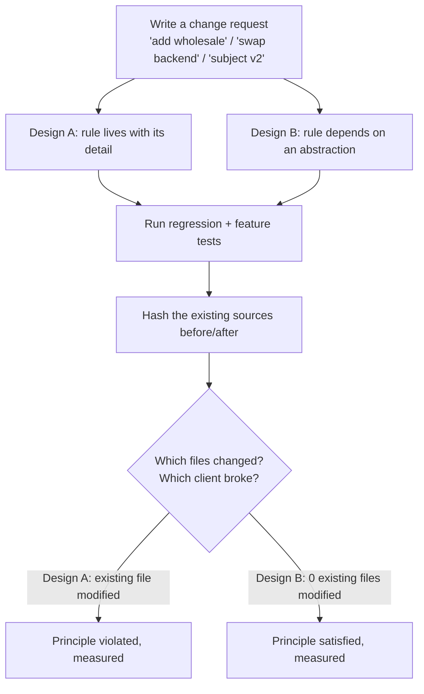

# SOLID Principles

## 1. Learning Objectives

After this lesson you can:

- [ ] State each of the five principles as a **change-landing question** rather than an
      acronym, and answer it for a module in front of you
- [ ] Execute the open/closed comparison: same change request ("add wholesale pricing"),
      two designs — executed: the switch design **modified** `Calculator.java`
      (`OCP-A: MODIFIED existing file -> Calculator.java`), the strategy design added
      only `WholesalePricing.java FeatureWholesaleB.java` (`OCP-B: 0 existing files
      modified`) with both regression suites still green
- [ ] Execute the dependency-inversion comparison — executed: the concrete-dependency
      design broke its own client when the backend was swapped inside the class
      (`DIP-A second-run exit=1 … out.log missing`) while the inverted design kept
      `ServiceB.java` hash-identical (`ServiceB.java hash unchanged`)
- [ ] Demonstrate a Liskov substitution violation with *identical client code* —
      executed: `same client code -> Rectangle: 50.0 units2 billed, Square: 100.0 units2
      billed`
- [ ] Show why a fat interface forces unimplemented methods and who a contract change
      then breaks — executed: `UnsupportedOperationException: not supported` from the
      renderer-only class, and the blast-radius comparison
- [ ] Measure single-responsibility cost as **retest scope** — executed: one concern per
      file vs four (`retest scope: 4 concerns` → `retest scope: 1 concern`)

*Provenance: all transcripts are **executed on the authoring machine** —
`solid-probes.sh` (Java 25, sha256 file-diff evidence for OCP/DIP, `grep`-counted concern
inventory for SRP) and `Sondes.java` (LSP and ISP). Each probe states its own change
request and prints which files changed.*

## 2. Prerequisites

- [Clean Code](clean-code.md) — the function-level version of the same question, and the
  behavior-preservation rule these probes rely on.
- [Separation of Concerns](separation-of-concerns.md) — the parent idea; SOLID is its
  module-level refinement (read it next if you want the principle before the five rules).
- [04-JAVA-PROGRAMMING](../04-JAVA-PROGRAMMING/README.md) — the probes are Java; the
  principles are language-independent.

## 3. Introduction

SOLID is usually delivered as five nouns on a slide: Single responsibility, Open/closed,
Liskov, Interface segregation, Dependency inversion. Nouns do not survive contact with a
code review, so this lesson restates each one as the **question an experienced reviewer
actually asks**: *when this requirement changes, which files do I have to edit, and which
tests do I have to re-run?* That question is measurable. Each probe below writes the same
kind of change request into two differently-shaped designs and then prints, from `sha256`
hashes and test runs, where the change landed. Nothing here is argued from taste: the
principle earns its keep exactly when the number in the output gets smaller.

## 4. The Problem It Solves

The problem is **change amplification**: a one-line requirement becoming a five-file edit
with a five-file regression risk. Before anyone names the principles, teams discover them
the hard way — a pricing rule added to a `switch` in `Calculator.java` means every
reviewer of that file must now re-verify retail and enterprise too, because they share a
file with the new case. The probe measures precisely that: not "switches are bad" (the
switch design passed both its regression and its feature test) but *"the change landed in
an existing file"*, which is a fact about review and regression scope, not about style.
The same shape of failure shows up in the DIP probe as a broken client (`out.log missing`)
and in the LSP probe as a total (`100.0`) nobody expected from code they had already
tested with rectangles.

## 5. Core Concepts

### The five, each as a measurable claim

| Principle | The reviewer's question | The probe's printed evidence |
|---|---|---|
| **S**ingle responsibility | how many concerns live in this file? retest scope = file's concern count | `4 concerns` → `1 concern` |
| **O**pen/closed | does the change land in an existing file or a new one? | `MODIFIED … Calculator.java` vs `0 existing files modified` |
| **L**iskov substitution | can a subtype go where the supertype went, with the same client code? | `Rectangle: 50.0` vs `Square: 100.0` |
| **I**nterface segregation | does an implementor carry methods it never uses? | `UnsupportedOperationException: not supported`; `Console untouched` |
| **D**ependency inversion | does editing a low-level detail require editing the high-level rule? | `MODIFIED … ServiceA.java` vs `ServiceB.java hash unchanged` |

### OCP: the counter is the point, not the claim that adding features is free

Probe P1 builds a `Calculator.price(base, type)` with a `switch`, runs the regression
(`regression A PASS (retail, enterprise unchanged)`), then applies the change request —
add wholesale — and re-runs everything:

```text
feature A PASS (wholesale=80)
OCP-A: MODIFIED existing file -> Calculator.java
```

Probe P2 builds the same behavior as a `Pricing` strategy parameter, hashes the existing
sources, applies *the same change request*, and hashes again:

```text
regression B PASS (retail, enterprise unchanged)
feature B PASS (wholesale=80), existing sources untouched
OCP-B: 0 existing files modified; new files: WholesalePricing.java FeatureWholesaleB.java
```

Both designs pass. The difference is only what a reviewer must re-read: in A, the diff
touches the code that computes retail and enterprise, so *those* come back into scope; in
B, the diff is additive and the hashed files prove nothing existing moved. "Closed for
modification" is therefore not a ban on editing — it is a claim about **who is
disturbed** by your change.

### DIP: the client is the casualty, and the hash proves it

Probe P3 has `ServiceA` construct its own `FileBackend`-style behavior. The change
request ("add a console backend") is applied by editing `ServiceA` itself:

```text
DIP-A test PASS (file backend)
DIP-A test FAIL after edit: out.log missing - backend switched inside the class
DIP-A second-run exit=1 (existing client broke: backend swapped in place)
DIP-A: MODIFIED existing file -> ServiceA.java (the high-level rule was edited to swap a low-level detail)
```

The pre-existing test exits 1 — the low-level detail was swapped *behind the client's
back*. Probe P4 injects a `Logger` interface instead:

```text
DIP-B test PASS (file backend injected)
LOG order-2
DIP-B test PASS (console backend injected, same service)
DIP-B: 0 existing files modified; new files: ConsoleLogger.java TestB2.java (ServiceB.java hash unchanged)
```

Same feature, same tests, zero edits to the high-level rule. DIP is not "always use
interfaces"; it is the observation that a high-level policy should not be recompiled —
and re-reviewed — because a wire format changed.

### LSP: a subtype that quietly narrows the contract

`Square extends Rectangle`, and its setters now move *both* dimensions. The client is
written only against `Rectangle`:

```java
static String resizeThenBill(Rectangle r) {
    r.setWidth(5);
    r.setHeight(10);
    return r.area() + " units2 billed";
}
```

Executed output:

```text
ok   lsp-subtype-breaks-supertype-client same client code -> Rectangle: 50.0 units2 billed, Square: 100.0 units2 billed
ok   lsp-nonfunctional-subtype-fails-superclient bill() over 12.0 / 16.0 / BrokenShape threw java.lang.UnsupportedOperationException: not implemented
```

Neither subclass is *wrong in isolation*: `Square` is a perfectly good square and
`BrokenShape` (which throws from `area()`) passes any test written about `BrokenShape`
alone. They are wrong **as subtypes**, because code written for the supertype gets a
different outcome. LSP is the requirement that a subtype preserve what the supertype
promises — including "this operation always produces a value".

### ISP: the fat interface makes you write code you will never call

```text
ok   isp-fat-forces-dead-implementation renderer-only implementation called through Report -> UnsupportedOperationException: not supported
ok   isp-narrow-accepts-minimal-implementation Console implements 1 of 3 contracts and satisfies every Renderable caller: report: 42
ok   isp-narrow-limits-blast-radius archival contract changes -> fat design: ConsoleOnly recompiles (it carries the method) | narrow design: Console untouched (it does not implement Archivable)
```

`ConsoleOnly` compiles, so the compiler is no help: the dead methods are a *runtime*
surprise for whoever calls `emailTo`. Splitting into `Renderable` / `Emailable` /
`Archivable` removes the temptation and shrinks the blast radius of the next contract
change to the classes that actually implement it.

### S: retest scope as the responsibility counter

Probe P5 writes one file holding four concerns (`@concern validate, price, persist,
notify`) and a split design with one concern per file, then applies the same request —
"the receipt subject becomes v2" — and counts concerns in the file that changed:

```text
both designs compile
SRP: change landed in monolith (1 file) -> that file holds 4 concerns -> retest scope: 4 concerns
SRP: change landed in split   (1 file) -> that file holds 1 concern(s) -> retest scope: 1 concern
```

Note the honesty of line 1: **both designs compile and both edits are one file.** The
monolith is not broken; it is *noisier to verify*, because touching that file means every
concern inside it re-enters the test set. "One reason to change" is best read as "one
thing to re-test".

## 6. How It Works

All five probes share one experimental shape — a controlled comparison against a change
request:



The hash step is what makes this more than an assertion: `sha256sum` before and after
the change request, `cmp` on the two lists, and the printed file names come from the diff
of those lists. A claim of "we didn't touch anything existing" is checkable by anyone who
re-runs the script.

## 7. Practical Examples

**Example 1 — OCP as a runnable A/B**

Strategy design (probe P2), the whole surface a change request needs to touch:

```java
public interface Pricing { double price(double base); }
public class RetailPricing implements Pricing { public double price(double b) { return b; } }
public class EnterprisePricing implements Pricing { public double price(double b) { return b * 0.9; } }
public class CalculatorB {
    public static double price(double base, Pricing policy) { return policy.price(base); }
}
```

The change request, satisfied without editing any of the above:

```java
public class WholesalePricing implements Pricing { public double price(double b) { return b * 0.8; } }
```

- What matters: `RegressionB` (retail + enterprise) re-ran **unchanged** and still passed,
  and its file hash is in both the before and after lists — proof it was not edited.
- **Expected output:** the `OCP-B: 0 existing files modified; new files: …` line above.
- **How to run it:** `bash solid-probes.sh` (the script recreates both designs in a
  scratch directory, so the transcript is reproducible end to end).
- **Assumptions:** bash, JDK 25, `sha256sum`/`cmp`/`diff` from coreutils.

**Example 2 — DIP: the injection point is the design**

```java
public interface Logger { void log(String msg); }

public class ServiceB {
    private final Logger logger;
    public ServiceB(Logger logger) { this.logger = logger; }
    public void handle(String msg) { logger.log(msg); }
}
```

- The constructor *is* the architecture decision: it says this class does not know where
  messages go, and that knowledge arrives per instance.
- The probe's `TestB` (file backend) and `TestB2` (console backend) run against the
  **same** `ServiceB.class` — hence `ServiceB.java hash unchanged`.
- **Expected output:** `DIP-B test PASS (file backend injected)` and
  `DIP-B test PASS (console backend injected, same service)`.
- **How to run it:** same script; P3 and P4 are adjacent so the two outcomes can be read
  side by side.

**Example 3 — ISP: the compile-legal lie**

```java
interface Report { String render(); void emailTo(String to); void archiveTo(String path); }

class ConsoleOnly implements Report {
    public String render() { return "report: 42"; }
    public void emailTo(String to) { throw new UnsupportedOperationException("not supported"); }
    public void archiveTo(String path) { throw new UnsupportedOperationException("not supported"); }
}
```

- The two throwing methods are **required by the compiler** and **wrong for this class**
  — the interface asked for a promise this class cannot keep, and the compiler's only
  available answer was a lie.
- **Expected output:** `UnsupportedOperationException: not supported`.
- Narrow alternative: `Console implements Renderable` alone — output `report: 42`.

## 8. Real-World Applications

- **Pricing, permissions, and validation rules**, where new rules arrive monthly; the
  OCP comparison is the argument you bring when someone proposes adding case 9 to a
  200-line `switch`.
- **Storage and messaging backends** (file vs S3 vs Postgres), where DIP's injection
  point lets tests run without the real dependency — the exact structure of every
  repository/service seam you met in [11-BACKEND-ENGINEERING](../11-BACKEND-ENGINEERING/README.md).
- **Plugin and strategy architectures**: `Pricing` above is a plugin surface; the probe
  shows what a plugin buys (additive changes) and what it costs (an indirection per call).
- **API client libraries**, where ISP shows up as "don't make every implementor provide
  streaming, batching and retries because the spec mentions them".
- **Refactoring reviews**, where `retest scope` gives a defensible answer to "can we ship
  this without re-testing everything?" — 1 concern or 4.

## 9. Common Mistakes

| Mistake | Why it happens | How to recognize it | How to prevent it |
|---|---|---|---|
| Quoting the acronym without the change request | principles learned from slides | no one can say *which* requirement would break | every principle review names the change scenario first |
| OCP as "never edit a file" | the rule taken literally | fear of touching any existing file | compare *blast radius*, as the hash diff does — additive edits are allowed |
| Interface per method | ISP over-applied | 1-method interfaces with 1 implementor, indirection everywhere | group by the clients that change together, split only when a fat one forces dead code |
| DIP without a real second implementation | speculative abstraction | `FooImpl`/`FooImpl2` where Impl2 is dead test scaffolding | invert when a probe shows the swap cost (P3's broken client) |
| LSP checked by the subtype's own tests | violations only appear in supertype clients | subtype green, integration red | run the *supertype's* client suite against every subtype |
| SRP read as "one method per class" | the noun "responsibility" mis-scoped | 40 tiny classes, no coherent module | count concerns that *change for the same reason*, not methods |
| Applying all five in a greenfield rewrite | enthusiasm | abstraction with no observed change pressure | let a real change request (like P1's) justify each seam |

## 10. Best Practices

- **Start from the change request.** Write down the requirement you actually expect
  ("we will add regions", "we will swap the queue") and ask where it lands *before*
  choosing structure.
- **Use the counter as a review artifact.** `MODIFIED existing file` vs `0 existing
  files modified` is a line a reviewer can verify in the diff.
- **Prove substitution with the supertype's own tests**, not the subtype's — the `resizeThenBill`
  client is the whole test.
- **Split interfaces at the seam where implementations differ.** `Renderable`, `Emailable`
  and `Archivable` exist because `Console` genuinely does not email; if every
  implementor implemented all three for real, the split would have bought nothing.
- **Invert dependencies at the point a probe breaks** — P3's failing client is the
  signal, not aesthetic preference for constructor injection.
- **Keep responsibilities aligned with test suites**: one concern per file means one
  file per test group, which is what makes `retest scope: 1` operational.
- **Re-run the probes when the design changes.** They are scripts, not prose; a claim
  that has stopped being true will print a new answer.

## 11. Limitations and Trade-Offs

- **Indirection has a cost.** The strategy design needs one more file and one more hop
  per call; for a `switch` with two cases that will never grow, the switch is the better
  design. The principle tells you what a change will cost, not what to build.
- **Hashes prove no file changed; they do not prove behavior.** The regression suites do
  that part. Both are needed — a design can leave files untouched and still be wrong.
- **The probes are deliberately small.** Real codebases have mixed signals: a file can
  hold a coherent module-level responsibility while containing several functions that
  each do two things. Scale the question, don't assume the answer transfers unchanged.
- **LSP gets harder with mutable state.** The rectangle/square case is the classic for a
  reason: value types are easier to substitute than stateful objects with setter
  contracts. With immutable inputs the violation class shrinks dramatically.
- **ISP can over-fragment.** Splitting until each interface has one method and one
  implementor produces the "interface per method" smell in the table above; the unit is
  *the group of methods that change together*.
- **None of the five is a security or correctness guarantee.** They organize change;
  tests, types and reviews establish correctness.

## 12. Practical Exercises

### Introductory

1. **Exercise 8.1** — Run `solid-probes.sh` and, from its output only, write the change
   request each probe received and which files each design touched.
   **Completion criteria:** a table with five rows (P1–P5) naming the change request, the
   modified files, and the test outcome — no prose interpretation.
2. **Exercise 8.2** — Reproduce the LSP violation yourself: write `resizeThenBill` from
   Example 3's client against `Rectangle`, then run it with `Square`.
   **Completion criteria:** both printed totals (`50.0` and `100.0`) appear, and you can
   state which postcondition of `Rectangle` the subtype failed to preserve.

### Intermediate

3. **Exercise 8.3** — Take the OCP-A switch design and add a third region (`"CA" -> 0.05`).
   Then do it in OCP-B.
   **Completion criteria:** for each, the list of modified files and the number of
   *unrelated* tests that now re-enter scope — with the numbers coming from the hash
   comparison, not from a claim.
4. **Exercise 8.4** — Take a module you have already built and count its concerns with
   the `@concern` marker method from P5.
   **Completion criteria:** a concern count per file, plus one split you would actually
   make (and one you deliberately would not, with the reason).

### Independent problem-solving

5. **Exercise 8.5** — A teammate argues that a 1200-line `OrderProcessor` class is fine
   because "it works and its tests are green". Design the evidence that would change
   *their* mind or *your* mind: what would you measure (retest scope? change history?
   fault localization?), what result would count as a problem, and what result would
   count as "leave it alone"?
   **Completion criteria:** a written measurement plan with thresholds stated before you
   look at the data, plus one executed demonstration of your method — e.g. apply a real
   change request to their class and count the files and tests it disturbs.

*Solutions: attempt first. They live in `solutions/` of this subject.*

## 13. Knowledge Check

1. The OCP-B design printed `0 existing files modified`, and both its regression and
   feature tests passed. What does that *not* prove? … *It does not prove the design is
   right or the feature correct — only that existing sources were untouched and the two
   executed tests still hold. Hashes prove absence of edits; tests prove behavior; a
   requirement change could still invalidate both.*
2. "Our `Square` passes every `Square` test, so it satisfies Liskov." What is wrong with
   this? … *LSP is about clients written for the supertype. The executed client
   `resizeThenBill` is the test that matters, and it billed `100.0` instead of `50.0`.*
3. When would you *not* split a fat interface? … *When every implementation genuinely
   implements every method and they change for the same reason — splitting then adds
   indirection without shrinking anyone's blast radius. Split when a fat one forces dead
   code, as `ConsoleOnly` did.*
4. Which is the better design in the probes — A or B? … *It depends on the expected change
   rate. Each probe's design passed its tests; B wins only where the change request
  `wholesale` actually recurs. With two cases and no growth, A's fewer files is a real
  advantage.*

## 14. Completion Criteria

Observable evidence that you have understood this lesson:

- [ ] You ran `solid-probes.sh` and `java Sondes` and can point to each of the five
      printed evidence lines
- [ ] You can state each principle as a question about a change request, not as an acronym
- [ ] You can explain why `DIP-A second-run exit=1` is a failure of the *design* rather
      than of the test
- [ ] You can name one principle where over-application is a real smell (see the table)
- [ ] You can pick a module you own and say which of the five it currently violates, with
      the evidence you would gather to confirm it

## 15. Summary

- SOLID is a set of questions about where a change lands and what re-enters the test set;
  the probes answer them with hashes and test runs.
- OCP's evidence is `MODIFIED` vs `0 existing files modified` — blast radius, not dogma.
- DIP's evidence is a broken client (`exit=1`) versus an unchanged hash.
- LSP is judged by supertype clients: `50.0` vs `100.0` from identical code.
- ISP removes compile-legal runtime lies and shrinks the blast radius of contract change.
- S is `retest scope`: 4 concerns or 1 — both designs compile, only one retests cheaply.

## 16. Next Steps

- Next lesson: [Separation of Concerns](separation-of-concerns.md) — the single principle
  all five refine, and how to draw module boundaries before choosing patterns.
- Practice: [exercise set](exercises/README.md).
- Where it is applied: [Project 07 — Architecture Decision Record](../20-PROJECT-LABORATORY/README.md),
  where a principle claim must arrive with the probe output that supports it.
