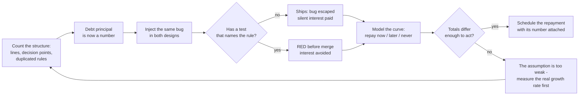

# Technical Debt

## 1. Learning Objectives

By the end of this lesson you will be able to:

- Quantify debt on a real file with static metrics — lines, decision points, duplicated
  rules — instead of calling the code "messy."
- Explain interest concretely: demonstrate an injected bug escaping an untested design
  while the tested one goes red, and name what each outcome costs.
- Read an interest curve: run the three repayment strategies (repay now, repay at release 6,
  never) and interpret their totals as a decision input.
- Distinguish deliberate debt (a shortcut with a known payoff) from accidental debt (a
  design eroded by change), and argue which repayment order either one implies.
- Frame refactoring as an economic decision with numbers, while staying honest about which
  numbers in the model are measured and which are assumptions.

## 2. Prerequisites

- Completed ARCH-07 (clean code) and ARCH-09 (separation of concerns): this lesson attaches
  prices to what those lessons measured structurally.
- Java 21+ (`javac -version`); probes are single-file scripts with a stated model.
- Willingness to write down assumptions — half of technical-debt reasoning is deciding what
  you are assuming about growth rates.

## 3. Introduction

"Technical debt" is a metaphor that escapes its loan office the moment it is used: everyone
says debt is bad, some say it is a loan, nobody shows the interest rate. This lesson
insists on the rate. Three probes, in order of how much they can tell you:

1. **Measurement** — the same feature written two ways, counted: `messy: lines=17
   decisionPoints=10 duplicatedTaxLadders=2` vs `clean: lines=10 decisionPoints=2
   duplicatedTaxLadders=1`.
2. **Interest, witnessed** — one injected bug, two designs: `messy: tax(100) = 8.0 with 0
   tests running -> bug escaped` while `clean suite: RED tax(100) = 8.0 want 7.0` catches
   it. The interest on untested code is not slower typing; it is defects that ship.
3. **The curve** — twelve releases of the same feature under three strategies:
   `repay-now=160.0, repay-at-6=192.1, never=542.1`.

The third probe carries a warning label rather than a result: its 25%-per-release growth is
a *stated assumption*, not a measurement. The lesson's method is to be explicit about which
line is which — that distinction is what turns the metaphor into a decision.

## 4. The Problem It Solves

The problem is that **debt is invisible in the moment and visible only in aggregate**.
While a shortcut works, it is indistinguishable from a correct decision; the cost appears
later as slower features, escaping bugs, and rework nobody budgeted. The three probes
counter each invisibility:

- Measurement replaces judgment with counts (the file that *looks* worse has 5× the
  decision points and a duplicated rule).
- The escaped bug replaces "tests are good" with a witnessed outcome — the same injected
  8.0 error ships silently from one design and stops in the other.
- The curve replaces "we'll fix it later" with cumulative totals that differ by 3.4×.

None of the three is a real interest rate from a real team; together they are the shape of
the argument you must be able to make about your own codebase.

## 5. Core Concepts

### P1: you cannot price what you have not counted

```text
messy: lines=17 decisionPoints=10 duplicatedTaxLadders=2
clean: lines=10 decisionPoints=2 duplicatedTaxLadders=1
```

Two implementations of one pricing rule, measured by a counting program rather than an
opinion. The meaningful number is `duplicatedTaxLadders=2`: the tax rule exists in two
places, so every future tax change has two places to be forgotten — the duplication is a
*hypothesis about a future bug*. `decisionPoints 10 → 2` prices the comprehension cost:
each decision point is a path a reader (and a test) must consider.

### P2: the interest is a defect that ships

```text
messy: tax(100) = 8.0 with 0 tests running -> bug escaped
clean suite: RED   tax(100) = 8.0 want 7.0 -> caught by the test the refactor wrote
```

The same error (rate 0.07 → 0.08) was introduced into both designs. In the messy design,
nobody could target the rule with a test cheaply, so no test exists: `tax(100)` returns
8.0 to the user with every appearance of success. In the clean design the rule is isolated
and a test already names the expected value, so the identical bug produces `RED` before
merge. This is the interest payment: not "code is unpleasant" but "errors are silent."

### P3: three repayment strategies over twelve releases

```text
TOTAL over 12 releases: clean-baseline=120.0, repay-now=160.0, repay-at-6=192.1, never=542.1
repay-now vs never: saves 382.1 units (70%) - and debt-only work is never counted as a missed feature
```

The model, stated in full: each release adds one feature; on a clean codebase each costs
10 units; unrepaid debt raises each subsequent feature's cost by 25% (a deliberate,
arguable assumption); repaying costs a one-time 40 units and restores the 10-unit cost.
Reading the rows: postponing repayment costs 32.1 units over repaying immediately
(`192.1 vs 160.0`), and never repaying costs 3.4× the immediate repayment — before
counting the features the team did not build while paying the higher rate. What the model
does *not* contain: the risk of a big-bang rewrite, the possibility that debt makes
features impossible rather than merely expensive, and any actual measurement of your
team's growth rate. Those are the inputs you must supply.

## 6. How It Works



## 7. Practical Examples

### Counting instead of arguing

```java
static int count(String s, String sub) { int n = 0, i = 0; while ((i = s.indexOf(sub, i)) >= 0) { n++; i += sub.length(); } return n; }
static int decisions(String s) { return count(s, "if (") + count(s, "case \""); }
// messy: lines=17 decisionPoints=10 duplicatedTaxLadders=2
```

A forty-line counting program turns a style debate into two numbers. The metric is only as
good as its definition — which is why the probe prints exactly what it counts.

### The same bug, two verdicts

```java
static final double RATE = 0.08;   // same injected bug as the messy version
// clean suite: RED   tax(100) = 8.0 want 7.0
```

The test file is the asset the debt was preventing: `TaxCleanTest` names the invariant
(`tax(100) == 7.0`), and naming invariants is what a tangled rule makes expensive.

### The curve, as code you can re-run

```java
double debtBefore = base * Math.pow(1 + growth, r - 1);           // untouched debt
double debtK = (r < repayAt) ? debtBefore : (r == repayAt ? base + principal : base);
```

Every number in the table comes from four named parameters — change them to your own
beliefs and re-run; the argument is the *structure*, not the constants.

## 8. Real-World Applications

- **Refactoring budgets.** Teams that reserve a fixed fraction of each iteration for debt
  repayment are running P3 with `repay-at-every-release` as the strategy.
- **Risk-based remediation.** P1's `duplicatedTaxLadders` is how audit-driven codebases
  prioritize: duplication in a rule that has changed before goes first.
- **Bug-escape reviews.** After an incident, "which test should have caught this, and why
  didn't it exist?" is P2's question applied to a real defect.
- **Just-in-time versus just-in-case refactoring.** The curve is the quantitative version
  of the standing argument: refactor when you are in the area, repay large principals on a
  schedule.
- **Technical-debt registers.** Storing debt items with their measured metrics and a
  growth assumption makes P3 an executable team artifact rather than a slogan.

## 9. Common Mistakes

- **Confusing style with debt.** Debt is future cost, not ugliness: an ugly function that
  never changes costs nothing, a pretty one with a duplicated rule everywhere costs a
  fortune. P1 counts duplication and decision paths, not indentation.
- **Presenting the model as measurement.** The 25% growth is an assumption; quoting
  `never=542.1` as fact is the same category error as quoting a hit ratio without its
  workload.
- **Only counting the repayment.** P3 includes the 40-unit principal — analyses that count
  only the benefit of refactoring justify every rewrite ever proposed.
- **Debt with no test net.** Refactoring untested code is a rewrite risk; P2's ordering
  (write the test, then move the code) is the safe sequence.
- **Rewrites as a substitute for repayment.** A big-bang rewrite converts small debt into a
  large one and is deliberately absent from the model — treat its absence as a warning.
- **Using "tech debt" as a curse word.** Deliberate debt with a known payoff is a tool;
  the lesson's distinction from accidental debt is what makes repayment *order* a decision.

## 10. Best Practices

- Measure before debating: pick two or three counts (duplicated rules, decision points,
  test coverage of the hot path) and argue from them.
- Label every model output with its assumptions, as P3 does in the probe and the lesson
  does in prose.
- Repay debt where it is being charged: the interest is paid at the *next* feature in that
  area, so schedule repayment with the roadmap that will pay it.
- Write the failing test first when repaying (P2's `RED` line is the proof the net exists).
- Keep a register: debt items with metric, owner, and the change expected to trigger them.
- Re-run the curve when assumptions change — growth rates are beliefs, and beliefs update.

## 11. Limitations and Trade-Offs

- **The growth rate is assumed, not measured.** 25% per release is illustrative; a real
  number requires historical feature-cost data most teams do not collect.
- **The metrics are crude by design.** A counting program over `if (` misses coupling
  across files, framework complexity, and cognitive load — it is a signal, not a verdict.
- **P2 is one bug, one design pair.** The escaped-bug demonstration is an existence proof
  that the interest can be a defect, not a rate.
- **Debt sometimes decays.** If the messy area is deleted or frozen, the curve stops; the
  model charges interest forever by construction.
- **Opportunity cost is unmodeled.** The units are feature-cost proxies; they do not carry
  morale, hiring friction, or incident risk.
- **Not all debt is equal.** Interest concentrated in code nobody touches is cheap; the
  model cannot see location — you supply that.

## 12. Practical Exercises

### Introductory

1. Reproduce P1: run the metric program and report the three numbers; then refactor one
   duplicated rule and re-run it.
2. Reproduce P2: inject the rate bug into both designs and paste both verdict lines.
3. Reproduce P3: confirm `repay-now=160.0, repay-at-6=192.1, never=542.1` on your machine.

### Intermediate

4. Change P3's growth assumption to 10% and to 40%: find the point where "repay at 6"
   becomes better than "never," and explain why the crossover moves.
5. Measure a real file from your project with P1's counters and state one thing the metrics
   missed that a reader would notice immediately.
6. Write the test for P2's messy version, then inject the bug again: show the verdict flip
   from `bug escaped` to `RED` — the interest payment interrupted.

### Independent problem-solving

7. Build a debt register entry for your current project: metric counts, the change most
   likely to trigger the interest, and a repayment estimate in the same units P3 uses.
8. Defend a piece of deliberate debt in writing: what payoff justified it, what the curve
   says about repaying it now versus later, and what evidence would change your answer.
9. Argue that the whole metaphor is wrong for software: compare it to an alternative
   framing (inventory, erosion, or epidemiology), and say which of P1–P3's numbers that
   framing explains better.

## 13. Knowledge Check

1. Which P1 number is a hypothesis about a future bug, and why is it that one?
2. What exactly "paid the interest" in P2's messy design — and what did the clean design's
   test represent economically?
3. Which of P3's inputs are measured and which are assumed? Name at least two of each kind.
4. Why does the model's exclusion of big-bang rewrites matter to the conclusion?
5. When is taking on debt the right decision under this lesson's own framework?

<details>
<summary>Answers</summary>

1. `duplicatedTaxLadders=2` — the tax rule lives in two places, so the next tax change has
   two places to be forgotten; that duplication predicts the defect.
2. The escaped 8.0 error shipped to users from an untested rule — the interest is paid as
   defects and undetected regressions; the test represented a standing detection asset that
   cost little precisely because the rule was isolated.
3. Measured: the P1 counts, the P2 verdicts, the arithmetic of the totals given parameters.
   Assumed: 25% growth per release, the 40-unit principal, the 10-unit feature baseline.
4. Because repaying debt is usually argued as "versus a rewrite"; a model without rewrite
   risk flatters both repayment and neglect differently than a model with it — the
   conclusion must be read knowing rewrite risk was never priced.
5. When the payoff is concrete and dated (a known deadline, a feature whose cost the curve
   shows exploding), the debt is in an area that will be touched soon, and the repayment is
   scheduled — that is, when it is a loan with a repayment plan rather than an accident.

</details>

## 14. Completion Criteria

You have completed this lesson when:

- [ ] P1's three counts reproduce and you can say which is a bug hypothesis vs a reading cost.
- [ ] P2's `bug escaped` and `RED tax(100) = 8.0 want 7.0` both appear on your machine,
      and you have flipped the messy verdict by adding a test.
- [ ] P3's totals reproduce and you can re-run it with your own growth assumption.
- [ ] You can separate what P3 measured from what it assumed, item by item.
- [ ] You have one real debt register entry from your own codebase with numbers attached.
- [ ] The mermaid diagram in Section 6 parses.

## 15. Summary

Technical debt becomes discussable when it is counted: `lines=17 decisionPoints=10
duplicatedTaxLadders=2` prices the structure, the injected bug demonstrates the interest as
a defect that ships from an untested design and is caught (`RED`) by a tested one, and the
twelve-release curve shows the three repayment strategies landing at `160.0 / 192.1 /
542.1`. The model's growth rate is an assumption and is labeled as one — the lesson's real
method is to state which numbers you measured and which you believe, then argue the
repayment from both. Debt is sometimes the right loan; never noticing you took it is the
expensive part.

## 16. Next Steps

- ARCH-07 `clean-code.md` and ARCH-09 `separation-of-concerns.md` — the structural
  measurements this lesson prices.
- ARCH-18 `scalability-and-reliability.md` — the load-side counterpart: mechanisms whose
  benefit is also conditional and worth a probe.
- 14-TESTING-AND-QUALITY (next subject) — P2's escaping test is the opening argument for
  coverage, mutation testing, and test strategy.
