# The Complete Development Process

## 1. Learning Objectives

After this lesson you can:

- [ ] Name and order the **26 stages** from problem identification to retirement, and say
      which artifact each stage produces
- [ ] Run a small feature through the whole process and read the *trace it leaves* —
      executed: the OrderDesk mini-repo's 9-commit history, each commit naming its stages
      (`stage 1-4 … stage 20-22`)
- [ ] Diagnose which stage a failure belongs to — executed: requirements validation
      catching an arithmetic error in an acceptance criterion *before* any code existed
      (commit `stage 6: … 18.70 → 21.40`)
- [ ] Separate the stages that must happen (their *effect* is unavoidable) from the
      ceremony you may compress (their *form* is adjustable), and defend the line
- [ ] Execute the feedback loop honestly — executed: defect introduced → harness RED
      `unknown-region-no-tax: got 10.0 want 5.0` exit 1 → fix → `ALL PASS` exit 0, as
      two commits
- [ ] Measure a non-functional requirement against its budget — executed: 1000-line
      total `326us (NFR1 budget 50000us)` → `NFR1 PASS`

## 2. Prerequisites

- [Programming Fundamentals](../02-PROGRAMMING-FUNDAMENTALS/README.md) — you must have
  written and run code to process a process *about* code.
- [Developer Tools / terminal](../03-DEVELOPER-TOOLS/terminal-fundamentals.md) — the
  trace you read is a `git log`.
- [11 Backend Engineering](../11-BACKEND-ENGINEERING/README.md) or
  [09 Frontend Engineering](../09-FRONTEND-ENGINEERING/README.md) — this lesson assumes
  you have shipped a small feature and felt where it hurt.

*Provenance: every transcript quoted below is **executed on the authoring machine** — a
throwaway Java 25 repo (`orderdesk`) built specifically as this lesson's worked example,
with `git`, `javac`, and `java` doing exactly what the text says. Your repo's hashes and
microseconds will differ; the trace's shape is the lesson.*

## 3. Introduction

"The software development process" is often taught as a diagram of boxes and arrows that
nobody follows. This lesson teaches it differently: as **26 stages, each of which must
happen in some form, because skipping it doesn't remove the work — it moves the work to a
worse place and charges interest.** Requirements not elicited now will be discovered in
production. Design not decided now will be decided implicitly by whoever types the code.

You will run one worked example — **OrderDesk**, an order-total engine for a small shop —
through all 26 stages in a real repository, and read the history it leaves.

## 4. The Problem It Solves

Before anyone wrote down "the process," software projects failed in a pattern: the team
built the *wrong* thing efficiently, or the *right* thing unrepeatably, or the right thing
that nobody could maintain. The process exists because each of those failure modes is a
missing stage — no validation (wrong thing), no feedback loop (unrepeatable), no
operational stages (unmaintainable). The process is not bureaucracy; it is the checklist
of ways a project is known to fail, ordered so each check costs less than the failure.

## 5. Core Concepts

### The 26 stages

Each stage has one job and one artifact. Phases group them; the phase names are yours to
rename, the stage effects are not.

**Phase I — Understand (1–8)**

| # | Stage | Artifact |
|---|---|---|
| 1 | Problem identification | problem statement |
| 2 | Stakeholder mapping | who decides, who benefits, who is harmed |
| 3 | Feasibility & risk scan | go / no-go with reasons |
| 4 | Goals & scope statement | in-scope, out-of-scope |
| 5 | Requirements elicitation | drafted FRs/NFRs |
| 6 | Requirements validation | acceptance criteria that survive arithmetic |
| 7 | Use-case & flow modeling | the journeys that must work |
| 8 | Non-functional targets | measured budgets (latency, load, security) |

**Phase II — Decide (9–15)**

| # | Stage | Artifact |
|---|---|---|
| 9 | Technical spike | evidence for the risky unknown |
| 10 | Architecture decisions | ADRs with rejected alternatives |
| 11 | High-level design | components and their contracts |
| 12 | Low-level design / interfaces | signatures and data shapes |
| 13 | Data design | schema and ownership |
| 14 | Test strategy | what will prove each requirement |
| 15 | Increment planning | the slice that ships first |

**Phase III — Build (16–19)**

| # | Stage | Artifact |
|---|---|---|
| 16 | Implementation | code that compiles |
| 17 | Review | a second human (or its disciplined substitute) |
| 18 | Automated verification | RED/GREEN evidence |
| 19 | Integration & system test | the whole working |

**Phase IV — Prove and Ship (20–22)**

| # | Stage | Artifact |
|---|---|---|
| 20 | Security & performance review | threat notes + budget measurements |
| 21 | Staging / acceptance | sign-off against the stage-6 criteria |
| 22 | Release | versioned, releasable artifact |

**Phase V — Operate and Evolve (23–26)**

| # | Stage | Artifact |
|---|---|---|
| 23 | Observability | dashboards, alerts, the questions you'll ask at 3 a.m. |
| 24 | Operations & incident response | what happens when it breaks |
| 25 | Usage analysis & improvement | evidence for the next iteration |
| 26 | Retirement / migration | how it ends without stranding anyone |

### The stage's honest contract

Every stage must do two things or it is theater: (a) produce its artifact, (b) change a
decision — if completing the stage cannot make you do something differently, question it.
Stage 6 is the purest example: it changed the requirements (below), before a line of code.

### Sequential is a fiction; ordering is real

Stages loop. But the *ordering constraint* is what matters: work that feeds a later stage
must exist before that later stage runs. You may do 16→18→19 in a two-minute loop (the
mini-repo does), but you cannot do 18 before 16 or 6 before 5 — the evidence won't exist
yet.

## 6. How It Works

```mermaid
flowchart LR
    subgraph I[Phase I - Understand 1-8]
        A1[5 elicit] --> A2[6 validate] --> A3[7 use cases] --> A4[8 NFR targets]
    end
    subgraph II[Phase II - Decide 9-15]
        B1[9 spike] --> B2[10 ADRs] --> B3[11-13 design] --> B4[14 test strategy]
    end
    subgraph III[Phase III - Build 16-19]
        C1[16 code] --> C2[17 review] --> C3[18 verify RED/GREEN] --> C4[19 integrate]
    end
    subgraph IV[Phase IV - Prove & Ship 20-22]
        D1[20 sec/perf] --> D2[21 acceptance] --> D3[22 release]
    end
    subgraph V[Phase V - Operate 23-26]
        E1[23 observe] --> E2[24 operate] --> E3[25 improve] --> E4[26 retire]
    end
    A4 --> B1
    B4 --> C1
    C4 --> D1
    D3 --> E1
    E3 -.->|"next iteration: back to 5"| A1
```



Read the arrows, not the boxes: the solid chain is the ordering constraint (a phase's
output is the next phase's input); the dashed return is **iteration** — improvement
evidence re-enters at *elicitation* (5), not at implementation, because a new need is a
new requirement.

**The mechanism, executed.** The mini-repo enacts the chain in nine commits:

```
f790e5d stage 1-4: problem, stakeholders, feasibility, scope
bb50831 stage 5: requirements drafted with acceptance criteria
919799e stage 6: validation caught ACC arithmetic error (20.00 x 1.07 = 21.40, not 18.70)
7774e0d stage 9-12: spike result, ADR-001 accepted, interface contracts
dc30992 stage 16-18: engine + acceptance harness green (ALL PASS)
facc706 stage 14+18: test strategy executed - NFR1 measured 326us < 50000us
d7e1b96 stage 18: defect introduced - harness RED (captured: unknown-region-no-tax got 10.0 want 5.0)
43832b0 stage 19: defect fixed, regression verified green
805c17f stage 20-22: staged acceptance, v0.1.0 released
```

Notice what the history *is*: a readable account of decisions and their evidence. That is
the process's real output — not documents, but an auditable sequence of "we knew this,
then we decided this, then we proved this."

## 7. Practical Examples

**Example 1 — the validation catch (stage 6, executed)**

The requirements were written with `ACC: … 2 lines of 10.00 in EU … THEN 18.70`. The
engine, written from the spec, computed `21.40` — and arithmetic agreed with the engine:
20.00 × 1.07 = 21.40. The fix was one commit, before any design work:

```
919799e stage 6: validation caught ACC arithmetic error (20.00 x 1.07 = 21.40, not 18.70)
```

- **The important lines:** the catch cost a `sed` and a commit. Had it survived to
  production, it would have cost a mispriced order, a customer dispute, and a hotfix.
- **How to run it yourself:** write an ACC, *compute it by hand*, then implement. The gap
  between hand and implementation is always the bug or the spec error — and you find out
  which while both are still cheap.
- **Assumptions:** Java 25, `git` — anything; the stage doesn't care about your tooling.

**Example 2 — the feedback loop (stages 16→19, executed)**

A defect was introduced on purpose (`region` default tax `0.0 → 1.0`):

```
$ javac -d out src/*.java && java -cp out AcceptanceTest
ok acc-eu-2lines = 21.4
Exception in thread "main" java.lang.AssertionError: unknown-region-no-tax: got 10.0 want 5.0
RED_EXIT=1
```

Fix, rerun:

```
ok acc-eu-2lines = 21.4
ok unknown-region-no-tax = 5.0
ALL PASS
GREEN_EXIT=0
```

- What the loop proves: the harness *can* fail (red is real, not decorative), and the
  fix is verified by the same instrument that found it.
- **How to run it:** break something deliberately once per project. If your suite stays
  green while code is broken, you have stages 14/18 in name only — the exact drill the
  mobile-testing lesson executes at length.

**Example 3 — a budgeted NFR (stage 8+18, executed)**

```
1000-line total: 326us (NFR1 budget 50000us) result=10700.0
NFR1 PASS
```

An NFR is a number with an owner and a check. "Fast" is not testable; `< 50 ms for a
1000-line order` is — the check above runs forever and fails the moment someone's change
crosses the budget.

## 8. Real-World Applications

Teams instantiate these stages as ceremonies of varying heaviness: a ticket template is
stage 5's artifact; an ADR template is stage 10's; a CI pipeline is stage 18 mechanized;
a runbook is stages 23–24 written down; a postmortem is stage 25 after an incident. When
a team says "we don't do process," they are usually doing stages 16 and 18 only — and
paying for 1–15 and 19–26 in production, support, and attrition. The economic version of
this lesson: each stage is an option purchased at the cheapest moment to exercise it.

## 9. Common Mistakes

| Mistake | Why it happens | How to recognize it | How to prevent it |
|---|---|---|---|
| Skipping validation (6) because "requirements are obvious" | obvious-to-me fallacy | production bugs that are *contradictions*, not crashes | compute every acceptance criterion by hand once |
| Treating the order as ceremony | process as religion | stage artifacts that change no decisions | require each artifact to name one decision it changed |
| Designing (11) before the spike (9) | confidence outruns evidence | the riskiest assumption has no test | riskiest-unknown-first ordering |
| Verification without red (18) | green feels like progress | suite never fails on deliberately broken code | the deliberate-break drill, per project |
| Release (22) without observability (23) | shipping feels like finishing | you learn of outages from customers | no release without at least one dashboard/alert |
| Improvement re-entering at 16 | fixes are easier than requirements | endless feature churn, no goal change | route new needs back through stage 5 |

## 10. Best Practices

- **Artifacts sized to reversibility.** A weekend prototype needs a paragraph per stage;
  a payment path needs the full set. The stage's *effect* is mandatory; its *volume* is a
  cost decision — say which one you're optimizing.
- **One page per decision.** ADRs, requirement sets, and postmortems earn trust by being
  short enough to read. A 40-page document that nobody reads is a skipped stage with extra
  steps.
- **Evidence in the history.** Commits and CI runs *are* the process record; narrative
  documents summarize them, they don't replace them. The mini-repo's nine commits taught
  this lesson more directly than any flowchart.
- **Budgets, not adjectives.** Every NFR gets a number and a check that can fail. *Stops
  applying when:* you are still exploring — pre-spike, an approximate budget with a
  TODO-to-measure is more honest than a precise number you invented.
- **Name the stage when you're stuck.** "We're blocked" is never true; "we're blocked on
  stage 6 output" tells you who to talk to.

## 11. Limitations and Trade-Offs

- **26 stages is a model, not a law.** Real processes compress and overlap; the model's
  job is diagnosis (which effect is missing?), not compliance. Two teams doing "stage 10"
  may write an ADR or make a hallway decision — only one leaves evidence.
- **The mini-repo is small.** It proves the trace is *readable*, not that it scales; at
  100 commits/day you need CI, PR conventions, and release automation to keep the trace
  legible — practices taught by subjects 16–17.
- **Documentation rots.** The stage artifact is only current the moment it's written;
  tie artifacts to code (ADR per architecture file, criteria per test) or they drift.
- **Human stages don't automate.** Review (17), acceptance (21), and incidents (24) need
  judgment; tooling prepares evidence, it does not sign off.
- **Not every project needs all 26 visibly.** A throwaway spike can run 1–5 loosely; a
  regulated system will run 6, 8, 20, and 21 far heavier than this lesson's example.

## 12. Practical Exercises

### Introductory

1. **Exercise 2.1** — re-read the nine-commit trace above and map every commit to its
   stage numbers; then name the two stages the trace *compresses hardest* and what their
   artifacts would look like at full size.
   **Completion criteria:** the full mapping table; the two compressed stages named with
   one artifact each (e.g., stage 7's use-case list, stage 24's runbook).
2. **Exercise 2.2** — reproduce the executed validation catch: write an acceptance
   criterion with an arithmetic consequence, implement against it, and find the mismatch
   (yours or the spec's).
   **Completion criteria:** one commit where the criterion changed, with the hand
   computation shown next to the engine's output.

### Intermediate

3. **Exercise 2.3** — run the deliberate-break drill end-to-end in your own code: green →
   break → red with the exact failure text → fix → green, as two commits each.
   **Completion criteria:** four captured outputs with exit codes (0/1/1… 0), and one
   sentence on what the drill proved your harness *can* detect.
4. **Exercise 2.4** — take a feature you already built and write its **missing-stage
   report**: for each of the 26 stages, present / partial / absent, with the production
   cost you can attribute to each absence.
   **Completion criteria:** the 26-row table with at least three absence→cost
   attributions traceable to real incidents or rework you experienced.

### Independent problem-solving

5. **Exercise 2.5** — design the *minimum viable process* for a two-person team shipping
   a customer-facing web app: choose which of the 26 stages to run explicitly, how each
   is compressed, and where the evidence lives (which artifact, which tool). Then run one
   real feature through it.
   **Completion criteria:** the process document plus one feature carried through with
   its evidence trail — artifacts present for every stage you claimed to run, and a
   written defense of each stage you deliberately merged or dropped that names the risk
   you accepted.

*Solutions: attempt first. They live in `solutions/` of this subject.*

## 13. Knowledge Check

1. Stage 6 caught an error before code existed. Explain why that catch is categorically
   cheaper than the same contradiction found in production, in terms of what has to be
   rebuilt in each case.
2. The dashed arrow returns from 25 to 5. Why not to 16? Give an example where returning
   straight to implementation would loop forever.
3. A teammate says "our process is: code, then test if there's time." Map their actual
   stage coverage onto the 26 and predict three failures they will meet — then say which
   single added stage buys the most risk reduction.

## 14. Completion Criteria

Observable evidence that you have understood this lesson:

- [ ] You can write the 26 stages from memory in order, grouped by phase
- [ ] You have reproduced one executed artifact from each of phases I–IV (a validated
      criterion, an ADR, a red/green pair, a measured budget)
- [ ] You can look at any project pain and name the stage whose absence causes it
- [ ] You can state, for a specific project, which stages you compress and what risk you
      are accepting by it

## 15. Summary

- 26 stages, five phases; each stage must produce an artifact *and* change a decision.
- The ordering constraint is real; the sequence is loopable — feedback re-enters at
  elicitation, not implementation.
- Executed trace: nine commits, one arithmetic catch, one red/green pair, one measured
  NFR (`326us < 50000us`) — the process's true output is an auditable history.
- Deliberately breaking your own harness is how you learn stage 18 is real.
- Ceremony volume scales with reversibility; the stage's effect never scales away.

## 16. Next Steps

- Next lesson: [Software Development Life Cycle](software-development-life-cycle.md) —
  how real teams schedule these stages iteratively.
- Practice: [exercise sets](exercises/README.md) for this subject.
- Where it is applied: [Project 07](../20-PROJECT-LABORATORY/README.md) — run its
  capstone through the 26 stages with this lesson's evidence discipline.
