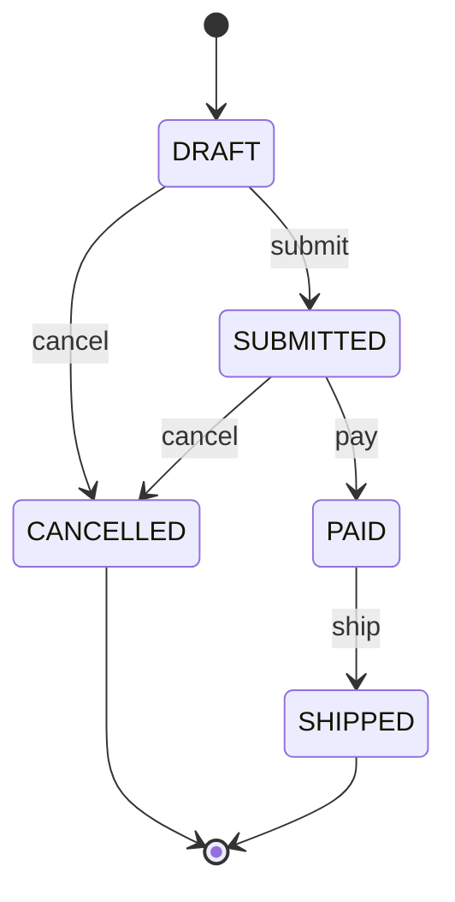
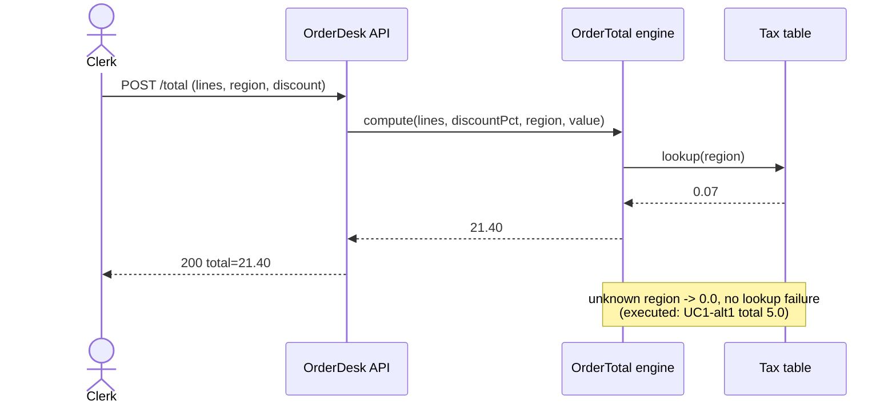
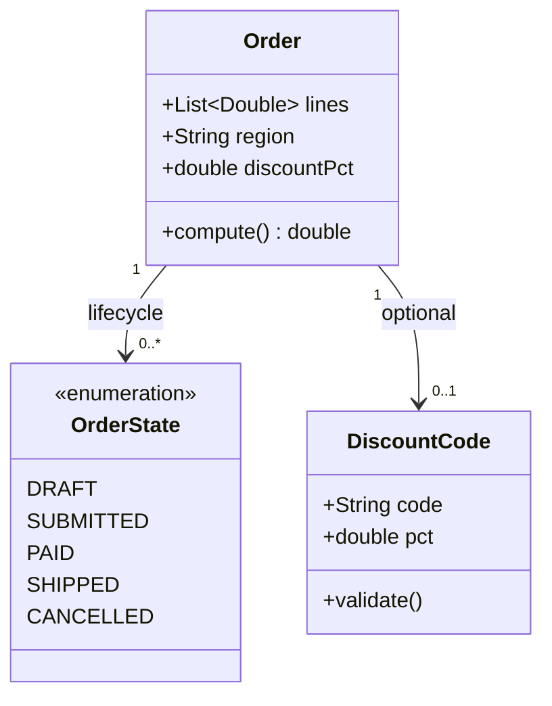

# Use Cases and UML

## 1. Learning Objectives

After this lesson you can:

- [ ] Write a use case with actor, goal, main flow, and alternate flows — then execute
      its flows as scenarios — executed: `UC1-main … UC1-alt1-unknown-region …
      UC1-alt2-empty-order`, all `ok`, `SCENARIO-LAB ALL PASS`
- [ ] Draw the four UML diagrams that earn their keep (use case, sequence, state,
      class), each carrying a decision rather than decoration
- [ ] Model a lifecycle as a state machine and prove the transitions — executed:
      `main-lifecycle DRAFT -> SUBMITTED -> PAID -> SHIPPED`, plus the two rejections
      `ship on DRAFT rejected, state stays DRAFT` and `pay on CANCELLED rejected`
- [ ] Match diagram kind to question: who uses it (use case), what messages in what
      order (sequence), what changes state (state), what structure exists (class)
- [ ] Keep diagrams and code in one change — a diagram that survives no refactor is a
      liability, and know which diagrams to skip entirely
- [ ] Trace requirement IDs into flows and flows into tests, closing the ARCH-04 matrix

*Provenance: scenario transcripts are **executed on the authoring machine** — the
`orderdesk` mini-repo (Java 25) and `ScenarioLab.java` in the lab directory. The UML
diagrams are mermaid source, validated by the same parser used elsewhere in this repo —
sequence, state, and class. The use case view is written as text: mermaid has no
use-case renderer, and a good text contract beats a bad picture of one.*

## 2. Prerequisites

- [Requirements Engineering](requirements-engineering.md) — use cases hang off
  requirement IDs (FR1–FR3, NFR1–NFR2).
- [Functional and Non-Functional Requirements](functional-and-nonfunctional-requirements.md)
  — scenarios are the level at which flows and budgets meet.

## 3. Introduction

UML's reputation is deserved: most UML in the wild is a photo of a class list nobody
updates. But the failure was never the notation — it was drawing everything about
everything. This lesson teaches the **minimum viable UML**: four diagrams, each chosen
because a specific question is hard to answer without it. A use case answers "what does
this system let people do," a sequence answers "what exactly happens, in what order," a
state diagram answers "what are the phases and what moves between them," and a class
diagram answers "what pieces exist and how do they refer to each other." If no open
question needs the answer, skip the diagram.

The distinguishing move in this lesson: **every flow drawn is also executed.** The state
machine below isn't a picture of the lifecycle — it's the lifecycle the probe actually
ran, rejections included.

## 4. The Problem It Solves

Verbal specs fail at boundaries and orderings. "The user submits an order" says nothing
about whether a draft can ship, what happens to a submitted order when payment fails, or
which of four messages arrives first between two components — and those are exactly the
places bugs live. Diagrams pay for themselves at the *edges*: state machines find illegal
transitions on paper (before they're found in production), sequence diagrams find missing
error paths before integration week. The worked example's engine fits on one screen — yet
it already has three flows whose order matters (discount before tax, rejection before
mutation, per region), which is why its ACs needed hand-computation at all.

## 5. Core Concepts

### A use case is a contract with alternate flows

A **use case** names an actor (a role, not a person), their goal, one main flow that
achieves it, and the alternate flows — the branch points where reality diverges. The
discipline that matters: *every alternate flow gets a scenario*, because that's where
implementations disagree. UC1 below has exactly three: main, unknown region, empty
order — the first is the happy path, the other two are contract.

### Scenarios are the executable form of a use case

A **scenario** is one concrete path through a use case. Executing each scenario turns the
diagram into a test suite with a shape: main flows assert values, alternate flows assert
*behavior under deviation* (empty order → `0.0`, unknown region → no tax applied). The
probe prints one `ok` per scenario — the use case's coverage is legible in the output:

```
--- UC1 Compute order total: main flow and alternates, executed
ok   UC1-main GIVEN 2x10 EU -> total 21.4
ok   UC1-alt1-unknown-region GIVEN 1x5 region XX -> total 5.0 (no tax applied)
ok   UC1-alt2-empty-order GIVEN 0 lines -> total 0.0
--- UC2 Apply discount code: main flow and rejection, executed
ok   UC2-main GIVEN 10% code in EU -> total 19.26
ok   UC2-alt-reject-bad-code rejected with "bad code", order unchanged
SCENARIO-LAB ALL PASS
```

### State machines find the transitions you forgot

A **state machine** lists states and the events that move between them. Its payoff is
the *negative space*: transitions you never drew are transitions that must be rejected.
The executed lifecycle has five states and four honest negatives:

```
ok   main-lifecycle DRAFT -> SUBMITTED -> PAID -> SHIPPED
ok   alt-cancel-submitted DRAFT -> SUBMITTED -> CANCELLED = CANCELLED
ok   invalid-ship-draft ship on DRAFT rejected, state stays DRAFT
ok   terminal-cancelled pay on CANCELLED rejected, state stays CANCELLED
```

The two rejections are the requirement: nothing ships an unpaid draft, nothing pays a
cancelled order. When the diagram and the code disagree, one of them is wrong — executing
the transitions is how you find out which.

### Sequence diagrams exist for order-dependence

Use **sequence** only when the *order* of messages is the question — retries, callbacks,
the moment a total is computed versus when tax is looked up. If swapping two arrows
changes nothing, the sequence diagram is redundant; a flowchart or prose will do.

### Class diagrams document structure after it stabilizes

A **class diagram** shows types and relationships. It's most useful once naming and
ownership have settled (post first slice); drawing it during churn produces a document
that's wrong by Friday. The one worth keeping: the domain nouns that appear in every
use case (Order, Line, region) with their real fields.

### Traceability closes the loop

Each flow names the FR it implements (UC2 ↔ FR2/FR3), each scenario names the check it
runs — the ARCH-04 matrix row and the scenario `ok` line are two views of one fact.

## 6. How It Works

**Use case view — actor and goals** (the box is the system boundary; `<<include>>`
means *always*, `<<extend>>` means *optionally*):

```text
Actor: Shop clerk ─────────────────────────────┐
│  OrderDesk (system boundary)                    │
│    UC1  Compute order total          │
│    UC2  Apply discount code   ──extends──▶ UC1 │
│    UC3  Cancel order                    │
│    UC4  Ship order           ──includes──▶ UC1 │
└─────────────────────────────────────────────┘
Actor: Payment provider ──▶ (UC4's pay event)
```

The two relationships are decisions: shipping *always* computes a total (its flow
includes UC1), discounts *may not run at all* (a discount flow extends the base flow).
An actor is any role outside the boundary — a person or another system.

**State view — the lifecycle that was executed above:**



Every arrow here maps to a `step(...)` call the probe executed; the transitions *not*
drawn (e.g. `DRAFT --> SHIPPED`) are the two rejection tests.

**Sequence view — one total request, messages in order:**



The note is the alternate flow surfacing in the ordered view — the point of drawing
sequences is finding what happens on the *other* branches of each arrow.

**Class view — the nouns the flows share:**



`0..1` on the code edge is the requirement expressed in multiplicity: most orders carry
no discount; FR2 governs the ones that try to.

## 7. Practical Examples

**Example 1 — writing a use case worth executing**

```text
UC1 Compute order total
Actor:    Shop clerk
Goal:     know what the customer owes
Main:     GIVEN 2 lines of 10.00, region EU  → total 21.40   [FR1]
Alt 1:    region not in tax table            → no tax        [FR1]
Alt 2:    empty order                        → total 0.0     [FR1 edge]
```

- What the important lines do: each flow line names its requirement, so scenario `ok`
  lines satisfy matrix rows.
- **Expected output:** the `UC1-*` block in section 5 — three `ok` lines.
- **How to run it:** `javac -cp out -d out ScenarioLab.java && java -cp out ScenarioLab`
- **Assumptions:** Java 25; lab layout from ARCH-02.

**Example 2 — using the state machine as the test generator**

```java
State s = State.DRAFT;
for (String ev : new String[]{"submit", "pay", "ship"}) { s = step(s, ev, true); }
// main path, plus the negatives the diagram does NOT contain:
State inv = step(State.DRAFT, "ship", false);  // must stay DRAFT
```

- The important line: the rejection test is derived from a *missing arrow* — no arrow,
  no transition, so the assertion writes itself.
- **Executed output:** `main-lifecycle DRAFT -> SUBMITTED -> PAID -> SHIPPED`,
  `invalid-ship-draft ship on DRAFT rejected, state stays DRAFT`.

**Example 3 — choosing NOT to draw**

A component diagram of the one-process OrderDesk would be one box. An activity diagram of
`compute()` would be its six lines of code. Both are skipped here — recorded, because
skipping is also a modeling decision with a rule: *no diagram without a question it
answers.*

## 8. Real-World Applications

Use cases anchor user-story mapping and demo scripts; state machines drive order
lifecycle, ticketing, and firmware (and their diagrams become the test table);
sequence diagrams are the default artifact for API and retry-semantics reviews; class
diagrams appear in ADRs whenever a schema decision must be reviewed. In regulated work,
the four together are the audit trail from requirement → flow → code. Paired with:
traceability IDs (ARCH-04), test generation (each scenario a test), ADRs (ARCH-02's
stage 10).

## 9. Common Mistakes

| Mistake | Why it happens | How to recognize it | How to prevent it |
|---|---|---|---|
| Diagram of everything | UML treated as deliverable | 30-class diagram, zero open questions | one question per diagram; skip the rest |
| Alternate flows omitted | happy path feels canonical | bugs arrive "unexpectedly" at edges | every branch point gets a named flow |
| States drawn without rejection tests | machine shows legal moves only | illegal transition crashes in prod | test each *absent* arrow (executed above) |
| Diagram drifts from code | drawn once, never touched | refactor invalidates arrows silently | diagram lives in the same commit as the change |
| Sequence for everything | arrows feel precise | ordering isn't actually the question | ask: does swapping arrows change behavior? |
| Actor = person | roles vs users conflated | "system" can't be an actor in the flow | actor = anything outside the boundary |

## 10. Best Practices

- **Put the scenario count in the use case** — `Main + 2 alts` is a testable summary you
  can check against the suite (`UC1-*` printed exactly 3 `ok`s).
- **Draw the state machine from the enum in code, or derive the enum from the drawing** —
  either direction keeps them one artifact; the middle ground (two copies) drifts.
- **Keep diagrams in mermaid beside the code** — they diff, they validate in CI (the
  parser check used on this file), and they can't rot in a drawing tool.
- **Name arrows with events, not methods** — `pay`, not `processPayment()`; the diagram
  is the domain vocabulary, the method name is an implementation choice.
- **Delete a diagram that has answered its question** — its value was the decision, and
  decisions don't need maintenance; records of them do (ADRs).

## 11. Limitations and Trade-Offs

- UML covers structure and behavior, not quality: budgets (ARCH-05) never live in a
  diagram.
- Sequence diagrams of asynchronous systems get ugly fast (forks, queues); below a
  certain complexity, message tables beat arrow spaghetti.
- Execution keeps diagrams honest only if scenarios stay tied to flow names — break that
  naming link and you have two artifacts again.
- A class diagram drawn pre-implementation will be wrong; treat it as a hypothesis with
  a review date.

## 12. Practical Exercises

### Introductory

1. **Exercise 6.1** — Write UC2-style use cases (actor, goal, main flow, 2 alternates)
   for logging into any app you use. **Completion criteria:** every flow line is
   checkable (a number or a concrete observable), and each names the requirement it
   serves.
2. **Exercise 6.2** — Draw the state machine for that login session (logged-out,
   credential-check, logged-in, locked, …) and list three *absent* transitions.
   **Completion criteria:** diagram plus the three rejection behaviors written as
   assertions.

### Intermediate

3. **Exercise 6.3** — Execute your state machine like `ScenarioLab`: main path, one
   alternate, two rejected transitions, all printed with pass/fail.
   **Completion criteria:** transcript showing 4+ `ok` lines and a final `ALL PASS`.
4. **Exercise 6.4** — Take one endpoint you built and draw its sequence diagram including
   the error branch; then find one arrow whose ordering you cannot justify from code.
   **Completion criteria:** diagram with the error path, and either a code citation for
   the ordering or a filed fix.

### Independent problem-solving

5. **Exercise 6.5** — For a feature request you recently received, produce the minimal
   diagram set — one to four diagrams — and justify each inclusion by the question it
   answers. **Completion criteria:** every diagram in the set has its question written
   above it, and you can defend excluding at least two other UML kinds.

*Solutions: attempt first. They live in `solutions/` of this subject.*

## 13. Knowledge Check

1. Your state diagram has an arrow `SUBMITTED --> PAID` but no `PAID --> SUBMITTED`.
   What test does the *absence* demand, and was it executed here? … *A forced reverse
   event must leave the state unchanged — executed as `pay on CANCELLED rejected, state
   stays CANCELLED`, the same shape.*
2. When is a sequence diagram redundant with a flowchart? … *When message order isn't
   the contested decision — if swapping arrows can't change behavior, the ordered view
   adds no information.*
3. The use case says `Main + 2 alts` but the suite prints five `UC1-*` scenarios. Who's
   wrong? … *The contract — either the use case forgot a flow (update it) or tests
   duplicate; traceability makes the disagreement visible.*

## 14. Completion Criteria

Observable evidence that you have understood this lesson:

- [ ] You can write a use case with alternates and say which FR each flow implements
- [ ] You can pick the right diagram kind for a given question, and justify skipping one
- [ ] You have executed a state machine including at least two rejected transitions
- [ ] You can name the four diagrams in this lesson, the question each answers, and say
      which three carry mermaid source validated here
- [ ] You can trace one scenario `ok` line back to a requirement ID

## 15. Summary

- Four diagrams earn their keep: use case (who/what), sequence (what order), state (what
  changes), class (what exists).
- Every flow you draw should have an executable scenario; every absent arrow should have
  a rejection test.
- Alternate flows are the contract — implementations diverge at edges, not on the happy
  path.
- Diagrams live in the repo, in the same commit as the change they reflect.
- No open question, no diagram.

## 16. Next Steps

- Next lesson: [Clean Code](clean-code.md) — the flows above are now code; making that
  code survivable.
- Practice: [exercise set](exercises/README.md)
- Where it is applied: [Project 07](../20-PROJECT-LABORATORY/README.md) — model its
  core lifecycle and execute the transitions before building the feature.
