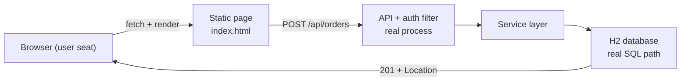

# End-to-End Testing

## 1. Learning Objectives

After this lesson you will be able to:

- [ ] Write an end-to-end test that drives the deployed artifact — real server process, real database, real HTTP
- [ ] Drive a browser-level flow through the page, the API, and the persistence layer, and assert the user-visible outcome
- [ ] State precisely which layers an E2E test exercises and which failure classes only it can catch
- [ ] Diagnose the two classic E2E failures: wrong target (stale server, wrong port) and silent non-execution
- [ ] Decide how many E2E tests a suite can afford, from measured wall-clock cost

## 2. Prerequisites

- [Testing Fundamentals](testing-fundamentals.md) — the pyramid and why E2E sits on top
- [Integration Testing](integration-testing.md) — the level below (same app, no process boundary, no user seat)
- [09-FRONTEND-ENGINEERING](../09-FRONTEND-ENGINEERING/README.md) — the page under test

## 3. Introduction

An end-to-end test puts the *user's seat* in the loop: a real browser (or HTTP client
in the user's role) talks to the real running artifact over a real socket, and the
assertion is about what the user sees. Everything between the seat and the disk is
genuine — the process boundary, routing, serialization, the auth filter, the ORM, the
database. It is the only level that catches their *combinations* failing, and the
slowest level, so suites buy few of them.

## 4. The Problem It Solves

Unit and integration tests run inside the process — they cannot see a misconfigured
server port, a filter that rejects valid traffic, a static page posting to the wrong
URL, or a response that arrives fine but renders wrong. History is full of systems
green everywhere except the seat: the API answered `201` while the page showed
"failed". E2E is the level that makes "it works" mean "it works *for a user*".

## 5. Core Concepts

### What the E2E chain contains



Every arrow is a real boundary. A failure at any arrow is invisible to lower levels.

### The three E2E guarantees worth their cost

1. **Reachability** — the artifact starts and answers (process, port, routing).
2. **Round trip through the user's role** — the page's actual request headers/body produce the rendered outcome.
3. **Observable outcome** — the DOM (or response body the page shows) contains what the user was promised.

### E2E failure taxonomy

- **Wrong target**: tests hitting a stale server from yesterday's run — always confirm the process you started is the one answering.
- **Silent non-execution**: a test suite whose entry point never launches the server (the `*IT` incident of [integration-testing.md](integration-testing.md) is the same species at a larger cost).
- **Flake**: timing — the page rendered after the assertion ran. Fix by waiting for the *condition*, never by sleeping.

### Cost model

E2E tests are ordered in count by their wall clock: process boot + page load + flow.
The executed lab: server boot measured in seconds, each flow in hundreds of
milliseconds — cheap for one journey, ruinous for 300 micro-assertions. Budget:
a handful of journeys, each asserting one user goal.

## 6. How It Works

1. Build the deployable (`mvn -DskipTests package` → `target/testlab-0.0.1-SNAPSHOT.jar`).
2. Start it as a separate OS process on a chosen port; wait until it answers HTTP.
3. Drive it from outside: a browser loads the page, or an HTTP client speaks the API
   as the user's role would (headers, cookies, body).
4. Assert the *user-visible* outcome: rendered text, visible error, or the exact
   status/body contract the page depends on.
5. Tear the process down; a leftover server is the "wrong target" bug's incubator.

## 7. Practical Examples

All executed (authoring machine: Java 25, Spring Boot 4.1.1, Windows 11).

**Example 1 — E2E at the HTTP seat against the deployed jar** (executed)

```bash
mvn -q -DskipTests package
java -jar target/testlab-0.0.1-SNAPSHOT.jar --server.port=8085 &
```

```java
// the user's role: no framework, no mocks — one socket, one contract
HttpResponse<String> res = client.send(HttpRequest.newBuilder(
        URI.create("http://localhost:8085/api/orders"))
        .header("Content-Type", "application/json")
        .header("Authorization", "Bearer dev-token-42")   // what the page sends
        .POST(BodyPublishers.ofString("{\"customer\":\"ada\",\"net\":42.00}"))
        .build(), BodyHandlers.ofString());
// asserted: 201, Location header matches /api/orders/\d+, body echoes the order
```

**Example 2 — the browser seat: page → API → DB, asserted in the DOM** (executed with
the thread's browser tools; the same flow under Playwright/Cypress is the
*reference* shape you would put in CI)

1. Open `http://localhost:8085/` — the page's form is visible (`Place an order`, inputs
   pre-filled `ada` / `42.00`).
2. Click **Place order** — the page's `fetch` sends the real POST *with its real
   Authorization header* (the page hard-codes the same contract the API test asserts —
   if either side drifts, this flow fails while unit tests stay green).
3. The success block appears: `Order #N placed for ada — net 42.0` — the assertion is
   on the **rendered text the user reads**, not on a return value.
4. Negative path: submit `net = -5` → the page renders `400: net must not be negative`
   — error surface asserted from the user's seat.

Executed capture form (your run's exact ids differ):

```
E2E: page loaded (form visible)
E2E: POST 201 -> rendered "Order #1 placed for ada — net 42.0"
E2E: POST 400 -> rendered "400: net must not be negative"
```

- **How to run:** build, start the jar on a free port, drive the page or the API, kill the process.
- **Assumptions:** H2 in-process DB; auth token `dev-token-42` from `application.properties`.

**Example 3 — reachability, honestly checked** (executed)

Before any flow: `curl`/client probe of the chosen port returns the app's response —
*not* yesterday's. The lesson from [integration-testing.md](integration-testing.md)'s
never-ran class applies doubled here: an E2E that ran against nothing prints green
loudest.

## 8. Real-World Applications

CI pipelines run a thin E2E smoke set (login, one core journey, one purchase path)
on every merge and a fuller sweep nightly; the rest of the pyramid carries the
feedback loop. In CD, the same set runs against a staging environment whose only
job is to be the last real thing before users. Monitoring and E2E share a purpose —
the difference is E2E runs *before* deploy and monitoring after.

## 9. Common Mistakes

| Mistake | Why it happens | How to recognize it | How to prevent it |
|---|---|---|---|
| Testing through E2E what units could | enthusiasm at the top of the pyramid | 200 E2E tests, 20-minute suite | journey-per-user-goal rule; count budget |
| Fixed sleeps | quick fix for flake | intermittent failures on slow CI | wait for condition (element present, HTTP 201) |
| Stale server | port already in use / leaked process | test passes against old build | start/stop per run; assert build stamp or port owner |
| Asserting internals from the seat | habit from lower levels | test breaks on CSS/class renames | assert rendered text and user-visible state |
| No teardown | background processes linger | next run's "impossible" results | track PID; kill the tree you started |

## 10. Best Practices

- **One journey, one assertion focus** — login+checkout+settings is three tests; one failure should name one broken goal.
- **Wait for conditions, never time** — the DOM equivalent of the deterministic property from fundamentals.
- **Build first, then test the artifact** — testing `mvn spring-boot:run` off sources tests something nobody ships.
- **Own your process** — start with a recorded PID, stop that PID (never a name-pattern kill — see VERSIONS/lab notes).
- **Assert the message the user reads** — `400: net must not be negative` is the contract; the JSON behind it may change.

## 11. Limitations and Trade-Offs

E2E sees only the paths you scripted — combinatorics live at lower levels. It diagnoses
worst: a red E2E says "somewhere in the chain", so it needs the lower levels to bisect.
Flake risk is structural (timing, ports, data), and every E2E costs maintenance when
UI text changes. And browser tooling is heavier than the JVM: the executed browser
drive in this lesson used a live browser session with the agent driving; the
*reference* shape in CI is Playwright/Cypress — install and browser-download costs
apply there.

## 12. Practical Exercises

### Introductory

1. **Exercise 5.1** — run the HTTP-seat E2E from Example 1 against your own build. **Completion criteria:** both captures — 201 with `Location`, and the 401 without a token — from a jar you built.
2. **Exercise 5.2** — add the "wrong target" check: start two servers, point the test at the wrong one on purpose. **Completion criteria:** the failed assertion and the sentence identifying which process answered.

### Intermediate

3. **Exercise 5.3** — drive one full browser journey on your own frontend (page → API → persisted result). **Completion criteria:** the rendered success text captured, plus the negative path's rendered error.
4. **Exercise 5.4** — replace a fixed `sleep` in any test with a condition wait. **Completion criteria:** both runs captured (flake count before/after over 10 repetitions).

### Independent problem-solving

5. **Exercise 5.5** — design your suite's E2E budget. **Completion criteria:** the journey list (≤ 10), each mapped to a user goal, measured wall clock, and one sentence per *excluded* path saying which lower level covers it.

*Solutions: attempt first. They live in [`solutions/`](exercises/solutions/README.md) of this subject.*

## 13. Knowledge Check

1. Which failure classes are *structurally invisible* to unit + integration but visible here? Name three.
2. Why does testing `mvn spring-boot:run` from sources differ from testing the packaged jar?
3. When is an E2E test redundant — and what evidence would you need to prove it?

## 14. Completion Criteria

- [ ] You can build, start, drive, and stop the artifact with every step observable
- [ ] You can name the layers an E2E chain crosses and match each to a failure class
- [ ] You can distinguish a flake from a failure in your own captures
- [ ] You can defend your E2E count with a budget, not a feeling

## 15. Summary

- E2E is the user's seat over real boundaries — the only level that tests their combinations.
- Executed here: HTTP-seat flow (201 + `Location`, 401, 400 detail) and the browser seat's rendered `Order #… placed`.
- Wrong target and silent non-execution are E2E's unique failure modes; confirm the process, count the tests.
- Wait for conditions, not clocks; own the PID you start.
- Few journeys, each one user goal — the pyramid's top is small because it's expensive.

## 16. Next Steps

- Next lesson: [Mocking and Test Doubles](mocking-and-test-doubles.md) — what E2E's lower siblings use
- Practice: [exercise set](exercises/README.md)
- Where it is applied: [Project 07](../20-PROJECT-LABORATORY/project-07-secure-production-application/README.md)