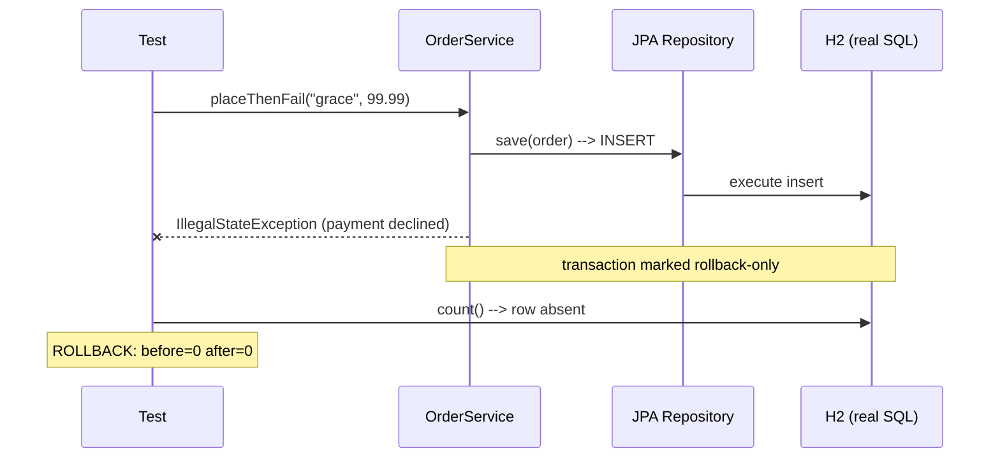

# Integration Testing

## 1. Learning Objectives

After this lesson you will be able to:

- [ ] Write a `@SpringBootTest` that proves beans wire, JPA maps, and transactions actually roll back
- [ ] Explain what an integration test can catch that a unit test structurally cannot
- [ ] Diagnose the "test never ran" class of failure (include patterns, naming conventions)
- [ ] Choose between an in-memory database, a shared test database, and a containerized real one — and state what each choice can and cannot prove
- [ ] Budget integration-test time against unit-test time using measured numbers

## 2. Prerequisites

- [Unit Testing](unit-testing.md) — the level below, and why it's fast
- [11-BACKEND-ENGINEERING](../11-BACKEND-ENGINEERING/README.md) — Spring context, JPA, transactions (`controllers-services-repositories.md`)

## 3. Introduction

A unit test proves your logic; an integration test proves your logic *is actually
connected*. Two classes can each be perfect in isolation and fail together because a
bean isn't wired, a column name doesn't match, a transaction never starts, or a
config property is misspelled. Integration tests run the real components with real
(medium-speed) collaborators — in the lab: the full Spring context, JPA, and an H2
database, in 12.60 seconds for 3 tests.

## 4. The Problem It Solves

Mocks let unit tests fake every collaborator — including the ones whose real behavior
differs from the fake. The classic escapes: SQL that only your real database rejects,
mapping mismatches (`customer` vs `cust_name`), transaction boundaries that silently
don't apply, and wiring errors that only surface at runtime. There is also a quieter
problem this lesson's lab hit personally: **a test that never runs**. Our integration
class was first named `OrderServiceIT` — surefire's default include pattern
(`*Test`, `Test*`, `*Tests`, `*TestCase`) skips it, so the "suite was green" while a
third of the intended tests executed nowhere. The rename to
`OrderServiceIntegrationTest` is part of the transcript below.

## 5. Core Concepts

### What integration means here

The unit under test is a *slice of the real system*: your service + real repository
proxy + real ORM mapping + real transaction manager + a database. Everything except
the thing you're testing is genuine — which is the point and the cost.

### The three proofs worth buying

1. **Wiring proof** — the context loads, the beans exist. Catches missing configuration.
2. **Round-trip proof** — save then read back through the mapping. Catches schema/field mismatches.
3. **Boundary proof** — the transaction's semantics: an exception after a save leaves *no row*.

### Include patterns are part of the test

A test class that the runner doesn't discover is not a weak test — it is an absent
one, and the suite is green about it. Print test counts in CI and alert on drops.

### Database choices, priced

| Option | Proves | Cannot prove | Speed |
|---|---|---|---|
| In-memory (H2) | wiring, mapping, transactions | your production SQL dialect | seconds |
| Shared test DB | dialect + concurrency, partly | isolation between runs | minutes |
| Containerized real engine | everything the engine decides | — (cost: startup per run) | minutes, cold |

## 6. How It Works

1. `@SpringBootTest` boots the application context the same way the real app does —
   auto-configuration, component scan, property loading — then autowires your test.
2. Hibernate (via the dialect) generates schema from entities (`ddl-auto=create-drop`
   in the lab) — a mismatch between entity and mapping fails here, not in production.
3. `@Transactional` on the service joins the transaction manager; an exception
   escaping the method marks it rollback-only, and the database discards the insert.
4. The test's own transaction handling matters: if the *test* were `@Transactional`,
   it would run inside one rolled-back transaction and see a different world — so the
   rollback probe deliberately is not.



## 7. Practical Examples

All executed (authoring machine: Java 25, Spring Boot 4.1.1, H2, Windows 11).

**Example 1 — wiring and round-trip** (executed)

```java
@SpringBootTest
class OrderServiceIntegrationTest {
    @Autowired private OrderService service;
    @Autowired private OrderRepository orders;

    @Test void contextLoads() {
        assertNotNull(orders, "repository bean wired");
        assertNotNull(service, "service bean wired");
        System.out.println("CTX-LOAD: beans wired, initial rows=" + orders.count());
    }

    @Test void placePersists() {
        long before = orders.count();
        Order saved = service.place("ada", 42.00);
        assertNotNull(saved.getId(), "persisted entity must have an id");
        Order reloaded = orders.findById(saved.getId()).orElseThrow();
        assertEquals("ada", reloaded.getCustomer(), "round-trip through the mapping");
        System.out.println("PERSIST: id=" + saved.getId() + " rows " + before + " -> " + orders.count());
        orders.deleteById(saved.getId());
    }
}
```

Executed output: `CTX-LOAD: beans wired, initial rows=0`,
`PERSIST: id=2 rows 0 -> 1`.

**Example 2 — the rollback probe** (executed)

The service under test:

```java
@Transactional
public Order placeThenFail(String customer, double net) {
    Order saved = orders.save(new Order(customer, net));
    throw new IllegalStateException("payment declined: simulated failure after save");
}
```

The probe and its executed result:

```java
@Test void rollbackAfterFailure() {
    long before = orders.count();
    assertThrows(IllegalStateException.class,
            () -> service.placeThenFail("grace", 99.99),
            "the simulated payment decline must propagate");
    long after = orders.count();
    assertEquals(before, after, "the save must have rolled back with the exception");
}
```

```
ROLLBACK: before=0 after=0 -> exception propagated AND the row is gone
```

Both halves matter: the exception *propagated* (callers can handle it) and the row
*vanished* (the DB didn't half-commit). A unit test with an in-memory `List` as the
"repository" can fake this; only this test proves the real transaction manager did it.

**Example 3 — the class that never ran** (executed)

```
# before rename: class OrderServiceIT — no mention anywhere in the run
[INFO] Tests run: 22, ... BUILD SUCCESS        # IT class absent from every line

# after rename to OrderServiceIntegrationTest:
[INFO] Tests run: 3, Failures: 0, Errors: 0, Skipped: 0, Time elapsed: 12.60 s
       -- in com.example.lab.OrderServiceIntegrationTest
[INFO] Tests run: 22, ... BUILD SUCCESS
```

- **How to run:** `mvn test` (full), `mvn test -Dtest=OrderServiceIntegrationTest` (alone).
- **Assumptions:** Maven 3.9.16, surefire 3.5.6 — include patterns are surefire's, check yours.

## 8. Real-World Applications

Integration suites are the merge gate's backbone: fast enough for every push (seconds
to low minutes), real enough to catch wiring. Teams typically split them from units by
profile/tag so devs run units in the inner loop and CI runs both; engines that matter
(PostgreSQL, MySQL) get containerized variants — *the container setup itself is
labelled reference here: the authoring machine runs H2 in-process; in your
environment, capture the container startup line and one test run against it.*

## 9. Common Mistakes

| Mistake | Why it happens | How to recognize it | How to prevent it |
|---|---|---|---|
| Class never runs | naming/include pattern mismatch | test count silently drops; file absent from run | print counts in CI; assert expected class names appear |
| Test made `@Transactional` | copied habit | rollback probe "passes" trivially inside test tx | run probes in test-managed transactions only |
| H2-proven SQL shipped to Postgres | dialects differ | green in CI, red in prod | containerized real-engine job for query-heavy code |
| One giant context test | boots once for everything | one failure masks others; 5-minute runs | slice by feature; assert one behavior per test |
| Shared mutable DB rows | tests seed via production paths | order-dependent integration failures | unique data per test; clean up in `finally` |

## 10. Best Practices

- **Prove the three proofs** — wiring, round-trip, transaction boundary; they are the cheapest bug classes this level catches.
- **Count tests as an assertion** — the `OrderServiceIT` incident: if a run reports fewer tests than yesterday, something stopped running.
- **Name the message you want on failure** — `assertThrows(..., "the simulated payment decline must propagate")` explains red before anyone opens logs.
- **Budget the level** — units 0.216 s vs integration 12.60 s executed here; keep the integration set small enough to run every push, or it runs never.
- **Match the engine you ship on** — H2 for the inner loop is fine *because* a real-engine job exists somewhere.

## 11. Limitations and Trade-Offs

Context boot dominates runtime (12.60 s for 3 tests): the suite scales with startup,
not test count, until you reuse contexts (Spring caches them across tests). H2-verified
claims are H2-scoped — quoting them as "the database accepts this" overstates. And
integration tests are *worse* diagnosers than units: a failure says "somewhere in the
slice", so they complement units rather than replace them — the pyramid needs both
bands.

## 12. Practical Exercises

### Introductory

1. **Exercise 4.1** — write the wiring test for your own app context. **Completion criteria:** executed `CTX-LOAD`-style line; one sentence on which failure classes it catches (and that it catches nothing else).
2. **Exercise 4.2** — write a round-trip test through your real mapping. **Completion criteria:** save → read → assert → cleanup; captured green run.

### Intermediate

3. **Exercise 4.3** — reproduce the rollback probe on a `@Transactional` method you own. **Completion criteria:** both halves captured — exception propagated *and* row/state unchanged.
4. **Exercise 4.4** — reproduce the never-ran incident: rename a test class out of the include pattern, watch the count drop, rename it back. **Completion criteria:** both counts and the empty-run evidence.

### Independent problem-solving

5. **Exercise 4.5** — design your suite's engine strategy: what H2 (or SQLite) proves, what needs the real engine, and how each runs in CI. **Completion criteria:** a decision table like section 5's, with your measured cold-start times and one executed test on the real engine you ship against.

*Solutions: attempt first. They live in [`solutions/`](exercises/solutions/README.md) of this subject.*

## 13. Knowledge Check

1. Why can a perfectly green unit suite coexist with a broken `application.properties`?
2. What exactly did the `OrderServiceIT` incident prove — and why is "add assertions" not the fix?
3. When would you accept H2-only integration tests, and what must exist before you may quote them as evidence about production?

## 14. Completion Criteria

- [ ] You can write the three proofs (wiring, round-trip, rollback) from a blank editor
- [ ] You can explain why the test class must not be `@Transactional` for a rollback probe
- [ ] You can check, from a run's output, that every test you believe exists actually ran
- [ ] You can state what your chosen database option can and cannot prove

## 15. Summary

- Integration tests buy wiring, mapping, and transaction proofs — things mocks structurally cannot show.
- The executed rollback probe: exception propagated, `before=0 after=0`.
- A test outside the include pattern is absent, not weak; counts belong in CI.
- In-memory databases are evidence about wiring and dialects-cached-in claims about production.
- 12.60 s for 3 tests vs 0.216 s for 16 units: keep the level small enough to always run.

## 16. Next Steps

- Next lesson: [End-to-End Testing](end-to-end-testing.md) — the whole stack, user's seat
- Practice: [exercise set](exercises/README.md)
- Where it is applied: [Project 07](../20-PROJECT-LABORATORY/project-07-secure-production-application/README.md)