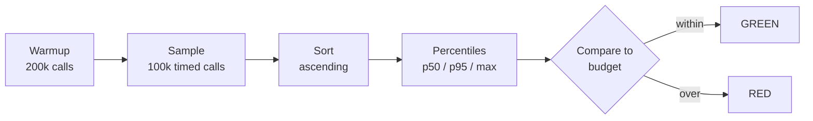

# Performance Testing

> Every transcript in this lesson was executed on the authoring machine (Windows,
> Java 25, `spring-boot-starter-parent` 4.1.1) against `PerformanceBatteryTest`
> in the batch-16 lab. Tooling we did not run — JMH, k6, JMeter, production
> traffic — is marked *labelled reference* and never quoted as a transcript.

## 1. Learning Objectives

After this lesson you will be able to:

- [ ] State a performance **budget** as a test assertion (p95 under N), not as a feeling
- [ ] Measure a hot path with JIT warmup, and explain why a cold measurement lies
- [ ] Read a latency distribution: why the average passing says nothing about the tail
- [ ] Build a regression gate that discriminates a slow implementation from a fast one,
  and prove the gate fires by breaking it deliberately
- [ ] Name two things a micro-benchmark cannot tell you about production behavior

## 2. Prerequisites

- [testing-fundamentals](testing-fundamentals.md) — arrange–act–assert, and why a test
  that prints but never asserts proves nothing (that lesson's `PrintTrapTest` returns here)
- [unit-testing](unit-testing.md) — writing assertions against real code
- [api-testing](api-testing.md) — the `RANDOM_PORT` real-socket harness this lesson's
  HTTP-level exercise builds on
- [integration-testing](integration-testing.md) — Spring's test contexts, used by the
  HTTP exercise

## 3. Introduction

Every other test in this subject asks *is it correct?*. Performance testing asks a
different kind of question: *is it still fast enough — and how would we know?*. A
regression in latency ships as quietly as any other: no exception, no red test, no
stack trace. Users just notice that the page "feels slower" three releases later,
when nobody can point at the commit.

The discipline is the same discipline you have already learned: turn the expectation
into an observable check. Instead of `assertEquals(95.00, …)` you write *p95 of
this call must stay under 50 µs* — and then you have to confront everything that
makes performance hard to measure: the JIT, the noise, the distribution hiding in
one number, and the machine underneath all of it.

## 4. The Problem It Solves

Before budgets-as-tests, teams "check performance" by running the app once on a
laptop, seeing it respond, and moving on. Three things go wrong with that:

1. **The first measurement is a lie.** The JVM interprets, then profiles, then
   compiles the hot path. A call measured on a cold JVM can be 10–100× slower than
   the same call after warmup. A laptop demo measures the cold path; your users
   hammer the warm one — or worse, the reverse: you ship a change that only looks
   fast because the demo never reached steady state.
2. **One number hides a distribution.** An average of 0.4 ms can mean "everything
   takes 0.4 ms" or "99% take 0.07 ms and 1% take 20 ms". Those are different
   products; the average reports them identically.
3. **Nobody reruns the check.** A one-off measurement doesn't gate anything. The
   next refactor removes the `HashSet` and nobody finds out until users do.

Performance testing is how those three failure modes become a red build instead of
a support ticket.

## 5. Core Concepts

### Latency and throughput

**Latency** is how long one operation takes. **Throughput** is how many operations
complete per second. They are related but not interchangeable: a system can be
fast per request and still saturate under concurrency. This lesson's batteries
measure latency; the load-shaping tools in section 8 measure both.

### Percentiles (p50, p95, p99)

Sort all samples of one metric ascending. The **p95** is the value 95% of samples
sit below. p50 is the median; p99 is the "one in a hundred" case. Percentiles are
how you talk about a distribution without lying with a mean. Rule of thumb: users
feel p95; *nobody* enjoys p99.

### Budget

A **budget** is a latency (or throughput) number you agree to not exceed, written
down before you measure, and then asserted: `p95 <= 50_000 ns`. A budget without
an assertion is a wish. A budget asserted but never explained becomes a magic
number that nobody dares tighten.

### Warmup

**Warmup** is running the code before you start sampling, so the JIT has compiled
the hot path and caches are populated. In our battery: 200 000 unmeasured calls
before the first sample is taken. Without it, you are benchmarking the interpreter.

### Measurement harness

The code that runs warmup, samples, sorts, and compares. Ours is hand-rolled —
about forty lines of `System.nanoTime()`. **JMH** (Java Microbenchmark Harness)
is the serious tool: it forks separate JVMs, handles dead-code elimination,
blackholes results, and does proper steady-state detection. We did not run JMH in
this batch (it means adding a plugin and reshaping the lab), so every JMH mention
below is *labelled reference* — the honest version of "use JMH" without a
transcript pretending we did.

### The regression gate

A performance test that fails the build. Like every gate in this subject, it is
only trustworthy once you have watched it fire: tighten the budget, see red,
revert. A gate that has never been red is a rubber stamp (see
[testing-fundamentals](testing-fundamentals.md)'s green-while-wrong drill).

### Kinds of performance test *(labelled reference)*

| Kind | Question it answers | We ran it? |
|---|---|---|
| Micro-benchmark | Is this function still fast? | ✅ executed (P1–P3) |
| Load test | Does it hold at N users/req-s? | ❌ needs k6/JMeter |
| Stress test | Where does it break? | ❌ needs a target environment |
| Soak test | Does it degrade over hours (leaks)? | ❌ needs hours of runtime |

## 6. How It Works

The measurement pipeline our battery runs, in order:



Why sort? A percentile is a *position* in the ordered distribution — `ns[int(n *
0.95)]` after sorting. The average is computed before sorting and is the only
summary that throws the distribution away first.

Why warmup? The JVM compiles hot methods with C2 after enough invocations. Until
then you are timing the interpreter. The measured samples must come from the same
steady state your production traffic will run in. Note P1's output below:
`p50=100ns p95=100ns` — steady state — while `max=16300ns` shows that even after
warmup, one sample in a hundred thousand hit a pause (GC, scheduling). That max is
real too; it is why you pick a percentile to gate on and keep the max as context.

## 7. Practical Examples

All three probes live in `PerformanceBatteryTest`. **How to run:**
`mvn test -Dtest=PerformanceBatteryTest`. **Assumptions:** Java 25, single JVM,
one machine — every absolute number below is *this machine's* number; the lesson's
claims are about the *relationships* (over/under, avg vs tail), which reproduce
anywhere.

**Example 1 — the budget, measured honestly** (executed, green)

```java
// warmup: let the JIT compile the hot path before any sample counts
for (int i = 0; i < 200_000; i++) {
    sink += eu.orderTotal(123.45);
}

long[] ns = new long[100_000];
for (int i = 0; i < ns.length; i++) {
    long t0 = System.nanoTime();
    sink += eu.orderTotal(123.45);
    ns[i] = System.nanoTime() - t0;
}
Arrays.sort(ns);
long p95 = ns[(int) (ns.length * 0.95)];

System.out.printf("P1 p50=%dns p95=%dns max=%dns budget=%dns%n", p50, p95, max, BUDGET_NS);
assertTrue(p95 <= BUDGET_NS, "p95 " + p95 + "ns exceeds budget " + BUDGET_NS + "ns");
```

```
P1 p50=100ns p95=100ns max=16300ns budget=50000ns
```

- `sink` accumulates every result so the JIT cannot dead-code-eliminate the calls —
  the classic micro-benchmark trap (JMH solves this generally; we solved it by hand).
- p95 = 100 ns sits far under the 50 µs budget; `max=16300ns` is the pause the
  percentile deliberately tolerates.

**Example 2 — the average that passes while p99 fails** (executed, green)

Real samples, with an injected 5 ms pause (a stand-in for a GC or deschedule)
every 83rd call, *inside* the timed window:

```
P2 avg=0.073ms PASS vs budget 5.0ms | p99=5.65ms max=6.99ms -> tail caught
```

The assertions encode both halves of the lesson: `avg <= budget` (the summary the
dashboard shows) **and** `p99 > budget` (the experience the unlucky 1% had). If
you gated on the average alone, this workload would ship.

**Example 3 — a gate that discriminates** (executed, green)

5 000 lookups against a 100 000-row list, keys at the far end, first with
`ArrayList.contains` (O(n) per lookup), then with a `HashSet` (O(1)):

```
P3 naive=944ms (budget 50ms) -> OVER | indexed=0ms -> PASS (found=10000)
```

The assertions are `indexed <= 50ms` and `naive > indexed * 5` — the second one
proves the gate can tell the two implementations apart. A gate that returned the
same verdict for both would be a rubber stamp.

Full run: `Tests run: 3, Failures: 0, Errors: 0, Skipped: 0` / `BUILD SUCCESS`.

**Example 4 — the deliberate break** (executed)

Temporarily tighten `BUDGET_NS` from `50_000` to `10`:

```
org.opentest4j.AssertionFailedError: p95 100ns exceeds budget 10ns ==> expected: <true> but was: <false>
[ERROR] Tests run: 1, Failures: 1, Errors: 0, Skipped: 0
[INFO] BUILD FAILURE
```

Revert → green again. The gate fires when it should; that is the whole claim.

**Two mistakes we actually made writing this battery** (both captured, both fixed —
they are the best material in this lesson):

1. First run of P2 printed `avg=0.001ms PASS | p99=0.01ms max=0.08ms -> tail missed`
   and failed its own tail assertion. Cause: the `Thread.sleep(5)` sat *before*
   `t0 = System.nanoTime()` — the pause was never inside the timed window, so the
   "tail" didn't exist. Moving the pause inside the window turned the same code
   into `p99=5.65ms -> tail caught`. **Your harness can silently not-measure what
   it claims to measure.**
2. First run of P3 printed `naive=24ms (budget 50ms) -> PASS` — the naive scan under
   budget, no discrimination. Cause: the lookup keys were `0..4999`, sitting at the
   *front* of a 100 000-element list, so `contains` averaged ~2 500 comparisons
   instead of ~97 500. Moving the keys to `95_000..99_999` produced the real
   worst case: `naive=944ms -> OVER`. **A benchmark whose workload is unrepresentative
   measures nothing — the benchmark was green while telling us the opposite of the truth.**

## 8. Real-World Applications

- **CI performance gates** run a small, stable benchmark per PR and fail on
  regressions beyond a noise margin. They work best when the workload is small and
  the machine is dedicated — see the flakiness trade-off in section 11.
- **Service budgets** in production: teams own a p95/p99 SLO per endpoint, alerted
  before users complain. The unit-scale assertion in Example 1 is the same idea at
  the smallest size.
- **Load tools** — *labelled reference*: k6, Gatling, and JMeter script realistic
  arrival patterns against a staging environment and report throughput plus
  percentiles. They answer questions our battery cannot (concurrency, connection
  pools, queueing) and are the standard next step after unit-scale budgets pass.
- **Before/after profiling** for optimization work: any PR claiming "made it faster"
  should carry both numbers — the same discipline as this lesson's P3 pair.

## 9. Common Mistakes

| Mistake | Why it happens | How to recognize it | How to prevent it |
|---|---|---|---|
| Measuring without warmup | first call is the most "interesting" one | numbers drop over the first N samples | fixed warmup phase; check p50 is stable |
| Gating on the average | mean feels like "typical" | users complain while the dashboard is green | assert percentiles; print avg as context only |
| Pause outside the timing window *(executed)* | instrumentation placed around, not inside, the work | P2 first run: `p99=0.01ms -> tail missed` | assert the tail *exists* as well as the budget |
| Unrepresentative workload *(executed)* | easy inputs chosen by habit | P3 first run: naive `24ms -> PASS` | build inputs from real worst-case shape |
| Budget tighter than the noise floor | number copied from another machine | gate flips red/green between runs | measure baseline variance; budget above it |
| Dead-code elimination | JIT removes the "work" you timed | suspiciously perfect numbers | accumulate results into a consumed sink |
| Never red | gate added and trusted | same as a never-failing unit test | deliberate-break drill (Example 4) |

## 10. Best Practices

- **Budgets live next to the code they protect**, as constants with a comment saying
  where the number came from — not in a wiki nobody opens.
- **Warm up, then sample, then sort.** The three-step shape of Example 1 is the
  minimum honest harness; anything less measures the wrong JVM.
- **Assert a percentile, print everything** (p50, p95, max, avg). The assertion
  gates; the printed line diagnoses when it fires.
- **Prove discrimination**: for every gate, show it passing the good implementation
  *and* failing the bad one (P3 does both in one run).
- **Budget for the machine class.** Absolute nanoseconds belong to the machine that
  measured them; gate on the hardware that runs CI, or gate on relative change.
- **When the discipline outgrows the harness, switch to JMH** *(labelled reference)*:
  fork-per-benchmark, blackhole results, and steady-state detection are real
  problems you should not keep re-solving by hand.

## 11. Limitations and Trade-Offs

- **A micro-benchmark says nothing about the macro.** `orderTotal` at 100 ns tells
  you nothing about p95 of a page load that makes 40 of them plus a database round
  trip. Unit budgets catch algorithmic regressions, not system ones.
- **Hand-rolled harnesses drift.** Ours runs in the same JVM as the tests, one fork,
  no steady-state check. JMH exists because each of those is a subtle way to lie.
- **CI machines are noisy.** Shared runners carry neighbours' GC and CPU steal;
  absolute budgets there are flaky budgets. Options: wide budgets, relative
  comparisons, or dedicated runners — each costs something.
- **Passing ≠ fast enough in production.** The battery proves the code path under
  our workload; concurrency, I/O and queueing need the load tools of section 8.
- **You cannot prove an absence.** A green budget means "not slower than this, here,
  now". It is a ratchet, not a proof.

## 12. Practical Exercises

### Introductory

1. **Exercise 9.1** — Add a p50 assertion to P1 with a 20 µs budget. **Completion
   criteria:** the suite stays green, and the printed line shows p50 well under it.
2. **Exercise 9.2** — Run P2 with the pause every 250th call instead of every 83rd.
   Predict first whether p99 still exceeds the 5 ms budget, then run.
   **Completion criteria:** your prediction and the printed `p99=` agree, with one
   sentence explaining the percentile arithmetic.

### Intermediate

3. **Exercise 9.3** — Add a P4 that budgets the *whole* `orderTotal` path at the
   API layer: time 100 `RANDOM_PORT` GETs against the running app, assert p95
   under a budget you justify from a measured baseline. **Completion criteria:**
   the test is green twice in a row (noise margin check), and you can state what
   the budget excludes (context load, connection setup).
4. **Exercise 9.4** — Break the gate two ways: (a) tighten the budget below p95,
   (b) replace the `HashSet` in P3 with the `ArrayList`. **Completion criteria:**
   two distinct red captures, both reverted to green, each with the failing
   assertion line quoted.

### Independent problem-solving

5. **Exercise 9.5** — You own a feed endpoint whose p99 doubled after a release
   while the average barely moved. Design the performance test that would have
   caught it: state the metric, the percentile, the budget, where it runs, and
   what you will do about runner noise. **Completion criteria:** a written test
   plan naming all five, plus the executed probe for the part you can run locally;
   parts needing staging are labelled reference with the exact command or script
   shape you would run.

*Solutions: attempt first. They live in `solutions/` of this subject.*

## 13. Knowledge Check

1. Your p95 budget passes for a month, then users report "the site is slow".
   What measurement would you add first, and what result would confirm their
   experience while p95 stays green? …
2. What would happen if you removed the warmup loop from Example 1 and why would
   the numbers move? …
3. When would you *not* gate a build on a latency assertion? …

## 14. Completion Criteria

Observable evidence that you have understood this lesson:

- [ ] You can write a percentile assertion from a blank editor and say why it is a
  percentile and not a mean
- [ ] You can explain both executed mistakes in Example 2's list and how you would
  have caught each with an assertion
- [ ] You have run the deliberate break yourself and quoted the red line
- [ ] You can name one question this battery cannot answer and the tool that can

## 15. Summary

- Performance becomes testable the moment the expectation is an assertion: p95
  under a budget, written before measuring.
- Warm up before sampling — a cold JVM measures the interpreter, not your code.
- Percentiles describe a distribution; averages hide exactly the part users feel.
- A gate is only trusted after it has been watched fail (executed: budget
  tightened → red → reverted).
- Our harness is honest but small: JMH and load tools are the next tier, and we
  did not pretend to run them.

## 16. Next Steps

- Next lesson: [Security Testing](security-testing.md) — assertions for the
  failure classes a green functional suite never looks for
- Practice: [exercise set](exercises/README.md)
- Where it is applied: performance budgets return in
  [16-DEVOPS-AND-INFRASTRUCTURE](../16-DEVOPS-AND-INFRASTRUCTURE/README.md) as pipeline gates