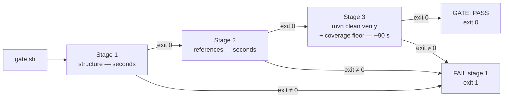

# Quality Gates

> Every transcript in this lesson was executed on the authoring machine (Windows,
> Git Bash, Java 25, Maven, JaCoCo 0.8.13) as a real three-stage script —
> baseline green, planted violation blocked, fix green — with the exit codes
> recorded. Hosted CI configuration (GitHub Actions, GitLab CI) is *labelled
> reference*: same stages, different runner.

## 1. Learning Objectives

After this lesson you will be able to:

- [ ] Assemble a quality gate from cheap static checks and an expensive test
  stage, ordered so the fast checks fail first
- [ ] Reproduce the blocked-run drill: new production code, all tests green,
  gate red — and say why that is the gate working rather than the gate nagging
- [ ] Read a gate's exit code, not its applause, and name the three legitimate
  responses to a red gate
- [ ] Choose what belongs in a gate and what belongs in a report, using speed,
  flakiness, and signal as the criteria
- [ ] Set a coverage floor you can defend against a measured baseline instead
  of a round number

## 2. Prerequisites

- [test-coverage](test-coverage.md) — where the coverage floor comes from, and
  why a percentage is evidence of execution only
- [security-testing](security-testing.md) — the secrets scan that belongs in a
  pre-commit stage, and the two-gap find-and-fix narrative this lesson's drill
  mirrors
- [testing-fundamentals](testing-fundamentals.md) — green-while-wrong: the fact
  a passing run can still print a wrong value
- [16-DEVOPS-AND-INFRASTRUCTURE](../16-DEVOPS-AND-INFRASTRUCTURE/README.md) —
  where gates stop being a script you run and become infrastructure that runs you

## 3. Introduction

Every other lesson in this subject ends with advice: run the suite, read the
report, assert the value. Advice does not survive contact with a deadline. What
survives is a **quality gate** — a script whose only job is to return a non-zero
exit code when something the team agreed on is broken, so that the merge, the
release, or the human's attention is stopped by a machine rather than by hope.

This lesson builds one for real: three stages, ordered cheapest-first, wired to
the two repository checkers you have been using all along plus the lab's Maven
build with a coverage floor. Then we break it on purpose. A feature branch
arrives with production code and no tests, every one of the 54 existing tests
passes, and the gate still refuses — because "the tests pass" and "this change
is tested" are different sentences, and only one of them was checked before.

## 4. The Problem It Solves

Before gates, quality checks were rituals with no enforcement: someone remembered
to run the suite, someone eyeballed the coverage badge, someone noticed three
weeks later that the tests had been skipped since the release crunch. The failure
mode is not malice — it is that **a check nobody is forced to run is not a
check**. A regression that would have failed one assertion merges because the
only thing standing between it and `main` was a person's memory and a green
badge from last Tuesday.

Gates solve the enforcement problem, not the testing problem: they make the
already-written checks non-optional. They also solve a sequencing problem — a
gate that runs structure checks in seconds before a 90-second Maven build tells
you *which* rule you broke first, when you can still fix it cheaply.

## 5. Core Concepts

### Gate versus report

A **report** tells you a fact and exits zero: the coverage HTML, the linter's
summary, a performance number. A **gate** turns a fact into a verdict: it exits
non-zero when a pre-declared threshold is violated, and something downstream
(ref CI, the merge button, the release script) refuses to proceed. Reports inform;
gates block. Mixing them up produces the worst of both — a number nobody reads
that also fails the build at random.

### Exit code is the whole contract

The script in §7.1 uses one idiom everywhere:

```bash
(cd "$LAB" && mvn -q clean verify) \
  || { echo "GATE: FAIL at stage 3 (tests/coverage)"; exit 1; }
```

The `||` means "if this stage's exit status is non-zero, announce which stage
died and stop with failure." Nothing else in the gate decides pass or fail —
not a log line, not a grep of "BUILD SUCCESS" (which can be satisfied by a
*previous* build's output), not a human reading the tail. The shell's exit
status is the only channel a pipeline can trust, so the gate protects it.

### Fail fast: cheap stages first

Stage 1 (curriculum structure) and stage 2 (link integrity) run in seconds;
stage 3 (compile + tests + coverage) is the ~90-second Maven build, of which a
single API test class takes 36.6 s. Ordering static checks first means the most
common breakages — a renamed file, a moved heading, a link that now points at
nothing — are reported before the expensive stage even starts. Ordering them
the other way taxes every trivial mistake with a full build.

### The floor is a ratchet

The coverage floor lives in the build (`jacoco:check`, `BUNDLE`,
`INSTRUCTION`/`COVEREDRATIO`, minimum `0.90`), not in the script, so *any*
invocation of `mvn verify` enforces it — locally, in CI, in a release build.
The floor is set against a measured baseline (the lab sat at 0.987 before the
drill) rather than a round number someone liked, and it moves up, never down.
Lowering a floor to get a build green is the gate-shaped version of weakening
an assertion: the rule now certifies the gap.

### What a gate should and should not enforce

Three criteria, in order of importance: **is it fast?** (a gate slower than the
feedback loop it protects gets bypassed), **is it deterministic?** (a flaky gate
teaches everyone to re-run instead of to fix, which destroys the meaning of red),
and **does red always mean act?** (if a red gate can legitimately be ignored,
it is a report wearing a gate's clothes). Style opinions, aspirational metrics,
and anything with a known-noisy signal belong in reports and review, not in the
gate.

### The three legitimate responses to a red gate

1. Fix the product (add the test, repair the code, correct the link).
2. Fix the rule, with a written reason (the threshold was set against a bad
   baseline; the check has a false positive you can name).
3. Stop and escalate — the red is real and the decision is not yours.

There is no fourth response in which the gate is edited until it passes.

## 6. How It Works



Each box is one subshell with one exit status; every `≠ 0` path short-circuits
to a labelled failure. The stages share no state, so re-running the gate after a
fix starts from scratch — and because stage 3 is `clean verify`, its coverage
number is computed from *this* build's test set, never a stale `target/`
([test-coverage](test-coverage.md) §7.5).

## 7. Practical Examples

**Example 1 — the gate itself, and its baseline run** (executed)

The complete script:

```bash
#!/usr/bin/env bash
# batch-16 quality gate: structure -> references -> tests + coverage floor
set -uo pipefail
REPO=/c/Users/PC/Desktop/Programming/CodePath-Masterclass
LAB=/c/Users/PC/AppData/Local/Temp/b16/testlab

echo "== 1/3 curriculum structure =="
(cd "$REPO" && python scripts/check-curriculum.py | tail -1) \
  || { echo "GATE: FAIL at stage 1 (structure)"; exit 1; }

echo "== 2/3 references =="
(cd "$REPO" && python scripts/check-links.py | tail -2) \
  || { echo "GATE: FAIL at stage 2 (references)"; exit 1; }

echo "== 3/3 tests + coverage floor =="
(cd "$LAB" && mvn -q clean verify) \
  || { echo "GATE: FAIL at stage 3 (tests/coverage)"; exit 1; }

echo "GATE: PASS"
```

Baseline run, clean lab, nothing planted yet:

```
== 1/3 curriculum structure ==
Structure is consistent. (Structural checks only - educational quality needs human review.)
== 2/3 references ==
check-links (progressive): 418 Markdown files checked, 0 broken reference(s), 85 planned-but-unwritten target(s).
All resolved references are valid; planned targets are tracked in ISSUE-REGISTER.md.
== 3/3 tests + coverage floor ==
GATE: PASS
BASE_EXIT=0
tests=54 failures=0
baseline ratio 379 / 384 = 0.987
```

- What matters: three stage headers, two validator verdicts, one exit code.
  The gate prints the *stage* that failed, so the red names its own first step.
- **Expected output:** `GATE: PASS`, exit status 0; 54 tests, 0 failures;
  bundle coverage 0.987 against a floor of 0.90.
- **How to run it:** `bash gate.sh` from any directory (paths are absolute);
  the exit status is visible with `echo $?`.
- **Assumptions:** Java 25, Maven, JaCoCo 0.8.13, Python 3 for the two
  repository checkers; stage 3 takes ~90 s of which one API test class is 36.6 s.

**Example 2 — the planted violation: 54 green tests, red gate** (executed)

A feature branch adds real production code and no tests
(`AuditLogger.java` — record, blank-guards, a filter and a renderer; quoted here
in the part that matters):

```java
public void record(String actor, String action) {
    if (actor == null || actor.isBlank()) {
        throw new IllegalArgumentException("actor must not be blank: " + actor);
    }
    if (action == null || action.isBlank()) {
        throw new IllegalArgumentException("action must not be blank: " + action);
    }
    entries.add(new Entry(Instant.now(), actor, action));
}
```

Stages 1 and 2 are unaffected — the curriculum is intact, no link broke. Stage 3
runs, every test passes, and the gate still refuses:

```
== 1/3 curriculum structure ==
Structure is consistent. ...
== 2/3 references ==
check-links (progressive): 418 Markdown files checked, 0 broken reference(s), ...
== 3/3 tests + coverage floor ==
[ERROR] Failed to execute goal org.jacoco:jacoco-maven-plugin:0.8.13:check (check)
        on project testlab: Coverage checks have not been met. See log for details.
GATE: FAIL at stage 3 (tests/coverage)
BLOCKED_EXIT=1
```

Surefire's report for that exact run:

```
total=54 failures=0 errors=0
```

and the coverage report the failing rule was reading:

```
covered 379 missed 127 ratio 0.749
AuditLogger: AuditLogger        covered 0 missed 110
AuditLogger: AuditLogger.Entry  covered 0 missed  12
```

- **The lesson in one line:** the test phase exited 0 and the *gate* exited 1.
  "All tests pass" says the existing suite still works; it says nothing about
  whether the new code was ever touched. The floor is the only rule in the build
  that noticed, and 0.749 < 0.90 is not a marginal miss — 127 instructions of
  the new class never ran once.
- **Expected output:** exit 1, `GATE: FAIL at stage 3 (tests/coverage)`.
- **How to run it:** drop any untested production class into the lab's
  `src/main/java` and run `bash gate.sh`.
- **Assumptions:** the floor is `COVEREDRATIO 0.90` on the bundle; a 122-
  instruction class is enough to move a 384-instruction bundle to 0.749 because
  the denominator is small — on a large repo the same gap moves the number less,
  which is exactly why the floor must be chosen against your own baseline.

**Example 3 — the only legitimate fix** (executed)

The red is answered by writing tests, not by touching the floor. Four of them —
counting, blank-rejection (the guards the report just named), the actor filter,
and the renderer:

```java
@Test
void blankActorOrActionIsRejected() {
    AuditLogger log = new AuditLogger();
    assertThrows(IllegalArgumentException.class, () -> log.record("", "x"));
    assertThrows(IllegalArgumentException.class, () -> log.record(null, "x"));
    assertThrows(IllegalArgumentException.class, () -> log.record("ada", null));
    assertThrows(IllegalArgumentException.class, () -> log.record("ada", "  "));
    assertEquals(0, log.count());
}
```

Re-run the gate:

```
== 3/3 tests + coverage floor ==
P3 both traversal shapes -> non-200, no file contents
P1 401 x2 identical; challenge=Bearer realm="lab"
GATE: PASS
FINAL_EXIT=0
tests=58 failures=0 errors=0
bundle ratio: 501 / 506 = 0.9901
```

- Before/after, same floor: `0.749 → 0.9901`, tests `54 → 58`, exit `1 → 0`.
  Notice the fix *raised* the number past the original baseline — the new code
  arrived fully covered, which is what "ratchet up" means in practice.
- **How to run it:** `bash gate.sh` (the whole thing, not just the test phase —
  the floor lives in `verify`).
- **Assumptions:** no configuration changed between runs 2 and 3; the only diff
  is one added test file.

**Example 4 — the gate's honest limit** (executed)

The final `GATE: PASS` run's output still contains, unchanged:

```
PRINT-TRAP: expected=19.9 actual=19.8 MISMATCH
...
GATE: PASS
```

A wrong value printed inside a passing gate, because the test that touches that
line prints instead of asserting ([testing-fundamentals](testing-fundamentals.md)),
and no rule in the gate compares printed values. The gate blocks *the failures
it was told about* — coverage floor, broken references, failing tests. It cannot
notice a vacuous test, an unasserted value, or a requirement nobody wrote down.
Green means "the agreed checks held," never "the software is correct."

## 8. Real-World Applications

- **Merge gates in CI.** The same stages, run by a hosted runner on every pull
  request, with branch protection making the check *required* so the merge button
  stays disabled while red (*labelled reference*: a GitHub Actions job that runs
  `gate.sh` and publishes its exit code as a status check).
- **Pre-commit hooks.** The cheap half — structure, references, the secrets scan
  from [security-testing](security-testing.md) — belongs where it costs seconds;
  nobody waits on a 90-second build to commit a message typo.
- **Release pipelines.** The expensive half (full suite, coverage floor, package
  build) gates the artifact, so what ships is bit-for-bit what passed.
- **Budget splits.** Teams routinely keep a fast per-push gate (unit + static,
  seconds) and a nightly full gate (E2E, performance, security battery), because
  the cost of a gate is paid by everyone who touches the repo.

## 9. Common Mistakes

| Mistake | Why it happens | How to recognize it | How to prevent it |
|---|---|---|---|
| Grep for "BUILD SUCCESS" instead of using exit codes | output looks easier to read | gate passes on stale log text | `cmd \|\| fail`, always; the shell already knows |
| Slow gate last, static checks never | copied from a build script | a typo costs 90 s to learn about | order stages by cost, cheapest first |
| Flaky checks inside the gate | "more coverage of the pipeline" | people re-run instead of fixing | deterministic or out; flake goes to a report |
| Lowering the floor to go green | deadline pressure | minimum drops in the same PR as the red | floors move only up, or with a written reason |
| Treating green as correctness | badge culture | `PRINT-TRAP` inside a PASS run (executed) | keep the print-trap lesson visible in the gate's docs |
| No stage labels on failure | aggregated logs | you know it failed, not where | echo the stage name on every exit path |
| Style linters in the merge gate | uniformity zeal | review argues about formatting, not behavior | style = report or autofix; gate = correctness |

## 10. Best Practices

- **Fail fast, cheapest stage first** — and print which stage died. Every
  transcript above names its stage on failure, so the red is self-describing.
- **Set floors against a measured baseline.** The 0.90 floor was chosen because
  the lab measured 0.987; a floor above your current number blocks everything,
  far below it blocks nothing.
- **Keep the pre-merge gate under a couple of minutes.** The moment a gate is
  slower than a coffee break, developers run it locally as little as possible —
  which is when it stops preventing anything.
- **One rule per gate entry, with a reproduction command in the message.**
  `GATE: FAIL at stage 3 (tests/coverage)` tells you to run `mvn clean verify`
  in the lab; a bare `build failed` sends you spelunking.
- **Never fix a red gate by editing the gate.** Fix the product, or fix the
  rule with a reason you would defend in review (§5).
- **Split by cost, not by religion.** Fast deterministic checks per push; slow
  or expensive ones nightly. Where the line falls depends on your suite's
  measured runtime, not on a rule of thumb.

## 11. Limitations and Trade-Offs

- **A gate only checks what it encodes.** Example 4 is the proof: a wrong value
  sails through a green gate. Coverage, link integrity, and test success are
  necessary, not sufficient.
- **Coverage floors are blunt on small bundles** (executed: one 122-instruction
  class moved the lab from 0.987 to 0.749). On a large monolith the same missing
  test moves nothing — consider per-module floors there.
- **Local ≠ CI.** This lesson's gate ran in Git Bash with absolute local paths.
  Hosted runners bring their own caches, timeouts, and flakes; parity is work
  (*labelled reference*: matrix builds, required checks, cache keys).
- **Gates tax every change.** The 90-second stage 3 is paid on every run — which
  is why stage ordering and the fast/slow split are design decisions, not
  optimizations.
- **Red can mean the rule is wrong.** Legitimate response 2 exists: a floor set
  on a bad baseline must be corrected, openly, in its own commit.
- **`85 planned-but-unwritten targets` passes stage 2.** The reference checker
  distinguishes "broken" from "not written yet" — a gate that failed on every
  unwritten plan would be ignored within a week. Know which of your checks are
  real and which are placeholders.

## 12. Practical Exercises

### Introductory

1. **Exercise 12.1** — Run the three stages of the gate individually and record
   each one's exit status and wall time. **Completion criteria:** a table with
   stage, command, exit code, seconds — and one sentence saying which stage you
   would drop first if the gate had to fit in 30 seconds.
2. **Exercise 12.2** — Break only stage 2 (point a link at a file you rename)
   and confirm stages 1 and 3 never start. **Completion criteria:** a transcript
   showing `GATE: FAIL at stage 2 (references)`, exit 1, and no Maven output.

### Intermediate

3. **Exercise 12.3** — Reproduce the planted-violation drill on your own copy of
   the lab: add an untested production class, watch the gate block, then close
   the gap with tests. **Completion criteria:** three captured runs (0.987 →
   below floor → above floor), with the test count and exit code from each.
4. **Exercise 12.4** — Add a fourth stage that fails the gate when the test
   output contains `MISMATCH` (closing Example 4's hole). **Completion criteria:**
   the gate exits 1 on today's lab with the print-trap present, and exits 0 after
   you turn the printed comparison into a real assertion — without changing any
   other stage.

### Independent problem-solving

5. **Exercise 12.5** — Design the gate policy for a team shipping weekly: which
   checks run per push, per merge, per release; the runtime budget for each; the
   floor numbers with the measurements that justify them; and the exact message
   a developer sees when each stage fails. **Completion criteria:** a written
   policy where every stage has a stated cost, a stated signal, and a named
   owner for its false positives.
6. **Exercise 12.6** — Take the gate from Exercise 12.5 to a hosted runner
   (*labelled reference*: CI YAML), make the check required for merges, and
   prove the enforcement by opening a PR that must not merge. **Completion
   criteria:** the PR refuses to merge while red, and merging succeeds after a
   legitimate fix — with no manual override used.

*Solutions: attempt first. They live in `solutions/` of this subject.*

## 13. Knowledge Check

1. Stage 3's tests all pass and the gate exits 1. State, in one sentence, what
   the gate knew that the test phase did not.
2. Why does the script `echo` a stage label on failure instead of letting the
   subshell's own error speak for itself?
3. Someone proposes gating on 100% line coverage. Using this lesson's baseline
   (0.987) and Example 4, give two reasons this is a worse gate than the one
   built here.
4. The coverage floor belongs in the pom rather than in `gate.sh`. What
   different behavior does that produce when someone runs `mvn verify` directly?
5. Name a check that must *not* go into a pre-merge gate, and say which of the
   three criteria in §5 disqualifies it.

## 14. Completion Criteria

You have completed this lesson when you can:

- [ ] Write a multi-stage gate script whose exit status is trustworthy (no log
  grepping) and whose failure names its stage
- [ ] Order three checks by cost and justify the order in one sentence each
- [ ] Reproduce the green-tests/red-gate drill from memory and interpret it
- [ ] Defend a coverage floor with a measurement, not a round number
- [ ] Point to one thing your gate does not check and say what does check it

## 15. Summary

- A gate is a rule with an exit code: reports inform, gates block, and the
  shell's status is the only contract worth trusting.
- Order stages cheapest-first so the common breakage fails in seconds; keep the
  expensive build last and under a couple of minutes.
- Executed: 54 green tests could not pass a gate that checked whether the new
  code ran — `0.749 < 0.90`, exit 1 — because passing tests and tested changes
  are different claims.
- The only fixes for a red gate are fixing the product or arguing the rule; the
  floor moved `0.749 → 0.9901` by adding four tests, never by touching config.
- Green means the agreed checks held. The `PRINT-TRAP` line inside a passing run
  is the permanent reminder of everything a gate does not see.

## 16. Next Steps

- The floor this lesson enforces: [Test Coverage](test-coverage.md) — the number
  itself, and the honesty drill no gate can catch (final lesson of this subject)
- Practice: [exercise set](exercises/README.md)
- Where it is applied: gates become infrastructure in
  [16-DEVOPS-AND-INFRASTRUCTURE](../16-DEVOPS-AND-INFRASTRUCTURE/README.md) —
  required checks, staged rollouts, and the pipeline that refuses to ship a
  change nobody verified