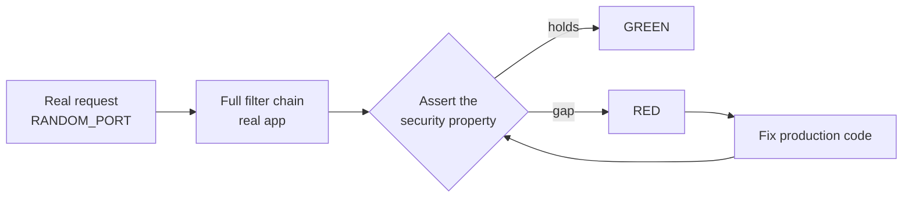

# Security Testing

> Every transcript in this lesson was executed on the authoring machine (Windows,
> Java 25, `spring-boot-starter-parent` 4.1.1) against `SecurityBatteryTest` in the
> batch-16 lab, plus a shell secrets scan over the lab sources. Tooling we did not
> run — OWASP dependency-check, ZAP, hosted DAST — is marked *labelled reference*.

## 1. Learning Objectives

After this lesson you will be able to:

- [ ] Write automated security assertions for authorization, injection, traversal,
  mass assignment, and response headers — and watch them fail on a real gap
- [ ] Explain why the fix belongs in production code, never in the assertion
- [ ] Run a secrets scan over a repository and interpret what a clean result does
  and does not prove
- [ ] Map each battery probe to the OWASP vulnerability class it approximates
- [ ] Say which security questions this battery cannot answer, and name the tier
  of tooling that answers them

## 2. Prerequisites

- [api-testing](api-testing.md) — the `RANDOM_PORT` real-socket harness and the
  401/400/404 contract this battery builds on
- [testing-fundamentals](testing-fundamentals.md) — green-while-wrong, the reason
  every security assertion here was first made to fail
- [mocking-and-test-doubles](mocking-and-test-doubles.md) — why security tests
  must run against the *real* filter chain, not a stubbed collaborator
- [11-BACKEND-ENGINEERING](../11-BACKEND-ENGINEERING/README.md) — the bearer-token
  API shape under test

## 3. Introduction

A green functional suite proves the system does what you asked. It says nothing
about what happens when someone asks for something you *didn't* ask for: someone
else's order, a file outside the upload directory, a SQL fragment dressed up as a
name. The tests for those asks are ordinary tests — same harness, same
arrange–act–assert — with one attitude difference: **you write them from the
attacker's side of the conversation**.

This lesson's battery is small on purpose. Five probes, each mapped to a real
vulnerability class, each written against the running application rather than a
mock. Two of them failed on first run. The app under test had two genuine gaps,
and the rest of the lesson is about what you do when your own security test turns
red: fix the product, never the assertion.

## 4. The Problem It Solves

Security review by human eyeball does not scale and does not regress-test: the
first reviewer's attention is gone by the second release, and nothing stops the
next developer from re-introducing the gap. Meanwhile the classic web vulnerabilities
are remarkably *testable* — each one is an observable behavior:

- an unauthenticated caller reaching a protected resource → a status-code assertion
- a payload executing as code/query → a round-trip assertion on the stored value
- a path escaping the resource root → a non-200 assertion
- an attacker-chosen field taking effect → a response/DB assertion
- a missing hardening header → a response-header assertion

Written once, these become the regression net that a review checklist cannot be.

## 5. Core Concepts

### The vulnerability classes we approximate

Each probe maps to an OWASP Top 10 family (the mapping is the point of the table —
the battery is a *sample*, not coverage):

| Probe | Class | The question it asks |
|---|---|---|
| P1 | Broken access control | Does a caller without the token get denied, identically, with a challenge? |
| P2 | Injection (SQLi) | Does a query-shaped string stay data end to end? |
| P3 | Path traversal | Can `../` address anything outside the resource? |
| P4 | Mass assignment | Are attacker-supplied fields (`id`, `admin`) honored? |
| P5 | Security misconfiguration | Do responses carry the hardening headers? |

### Identical denials

P1 asserts the missing-token and wrong-token 401 bodies are **byte-identical**.
If they differ ("token expired" vs "no header provided"), you have handed the
caller an oracle: the attacker learns which credential form to focus on. This is
the same principle as TEST-08's pinned bodies, now asserted as a rule.

### Fix the product, not the assertion

When a security test fails you are at a fork: weaken the expectation, or repair
the code. Weakening compiles into a *documented* vulnerability — the test now
asserts the gap is present. The only legitimate edits after a red security test
are in production code, configuration, or a consciously argued test expectation
that was wrong about the standard (e.g., you misread RFC 6750). This battery
demonstrates the fork: two reds, two production fixes, zero assertion changes.

### Filter ordering

The header fix is a servlet filter (`SecurityHeadersFilter`), and the obvious
implementation almost didn't work: `ApiAuthFilter` writes the 401 body directly
and *does not continue the chain*, so a header filter registered behind it would
never run on 401 responses — exactly the responses P5 checks. The fix runs at
`Ordered.HIGHEST_PRECEDENCE` so it wraps the auth filter. Security plumbing has
an order; the order is part of the security property.

### Secrets scanning

A static grep for credential shapes (access-key prefixes, private-key headers,
literal passwords) over the source tree. Cheap, fast, false-negative-prone: it
finds secrets that are *formatted* like secrets. It belongs in the pre-commit
gate of [quality-gates](quality-gates.md), not on a penetration-test bill.

## 6. How It Works



The requests go through java.net.http against the live server — no mocks, because
the properties under test (headers written by filters, rejection by the container,
Jackson's binding rules) only exist in the real pipeline. A mocked collaborator
would let every one of these pass while the deployed app stayed vulnerable — the
exact lesson of [mocking-and-test-doubles](mocking-and-test-doubles.md).

## 7. Practical Examples

**Example 1 — the two reds** (executed, first run)

```
P3 both traversal shapes -> non-200, no file contents
P2 literal round-trip; get-after-insert=200 table-alive=yes
P4 id/admin fields ignored; /api/orders/999999 -> 404
[ERROR] Tests run: 5, Failures: 2, Errors: 0, Skipped: 0 <<< FAILURE!
org.opentest4j.AssertionFailedError: X-Content-Type-Options: nosniff must be set ==> expected: <nosniff> but was: <<absent>>
org.opentest4j.AssertionFailedError: 401 must include a WWW-Authenticate challenge ==> expected: <true> but was: <false>
[INFO] BUILD FAILURE
```

Three probes green (the app's parameterized queries, container path handling, and
Jackson binding already did the right thing), two red — both real:

- **P1**: our hand-rolled 401 never sent `WWW-Authenticate`. RFC 6750 requires a
  challenge on a 401; without it, clients cannot know the service wants Bearer auth.
- **P5**: no `X-Content-Type-Options: nosniff` on responses.

**Example 2 — the fixes, in production code** (executed)

In `ApiAuthFilter`, the 401 branch now sets the challenge:

```java
res.setStatus(401);
// RFC 6750: a 401 must carry a challenge — found missing by SecurityBatteryTest P1
res.setHeader("WWW-Authenticate", "Bearer realm=\"lab\"");
```

And a new filter, ordered to wrap the auth filter:

```java
@Component
@Order(Ordered.HIGHEST_PRECEDENCE)
public class SecurityHeadersFilter extends OncePerRequestFilter {
    @Override
    protected void doFilterInternal(HttpServletRequest req, HttpServletResponse res, FilterChain chain)
            throws ServletException, IOException {
        res.setHeader("X-Content-Type-Options", "nosniff");
        res.setHeader("X-Frame-Options", "DENY");
        chain.doFilter(req, res);
    }
}
```

**Example 3 — green, all five probes** (executed)

```
P3 both traversal shapes -> non-200, no file contents
P5 X-Content-Type-Options=nosniff X-Frame-Options=DENY
P2 literal round-trip; get-after-insert=200 table-alive=yes
P1 401 x2 identical; challenge=Bearer realm="lab"
P4 id/admin fields ignored; /api/orders/999999 -> 404
[INFO] Tests run: 5, Failures: 0, Errors: 0, Skipped: 0
[INFO] BUILD SUCCESS
```

**The P2 payload**, for the record — a customer named with a classic injection
attempt, sent as JSON and asserted to come back verbatim:

```java
String evil = "x'; DROP TABLE orders; --";
// POST /api/orders {"customer": <evil>, "net": 10.0} -> 201
// GET  the created Location   -> 200, body contains "DROP TABLE orders"
// (the table-alive proof: the GET itself only succeeds if the table survived)
```

H2 + JPA parameterize every query, so the payload is stored as a value. The test's
job is to keep that true: an `@Query(nativeQuery = true)` with string concatenation
added later would break this test — which is precisely when you want to hear about it.

**Example 4 — the secrets scan** (executed, shell)

```bash
grep -rnE "(AKIA[0-9A-Z]{16}|ASIA[0-9A-Z]{16}|-----BEGIN [A-Z ]*PRIVATE KEY|[\"'][^\"']*password[\"']\s*[:=])" \
  src/main src/test --include='*.java'
```

Clean on the lab: **0 matches**. What that proves: no AWS key, no PEM block, no
literal password assignment in Java sources. What it does *not* prove: the token
the tests use lives in `application.properties` (`lab.token=…`) — configuration,
not code, and in production such values belong in environment/secret stores, never
in a committed file. A clean scan is a floor, not a certificate.

## 8. Real-World Applications

- **CI security gates**: the secrets scan (Example 4) plus this style of
  authorization test run on every PR; see [quality-gates](quality-gates.md) for
  the gate that wraps them.
- **Contract-level authz matrices**: teams express "role × endpoint × expected
  status" as a parameterized test table — the same assertions as P1, multiplied
  over roles.
- **DAST and dependency scanning** — *labelled reference*: OWASP ZAP crawls a
  running app looking for these classes dynamically; dependency-check/SCA match
  your dependency versions against CVE databases; neither was run here (they need
  a target process and a vulnerability feed). They complement, not replace, the
  assertions above: scanners find what you did not think to ask.
- **Security regression as code**: each incident gets a test before the fix ships
  (the same red–green shape as Example 1→3).

## 9. Common Mistakes

| Mistake | Why it happens | How to recognize it | How to prevent it |
|---|---|---|---|
| Weakening the assertion after a red | deadline pressure | test edited in the same commit as the failure, expectation loosened | review rule: security reds are fixed in production code |
| Testing through mocks | speed | assertions pass with the real filter chain disabled | always run these against the live server |
| Checking only status codes | habit | 401 correct but body leaks which header was wrong | assert body bytes and headers too |
| Filter ordering blindness | filters composed implicitly | headers present on 200s, absent on 401s | assert headers on the *denied* response (P5 does) |
| Secrets scan overconfidence | grep feels thorough | scan green while config files hold credentials | scope claims: code-only clean ≠ secret-free |
| One-and-done security tests | "we passed the audit" | classes from later incidents have no probe | map probes to OWASP classes, extend the table |

## 10. Best Practices

- **Write the denial twice**: no token and *wrong* token, then assert the two
  responses are identical — an oracle is born from the difference, not the status.
- **Assert what the standard requires** (challenge headers, content types), not
  just "it failed".
- **P payloads, round-trip them**: the injection test must prove the payload is
  data *after* the round trip (GET it back), not merely that the POST didn't 500.
- **Keep a probe-to-class map** so coverage gaps are visible as gaps in the table.
- **Run the cheap checks in pre-commit** (secrets grep) and the real battery in CI;
  both are in this subject's [quality-gates](quality-gates.md) gate.
- **Pair with a threat model** — the batteries test the classes you thought of;
  [15-APPLICATION-SECURITY](../15-APPLICATION-SECURITY/README.md) teaches how to
  think about the ones you haven't.

## 11. Limitations and Trade-Offs

- **Five probes are a sample.** The mapping table shows the shape of coverage, not
  coverage. CSRF, SSRF, XXE, deserialization, rate limiting — none are probed here.
- **A green battery does not mean secure.** It means these specific properties
  held against these specific inputs on this machine, today. Security is a
  reduction of risk, never a certificate.
- **Scanners have blind spots**: dependency-check needs a feed (unavailable in
  this batch's offline-ish environment — *labelled reference*), DAST needs a
  reachable target and crawls only what navigation reaches.
- **Hand-rolled auth is lab-only.** The bearer filter exists so every property is
  visible in ~30 lines; production should use the frameworks subject 15 covers,
  with sessions, CSRF and rotation handled for you.
- **Performance cost is real** but small: five HTTP tests added ~11 s to the suite
  (Spring context + real sockets), which is the price of testing reality.

## 12. Practical Exercises

### Introductory

1. **Exercise 10.1** — Add a P6 asserting `Content-Type` on the 401 body is
   `application/problem+json`. **Completion criteria:** the assertion passes on
   the fixed app, and you can say what breaks if it ever returns `text/html`.
2. **Exercise 10.2** — Run the secrets scan over *your* project (or this
   curriculum repo). **Completion criteria:** the command, its match count, and a
   two-line interpretation of what each match (or the absence) means.

### Intermediate

3. **Exercise 10.3** — Turn the authorization check into a table test over three
   roles (anonymous, wrong token, right token × two endpoints). **Completion
   criteria:** 6 parameterized cases green, and the anonymous/wrong-token bodies
   asserted identical for each endpoint.
4. **Exercise 10.4** — Deliberately reintroduce one of the two gaps (remove the
   `WWW-Authenticate` line), run, capture the red, restore. **Completion criteria:**
   both transcripts quoted — the battery must be able to fail again.

### Independent problem-solving

5. **Exercise 10.5** — Your file-upload endpoint accepts `filename` from the
   client. Specify (and where possible execute) the security test for path
   traversal in the *stored* filename: state the payload, where it is asserted
   (request path? storage path? disk listing?), and the failure you expect if the
   code concatenates paths naively. **Completion criteria:** a written test with
   payload + assertion + expected-failure transcript for a naive implementation;
   any part you cannot run locally is labelled reference with the exact
   environment it needs.

*Solutions: attempt first. They live in `solutions/` of this subject.*

## 13. Knowledge Check

1. P1's two denials must be byte-identical — walk through what an attacker does
   with a service whose "missing token" and "wrong token" responses differ. …
2. What would happen if `SecurityHeadersFilter` were registered with default
   ordering, and which probe would catch it? …
3. When would you *not* fix a red security assertion in production code? …

## 14. Completion Criteria

Observable evidence that you have understood this lesson:

- [ ] You can write the P1/P2 pair from a blank editor against your own API
- [ ] You have run both deliberate re-introductions (Exercise 10.4 style) and have
  the red transcripts
- [ ] You can state, from memory, what the clean secrets scan does *not* prove
- [ ] You can name two vulnerability classes this battery does not touch and the
  tool tier that would

## 15. Summary

- Security properties are testable behaviors: denials, round-trips, path
  resolution, binding rules, headers — each becomes an ordinary assertion.
- Two of five probes failed on the app's first run; both fixes went into
  production code, never into the assertions (executed red → fix → green).
- Identical denials and required challenge headers are assertions, not vibes.
- A clean secrets scan is a floor: it proves format, not absence.
- Five probes map to OWASP classes and prove nothing beyond them — pair with a
  threat model and the scanners you cannot see here.

## 16. Next Steps

- Next lesson: [Test Coverage](test-coverage.md) — the number that measures what
  ran, and every argument people have mistaken for quality
- Practice: [exercise set](exercises/README.md)
- Where it is applied: [15-APPLICATION-SECURITY](../15-APPLICATION-SECURITY/README.md)
  builds the vulnerability classes these probes sample