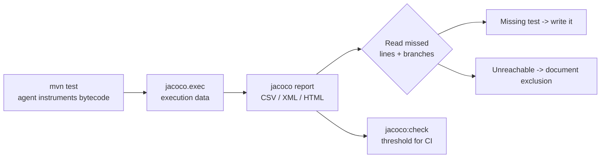

# Test Coverage

> Every transcript in this lesson was executed on the authoring machine (Windows,
> Java 25, Maven, `spring-boot-starter-parent` 4.1.1) against the batch-16 lab with
> JaCoCo 0.8.13 wired into its pom. The baseline report, both gap-closing rounds,
> and the stale-class incident below are real output. Tooling we did not run
> (PIT mutation testing, IDE coverage views) is marked *labelled reference*.

## 1. Learning Objectives

After this lesson you will be able to:

- [ ] Wire JaCoCo into a Maven build and read its per-class counters
- [ ] Use a coverage report as a *gap finder* — the exact lines and branches no
  test reached — rather than as a score
- [ ] Explain why 100% line coverage can coexist with an untested branch, and
  find that contradiction in a real report
- [ ] Separate what coverage proves (execution) from what it cannot prove
  (assertion quality) — with an executed counterexample
- [ ] Classify leftover uncovered code as a missing test or an unreachable path,
  and justify the classification
- [ ] Rerun a report honestly: `clean` before you trust a delta

## 2. Prerequisites

- [unit-testing](unit-testing.md) — the 46-test suite this report measures
- [testing-fundamentals](testing-fundamentals.md) — green-while-wrong, the reason
  the honesty drill in §7.4 matters more than the percentages
- [test-driven-development](test-driven-development.md) — the report answers
  "did anything execute?", never "did anything get checked?"
- [quality-gates](quality-gates.md) — where the number becomes a policy

## 3. Introduction

Coverage is the most quoted and least read number in software engineering. Quoted:
it fits in a badge and a percentage. Least read: the useful part of a coverage
report is not the total at the bottom — it is the list at the top: *which lines
and branches nothing touched*.

This lesson runs a real report against a real 46-test suite, watches it name four
gaps that forty-six green tests never noticed, closes them in two rounds, and then
runs the drill that keeps the number honest: a green, high-coverage run that still
prints a wrong value to the console.

## 4. The Problem It Solves

A green suite answers "did the tests I wrote pass?" It cannot answer "what did
none of my tests even reach?" — and that question is where entire methods live
untested for years behind a reassuring build badge. Coverage instrumentation
answers it mechanically: every instruction executed (or not), every branch taken
one way (or not), attributed to a source line.

The report below found four such gaps in a suite whose author had just written
boundary tests on purpose: `getRate()`, two `net < 0` throw paths, and a
`quantity <= 0` guard. Forty-six tests passed. None of them called those lines
once.

## 5. Core Concepts

### The counters, and which one to read first

JaCoCo counts four things: **instruction** (bytecode) coverage, **branch**
coverage (each `if`/`?:` arm, each `&&`/`||` operand), **line** coverage, and
**method** coverage. Order of usefulness when reading a report:

1. **Missed lines, by file** — the actionable list: go look at that line
2. **Branch ratio** — line coverage lies by rounding; branches do not
3. Instruction ratio — fine-grained, stable, what gates usually threshold
4. Line ratio — what humans quote; the coarsest of the four

### Line coverage hides branches by construction

A line counts as covered if *any* instruction on it executed. An `if` with an
untaken arm still shows a covered line. This lesson's baseline report is a clean
exhibition of the effect: `OrdersController` showed **16/16 lines — 100%** — while
its branch counter sat at **70%**. Three validation branches had never fired.

### Coverage measures execution, not truth

The counter increments when a line runs, regardless of what the test did
afterwards. A test that calls the method and asserts nothing moves the number
exactly as much as a test that pins every output. This is not a philosophical
claim here — §7.4 runs it: the same green, high-coverage run prints
`PRINT-TRAP: expected=19.9 actual=19.8 MISMATCH`.

### Missing test vs unreachable path

Not every missed line is a bug in your test suite. `LabApplication.main()` is
uncovered because tests boot the context without ever invoking `main` — the line
is real production code that no test-execution mode can reach. Classify each
leftover as either:

- **missing test** → write it (§7.2 did, four times over)
- **structurally unreachable** → exclude it consciously, with the reason written
  down — never by raising the threshold until the number passes

## 6. How It Works



The `prepare-agent` goal writes a JVM agent that records execution data while
surefire runs; the `report` goal (bound to the `test` phase) merges it with the
class files into `target/site/jacoco/`. The pom fragment this lesson adds:

```xml
<plugin>
  <groupId>org.jacoco</groupId>
  <artifactId>jacoco-maven-plugin</artifactId>
  <version>0.8.13</version>
  <executions>
    <execution>
      <id>prepare-agent</id>
      <goals><goal>prepare-agent</goal></goals>
    </execution>
    <execution>
      <id>report</id>
      <phase>test</phase>
      <goals><goal>report</goal></goals>
    </execution>
  </executions>
</plugin>
```

- **How to run:** `mvn clean test`, then read `target/site/jacoco/jacoco.csv`
  (per-class counters) or open `target/site/jacoco/index.html`.
- **Assumptions:** Java 25 bytecode is supported by the JaCoCo version; always
  `clean` before comparing two reports.

## 7. Practical Examples

### Example 1 — the baseline report names four gaps (executed)

The existing suite, 46 tests, all green, run with the report attached:

```
CLASS                   instr%     br%  line cov/miss
ApiAuthFilter           100.0%   75.0%     15/0
OrdersController        100.0%   70.0%     16/0
CheckoutService          80.0%   75.0%      7/1
LabApplication           37.5%    n/a%      1/2
TaxCalculator            86.0%   87.5%     16/2

TOTAL instruction 93.2% (358/384)  branch 79.4% (27/34)  line 94.0% (78/83)
```

93.2% looks respectable. The line-then-branch drill-down shows what it hides —
the script walks `jacoco.xml` and prints every line with missed instructions or
a missed branch arm:

```
TaxCalculator.java   -> L25:instr missed 3; L41:branch missed 1/2; L42:instr missed 6;
                        L53:instr missed 6
CheckoutService.java -> L17:branch missed 1/2; L18:instr missed 6
OrdersController.java-> L33:branch missed 2/6; L36:branch missed 1/4
ApiAuthFilter.java   -> L31:branch missed 1/2
LabApplication.java  -> L9:instr missed 4; L10:instr missed 1
```

Read against the sources, those line numbers are exact sentences:

- `TaxCalculator.L25` — `getRate()` was never called by any test
- `TaxCalculator.L41/L42` — the `net < 0` guard in `orderTotal` never threw
- `TaxCalculator.L53` — the `net < 0` guard in `discountedTotal` never threw
- `CheckoutService.L17/L18` — `quantity <= 0` never threw
- `OrdersController.L33` — 2 of 6 validation branches untaken (`req == null`,
  `customer == null`)
- `OrdersController.L36` — `net == null` never bound
- `ApiAuthFilter.L31` — the `startsWith("/api/")` **false** arm: no test ever
  sent a non-API path through the filter

Note the shape of the finding: these are the *failure* paths. Happy-path suites
cover happy paths; the report is a map of the error handling you assumed you
tested.

### Example 2 — round 1: close what the report named (executed)

Four tests, each derived from a line number above — never written before the
report existed:

```java
@Test
void getRateWasNeverCalled() {
    assertEquals(0.21, new TaxCalculator(0.21).getRate(), 1e-9);
}

@Test
void orderTotalNegativeGuardWasNeverTaken() {
    TaxCalculator calc = new TaxCalculator(0.21);
    assertThrows(IllegalArgumentException.class, () -> calc.orderTotal(-1.00));
    assertEquals(100.00, calc.orderTotal(100.00), 0.0001); // free shipping at threshold
}
```

After `mvn clean test` — 50 tests, 0 failures:

```
TaxCalculator               100.0%  100.0%    18/18
CheckoutService             100.0%  100.0%     8/8
TOTAL instruction 98.7% (379/384)  branch 88.2% (30/34)  line 97.6% (81/83)
```

Two classes went from 86%/80% to 100%, and the branch counter rose 79.4 → 88.2%.
What is still missing, exactly: `OrdersController` L33/L36, `ApiAuthFilter` L31,
`LabApplication` L9–10.

### Example 3 — round 2: branches reachable only two different ways (executed)

The remaining controller branches split by *reachability*, and the tests say so
in their names:

```java
@Test
void nullCustomerFieldBranch() {
    // customer key absent -> Jackson binds null (distinct from blank)
    OrdersController c = new OrdersController(mock(OrderService.class));
    ResponseEntity<?> r = c.create(new OrdersController.OrderRequest(null, 5.00));
    assertEquals(400, r.getStatusCode().value());
}

@Test
void nullBodyBranchIsOnlyReachableByDirectCall() {
    // through HTTP an absent body dies in Jackson before the controller runs
    OrdersController c = new OrdersController(mock(OrderService.class));
    ResponseEntity<?> r = c.create(null);
    assertEquals(400, r.getStatusCode().value());
}
```

The `req == null` arm is **structurally unreachable through HTTP** — an absent
body raises `HttpMessageNotReadableException` in the message converter, long
before the controller method runs. That branch is only testable by calling the
method directly, which is exactly what the second test does and what the comment
documents. The filter's false arm, by contrast, is reachable through the normal
harness with a single non-`/api/` request:

```java
@Test
void nonApiPathPassesTheAuthFilter() throws Exception {
    ApiAuthFilter filter = new ApiAuthFilter("secret");
    MockHttpServletRequest req = new MockHttpServletRequest("GET", "/index.html");
    MockHttpServletResponse res = new MockHttpServletResponse();
    final boolean[] chained = {false};
    filter.doFilter(req, res, (rq, rs) -> chained[0] = true);
    assertTrue(chained[0], "non-/api/ path must reach the chain without a token");
}
```

Final state — 54 tests, 0 failures:

```
ApiAuthFilter        instr 100.0%  branch 100.0%
OrdersController     instr 100.0%  branch 100.0%
CheckoutService      instr 100.0%  branch 100.0%
TaxCalculator        instr 100.0%  branch 100.0%
LabApplication       instr  37.5%  branch n/a

TOTAL instr 98.7% (379/384)  branch 100.0%  line 97.6% (81/83)
```

Every test-owned class is at 100% instruction and branch. The entire remaining
5 instructions (1.3%) are `LabApplication.main()` — the one honest leftover.

### Example 4 — the honesty drill: high coverage, wrong value, green run (executed)

The final run above exited **0**. Its output contains, unchanged:

```
PRINT-TRAP: expected=19.9 actual=19.8 MISMATCH
EXIT=0
TOTAL tests=54 failures=0 errors=0
```

`TaxCalculator` is 100% covered and a wrong value still sails through the build,
because the test that touches it prints instead of asserting (the print trap from
[testing-fundamentals](testing-fundamentals.md)). The percentage moved for every
line that ran; not one of them was *checked*. If you remember one transcript from
this lesson, remember this one: **coverage is evidence of execution, and only
execution.**

### Example 5 — the incident: a delta you cannot trust without `clean` (executed)

Between rounds, a plain `mvn test` reported:

```
Tests run: 52, Failures: 1, Errors: 0
IsolationDependentTest.dependsOnSeed -- FAILURE!
AssertionFailedError: shared state missing when this test runs alone
  ==> expected: <seeded-by-IsolationSeedTest> but was: <null>
```

`IsolationSeedTest` and `IsolationDependentTest` no longer exist as sources —
their **compiled classes** were still sitting in `target/test-classes` from an
earlier probe, and surefire ran them in an order that broke their hidden
dependency. `mvn clean test` restored 46→50 green. Two lessons travel with the
number: stale build output is part of your test run, and a coverage delta
computed across two builds where one wasn't cleaned is a delta between two
different test *sets*.

## 8. Real-World Applications

Coverage earns its keep in three places, in increasing order of wisdom:

1. **As a local feedback loop** — run the report after writing tests, look at
   *your* file's missed lines, decide deliberately. This is what §7.2 did.
2. **As a CI ratchet** — a floor that only moves up: new code must be covered so
   the total cannot decay. The floor belongs in the gate, not in your head; it is
   the subject of [quality-gates](quality-gates.md).
3. **As a review artifact** — attach the diff of the coverage report to the pull
   request. "This PR adds 120 instructions and covers 60 of them" is a reviewable
   fact; "coverage is 91%" is a mood.

Teams that get in trouble use it in reverse: a top-down target ("we will be at
80% by Friday") produces exactly the behavior §7.4 caught — calls without
assertions — and the number rises while the regression net rots.

## 9. Common Mistakes

| Mistake | Why it happens | How to recognize it | How to prevent it |
|---|---|---|---|
| Reading only the total | badge culture | 93% while named lines are dead | always open the missed-lines list first |
| Chasing 100% | target set top-down | tests calling getters, asserting nothing | ratchet floors, plus review the *new* tests |
| Comparing dirty builds | haste | delta swings both ways | `mvn clean` both sides of any comparison |
| Treating exclusions as fixes | threshold pressure | "excluded" grows every release | each exclusion carries a written reason |
| Ignoring branch counters | line coverage reads greener | 100% lines, 70% branches (executed above) | gate on instructions/branches, quote lines only to humans |
| Letting `main()` guilt you | completeness instinct | app entry point always red | document it as structurally unreachable |

## 10. Best Practices

- **Report first, tests second.** Write no coverage-driven test before reading
  the report; the report decides which gaps are worth closing.
- **Test the failure paths the report finds.** Missed lines cluster in guards,
  catch blocks, and validation — the code whose failure is most expensive.
- **Keep every coverage-driven test a real test.** Each one in §7.2–7.3 asserts
  a value or a message, not merely an execution.
- **Gate on the bundle, review the file.** The threshold is a floor for CI; the
  per-file list is what you actually read.
- **Never fix a red coverage gate by deleting the test** — fix it by writing
  one, or by excluding an unreachable line with a comment saying why.
- **Pair with mutation testing** (*labelled reference*: PIT) when you need to
  know whether the assertions bite — coverage cannot tell you.

## 11. Limitations and Trade-Offs

- **Execution ≠ assertion.** The single biggest limitation, executed in §7.4.
  A covered line with a vacuous test is indistinguishable from a well-tested one.
- **Instrumentation perturbs timing.** The performance battery's micro-benchmarks
  ([performance-testing](performance-testing.md)) must run outside coverage
  instrumentation or the numbers lie; agent overhead is real.
- **Offline agents and JaCoCo/JIT**: extremely aggressive JIT optimization can
  occasionally attribute lines imprecisely on exotic JDKs — treat single-line
  anomalies as hints, not verdicts.
- **Generated code dilutes the number.** DTOs, builders, and framework subclasses
  inflate the denominator; that is a reason to scope the report, not to raise the
  threshold.
- **A percentage is not a probability.** 98.7% coverage does not mean 98.7% of
  bugs are caught; the bugs live in the interactions your counter never models.

## 12. Practical Exercises

### Introductory

1. Re-run the lab report and list, in your own words, what `LabApplication`'s
   37.5% means. Is a `main()` test worth writing? Argue either side in three
   sentences.
2. Delete `CoverageGapTest` and reproduce the baseline: 93.2% / 79.4% / 94.0%.
   Which four classes lose coverage, and why those four specifically?

### Intermediate

3. Take any method in this curriculum's lab with a `switch` or chained `&&`,
   write one test that executes every *line* but only half the *branches*, and
   show the report disagreeing with your line count.
4. Add a new production class with two methods and no tests; watch the bundle
   ratio fall; then cover one method only and observe which counter moves.

### Independent problem-solving

5. Design the coverage policy for a team that ships weekly: which counter, which
   floor, how the floor moves, what a developer sees when the gate fails, and how
   an unreachable line gets exempted. Justify the floor against the baseline in
   Example 1, not against a round number.
6. Build a two-build comparison harness (`clean` on both sides) and use it to
   measure the coverage delta of a real feature branch before review.

## 13. Knowledge Check

1. Line coverage says 100%, branch coverage says 70%. What did the tests miss?
2. Which is more useful to open first in `jacoco.csv`: the total row or the
   per-class rows, and why?
3. The report shows `L9` and `L10` uncovered in `LabApplication`. Name the two
   legitimate responses and the one illegitimate response.
4. How did Example 4's run exit? What did its console print? What does that
   prove about the number 98.7%?
5. Why must both sides of a coverage comparison be built with `clean`?

## 14. Completion Criteria

You have completed this lesson when you can:

- [ ] Generate a JaCoCo report from a clean build and name the four counters
- [ ] Given a report, quote the exact missed lines and say what code they are
- [ ] Reproduce the line-vs-branch contradiction on some file of your own
- [ ] Explain the honesty drill from memory, with the transcript's shape
- [ ] Classify `main()` as unreachable and defend excluding it in writing

## 15. Summary

Coverage's value is the list, not the percentage: the report found four untested
failure paths in forty-six green tests, each closed with a real assertion in two
rounds (93.2% → 98.7% instruction, 79.4% → 100% branch). The final run also
printed a wrong value and exited zero — because coverage counts execution, never
checks. Read it as a gap finder, gate it as a floor, and keep every
coverage-derived test a test.

## 16. Next Steps

- [quality-gates](quality-gates.md) — turn the number into a rule that blocks
  regressions without blocking progress
- [unit-testing](unit-testing.md) — the assertion discipline the number cannot
  measure
- [performance-testing](performance-testing.md) — why instrumented bytecode must
  stay away from the stopwatch