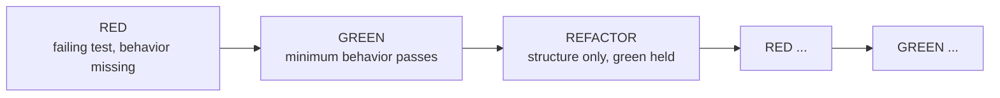

# Test-Driven Development

## 1. Learning Objectives

After this lesson you will be able to:

- [ ] Run a full red–green–refactor cycle on a small rule and capture all three runs
- [ ] State what each phase is allowed to change — and why the red must fail for the *right* reason
- [ ] Diagnose a red that fails for the wrong reason (compilation, wiring, typo) and restore a meaningful one
- [ ] Explain TDD as a design feedback loop, honestly: when to skip it and what you lose
- [ ] Use the cycle's rhythm to keep a suite that is green *because* it's small and sharp

## 2. Prerequisites

- [Unit Testing](unit-testing.md) — the tests you write first
- [Testing Fundamentals](testing-fundamentals.md) — what red and green mean mechanically

## 3. Introduction

TDD is a two-minute rhythm: write a failing test, make it pass with the minimal
behavior, clean up while everything is green. Its famous claim — tests fall out as a
by-product — is the *least* interesting one. The real product is the feedback: a test
that is hard to write is telling you the interface is wrong, and a red that appears
in seconds tells you your design question has an answer. This lesson executes one
complete cycle so the transcript, not the rhetoric, carries the argument.

## 4. The Problem It Solves

Without a written prediction first, "write code, then test it" invites tests that
describe what the code *does* — including its bugs (the lying-comment capture from
[subject 13's clean-code lesson](../13-SOFTWARE-ENGINEERING-AND-ARCHITECTURE/clean-code.md)
is what that produces: `got 20.0 want 19.9`). TDD reverses the order so the
expectation exists *before* the implementation can influence it. The cycle also
solves the "when do I know it works?" problem: you know when the red you wrote turns
green and nothing else broke.

## 5. Core Concepts

### The three phases, with their contracts

1. **Red** — write a test that fails *because the behavior is missing*. Allowed to change: test code only. If it fails for a wrong reason (compile error, wrong import), fix that first — a red you don't understand trains you to ignore reds.
2. **Green** — the *minimum* behavior that passes. Allowed to change: production code only. No gold-plating; the next test decides what's needed.
3. **Refactor** — improve names/structure with green as a safety net. Allowed to change: anything, behavior preserved. Never add behavior here — that's a new red.

### The cycle's evidence types

A red can fail three ways: **assertion failure** (right reason — behavior missing),
**compilation error** (acceptable when the API doesn't exist yet — but say so), or
**error/exception** (usually a stub not wired). Record which one you got; it's the
cycle's honest log.

### TDD as design feedback

A test that needs three collaborators to be constructed is telling you the unit is too
big (the SRP retest-scope measurement of subject 13, seen from the test side). The
rhythm converts design discomfort from an argument into an observation.

## 6. How It Works



1. Choose the next behavior (one rule, one boundary).
2. Express it as an assertion with concrete numbers — predict the value on paper if the lesson's discipline applies (it does: prediction-before-run is this whole curriculum's rule).
3. Run: capture the red, check its *reason*.
4. Implement the smallest thing that makes it pass — no more.
5. Run: capture green. Then refactor while green; run again to prove behavior held.

## 7. Practical Examples

All executed (Java 25, `testlab`, surefire 3.5.6, Windows 11). Rule under test:
*loyalty discount — 5% off orders at/above the 100.00 threshold.*

**Step 1 — RED, written before the rule exists** (executed)

Test (the prediction):

```java
assertEquals(95.00, eu.discountedTotal(100.00), 0.0001, "orders at/above 100.00 get 5% off");
assertEquals(99.99, eu.discountedTotal(99.99), 0.0001, "below the threshold, no discount");
```

Production at this point is a stub — `discountedTotal(net) { return net; }` — so the
test compiles and fails on the *assertion*:

```
[ERROR]   TddCycleTest.loyaltyDiscount:20 orders at/above 100.00 get 5% off ==> expected: <95.0> but was: <100.0>
[ERROR] Tests run: 1, Failures: 1, Errors: 0, Skipped: 0
[INFO] BUILD FAILURE
```

This is the right red: wrong value, right reason, zero ambiguity about what's missing.

**Step 2 — GREEN, minimum behavior** (executed)

```java
public double discountedTotal(double net) {
    if (net < 0) throw new IllegalArgumentException("net must not be negative: " + net);
    return net >= FREE_SHIPPING_AT ? round2(net * (1 - 0.05)) : net;
}
```

(The literal `0.05` is deliberate — the named constant arrives in step 3.)

```
[INFO] Tests run: 1, Failures: 0, Errors: 0, Skipped: 0
[INFO] BUILD SUCCESS
```

Note what the green run *did not* contain: any change to existing methods — the
`TddGreenTest` twin proves the older assertions (`shippingBoundaries`, `lineTotal`)
are untouched: full suite afterwards `Tests run: … BUILD SUCCESS`.

**Step 3 — REFACTOR, behavior held** (executed)

Extracted the magic number to a named constant — the lab's final state:

```java
public static final double LOYALTY_RATE = 0.05;

public double discountedTotal(double net) {
    if (net < 0) throw new IllegalArgumentException("net must not be negative: " + net);
    return net >= FREE_SHIPPING_AT ? round2(net * (1 - LOYALTY_RATE)) : net;
}
```

rerun:

```
[INFO] Tests run: 1, Failures: 0, Errors: 0, Skipped: 0
[INFO] BUILD SUCCESS
```

- **How to run:** `mvn test -Dtest=TddCycleTest` (red state), `-Dtest=TddGreenTest` (green/refactor states).
- **Assumptions:** the red run requires the stub; the lesson quotes both source states, and the lab ends in the implemented state.

## 8. Real-World Applications

TDD shows up as micro-rhythm inside story work (unit scale), as "red first" review
discipline even for teams that don't do full TDD, and in safety-critical domains
where the written prediction *is* the specification artifact. Many professional teams
run a pragmatic subset: test-first for logic (the type of code this subject's labs
keep finding bugs in), less so for wiring/UI where E2E and refactoring costs differ.

## 9. Common Mistakes

| Mistake | Why it happens | How to recognize it | How to prevent it |
|---|---|---|---|
| Accepting a wrong red | hurry | red is a compile error unrelated to the rule | make it an assertion failure before implementing |
| Gold-plating green | anticipating future tests | implementation includes untested paths | smallest behavior; the next red decides |
| Refactor with new behavior | mixing phases | green run includes untested changes | one rule: refactor never adds assertions' targets |
| Skipping the prediction | ritual fatigue | you can't say what red will print | write the expected value first (curriculum rule) |
| TDD as ceremony | dogma | tests written to mirror methods 1:1 | ask what design feedback you got; none? try a different granularity |

## 10. Best Practices

- **One behavior per cycle** — two assertions about one rule is fine; two rules is two cycles.
- **Name the red's reason before fixing** — assertion? compile? exception? Write it in the log.
- **Keep cycles tiny enough that green is instant** — the 0.2 s unit suite is what makes the rhythm possible.
- **Refactor only while green** — the safety net exists for exactly this phase.
- **Skip honestly** — prototypes, throwaway spikes, and glue code can skip TDD; say which one you're doing rather than doing a fake cycle.

## 11. Limitations and Trade-Offs

TDD's feedback is only as good as your tests — it cannot tell you you're building the
wrong thing (that's requirements' job, [subject 13](../13-SOFTWARE-ENGINEERING-AND-ARCHITECTURE/README.md)),
and it slows the *first* feature while speeding every one after. Design-heavy or
exploratory work often inverts: spike first, then test-first for the keeper. And TDD
says nothing directly about integration/E2E levels — the red–green rhythm just runs
slower there (12.60 s per integration run measured here).

## 12. Practical Exercises

### Introductory

1. **Exercise 7.1** — replay the executed cycle on your own rule. **Completion criteria:** three captured runs — assertion-red, green, refactor-green — each with the reason line.
2. **Exercise 7.2** — deliberately produce a wrong red (make the test call a nonexistent method), then restore the right one. **Completion criteria:** both captures and the classification of each red.

### Intermediate

3. **Exercise 7.3** — do a cycle where the red is *design feedback*: the test needs four collaborators, so split the unit. **Completion criteria:** before/after constructor arity and the green run after the split.
4. **Exercise 7.4** — TDD a validation rule with three boundaries in three cycles. **Completion criteria:** three red–green pairs, one per boundary, with predictions written first.

### Independent problem-solving

5. **Exercise 7.5** — run test-first and test-after on the *same* small feature in two branches, then compare. **Completion criteria:** time per branch, defect count (bugs you shipped in one and not the other), and your verdict — which feedback was different, not which feels virtuous.

*Solutions: attempt first. They live in [`solutions/`](exercises/solutions/README.md) of this subject.*

## 13. Knowledge Check

1. Your red is `ClassNotFoundException`. Which phase failed, and what do you do before implementing anything?
2. Why is "implement then write tests" systematically different from TDD, even with identical final tests?
3. Name two situations where skipping TDD is the right call — and what you must do instead.

## 14. Completion Criteria

- [ ] You can run a full cycle and show the three runs' captured outputs
- [ ] You can classify any red as right-reason or wrong-reason in one look
- [ ] You can state the change-permissions of each phase from memory
- [ ] You can explain what design feedback TDD gave you on real code (with the example)

## 15. Summary

- Red = prediction written before the implementation can bias it; green = minimum behavior; refactor = structure with green held.
- Executed cycle: `expected: <95.0> but was: <100.0>` → minimal rule → green → constant extraction → green again.
- The red's *reason* is data: assertion-failure reds are design feedback, wrong reds are noise to clear first.
- TDD is a feedback loop about design, not a religion — its value shows in suites that are green because they're sharp.
- Skipping is allowed; faking the ritual is not.

## 16. Next Steps

- Next lesson: [API Testing](api-testing.md) — the same discipline over HTTP contracts
- Practice: [exercise set](exercises/README.md)
- Where it is applied: [Project 07](../20-PROJECT-LABORATORY/project-07-secure-production-application/README.md)