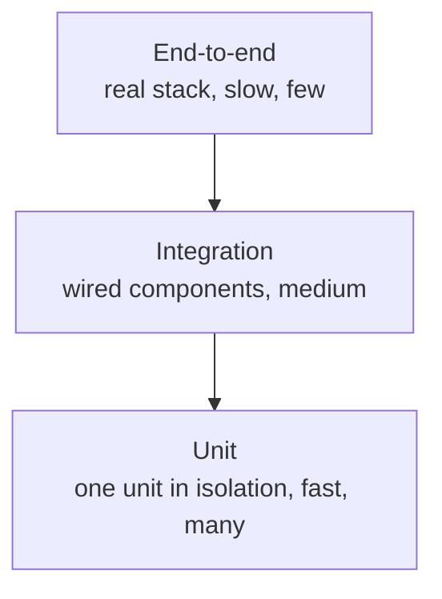

# Testing Fundamentals

## 1. Learning Objectives

After this lesson you will be able to:

- [ ] Explain what makes a test trustworthy — and demonstrate an untrustworthy test passing while its output is wrong
- [ ] Arrange–act–assert a test so the reader can see the behavior under test in one line
- [ ] Diagnose an order-dependent test by running it alone and read the isolation failure
- [ ] Place a test on the pyramid (unit / integration / end-to-end) and justify the placement from what it exercises
- [ ] State exactly what a green suite does and does not tell you

## 2. Prerequisites

- [04-JAVA-PROGRAMMING](../04-JAVA-PROGRAMMING/README.md) — the Java used in every executed example
- [13-SOFTWARE-ENGINEERING-AND-ARCHITECTURE](../13-SOFTWARE-ENGINEERING-AND-ARCHITECTURE/README.md) — acceptance criteria: a test is an AC you can execute (set 2's `acc-eu-discount10 got 19.26` is the model)

## 3. Introduction

A test is a *prediction written down as a program*: you state what the system will do
under stated conditions, and the machine judges your prediction. The words matter.
`println`ing a value is you judging it; an assertion is the machine judging it, and only
the machine's judgment can run while you sleep — in CI, at 3 a.m., on someone else's
machine. This lesson builds the vocabulary (properties, structure, levels) that every
later lesson assumes.

## 4. The Problem It Solves

Before automated tests, "does it still work?" was answered by a person clicking through
the program — slow, incomplete, and impossible to run on every change. The replacement
was scripted checks; the failure mode of *that* replacement is worse in an interesting
way: a script that cannot fail. If your check prints a value but asserts nothing, every
run "passes" and you have traded honest uncertainty for manufactured confidence. Both
extremes were executed in the lab for this lesson — the print trap passed while printing
`MISMATCH`, and a well-asserted suite failed the moment its hidden dependency was
removed.

## 5. Core Concepts

### The properties of a trustworthy test

- **Fast** — unit-level tests run in milliseconds; if feedback takes minutes, people run tests less.
- **Isolated** — the result depends only on the code under test, not on which other tests ran first or on shared mutable state.
- **Self-verifying** — every expectation is an assertion. A human reading output is a test that never runs in CI.
- **Deterministic** — the same code gives the same verdict; a test that fails 1% of the time trains people to re-run failures.
- **Unambiguous verdict** — green means "the behavior I checked is correct"; red means "it is not". Never "something happened".

### Arrange–Act–Assert (AAA)

Three sentences: set up the world, do the one thing, check the result. One act per test.
A test with two acts has two reasons to fail and won't tell you which.

### The test levels (the pyramid)



Each level trades speed for fidelity: units tell you *logic* is right quickly; only a
full-stack test tells you the *wiring* is right. The pyramid's shape is an economics
claim — put each requirement at the cheapest level that can actually fail it.

### What green really means

Surefire exits non-zero only when an assertion fails, an error is thrown, or a test
aborts. Printed text is not in that list. Green means "every assertion that ran
passed" — not "the program is correct", not "the output looked right", and not even
"all the tests you think exist ran" (a `*IT` class outside surefire's include pattern
never executes at all — an integration test of ours silently didn't, until the class
was renamed).

## 6. How It Works

1. You write a test class; the build tool discovers classes matching its include
   pattern (`*Test`, `Test*`, `*Tests`, `*TestCase` for surefire).
2. Each `@Test` method runs inside the framework: it catches the exception if one
   escapes, records pass/fail, and continues to the next test.
3. After all tests, the runner aggregates counts and exits: `0` for green,
   non-zero for any failure — that exit code is the *only* thing CI can see.
4. A test reading `static` state another test filled passes only if the filler ran
   first; run it alone and the state is `null`, so it fails. The suite's green never
   contained the information "this test can survive alone".

## 7. Practical Examples

**Example 1 — the print trap: green while wrong** (executed)

```java
@Test
@DisplayName("green while wrong: prints a mismatch and passes anyway")
void printOnlyCheck() {
    double expected = 19.90;               // from the spec: tax then discount
    double actual = 20.00 * 1.10 * 0.90;   // discount then tax: 19.80 — the wrong order
    System.out.println("PRINT-TRAP: expected=" + expected + " actual=" + actual
            + (Math.abs(actual - expected) < 0.005 ? " OK" : " MISMATCH"));
    // no assertion — nothing here can ever make this test fail
}
```

- **Executed output** (authoring machine, Java 25 / JUnit 5 / surefire 3.5.6):

```
PRINT-TRAP: expected=19.9 actual=19.8 MISMATCH
[INFO] Tests run: 1, Failures: 0, Errors: 0, Skipped: 0, Time elapsed: 0.006 s -- in com.example.lab.PrintTrapTest
```

…inside a run ending `[INFO] Tests run: 22, Failures: 0` / `BUILD SUCCESS`. The test is
green, the value is wrong, and nothing in CI will ever tell you.

- **How to run it:** `mvn test` in the batch's `testlab` lab (Spring Boot 4.1.1, Java 25).
- **Assumptions:** Windows 11, Maven 3.9.16 — see [VERSIONS.md](../VERSIONS.md).

**Example 2 — an order-dependent test: green together, red alone** (executed)

```java
@TestMethodOrder(MethodOrderer.OrderAnnotation.class)
class IsolationOrderTest {
    static final String SHARED = "seeded-by-first-test";
    static String value;   // shared mutable state across tests — the actual defect

    @Test @Order(1) void seeds() { value = SHARED; assertEquals(SHARED, value); }

    @Test @Order(2) void dependsOnSeed() {
        assertEquals(SHARED, value, "shared state missing when this test runs alone");
    }
}
```

Full suite (executed): `Tests run: 2 … 0.164 s` and the line
`ISOLATION: dependsOnSeed saw value=seeded-by-first-test` — green. The same method alone:

```bash
mvn test -Dtest='IsolationOrderTest#dependsOnSeed'
```

```
org.opentest4j.AssertionFailedError: shared state missing when this test runs alone
==> expected: <seeded-by-first-test> but was: <null>
[ERROR] Tests run: 1, Failures: 1, Errors: 0, Skipped: 0
[INFO] BUILD FAILURE
```

The fix that makes it survive alone (executed, then reverted so the probe reproduces):

```java
if (value == null) value = SHARED;   // FIX: arrange your own state
```

— isolated run goes `Tests run: 1, Failures: 0 … BUILD SUCCESS`. Every test must
**arrange its own state**; order dependence is a test that secretly has two authors.

**Example 3 — the pyramid, priced in seconds** (executed)

```
[INFO] Tests run: 16, Failures: 0, ... Time elapsed: 0.216 s -- in com.example.lab.TaxCalculatorTest
[INFO] Tests run: 3, Failures: 0, ... Time elapsed: 12.60 s -- in com.example.lab.OrderServiceIntegrationTest
```

16 unit tests in 0.216 s vs 3 integration tests in 12.60 s — ~58× slower per test on
this machine. That ratio, not taste, is why the pyramid's base is units.

## 8. Real-World Applications

Every green-button CI pipeline rests on these properties: a red build stops the merge,
which only means something if red is possible for the *right* reasons. Teams codify
the properties as review rules ("assert, don't print"; "tests must pass alone" — some
CI jobs literally shuffle test order) and as suite hygiene: a quarantined flaky test
gets fixed or deleted, because a known-flaky suite is a print trap with extra steps.

## 9. Common Mistakes

| Mistake | Why it happens | How to recognize it | How to prevent it |
|---|---|---|---|
| Print-and-eyeball "tests" | console output feels like evidence | test can't fail: delete the code under test and it stays green | every expectation is an `assertEquals`/`assertTrue` |
| Order dependence | shared static state or DB rows across tests | passes in suite, fails alone (`-Dtest=Class#method`) | each test arranges its own state; clean per-test |
| Testing the wrong level | E2E for logic, unit for wiring | slow suite missing wiring bugs; unit tests mocking everything | place each requirement on the cheapest level that can fail it |
| Retesting what the compiler proves | habit | tests asserting a getter returns the field it was set with | ask: what failure class does this catch that compilation doesn't? |
| Ignoring "didn't run" | include patterns are invisible | coverage or test counts that silently drop | print counts in CI and alert on a decrease |

## 10. Best Practices

- **Assert the observable, arrange your own state** — Example 2's rule; it is what makes order shuffling safe.
- **One act, one assertion focus** — multiple `assert`s on one result are fine; two *acts* are not.
- **Let failure messages do the work** — `assertEquals(expected, actual, "shipping(99.99)")` beats a bare `false`.
- **Name the behavior, not the method** — `negativePriceRejected`, not `test1`. The name is the prediction.
- **Count your tests in CI** — a suite that quietly runs fewer tests is green; alert on count drops (see Example 1's sibling: classes outside the include pattern).

## 11. Limitations and Trade-Offs

These properties can conflict: determinism vs tests that exercise real time/randomness
(seeded randomness or fake clocks); speed vs fidelity (the 58× ratio pulls in both
directions). And the properties are necessary, not sufficient — a perfectly isolated,
deterministic, self-verifying suite can assert only trivial things and miss every bug
that matters. Trustworthiness of *execution* is this lesson; trustworthiness of
*coverage* is [test-coverage.md](test-coverage.md)'s subject, and it is a different
question.

## 12. Practical Exercises

### Introductory

1. **Exercise 2.1** — turn a print-only check into a real test. **Completion criteria:** the test fails on the wrong value (capture the red) and passes on the right one.
2. **Exercise 2.2** — write three AAA tests for one function, one per boundary. **Completion criteria:** each test's three sections visible; all green in one run.

### Intermediate

3. **Exercise 2.3** — build an order-dependent pair deliberately, prove green together / red alone with `-Dtest=…#method`, then fix it and show the isolated green. **Completion criteria:** all three captures (the lesson's shape).
4. **Exercise 2.4** — for five requirements of your own code, name the cheapest level that can fail each. **Completion criteria:** a requirement → level table with one-line justifications.

### Independent problem-solving

5. **Exercise 2.5** — a teammate's suite is green in CI but a bug shipped. Investigate and produce the verdict. **Completion criteria:** the executed evidence — at least one of: a print-only test, an unrun class, an assertion on the wrong value — with the run that exposes it.

*Solutions: attempt first. They live in [`solutions/`](exercises/solutions/README.md) of this subject.*

## 13. Knowledge Check

1. Your suite runs 200 tests, all green. What are three things green does *not* imply?
2. What would happen if you deleted the code under test — how would a print-only test react? An assertion-based one?
3. When would you deliberately accept an order-dependent test? (Hint: when is order itself the behavior under test?)

## 14. Completion Criteria

- [ ] You can explain why the print trap passes without notes, from your own capture
- [ ] You can write an isolated AAA test from a blank editor and prove it passes alone
- [ ] You can place any test on the pyramid and say which failure class it can and cannot catch
- [ ] You can state the exact conditions under which a runner turns red

## 15. Summary

- A test is a prediction the machine judges; an assertion is what makes the machine able to judge.
- Fast, isolated, self-verifying, deterministic — each property exists because its absence produces false greens.
- The print trap is executable proof: `MISMATCH` printed, `BUILD SUCCESS` returned.
- Order dependence hides behind suite green; `-Dtest=Class#method` is the microscope.
- Green means "every assertion that ran passed" — check that the tests you expect actually ran.

## 16. Next Steps

- Next lesson: [Unit Testing](unit-testing.md) — the base of the pyramid in detail
- Practice: [exercise set](exercises/README.md)
- Where it is applied: [Project 07](../20-PROJECT-LABORATORY/project-07-secure-production-application/README.md)'s test strategy