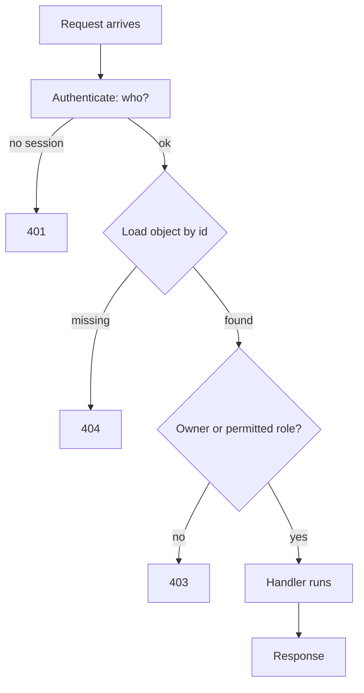

# Access Control

> Every transcript in this lesson was executed on the authoring machine (Windows 11,
> Python 3.13.5, standard library only) in the batch-17 `seclab-B` scratch lab. The probe
> runs its own HTTP server and client in one process. Tooling we did not run — SAST
> authorization linters, real IAM policy audits, gateway-level policy tests — is marked
> *labelled reference*.

## 1. Learning Objectives

After this lesson you will be able to:

- [ ] Separate authentication ("who") from authorization ("may they") and point at where each belongs in a request handler
- [ ] Demonstrate an IDOR by fetching another user's object with a valid session, then close it with an ownership check that still lets admins through
- [ ] Explain forced browsing and show an admin route flipping from 200 to 403 when the check is added
- [ ] Demonstrate mass assignment — a client choosing its own role — and fix it with a server-side field allowlist
- [ ] Describe the three canonical models (RBAC, ABAC, ReBAC) and say which one a given system actually implements

## 2. Prerequisites

- [Session Security](session-security.md) — the session token this lesson reads the user's identity from
- [Security Fundamentals](security-fundamentals.md) — least privilege and fail-safe defaults, the principles made concrete here
- [11-BACKEND-ENGINEERING](../11-BACKEND-ENGINEERING/README.md) — the API whose every route now needs a check

*No code prerequisite beyond reading Python — the probe is printed in full and uses only the standard library.*

## 3. Introduction

Authentication answers "who is calling?"; authorization answers "may they do *this*, to
*that*?" Systems fail at the second far more often than the first — the login works
perfectly, and then any logged-in user reads anyone's invoice. The reason is structural:
authentication is one check at the front door, while authorization is a check on *every
object of every operation*, and missing one of hundreds is invisible until someone
requests it. This lesson demonstrates the three canonical failures — **IDOR**, **forced
browsing**, **mass assignment** — against a running local server, then adds the one line
that closes each, watching every response flip from 200 to 403.

## 4. The Problem It Solves

Early web apps had one kind of user (admin), so "logged in" was a sufficient answer to
authorization. Multi-user applications broke that assumption, and the failures that
followed are still the top of every breach taxonomy:

- **IDOR (Insecure Direct Object Reference).** The handler takes an object id from the
  URL and serves the row without asking whether the caller owns it. Phase 1 of the probe
  has bob — a perfectly valid session — read alice's note in one request.
- **Forced browsing.** An admin route is unlisted, so it feels hidden; a non-admin who
  types the URL gets 200 anyway (phase 3). Obscurity did the authorizing, and obscurity
  is not a control ([security-fundamentals.md](security-fundamentals.md)).
- **Mass assignment.** The update-profile endpoint binds *every* field the client sends,
  including `role`. One request from bob and bob is an admin (phase 4).

None of these is a broken password. All three are the same missing sentence: *the server
never asked whether this caller may do this to this object.* The fix is not a framework
feature — it is a check, in the right place, on every path.

## 5. Core Concepts

### Authentication vs authorization

- **Authentication** — establishing identity (session, token, key). Happens once per
  request, early.
- **Authorization** — deciding whether that identity may perform this action on this
  resource. Happens per action *and per object*, after identity is known.

### The three canonical models

| Model | Decision based on | Example | Choose it when |
|---|---|---|---|
| **RBAC** (role-based) | the actor's role | "admins may delete notes" | permissions cluster into a few roles |
| **ABAC** (attribute-based) | attributes of actor + resource + environment | "owner OR dept matches AND during work hours" | rules depend on data, not just roles |
| **ReBAC** (relationship-based) | a graph of relationships | Google Docs' sharing list | access is per-object and user-defined |

Most real systems are RBAC with an ownership rule layered on — exactly the combination
the probe's fixed check implements: `owner OR role == admin`.

### IDOR and the object-level check

An **IDOR** is an authorization gap at the *object* level: the route is reachable, the
user is authenticated, and the specific row is never compared to the caller. The class
name is narrower than the habit: the fix (ownership check) belongs in the handler that
loads the object, not in the UI that links to it.

### Deny by default

Every route starts from *deny*. The probe's `MODE["checks"] = "on"` state is that
default: unknown caller → 403, non-owner → 403, non-admin → 403, and the allowed cases
are explicit exceptions. Fail-safe defaults from
[security-fundamentals.md](security-fundamentals.md), now with code.

### The client is a narrator, never an authority

`role` in a request body, `owner` in a form, `is_admin=1` in a query string — these are
*claims*. The server may read them as input data; it must never read them as facts. Mass
assignment is what happens when a framework's convenient "bind everything" default turns
claims into facts.

## 6. How It Works



The diagram's load-then-check order matters: 404 before 403 means you do not confirm the
existence of objects the caller may not see, and the check can never be skipped by a code
path that "already loaded the row". The probe's handler follows the same sequence,
returning `not found` first and `not owner` second.

## 7. Practical Examples

**Example 1 — the full probe: IDOR, forced browsing, mass assignment**

```python
# SEC-06 access-control probe: IDOR, forced browsing, mass assignment.
# Standard library only; server and client in one process. Run: python authz_probe.py
import json
import secrets
import threading
import http.client
from http.server import BaseHTTPRequestHandler, HTTPServer

MODE = {"checks": "off"}        # "off" = vulnerable, "on" = fixed
USERS = {"alice": {"role": "user"}, "bob": {"role": "user"},
         "carol": {"role": "admin"}}
NOTES = {1: {"owner": "alice", "title": "groceries"},
         2: {"owner": "bob", "title": "salary negotiation"}}
TOKENS = {}                     # token -> username


class Handler(BaseHTTPRequestHandler):
    def log_message(self, *a):
        pass

    def _send(self, code, obj):
        body = json.dumps(obj).encode()
        self.send_response(code)
        self.send_header("Content-Type", "application/json")
        self.send_header("Content-Length", str(len(body)))
        self.end_headers()
        self.wfile.write(body)

    def _user(self):
        auth = self.headers.get("Authorization", "")
        return TOKENS.get(auth.removeprefix("Bearer "))

    def do_GET(self):
        who = self._user()
        if self.path.startswith("/notes/"):
            note_id = int(self.path.split("/")[-1])
            note = NOTES.get(note_id)
            if note is None:
                return self._send(404, {"error": "not found"})
            if MODE["checks"] == "on" and who != note["owner"] and USERS[who]["role"] != "admin":
                return self._send(403, {"error": "not owner"})   # the missing line, fixed
            self._send(200, note)
        elif self.path == "/admin/metrics":
            if MODE["checks"] == "on" and USERS[who]["role"] != "admin":
                return self._send(403, {"error": "admins only"})
            self._send(200, {"signups": 1284, "failed_logins": 17})
        else:
            self._send(404, {"error": "not found"})

    def do_POST(self):
        n = int(self.headers.get("Content-Length", 0))
        data = json.loads(self.rfile.read(n) or b"{}")
        who = self._user()
        if self.path == "/login":
            if data.get("user") not in USERS:
                return self._send(401, {"error": "no such user"})
            tok = secrets.token_urlsafe(12)
            TOKENS[tok] = data["user"]
            self._send(200, {"token": tok})
        elif self.path == "/profile":
            role = data.get("role")
            if MODE["checks"] == "on" or role is None:
                # fixed: role is never read from the request body
                if role is not None:
                    print(f"    (fixed server ignored client-sent role={role!r})")
            else:
                USERS[who]["role"] = role          # mass assignment: client picks its own role
            self._send(200, {"user": who, "role": USERS[who]["role"]})
        else:
            self._send(404, {"error": "not found"})


def req(method, path, body=None, token=None, port=8094):
    c = http.client.HTTPConnection("127.0.0.1", port, timeout=5)
    headers = {}
    if token:
        headers["Authorization"] = f"Bearer {token}"
    payload = json.dumps(body) if body is not None else None
    if payload:
        headers["Content-Type"] = "application/json"
    c.request(method, path, payload, headers)
    r = c.getresponse()
    raw = r.read().decode()
    c.close()
    return r.status, raw


server = HTTPServer(("127.0.0.1", 8094), Handler)
threading.Thread(target=server.serve_forever, daemon=True).start()

_, body = req("POST", "/login", {"user": "bob"})
bob = json.loads(body)["token"]
_, body = req("POST", "/login", {"user": "alice"})
alice = json.loads(body)["token"]
_, body = req("POST", "/login", {"user": "carol"})
carol = json.loads(body)["token"]
print(f"3 sessions: bob, alice, carol (carol is the only admin)")

print()
print("=== 1. IDOR: checks off ===")
st, body = req("GET", "/notes/1", token=bob)          # note 1 belongs to alice
print(f"bob GET /notes/1 (alice's) -> {st}: {body}")

print()
print("=== 2. IDOR: the ownership check on ===")
MODE["checks"] = "on"
st, body = req("GET", "/notes/1", token=bob)
print(f"bob GET /notes/1 (alice's) -> {st}: {body}")
st, body = req("GET", "/notes/2", token=bob)
print(f"bob GET /notes/2 (own)      -> {st}: {body}")
st, body = req("GET", "/notes/1", token=carol)
print(f"carol(admin) GET /notes/1   -> {st}: {body}")

print()
print("=== 3. forced browsing to an admin route ===")
MODE["checks"] = "off"
st, body = req("GET", "/admin/metrics", token=alice)
print(f"checks off: alice GET /admin/metrics -> {st}: {body}")
MODE["checks"] = "on"
st, body = req("GET", "/admin/metrics", token=alice)
print(f"checks on : alice GET /admin/metrics -> {st}: {body}")
st, body = req("GET", "/admin/metrics", token=carol)
print(f"checks on : carol GET /admin/metrics -> {st}: {body}")

print()
print("=== 4. mass assignment: client sends its own role ===")
MODE["checks"] = "off"
st, body = req("POST", "/profile", {"name": "bob", "role": "admin"}, token=bob)
print(f"checks off: bob POST /profile -> {st}: {body}")
st, body = req("GET", "/admin/metrics", token=bob)
print(f"checks off: bob GET /admin/metrics -> {st}: {body}   <- privilege escalated")
MODE["checks"] = "on"
USERS["bob"]["role"] = "user"   # lab reset: undo the escalation before testing the fix
st, body = req("POST", "/profile", {"name": "bob", "role": "admin"}, token=bob)
print(f"checks on : bob POST /profile -> {st}: {body}")

server.shutdown()
```

- `_user()` derives identity from the server's own token map — never from anything the
  request claims about itself.
- The vulnerable and fixed behaviors are the same handler with `MODE["checks"]` flipped,
  so each comparison isolates exactly one missing check.
- **Expected output:** the capture below.
- **How to run it:** `python authz_probe.py` (Windows 11, Python 3.13.5; one process,
  port 8094 on loopback).
- **Assumptions:** standard library only.

**Executed capture:**

```text
3 sessions: bob, alice, carol (carol is the only admin)

=== 1. IDOR: checks off ===
bob GET /notes/1 (alice's) -> 200: {"owner": "alice", "title": "groceries"}

=== 2. IDOR: the ownership check on ===
bob GET /notes/1 (alice's) -> 403: {"error": "not owner"}
bob GET /notes/2 (own)      -> 200: {"owner": "bob", "title": "salary negotiation"}
carol(admin) GET /notes/1   -> 200: {"owner": "alice", "title": "groceries"}

=== 3. forced browsing to an admin route ===
checks off: alice GET /admin/metrics -> 200: {"signups": 1284, "failed_logins": 17}
checks on : alice GET /admin/metrics -> 403: {"error": "admins only"}
checks on : carol GET /admin/metrics -> 200: {"signups": 1284, "failed_logins": 17}

=== 4. mass assignment: client sends its own role ===
checks off: bob POST /profile -> 200: {"user": "bob", "role": "admin"}
checks off: bob GET /admin/metrics -> 200: {"signups": 1284, "failed_logins": 17}   <- privilege escalated
    (fixed server ignored client-sent role='admin')
checks on : bob POST /profile -> 200: {"user": "bob", "role": "user"}
```

Phase 2 is the whole lesson in three lines: the same request that returned alice's note
now returns 403, bob's own note still returns 200 (the fix did not break legitimate
use), and the admin still reaches the record (the fix did not break privilege either).
Phase 4's final line shows the allowlist working: the client *sent* `role: "admin"` and
the stored role stayed `user`.

**Example 2 — the one-line ownership check in a typical route (illustration)**

```python
# framework-shaped pseudocode, same rule as the probe:
def get_note(request, note_id):
    note = db.find(Note, note_id)
    if note is None:
        return 404
    if note.owner_id != request.user.id and not request.user.is_admin:
        return 403                      # this line is the entire fix for IDOR
    return note
```

- **Expected output:** no output — the shape of the check: load, deny, then serve.
- **Assumptions:** an ORM and a request object; the rule is framework-independent.

## 8. Real-World Applications

- **Every multi-tenant SaaS** — the IDOR check is the difference between "your data"
  and "everyone's data", and object-level authorization is now an explicit OWASP entry
  (API1:2023 Broken Object Level Authorization).
- **Admin panels** pair RBAC with forced-browsing tests: the route is checked, not the
  menu item that links to it.
- **Update endpoints** use field allowlists (`name`, `bio`, `email` — never `role`,
  `balance`, `verified`) wherever a framework auto-binds request bodies.
- Paired with: sessions ([session-security.md](session-security.md)), audit logging,
  and the API error discipline from [secure-api-design.md](secure-api-design.md).

## 9. Common Mistakes

| Mistake | Why it happens | How to recognize it | How to prevent it |
|---|---|---|---|
| IDOR: object loaded before any ownership comparison | Handler trusts "they're logged in" | Change an id in the URL, get someone else's row | Check in the handler that loads the object, after load, before serve |
| Checking roles but not ownership (or vice versa) | RBAC added first, object rules forgotten | Users can't see others' data but admins' data is exposed to all admins' ex-colleagues, or owners can edit others' shared items | Write the rule as `owner OR role` explicitly, as in the probe |
| Admin area protected by hidden links only | Security equated with obscurity | Direct navigation to `/admin` succeeds for a normal user | Deny-by-default role check on the route itself |
| Mass assignment from auto-bound bodies | Framework convenience default | Client can set `role`, `verified`, `balance` | Explicit field allowlist; never bind request JSON directly onto the model |
| 404/403 inconsistency leaking existence | Checks written ad hoc per route | Non-owners get 404 sometimes, 403 other times — inconsistent signals | Fix one order (load → 404 → 403) and use it everywhere |
| Authorization only in the UI | Frontend hides what backend allows | `curl` succeeds where the button is invisible | Server-side checks; UI hiding is UX, not control |

## 10. Best Practices

- **Deny by default; allow explicitly.** New routes ship closed. The rule stops
  applying only where a genuinely public route exists — mark those deliberately.
- **Put the check next to the data access.** Central middleware can't see object
  ownership; the handler that loads the object can. Framework-level policy engines help
  but do not replace the object-level rule.
- **Derive identity server-side** (as `_user()` does) — never accept `X-User`,
  `?user=`, or a body field as the caller's identity.
- **Allowlist writable fields on every update endpoint.** Prefer building the row from
  named fields over binding the whole payload.
- **Test authorization like any other behavior**: the probe's four phases are the
  template — non-owner, owner, non-admin, admin, plus an escalation attempt. Write them
  as tests (the habit from [14-TESTING-AND-QUALITY](../14-TESTING-AND-QUALITY/README.md)).
- **Make 403 vs 404 an explicit, consistent choice.** For sensitive objects, returning
  404 to non-owners hides existence; for others, 403 is clearer. Pick one per resource
  type and apply it uniformly.

## 11. Limitations and Trade-Offs

- **Checks are per-request work.** Ownership tests add a rule to every route; in complex
  domains the rule set itself becomes the risk — ten models × five actions is fifty
  rules to keep straight. Policy engines and centralized rule definitions fight this;
  they do not remove it.
- **`owner OR admin` is not universally right.** Shared resources need ReBAC-style
  relationships, and "admin can read everything" conflicts with separation-of-duties or
  privacy regimes (support staff without content access). Name the exception your system
  needs and model it deliberately.
- **The probe ignores the network and middleware layers** — gateways, API keys, rate
  limits, and multi-tenant header checks are out of scope here; the probe's server runs
  on loopback with three users and no persistence.
- **Static analysis of authorization logic** (tools that find unchecked routes at scale)
  and real IAM/policy audits were not run — *labelled reference*. The probe demonstrates
  one route of each class, not a whole codebase's coverage.

## 12. Practical Exercises

### Introductory

1. **Exercise 6.1** — Run the probe and, for each of the four phases, name the check
   that produced the status code. **Completion criteria:** a table mapping each printed
   line to one of exists / owner / role / allowlist.
2. **Exercise 6.2** — Add a third user with role `user` and a third note; extend phase 2
   so the new user's access attempts appear. **Completion criteria:** a capture showing
   403 for a non-owner non-admin and 200 for the owner.

### Intermediate

3. **Exercise 6.3** — Turn phases 1–4 into automated tests that fail against the
   vulnerable mode and pass against the fixed mode. **Completion criteria:** four test
   results, two per mode, matching the probe's status codes.
4. **Exercise 6.4** — Add a `DELETE /notes/{id}` route to the probe and secure it from
   the start (deny by default). **Completion criteria:** captures showing non-owner →
   403, owner → 204, and the row actually removed only in the second case.

### Independent problem-solving

5. **Exercise 6.5** — A team says their app is safe because "the UI only shows each user
   their own records". Design the review that would convince you otherwise.
   **Completion criteria:** a written test plan naming at least three requests to send
   with a normal user's token (URL variations, method variations, id variations) and the
   response that would prove a gap — without touching any system you do not own.

*Solutions: attempt first. They live in `solutions/` of this subject.*

## 13. Knowledge Check

1. Phase 2's fixed check reads `owner OR admin`. What breaks if you write it as
   `owner OR role != "user"` instead?
2. A route returns 404 for objects you do not own and 403 for objects you own but may
   not delete. Is that consistent? Justify the choice in one paragraph.
3. When would RBAC alone be the wrong model? Describe a system where the answer must
   depend on a relationship or an attribute instead.

## 14. Completion Criteria

Observable evidence that you have understood this lesson:

- [ ] You can explain the difference between authentication and authorization with an example route
- [ ] You can reproduce all four probe phases from a blank editor and say which check each one exercises
- [ ] You can write an ownership check that does not break admin or owner paths
- [ ] You can find a mass-assignment hole by inspection in any update handler you read
- [ ] You can state one system where `owner OR admin` is insufficient and what model it needs

## 15. Summary

- Authentication says who; authorization says may — the second is per-object and is
  where real breaches live.
- IDOR, forced browsing, and mass assignment are one failure in three costumes: the
  server believed the client.
- Deny by default, load → 404 → 403 → serve, and identity derived server-side.
- RBAC + an ownership rule covers most systems; know when relationships or attributes
  must decide instead.
- Every fix here was watched flipping a real response from 200 to 403 — write those
  flips as tests.

## 16. Next Steps

- Next lesson: [Injection Vulnerabilities](injection-vulnerabilities.md) — when input
  stops being data and becomes code
- Practice: the subject's exercise set (written with its exercise installment)
- Where it is applied: [Project 07](../20-PROJECT-LABORATORY/project-07-secure-production-application/README.md)'s
  security checklist, and the safe-use rules in [SECURITY.md](../SECURITY.md)