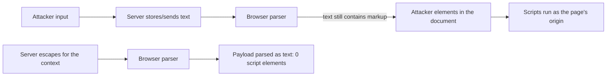

# Cross-Site Scripting

> Every transcript in this lesson was executed on the authoring machine (Windows 11,
> Python 3.13.5, standard library only) in the batch-17 `seclab-B` scratch lab. Pages are
> parsed with the same standard-library parser used here to count `<script>` elements —
> a browser's *execution* of those elements was not run and is marked *labelled reference*
> along with CSP reporting and browser-extension testing.

## 1. Learning Objectives

After this lesson you will be able to:

- [ ] Define XSS as injection into the browser's parser, and distinguish reflected, stored, and DOM-based variants by where the payload lives
- [ ] Demonstrate reflected and stored XSS by feeding a payload through a page and counting the `<script>` element the browser's parser would receive
- [ ] Eliminate both by escaping at the output layer, and show the same pages parsing to zero script elements
- [ ] Explain why `html.escape` does not fix a `javascript:` URL, and apply a scheme allowlist where it doesn't
- [ ] Choose the right layer for each output context (HTML body, attribute, URL, JavaScript, CSS) and say what breaks when the wrong one is used

## 2. Prerequisites

- [Injection Vulnerabilities](injection-vulnerabilities.md) — the same root cause (data becomes syntax), aimed at a different interpreter
- [Security Fundamentals](security-fundamentals.md) — defense in depth and the verification habit this lesson's probes follow
- [06-INTERNET-AND-WEB-FOUNDATIONS](../06-INTERNET-AND-WEB-FOUNDATIONS/README.md) — how the browser parses HTML and runs scripts

*No code prerequisite beyond reading Python — the probe is printed in full and uses only the standard library.*

## 3. Introduction

Cross-site scripting (XSS) is injection with the browser as the interpreter. The server
sends HTML; the browser's parser turns that text into a document; if attacker text is
still *markup* by the time it is sent, the attacker's elements — `<script>`, ``, `<svg onload=...>` — join the document and run with the page's origin.
That origin is the prize: scripts run as your site, so they can read anything the user
can see, call your APIs with the user's session, and rewrite the page. This lesson
renders reflected, stored, and URL-scheme cases through a real parser, counts the script
elements on each side of the fix, and shows the one case escaping alone cannot cover.

## 4. The Problem It Solves

XSS dominated web breaches because *building HTML by concatenation is the natural way to
write a server-rendered page*:

- **A search box that echoes its query.** `Results for {q}` — harmless-looking, and
  phase 1 of the probe shows the payload arriving as a live `<script>` element.
- **A stored field rendered later.** A note title, a comment, a display name: the payload
  is saved *as data* and becomes markup on every subsequent view (phase 3). Stored XSS is
  self-propagating: one victim's page load can persist the payload for everyone.
- **"It's just text."** Text and markup are indistinguishable until the parser separates
  them — and the parser has no way to know which side wrote the string.

The fix has to happen where the context is known: at the moment a value is placed into a
specific output context (HTML body, attribute, URL, script, style), transform it so the
parser reads it as data. That transformation — **contextual escaping** — is what phase 2
and phase 4 execute, and the parser confirms the payload demoted from element to text.

## 5. Core Concepts

### The three variants

| Variant | Where the payload lives | Typical route |
|---|---|---|
| **Reflected** | in the request (query, form); echoed in the response | `/search?q=<script>...` |
| **Stored** | in the database; served to future viewers | profile name, comment, note title |
| **DOM-based** | entirely client-side — JS reads `location.hash` and writes it into the DOM | fragment handling in an SPA |

All three end at the same point: a parser treats attacker text as markup. The
difference is only the payload's route to the page.

### Sink and context

A **sink** for XSS is any place untrusted text lands in a document: element body,
attribute value, `href`/`src` URL, `<script>` body, CSS, or an HTML comment. The fix
depends on the **context** — the same `html.escape` that is correct inside `<h1>` is
insufficient inside an `href`, because quotes are not the issue there: the *URL scheme*
is. Phase 4 demonstrates exactly that: after escaping, `javascript:alert(...)` survives
intact as a script-capable scheme, until a scheme allowlist blocks it.

### Escaping vs sanitizing vs output encoding

- **Output encoding/escaping** (what the probe uses) — mechanical transformation for one
  context; `html.escape` turns `<` into `<` so the parser never sees a tag.
- **Sanitizing** (e.g., a scrubber library on rich HTML) — parses and *removes* dangerous
  constructs while allowing some markup; needed only when users must submit HTML.
- **Trusted types / template systems** — frameworks that make the safe sink the default
  so escaping is automatic rather than remembered.

### Content Security Policy (CSP)

An HTTP response header that tells the browser which script sources may run — a second
layer that can make injected `<script>` inert even if markup slips through. It is
defense in depth, not a substitute for escaping: a policy that allows inline script has
given away most of the benefit. CSP was not run in this lab — *labelled reference*.

### Same-origin as the blast radius

Scripts run under the *page's* origin, so XSS reads same-origin cookies (unless
`HttpOnly` — [session-security.md](session-security.md)), calls same-origin APIs as the
victim, and can alter anything on the page. Cross-origin data stays out of reach — which
is why XSS is measured by what the *victim's session* can touch.

## 6. How It Works



The parser is the judge in this lesson: whatever the server sends, the
`ScriptCollector` parser in the probe reports how many script elements the document
actually contains — `['window.__pwned=1']` when the payload survived, `[]` after
escaping. That count is this lesson's equivalent of watching the exploit fire.

## 7. Practical Examples

**Example 1 — the full probe: reflected, stored, escaping, and the URL-scheme case**

```python
# SEC-08 XSS probe: reflected and stored XSS, escaping at the HTML layer, and the
# URL-scheme case html.escape does not cover. Standard library only.
# Run: python xss_probe.py
import html
from html.parser import HTMLParser


class ScriptCollector(HTMLParser):
    """Parses a page the way a browser's parser would and records script elements."""

    def __init__(self):
        super().__init__()
        self.scripts = []
        self._in_script = False
        self._buf = ""

    def handle_starttag(self, tag, attrs):
        if tag == "script":
            self._in_script = True
            self._buf = ""

    def handle_data(self, data):
        if self._in_script:
            self._buf += data

    def handle_endtag(self, tag):
        if tag == "script":
            self._in_script = False
            self.scripts.append(self._buf)


def scripts_in(page):
    p = ScriptCollector()
    p.feed(page)
    return p.scripts


PAYLOAD = "<script>window.__pwned=1</script>"


def search_page(q, escape=False):
    shown = html.escape(q) if escape else q
    return f"<html><body><h1>Results for {shown}</h1></body></html>"


def note_page(title, escape=False):
    shown = html.escape(title) if escape else title
    return f"<html><body><ul><li>{shown}</li></ul></body></html>"


print("=== 1. reflected XSS: ?q= echoed straight into the page ===")
page = search_page(PAYLOAD)
print(f"  HTML sent to the browser: {page}")
print(f"  script elements parsed   : {scripts_in(page)}")

print()
print("=== 2. the same query escaped at the output layer ===")
page = search_page(PAYLOAD, escape=True)
print(f"  HTML sent to the browser: {page}")
print(f"  script elements parsed   : {scripts_in(page)}")

print()
print("=== 3. stored XSS: payload saved in a note title, later rendered ===")
stored = PAYLOAD
page = note_page(stored)
print(f"  HTML sent to the browser: {page}")
print(f"  script elements parsed   : {scripts_in(page)}")
page = note_page(stored, escape=True)
print(f"  escaped rendering       : {page}")
print(f"  script elements parsed   : {scripts_in(page)}")

print()
print("=== 4. what html.escape does NOT fix: a javascript: URL ===")


def avatar_href(url, escape=True):
    value = html.escape(url) if escape else url
    return f'<a href="{value}">profile</a>'


for url in ["javascript:alert(document.cookie)",
            "https://example.org/avatar.png"]:
    link = avatar_href(url)
    print(f"  input : {url}")
    print(f"  output: {link}")
    print(f"  still a script-capable scheme: {url.startswith('javascript:')}")


def safe_avatar_href(url):
    from urllib.parse import urlparse
    scheme = urlparse(url).scheme.lower()
    if scheme not in ("http", "https"):            # allowlist by scheme
        return "#blocked"
    return f'<a href="{html.escape(url, quote=True)}">profile</a>'


print()
print("  after scheme allowlisting:")
for url in ["javascript:alert(document.cookie)",
            "https://example.org/avatar.png"]:
    print(f"  {url} -> {safe_avatar_href(url)}")
```

- Phases 1 vs 2 and the two halves of phase 3 are the *same payload* through one
  boolean (`escape`), so each pair isolates the escaping step.
- `ScriptCollector` is the parser: it reports what a browser's parser would build,
  without executing anything.
- **Expected output:** the capture below.
- **How to run it:** `python xss_probe.py` (Windows 11, Python 3.13.5).
- **Assumptions:** standard library only; no browser and no network.

**Executed capture:**

```text
=== 1. reflected XSS: ?q= echoed straight into the page ===
  HTML sent to the browser: <html><body><h1>Results for <script>window.__pwned=1</script></h1></body></html>
  script elements parsed   : ['window.__pwned=1']

=== 2. the same query escaped at the output layer ===
  HTML sent to the browser: <html><body><h1>Results for &lt;script&gt;window.__pwned=1&lt;/script&gt;</h1></body></html>
  script elements parsed   : []

=== 3. stored XSS: payload saved in a note title, later rendered ===
  HTML sent to the browser: <html><body><ul><li><script>window.__pwned=1</script></li></ul></body></html>
  script elements parsed   : ['window.__pwned=1']
  escaped rendering       : <html><body><ul><li>&lt;script&gt;window.__pwned=1&lt;/script&gt;</li></ul></body></html>
  script elements parsed   : []

=== 4. what html.escape does NOT fix: a javascript: URL ===
  input : javascript:alert(document.cookie)
  output: <a href="javascript:alert(document.cookie)">profile</a>
  still a script-capable scheme: True
  input : https://example.org/avatar.png
  output: <a href="https://example.org/avatar.png">profile</a>
  still a script-capable scheme: False

  after scheme allowlisting:
  javascript:alert(document.cookie) -> #blocked
  https://example.org/avatar.png -> <a href="https://example.org/avatar.png">profile</a>
```

Phase 1 is reflected XSS in full: the payload string crossed from query to page and the
parser found a script element holding `window.__pwned=1`. Phase 2 is the fix — identical
request, one `html.escape` at the output, and the parser finds nothing. Phase 3 shows
stored XSS and its fix with the same payload (storage is irrelevant to the control — the
escaping happens at *render* time, which is why escaping late is correct and escaping on
input is not). Phase 4 is the honest limit: escaping left `javascript:` fully intact;
only the scheme allowlist changed the outcome.

**Example 2 — contextual encoding cheat sheet (illustration)**

```python
# HTML body / attribute (quotes on): html.escape(value, quote=True)
# URL context: parse and allowlist the scheme FIRST, then escape (phase 4)
# JavaScript string inside <script>: json.dumps(value) — not html.escape
#   json.dumps("<script>") -> '"<script>"'  still needs the script-context rules
# CSS: never interpolate untrusted values; use classes
# Template auto-escaping: keep it ON; disable it for nothing you did not hand-write
```

- **Expected output:** no output — the mapping from context to control.
- **Assumptions:** each line names a context; phase 4 executed the URL row for real.

## 8. Real-World Applications

- **Any server-rendered page with user text** — profiles, comments, tickets, search
  results — is a potential reflected or stored sink; template auto-escaping (Jinja2,
  React JSX text, Go `html/template`) handles the common case, and `|safe` /
  `dangerouslySetInnerHTML` are the exact places where it is turned off (review those).
- **Rich-text editors** need the scrubber path: parse HTML, allowlist tags/attributes,
  serialize — never regex-strip `<script>`.
- **Bug bounty staples** are DOM XSS in front-end frameworks reading `location.*` into
  sinks like `innerHTML`.
- Paired with: `HttpOnly` cookies ([session-security.md](session-security.md)) to cap
  what a script can steal, and CSP as the second layer.

## 9. Common Mistakes

| Mistake | Why it happens | How to recognize it | How to prevent it |
|---|---|---|---|
| Escaping on input, not at output | "We cleaned it when it arrived" | Payload broken for storage but re-emitted raw in a second context | Escape per context, at render time — the only point where context is known |
| Escaping with the wrong context tool | One `escape()` used everywhere | `html.escape` on a URL: phase 4's `javascript:` still works | Context table (section 7 Example 2); scheme allowlist for URLs |
| Rich HTML "sanitized" with regex | `<script>` replaced by string ops | `<scr<script>ipt>` or `` payloads survive | Parse-and-allowlist sanitizer, or don't accept HTML |
| `innerHTML`/`|safe`/`v-html` with untrusted data | Convenience in templates and SPAs | Front-end renders a user field into markup | Text-only sinks (`textContent`), or sanitize with a real parser |
| Attribute without quotes in the template | Hand-written HTML | Payload escapes the attribute with a space | Always quote attribute values AND escape with `quote=True` |
| Relying on CSP alone | Header seen as the fix | Policy allows `unsafe-inline` | Escaping first, CSP as layer two |
| Assuming stored fields are safe because a handler validated them | Validation ≠ encoding | Later-rendered field executes in another page | Validate for type/format; encode at every render |

## 10. Best Practices

- **Escape at every output, for the context of that output.** The rule stops applying
  only where the value is not going into a document at all (an API consumed by a native
  app — but then that client has its own rendering rules).
- **Turn on template auto-escaping and leave it on.** Treat every escape hatch
  (`|safe`, `dangerouslySetInnerHTML`, `innerHTML =`) as a review gate requiring a
  reason in a comment.
- **Prefer sinks that cannot parse markup**: `textContent`, DOM APIs that create text
  nodes, framework text interpolation.
- **URLs: allowlist schemes** (`http`, `https`, `mailto`) before any value reaches
  `href`/`src` — phase 4 shows escaping alone leaving `javascript:` untouched.
- **Sanitize with a parser, not a regex**, and only when users must submit markup.
- **Add CSP as layer two** after escaping is correct — and keep `HttpOnly` on session
  cookies so a successful script cannot simply read the token.
- **Write the failing test first**: a payload, a count of parsed script elements > 0;
  then escape; then the same payload at 0 — the probe's phases are that test.

## 11. Limitations and Trade-Offs

- **Escaping is a per-context discipline, and contexts multiply.** Attribute values,
  URLs, `javascript:` bodies, CSS, SVG, MathML, HTML comments — each has its own rules;
  systems that embed user HTML (rich editors, markdown renderers) accept a genuinely
  harder problem and must use battle-tested sanitizers, not hand-rolled filters.
- **Escaping does nothing for the URL-scheme case or for logic bugs** where the page
  renders attacker-chosen *content* the user is tricked into approving (phishing via
  legitimate domains) — different lessons, different controls.
- **This lab's parser is Python's `html.parser`, not a browser.** It faithfully
  demonstrates markup-vs-text, but it does not execute scripts, does not model browser
  quirks or mutation XSS (`mXSS`) in innerHTML round-trips, and no CSP, extension, or
  browser-in-the-loop test was run — *labelled reference*. The claim "the browser would
  execute the parsed script" is standard browser behavior, not something this capture
  observed directly.
- **Auto-escaping frameworks hide the mechanism.** That is good for safety and bad for
  understanding — hence this lesson's manual rendering before you rely on the framework.

## 12. Practical Exercises

### Introductory

1. **Exercise 8.1** — Run the probe and, for phases 1–3, write what the parser's list
   tells you about what the browser would build. **Completion criteria:** three
   sentences tied to the `scripts_in` output, one of them explaining phase 3's `[]`.
2. **Exercise 8.2** — Add an attribute context to the probe: render
   `` escaped and unescaped with a payload that closes the attribute.
   **Completion criteria:** captures where the unescaped page parses to the attacker's
   element and the escaped page parses to an `` with text.

### Intermediate

3. **Exercise 8.3** — Store the payload, render it on a *second* "other user's view"
   function, and prove escaping at render time protects both pages without changing the
   stored data. **Completion criteria:** captures showing the stored value unchanged and
   both renderings parsing to `[]`.
4. **Exercise 8.4** — Implement the URL scheme allowlist for `src` as well as `href`,
   and test `javascript:`, `data:text/html,...`, and `https://`. **Completion criteria:**
   a capture where the first two are `#blocked` and the third passes.

### Independent problem-solving

5. **Exercise 8.5** — A teammate wants to render user markdown with "just a regex that
   strips `<script>`". Design the review that replaces it. **Completion criteria:** a
   written argument using at least two payloads that defeat regex stripping (show them
   running against the teammate's regex), plus a recommended parser-based approach with
   its own test cases.

*Solutions: attempt first. They live in `solutions/` of this subject.*

## 13. Knowledge Check

1. Phase 2 and phase 3's escaped rendering produce `[]` from the same payload — why is
   the *stored* variant not fixed by escaping when the note is saved?
2. What does phase 4 prove that phases 1–3 cannot, and which control finishes the job
   the escaping started?
3. When would you accept user-submitted HTML at all, and what would you require of the
   component that processes it?

## 14. Completion Criteria

Observable evidence that you have understood this lesson:

- [ ] You can explain XSS in terms of a parser, not "bad scripts", and name the three variants' routes
- [ ] You can reproduce phases 1–4 from a blank editor and interpret every `scripts_in` list
- [ ] You can pick the correct encoding for a given output context and justify it
- [ ] You can find an unescaped sink by inspection in any template or DOM code you read
- [ ] You can state what escaping does not cover (URL schemes, rich HTML) and its control

## 15. Summary

- XSS is injection into the browser's parser: attacker text arrives as markup and runs
  under the page's origin.
- Reflected, stored, and DOM-based differ only in the payload's route; the fix is the
  same — escape at render time, for the context.
- The parser is the test: payload parses to a script element before, `[]` after.
- `html.escape` is not universal: phase 4's `javascript:` URL survives it; scheme
  allowlists do the rest.
- `HttpOnly` and CSP are layers that cap the damage — never the primary control.

## 16. Next Steps

- Next lesson: [CSRF](csrf.md) — the sibling that abuses the browser's automatic cookie
  attachment instead of its parser
- Practice: the subject's exercise set (written with its exercise installment)
- Where it is applied: [Project 07](../20-PROJECT-LABORATORY/project-07-secure-production-application/README.md)'s
  security checklist, and the safe-use rules in [SECURITY.md](../SECURITY.md)