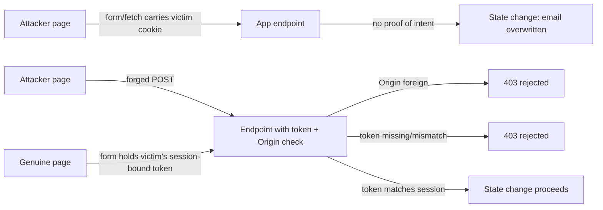

# CSRF

> Every transcript in this lesson was executed on the authoring machine (Windows 11,
> Python 3.13.5, standard library only) in the batch-17 `seclab-C` scratch lab. The lab
> attaches the victim's session cookie to the forged request explicitly, standing in for
> a browser that sends it — real-browser cookie withholding under `SameSite`, and browser
> `Origin` behaviour, were not run and are marked *labelled reference*.

## 1. Learning Objectives

After this lesson you will be able to:

- [ ] Define CSRF as the abuse of *ambient authority* — cookies the browser attaches without being asked
- [ ] Explain why the same-origin policy stops the attacker *reading* a response but not *sending* the request
- [ ] Demonstrate a forged state-changing POST succeeding against an undefended endpoint, then failing against an Origin check and against a session-bound token
- [ ] Implement a per-session CSRF token correctly: issue it at login, compare it in constant time, reject missing and mismatched tokens differently from valid ones
- [ ] Choose and layer the right defenses (token, `SameSite`, Origin check, no side effects on GET) and say what each one alone does not cover

## 2. Prerequisites

- [Session Security](session-security.md) — the cookies and sessions this attack rides; `HttpOnly`, expiry, and fixation
- [Cross-Site Scripting](cross-site-scripting.md) — the sibling browser-mediated attack: XSS steals the token, CSRF uses the cookie
- [06-INTERNET-AND-WEB-FOUNDATIONS](../06-INTERNET-AND-WEB-FOUNDATIONS/README.md) — the same-origin policy, cookies, and how browsers attach them

*No code prerequisite beyond reading Python — the probe is printed in full and uses only the standard library.*

## 3. Introduction

Cross-site request forgery (CSRF) is an attack on *trust through cookies*. When you are
logged into a site, your browser attaches your session cookie to every request it thinks
belongs there — you never approve each one. That convenience is the whole attack: if an
attacker can make your browser *send* a request to your bank, the bank sees your cookie
and treats the request as you. The request is forged — the attacker wrote its body — but
the authority is genuine, because it rides in your cookie. This lesson runs a forged
state-changing POST end to end, then turns on the two server-side defenses that stop it,
one at a time, so you can watch each rejection happen.

## 4. The Problem It Solves

Before CSRF had a name, nearly every web app was vulnerable by construction:

- **Forms did the state changes.** Changing an email address, transferring money, deleting an account — all `POST /something` with cookies attached automatically. Nothing else in the request proved *the user intended it*.
- **State changes on GET were common.** `GET /transfer?to=attacker&amount=1000` needed no form at all: an `` on any page would fire it.
- **The same-origin policy looked like protection — it is not.** The browser blocks the attacker's page from *reading* your inbox; it does not stop the attacker's page from *sending* the request in the first place. CORS governs reading, not sending.
- **Knowing the URL was enough.** Endpoints are not secret. If the only thing protecting `/settings/email` is that attackers do not know it, they do: URLs are in HTML, JS bundles, and guessable conventions.

The fix is to make every state-changing request carry evidence that the *genuine page*
built it — evidence an attacker's page cannot read or reproduce. Phase 1 of the probe is
the vulnerability without that evidence; phases 2 and 3 are two independent ways to
require it.

## 5. Core Concepts

### Ambient authority

**Ambient authority** means a request carries credentials the recipient trusts without the
requester consciously attaching them — here, the session cookie. Contrast this with
*explicit* authority: an `Authorization: Bearer ...` header that JavaScript must add on
purpose. Ambient authority is exactly what makes "the browser sent it" mean nothing
about "the user meant it".

### The same-origin policy does not block sending

The **same-origin policy** restricts what *response data* a foreign page can read;
`cross-origin resource sharing` (CORS) is the opt-in mechanism for relaxing that. Neither
gates whether the *request* leaves the browser. A cross-site `<form>` or `fetch()` with
`credentials: 'include'` is sent; the attacker just cannot see the answer. CSRF exploits
the sending half while the browser enforces the reading half.

### The CSRF token

A **CSRF token** is a random, unguessable string the server issues to the legitimate
client and requires back on every state-changing request. Its security rests on two
properties:

- **Unpredictable** — generated with a CSPRNG (`secrets.token_urlsafe`), never a timestamp or hash of the user id.
- **Session-bound** — stored server-side with the session, so a token the *attacker* obtains by logging into their own account is checked against *the victim's* session and fails. Phase 3 proves this: `mallory`'s real, valid token is rejected as a `csrf token mismatch` for alice's session.

### SameSite: the cookie-level control

The **`SameSite` cookie attribute** tells the browser when to attach the cookie
cross-site: `Strict` — never cross-site; `Lax` — only top-level `GET` navigations, not
POSTs or subresource requests; `None` — always (and requires `Secure`). `Lax` is the
modern default for cookies that don't specify it. Because `Lax` alone depends on browser
defaults and still permits top-level navigations, it is a *layer*, not the primary
control. The lab sets `SameSite=Lax` on the session cookie but attaches the cookie
manually to model a client that sends it anyway; browser withholding itself is a
*labelled reference*.

### Origin and Referer checks

Every browser request carries an **`Origin` header** (and usually a **`Referer`**) naming
the page that initiated it. A server that rejects requests whose Origin is not its own
blocks forged browser submissions — cheap and effective, but Referer can be stripped by
privacy policies and older clients, which is why it is layer two, not layer one.

### Unsafe methods and "GET must be safe"

HTTP's **safe methods** (`GET`, `HEAD`) must not change state — that contract is what
makes links, crawlers, and prefetching harmless. CSRF defense starts by honoring it:
nothing that mutates data belongs on a route an `` tag can trigger.

## 6. How It Works



The token is the difference between "your cookie was present" and "your page sent this".
It travels only where the genuine app can read it — in the app's own HTML/JS — and the
attacker's page, blocked by the same-origin policy from reading the response, can never
extract it.

## 7. Practical Examples

**Example 1 — the full probe: a forged POST, then each defense in turn**

```python
# SEC-09 CSRF probe: forged state-changing request, Origin check, session-bound token.
# Standard library only; server and client in one process. Run: python csrf_probe.py
import json
import secrets
import threading
import http.client
from http.server import BaseHTTPRequestHandler, HTTPServer

CHECKS = {"origin": False, "token": False}   # both off = vulnerable
SESSIONS = {}                                # sid -> {"user": str, "csrf": str}
EMAILS = {"alice": "alice@example.com"}
PORT = 8095


class Handler(BaseHTTPRequestHandler):
    def log_message(self, *a):
        pass

    def _send(self, code, obj, sid=None):
        body = json.dumps(obj).encode()
        self.send_response(code)
        self.send_header("Content-Type", "application/json")
        self.send_header("Content-Length", str(len(body)))
        if sid:
            self.send_header("Set-Cookie", f"sid={sid}; Path=/; HttpOnly; SameSite=Lax")
        self.end_headers()
        self.wfile.write(body)

    def _sid(self):
        for part in self.headers.get("Cookie", "").split(";"):
            k, _, v = part.strip().partition("=")
            if k == "sid":
                return v
        return None

    def do_POST(self):
        n = int(self.headers.get("Content-Length", 0))
        data = json.loads(self.rfile.read(n) or b"{}")
        if self.path == "/login":
            sid = secrets.token_urlsafe(16)
            SESSIONS[sid] = {"user": data["user"], "csrf": secrets.token_urlsafe(16)}
            self._send(200, {"csrf": SESSIONS[sid]["csrf"]}, sid=sid)
        elif self.path == "/settings/email":
            sid = self._sid()
            if sid not in SESSIONS:
                return self._send(401, {"error": "no session"})
            sess = SESSIONS[sid]
            if CHECKS["origin"]:
                origin = self.headers.get("Origin") or self.headers.get("Referer", "")
                if not origin.startswith(f"http://127.0.0.1:{PORT}"):
                    return self._send(403, {"error": "cross-origin request rejected"})
            if CHECKS["token"]:
                if not self.headers.get("X-CSRF-Token"):
                    return self._send(403, {"error": "missing csrf token"})
                if self.headers["X-CSRF-Token"] != sess["csrf"]:
                    return self._send(403, {"error": "csrf token mismatch"})
            EMAILS[sess["user"]] = data["email"]          # the state change
            self._send(200, {"user": sess["user"], "email": EMAILS[sess["user"]]})
        else:
            self._send(404, {"error": "not found"})


def req(method, path, body=None, sid=None, headers=None):
    c = http.client.HTTPConnection("127.0.0.1", PORT, timeout=5)
    h = dict(headers or {})
    if sid:
        h["Cookie"] = f"sid={sid}"
    payload = json.dumps(body) if body is not None else None
    if payload:
        h["Content-Type"] = "application/json"
    c.request(method, path, payload, h)
    r = c.getresponse()
    raw = r.read().decode()
    set_cookie = r.getheader("Set-Cookie")
    c.close()
    return r.status, raw, set_cookie


server = HTTPServer(("127.0.0.1", PORT), Handler)
threading.Thread(target=server.serve_forever, daemon=True).start()

# victim logs in and keeps her cookie; the attacker somehow rides that cookie
_, body, cookie = req("POST", "/login", {"user": "alice"})
alice_sid = cookie.split(";")[0].split("=")[1]
alice_token = json.loads(body)["csrf"]
# the attacker logs in too and has his own CSRF token
_, body, _ = req("POST", "/login", {"user": "mallory"})
mallory_token = json.loads(body)["csrf"]
print(f"alice's email before: {EMAILS['alice']}")

evil = {"Origin": "https://evil.example"}
print()
print("=== 1. no defenses: forged cross-site POST rides alice's cookie ===")
st, body, _ = req("POST", "/settings/email",
                  {"email": "attacker@evil.example"}, sid=alice_sid, headers=evil)
print(f"forged POST (Origin: https://evil.example, no token) -> {st}: {body}")

print()
print("=== 2. Origin check on ===")
CHECKS["origin"] = True
st, body, _ = req("POST", "/settings/email",
                  {"email": "attacker@evil.example"}, sid=alice_sid, headers=evil)
print(f"same forged request -> {st}: {body}")
CHECKS["origin"] = False

print()
print("=== 3. session-bound CSRF token on ===")
CHECKS["token"] = True
st, body, _ = req("POST", "/settings/email",
                  {"email": "new@example.com"}, sid=alice_sid)
print(f"no token            -> {st}: {body}")
st, body, _ = req("POST", "/settings/email",
                  {"email": "new@example.com"}, sid=alice_sid,
                  headers={"X-CSRF-Token": mallory_token})
print(f"attacker's own token -> {st}: {body}")
st, body, _ = req("POST", "/settings/email",
                  {"email": "new@example.com"}, sid=alice_sid,
                  headers={"X-CSRF-Token": alice_token})
print(f"alice's real token  -> {st}: {body}")
print(f"alice's email after : {EMAILS['alice']}")

server.shutdown()
```

- Phase 1 is the whole vulnerability: foreign Origin, no token, victim's cookie attached — and the endpoint returns `200` with the attacker's email stored as alice's.
- Phase 2 flips one boolean (`CHECKS["origin"]`) and the same forged request is refused before any state change; phase 3 flips the other and shows the three-way outcome a real token check must produce: `missing`, `mismatch`, `valid`.
- The attacker's own token being *valid for mallory but rejected for alice* is what "session-bound" buys — a global or per-app token would have passed.
- **Expected output:** the capture below.
- **How to run it:** `python csrf_probe.py` (Windows 11, Python 3.13.5).
- **Assumptions:** standard library only; loopback server; the cookie is attached by the client code on purpose (see the header note).

**Executed capture:**

```text
alice's email before: alice@example.com

=== 1. no defenses: forged cross-site POST rides alice's cookie ===
forged POST (Origin: https://evil.example, no token) -> 200: {"user": "alice", "email": "attacker@evil.example"}

=== 2. Origin check on ===
same forged request -> 403: {"error": "cross-origin request rejected"}

=== 3. session-bound CSRF token on ===
no token            -> 403: {"error": "missing csrf token"}
attacker's own token -> 403: {"error": "csrf token mismatch"}
alice's real token  -> 200: {"user": "alice", "email": "new@example.com"}
alice's email after : new@example.com
```

**Example 2 — issuing and checking the token (illustration)**

```python
import hmac
import secrets

# at login (server side): mint a fresh token bound to this session only
csrf = secrets.token_urlsafe(32)
SESSIONS[sid] = {"user": user, "csrf": csrf}

# on every unsafe request (POST/PUT/PATCH/DELETE), before any state change:
provided = headers.get("X-CSRF-Token", "")
sess = SESSIONS.get(sid)
if not provided or not sess or not hmac.compare_digest(provided, sess["csrf"]):
    reject(403, "csrf token mismatch")   # constant-time compare, no early string ==

# the genuine page embeds it once (template or bootstrap), the JS echoes it back:
#   <meta name="csrf-token" content="{{ csrf_token }}">
#   fetch(url, {method: "POST", headers: {"X-CSRF-Token": token}})
```

- **Expected output:** no output — this is the production shape of phase 3's `CHECKS["token"]` branch.
- **Assumptions:** `hmac.compare_digest` avoids the timing side channel of `==`; the token lives server-side per session, never in the URL.

## 8. Real-World Applications

- **Any cookie-authenticated state change**: password/email changes, fund transfers, admin actions, deleting resources. Frameworks ship it (Django `CsrfViewMiddleware`, Rails `protect_from_forgy`, Laravel `VerifyCsrfToken`, Express `csurf`) — the failures are in disabled middleware and API routes added outside it.
- **Login and change-password forms** need tokens too: *login CSRF* plants the attacker's session in the victim's browser.
- **JSON APIs** get partial protection for free — `Content-Type: application/json` cannot be sent by a simple cross-origin form, so the browser preflights it — but this holds only while the API accepts nothing else and the auth is not cookie-based.
- Paired with: [Session Security](session-security.md) for cookie flags, and [Cross-Site Scripting](cross-site-scripting.md) — an XSS hole renders tokens moot, which is why they are layered, not alternatives.

## 9. Common Mistakes

| Mistake | Why it happens | How to recognize it | How to prevent it |
|---|---|---|---|
| State changes on `GET` | "It was convenient for testing" | `/delete?id=3` reachable by `` | Move mutations to POST/PUT/DELETE; keep GET side-effect free |
| Token checked for *presence* only | `if "X-CSRF-Token" in headers` | Phase 3's mismatch case would pass | Compare against the session's token in constant time |
| Global/static token | One token per deployment, hardcoded | Same value in every session and every page load | Fresh random per session, rotated with the session |
| Attacker's token accepted | Token not bound to the session | Mallory's token works on alice's session | Store the token inside the session record; check it there |
| Only `Referer` checked | Header assumed always present | Requests from privacy-stripping contexts break (or bypass) | `Origin` first, token as the primary control |
| `SameSite=None` kept for old flows | Migration never finished | Cookie set with `None; Secure` on a first-party app | Default `Lax`; justify every `None` in a comment |
| Assuming CORS protects | CORS confused with request blocking | "We don't send ACAO, we're safe" — request already arrived | CORS gates reading; tokens gate sending |
| Token in the URL/query string | Server-side rendering shortcuts | Token leaks via `Referer`, logs, browser history | Header or hidden form field only |

## 10. Best Practices

- **Token on every unsafe request, checked before any state change** — the rule stops applying only to endpoints authenticated by a non-cookie mechanism the browser never attaches automatically (an `Authorization` bearer header), where ambient authority doesn't exist.
- **Layer `SameSite=Lax` or `Strict` under the token.** Cookies that never travel cross-site remove whole classes of mistakes; the rule relaxes for genuinely cross-site flows (OAuth callbacks, embedded checkout) where `None; Secure` is unavoidable and the token must then carry the weight.
- **Add the Origin check** — it is three lines (phase 2) and catches requests no token ever sees, including some same-site subdomain cases.
- **Use `hmac.compare_digest`** for token comparison; treat tokens as secrets in logs (never log them).
- **Mint the token at session creation** and keep it out of URLs, analytics, and error reports.
- **Test it like the probe does**: forge the request, watch the 200, turn on the control, watch the 403 — a failing-then-passing test, in the spirit of [14-TESTING-AND-QUALITY](../14-TESTING-AND-QUALITY/README.md).

## 11. Limitations and Trade-Offs

- **`SameSite` is a browser policy, not server proof.** Old browsers, mis-set `None`, same-*site* (subdomain) attackers, and top-level `GET` navigations fall outside it — the server-side token remains the authority.
- **The lab did not run a browser.** Whether a real cross-site form carries the cookie, whether `Referer` is sent, and how each browser treats `Lax` defaults were not observed here — the probe attaches the cookie deliberately to test the *server's* logic under the "cookie was sent" condition. Those browser behaviors are *labelled reference*.
- **Tokens cost plumbing.** Every render and every state-changing call must carry the token; SPAs must keep it in memory (a token in `localStorage` is readable by XSS — see [cross-site-scripting.md](cross-site-scripting.md)).
- **Non-cookie clients are unaffected either way.** A native app using bearer tokens has no ambient authority, so CSRF is largely irrelevant — but the moment the same endpoints accept cookie auth, the requirements above apply to them too.
- **CSRF is not authorization.** A valid token proves the request came through your page, not that the user may perform the action — that is [access-control.md](access-control.md)'s job.

## 12. Practical Exercises

### Introductory

1. **Exercise 9.1** — Run the probe and explain phase 1's `200` in one paragraph using the words "ambient authority" and "same-origin policy". **Completion criteria:** the paragraph says why the attacker could *send* but could not have *read* the response.
2. **Exercise 9.2** — Add a fourth phase where the forged request uses `GET /settings/email?email=...` with the state change still on that route; show it succeeding with no token and no Origin check at all. **Completion criteria:** a capture where the GET variant returns `200`.

### Intermediate

3. **Exercise 9.3** — Rotate alice's token after login (re-issue on every request) and prove the old token now fails with `csrf token mismatch` while the new one passes. **Completion criteria:** two captures showing the stale-token 403 and the fresh-token 200.
4. **Exercise 9.4** — Implement the Origin check with `hmac.compare_digest`-style strictness for the full origin (scheme, host, port) and test `http://127.0.0.1:8095.evil.example`, `https://127.0.0.1:8095`, and the correct origin. **Completion criteria:** the first two are 403, the third is 200.

### Independent problem-solving

5. **Exercise 9.5** — A teammate argues `SameSite=Strict` alone replaces CSRF tokens on your app. Design the experiment that answers them. **Completion criteria:** a written top-level-navigation scenario (link from an email) where `Strict` withholds the cookie *and* the user's own GET navigation breaks — then a recommendation with the trade-off stated, referencing this lesson's phases 2–3.

*Solutions: attempt first. They live in `solutions/` of this subject.*

## 13. Knowledge Check

1. Phase 3 shows mallory's token rejected even though it is a genuine, valid token. What exactly was checked, and what would have happened if the token had been stored per-application instead of per-session?
2. Why does blocking the attacker from *reading* your inbox (same-origin policy) do nothing to stop them *changing* your email address?
3. When would you accept a state-changing endpoint with no CSRF token at all — and what property of that endpoint makes it safe?
4. Phase 2 and phase 3 both end in `403`. Which single control would you keep if you could keep only one, and what does your choice not cover?

## 14. Completion Criteria

Observable evidence that you have understood this lesson:

- [ ] You can explain CSRF in terms of ambient authority, not "fake forms", and say what the same-origin policy does and does not block
- [ ] You can reproduce phases 1–3 from a blank editor and interpret every status code
- [ ] You can write the token issue/check pair (Example 2) including the constant-time comparison
- [ ] You can diagnose the eight mistakes in section 9 in code you read
- [ ] You can state one scenario where `SameSite` alone fails and one where CSRF tokens are irrelevant

## 15. Summary

- CSRF forges *requests*, not credentials: the browser's own cookie supplies the authority, so no secret is stolen — the request is simply sent.
- The same-origin policy blocks reading the response; it never blocks sending the request.
- A session-bound random token is the primary control: phase 3 shows missing, mismatched, and valid tokens each getting the right answer.
- `SameSite` cookies and Origin checks are cheap layers underneath — none of them alone is proof.
- GET must be safe; a state-changing GET needs no token, no header, and no attacker skill to trigger.

## 16. Next Steps

- Next lesson: [SSRF](ssrf.md) — when the server, not the browser, is talked into fetching a URL the attacker chose
- Practice: the subject's exercise set (written with its exercise installment)
- Where it is applied: [Project 07](../20-PROJECT-LABORATORY/project-07-secure-production-application/README.md)'s
  security checklist, and the safe-use rules in [SECURITY.md](../SECURITY.md)