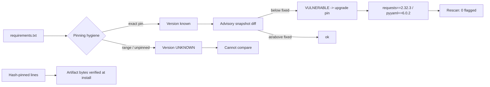

# Dependency Security

> Every transcript in this lesson was executed on the authoring machine (Windows 11,
> Python 3.13.5, standard library only) in the batch-17 `seclab-C` scratch lab. The
> advisory file is an **offline fixture shaped like an OSV record** — no live advisory
> database, package index, or scanner (pip-audit, npm audit, OSV) was contacted, and
> those runs are marked *labelled reference*.

## 1. Learning Objectives

After this lesson you will be able to:

- [ ] Explain the software supply chain in terms of direct and transitive dependencies and what a lockfile freezes
- [ ] Audit a requirements file for pinning hygiene: distinguish pinned, ranged, and unpinned entries and say what each makes knowable
- [ ] Compare pinned versions against an advisory snapshot and interpret a `VULNERABLE` and an `UNKNOWN` verdict
- [ ] Describe hash pinning and what class of tampering it removes from the threat model
- [ ] Choose a remediation order for a flagged dependency — upgrade, then verify — and say why unpinned entries cannot be triaged at all

## 2. Prerequisites

- [Security Fundamentals](security-fundamentals.md) — threat modeling applied to someone else's code running in your process
- [03-DEVELOPER-TOOLS](../03-DEVELOPER-TOOLS/README.md) — package managers, install commands, and lockfiles
- [11-BACKEND-ENGINEERING](../11-BACKEND-ENGINEERING/README.md) — the application whose `requirements.txt` this lesson examines

*No code prerequisite beyond reading Python — the probe is printed in full and uses only the standard library.*

## 3. Introduction

Every application is mostly *other people's code*. A typical service pulls hundreds of
packages, each with its own dependencies, and runs them with your privileges inside your
process — a compromise of any link in that chain is a compromise of you. **Dependency
security** is the set of habits that keeps the chain knowable: pin what you install,
know what you pinned, compare it against published advisories, and verify that what you
installed is what the registry said. This lesson reads a realistic requirements file
through those habits, finds two vulnerable pins and one entry that *cannot even be
triaged*, upgrades the pins, and confirms the flags clear.

## 4. The Problem It Solves

The failures this discipline prevents are the dominant breach pattern of the last decade:

- **"It just resolves latest."** Unpinned entries (`flask` in phase 1) mean today's install differs from yesterday's — and from the version you tested. Every build is a fresh, unreviewed supply of code.
- **Known CVEs in old pins.** `requests==2.31.0` is *below* the fixed version in phase 2 — a scanner would flag it instantly, but only because the version was pinned enough to compare. Ranged and unpinned entries come back `UNKNOWN`, the verdict worse than `VULNERABLE`, because nothing can be asserted at all.
- **The registry is not trusted infrastructure.** A maintainer account takeover, a typosquatted name (`reqeusts`), or a cache-poisoned artifact delivers code without any vulnerability *announcement* — hash pinning (phase 4) and lockfiles are the structural answers, advisories only catch the published ones.
- **Transitive silence.** Your file pins five packages; they pull in fifty. Without a lockfile recording the full tree, the fifty are whatever the resolver felt like.

Before pinning and scanning, the workflow was "run `pip install` and hope the changelog
mentions breaking changes" — and the security half of that hope never came true.

## 5. Core Concepts

### What the requirements file can and cannot say

| Form | Example | Knowable? |
|---|---|---|
| Exact pin | `requests==2.31.0` | Version → comparable to advisories ✔ |
| Range | `django>=4,<5` | Not a version; resolution outcome unknown ✘ |
| Unpinned | `flask` | Nothing — newest at install time ✘ |
| Hash-pinned | `uvicorn==0.30.6 --hash=sha256:...` | Version **and** artifact bytes ✔ |

Phase 1 classifies all four from the same file; phase 2 shows the consequence
(`UNKNOWN (not pinned; cannot compare)` for the ranged entry).

### Advisories

An **advisory** is a published record that a package version range is vulnerable: a
**CVE** (universal id), a **GHSA** (GitHub's id, used by Dependabot), or an **OSV**
entry (the open format the fixture mirrors: package name plus a fixed-version
threshold). **SCA** (software composition analysis) tools — `pip-audit`, `npm audit`,
`osv-scanner` — fetch these databases and diff them against your pins. The probe does
that diff offline: `parse_version` compares tuples, `vulnerable_below` is the fixture's
fixed version, and the verdicts (`VULNERABLE`, `ok (>= fixed)`, `UNKNOWN`) are exactly
what a live scanner produces.

### Hash pinning

**Hash pinning** attaches the artifact's SHA-256 to the requirement
(`--hash=sha256:...`), and the installer refuses any bytes that don't match — so a
registry compromise, mirror tamper, or MITM delivers *nothing* rather than your process
a backdoor. `pip --require-hashes` makes every requirement carry one (phase 4 detects
which lines do). It closes the *delivery* channel; advisories cover the *published
vulnerability* channel; neither replaces the other.

### Lockfiles and the transitive tree

A **lockfile** (`package-lock.json`, `poetry.lock`, `uv.lock`, `requirements.txt` with
hashes) records every resolved version, so CI installs *the same tree* you reviewed.
Pinning without committing the lock is half the control: the pins drift on the next
resolution.

### Typosquatting and dependency confusion

Attackers register names that *look* popular (`colorama` vs `colourama`) or push an
internal-package name to the public index. Countermeasures: exact-name review, private
index priority, lockfiles, and publisher verification — none of which appear in a plain
unpinned requirements file (*labelled reference*: no typosquat was fetched here, by
design).

## 6. How It Works



The flow's two exits are the lesson's core: a pinned version can be *answered* (vulnerable
or ok), and everything else answers `UNKNOWN` — which phase 2 prints for `django`, and
which is the scanner telling you your file makes the question unaskable.

## 7. Practical Examples

**Example 1 — the full probe: hygiene audit, advisory diff, upgrade, hash detection**

```python
# SEC-13 dependency-security probe: pinning hygiene, an offline advisory snapshot
# checked against pinned versions, and hash-pinning detection.
# Standard library only; the advisory file is a LAB FIXTURE, not live data.
# Run: python deps_probe.py
import json
import re
from pathlib import Path

REQ = Path("requirements-lab.txt")
ADVISORIES = Path("advisories-lab.json")

REQ.write_text(
    "requests==2.31.0\n"
    "flask\n"
    "django>=4,<5\n"
    "uvicorn==0.30.6\n"
    "pyyaml==6.0.1\n",
    encoding="utf-8")

# LAB FIXTURE shaped like an OSV/pip-audit record (real runs: see labelled reference)
ADVISORIES.write_text(json.dumps([
    {"id": "GHSA-LAB-0001", "package": "requests", "vulnerable_below": "2.32.0",
     "summary": "proxy-lookup URL leak (fixture)"},
    {"id": "GHSA-LAB-0002", "package": "pyyaml", "vulnerable_below": "6.0.2",
     "summary": "unsafe load in fixture advisory"},
    {"id": "GHSA-LAB-0003", "package": "django", "vulnerable_below": "5.0.7",
     "summary": "range notation complicates the answer (fixture)"},
], indent=2), encoding="utf-8")

PIN = re.compile(r"^\s*([A-Za-z0-9_.-]+)\s*==\s*([0-9][0-9a-zA-Z.]*)\s*(.*)$")
NAME = re.compile(r"^\s*([A-Za-z0-9_.-]+)")


def parse_version(v):
    return tuple(int(p) for p in re.findall(r"\d+", v))


def parse_requirements(text):
    entries = []
    for line in text.splitlines():
        line = line.strip()
        if not line or line.startswith("#") or line.startswith("-"):
            continue
        m = PIN.match(line)
        if m:
            entries.append({"raw": line, "name": m.group(1).lower(),
                            "version": m.group(2), "rest": m.group(3),
                            "pinned": True, "hash_pinned": "--hash=" in m.group(3)})
        else:
            entries.append({"raw": line, "name": NAME.match(line).group(1).lower(),
                            "version": None, "rest": "", "pinned": False,
                            "hash_pinned": False})
    return entries


entries = parse_requirements(REQ.read_text(encoding="utf-8"))
print("=== 1. pinning hygiene ===")
for e in entries:
    if not e["pinned"]:
        tag = "UNPINNED - resolves to whatever is newest"
    elif e["hash_pinned"]:
        tag = "hash-pinned"
    else:
        tag = "version-pinned"
    print(f"  {e['raw']:<24} -> {tag}")
print(f"  unpinned entries: {sum(1 for e in entries if not e['pinned'])}")

print()
print("=== 2. pinned versions vs offline advisory snapshot (LAB FIXTURE) ===")
advisories = json.loads(ADVISORIES.read_text(encoding="utf-8"))
for e in entries:
    for adv in advisories:
        if adv["package"] != e["name"]:
            continue
        if not e["pinned"]:
            print(f"  {e['name']:<10} {e['raw']:<24} -> UNKNOWN (not pinned; cannot compare)")
            continue
        vulnerable = parse_version(e["version"]) < parse_version(adv["vulnerable_below"])
        state = "VULNERABLE" if vulnerable else "ok (>= fixed)"
        print(f"  {e['name']:<10} {e['raw']:<24} vs {adv['id']} < {adv['vulnerable_below']} "
              f"-> {state}")

print()
print("=== 3. after upgrading the two flagged pins ===")
upgraded = parse_requirements(
    "requests==2.32.3\nflask\npyyaml==6.0.2\n")
flagged = 0
for e in upgraded:
    for adv in advisories:
        if adv["package"] == e["name"] and e["pinned"]:
            if parse_version(e["version"]) < parse_version(adv["vulnerable_below"]):
                flagged += 1
print(f"  requests==2.32.3, pyyaml==6.0.2 -> still-flagged pinned entries: {flagged}")
print(f"  flask remains UNPINNED - advisory comparison still impossible for it")

print()
print("=== 4. hash-pinning detection ===")
hashed = Path("requirements-hashed.txt")
hashed.write_text("uvicorn==0.30.6 --hash=sha256:"
                  "0000000000000000000000000000000000000000000000000000000000000000\n",
                  encoding="utf-8")
h = parse_requirements(hashed.read_text(encoding="utf-8"))[0]
print(f"  line: {h['raw'][:56]}...")
print(f"  version-pinned: {h['pinned']}, hash-pinned: {h['hash_pinned']}")
print("  live pip-audit / OSV / npm audit not run - labelled reference")
```

- Phase 1 classifies the file: two exact pins, two unpinned entries (the range form counts as unpinned because it doesn't name a version), and the header `unpinned entries: 2`.
- Phase 2 is the whole point of pinning: the two exact pins get real verdicts (`VULNERABLE` ×2), and `django`'s range returns `UNKNOWN` — the fixture *has* an advisory for it, but nothing can be compared.
- Phase 3 reruns the diff after upgrading: `still-flagged pinned entries: 0` — while `flask` is explicitly still unknowable, so the audit isn't "done", it's *partially answerable*.
- Phase 4 detects hash-pinning on the line form pip requires under `--require-hashes`.
- **Expected output:** the capture below.
- **How to run it:** `python deps_probe.py` (Windows 11, Python 3.13.5).
- **Assumptions:** standard library only; `advisories-lab.json` is a fixture with OSV-shaped records; no network.

**Executed capture:**

```text
=== 1. pinning hygiene ===
  requests==2.31.0         -> version-pinned
  flask                    -> UNPINNED - resolves to whatever is newest
  django>=4,<5             -> UNPINNED - resolves to whatever is newest
  uvicorn==0.30.6          -> version-pinned
  pyyaml==6.0.1            -> version-pinned
  unpinned entries: 2

=== 2. pinned versions vs offline advisory snapshot (LAB FIXTURE) ===
  requests   requests==2.31.0         vs GHSA-LAB-0001 < 2.32.0 -> VULNERABLE
  django     django>=4,<5             -> UNKNOWN (not pinned; cannot compare)
  pyyaml     pyyaml==6.0.1            vs GHSA-LAB-0002 < 6.0.2 -> VULNERABLE

=== 3. after upgrading the two flagged pins ===
  requests==2.32.3, pyyaml==6.0.2 -> still-flagged pinned entries: 0
  flask remains UNPINNED - advisory comparison still impossible for it

=== 4. hash-pinning detection ===
  line: uvicorn==0.30.6 --hash=sha256:00000000000000000000000000...
  version-pinned: True, hash-pinned: True
  live pip-audit / OSV / npm audit not run - labelled reference
```

**Example 2 — the live flow this lesson emulates offline (illustration)**

```python
# Live tooling the fixture stands in for (NOT run in this lab):
#
#   pip-audit -r requirements.txt --format json     # SCA against OSV/PyPI
#   npm audit --json && npm ci                      # lockfile-driven, npm registry
#   osv-scanner -r requirements.txt                 # Google's OSV client
#   pip install --require-hashes -r requirements-hashed.txt   # artifact verification
#
# CI shape: the diff runs on every PR; a VULNERABLE verdict fails the build,
# and 'UNKNOWN' (an unpinned entry) is also a build failure — no answer, no merge.
#
# Advisory record this probe's fixture mirrors (OSV field names):
#   {"package": {"name": "requests"}, "ranges": [{"type": "ECOSYSTEM",
#     "events": [{"fixed": "2.32.0"}]}], "summary": "..."}

import urllib.request

def osv_query(name, version):                     # illustration of the live call
    body = b'{"package": {"name": "' + name.encode() + b'", "ecosystem": "PyPI"}}'
    req = urllib.request.Request("https://api.osv.dev/v1/query", data=body,
                                 headers={"Content-Type": "application/json"})
    return urllib.request.urlopen(req, timeout=10).read()   # never executed here
```

- **Expected output:** no output — a map from the offline phases to the real commands; the probe's final line labels exactly this as not run.
- **Assumptions:** illustration only; no network was used anywhere in this lesson.

## 8. Real-World Applications

- **CI gates**: `pip-audit`/`npm audit` as a required check, with unpinned entries treated as failures — the operational version of phases 1–2.
- **Lockfile commits** (`package-lock.json`, `poetry.lock`) are the default in reviewed projects; the PR that bumps a dependency shows the *whole* resolved diff, not just your file.
- **Hash-pinned internal indexes** and **private artifact proxies** harden delivery for organizations that install from their own mirror — phase 4's line form is what those pipelines carry.
- **Coordinated disclosure response**: when an advisory drops, the runbook is phase 3 — find the pin, upgrade to the fixed version, rescan to zero, ship.
- Paired with: [secrets-management.md](secrets-management.md) for credentials the build pipeline injects, and [secure-api-design.md](secure-api-design.md) for the endpoints those dependencies serve.

## 9. Common Mistakes

| Mistake | Why it happens | How to recognize it | How to prevent it |
|---|---|---|---|
| Unpinned entries ("it'll be fine") | Defaults and tutorials | Phase 1: `UNPINNED` ×2 | Exact pins + committed lockfile |
| Ranges in production files | "Flexible for the team" | Phase 2: `UNKNOWN (not pinned)` | Ranges only where resolution is locked elsewhere |
| Never scanning advisories | Assuming "popular = safe" | Old pins ship for months | CI SCA on every PR (phase 2's diff) |
| Upgrading without rescanning | Version bumped, ticket closed | Vulnerable flag persists elsewhere | Phase 3's rescan-to-zero as the done condition |
| No hash pinning | Registry assumed trusted | `hash-pinned: False` on every line | `--require-hashes` or lockfile with integrity hashes |
| Pinning only direct deps | Transitive tree unseen | Unreviewed sub-dependency CVE | Commit the full lockfile, audit *it* |
| Typosquatted name review skipped | Install from memory | Package added with no maintainer check | Exact-name diff review on every new dependency |
| Adding a dependency for one function | Convenience | Large attack surface for small use | Vendor the ten lines; every dep is code you run |

## 10. Best Practices

- **Pin exactly in deployable units, lock everywhere.** The rule relaxes for libraries that must declare ranges *for consumers* — those still ship lockfiles for their own CI.
- **Make the advisory diff a build gate**: `VULNERABLE` fails, and so does `UNKNOWN` — phase 2's third line is a reminder that "we can't tell" is not a pass.
- **Hash-pin or verify integrity** at install time (phase 4) so the delivery channel is authenticated end to end.
- **Upgrade deliberately**: bump the pin, run the tests ([14-TESTING-AND-QUALITY](../14-TESTING-AND-QUALITY/README.md)), rescan to zero (phase 3), then merge — security and compatibility are separate checks.
- **Minimize the count**: fewer dependencies means fewer future advisories; review each addition like the code review it is, since it *is* code you will run.
- **Track the tree**, not just your file: a transitive dep's CVE is your CVE.

## 11. Limitations and Trade-Offs

- **The advisory data here is a fixture.** Real databases carry false positives (ranges that don't match your usage) and false negatives (unpublished issues); no live scan ran — *labelled reference*. The verdict *logic* is the same, which is what the phases demonstrate.
- **Pinning fights ecosystem updates.** Exact pins mean you adopt fixes manually; the cost is upgrade toil, and the trade-off is deliberate, reviewed movement instead of drift. Apps should pin; libraries usually shouldn't (they declare ranges for downstream resolvers).
- **A clean scan ≠ safe code.** Advisories cover *known* issues in named versions; typosquatting, maintainer takeover, and malicious-but-undisclosed releases are answered by hashes, lockfiles, minimal dependencies, and review — not by the diff.
- **`parse_version` is educational.** Real version semantics (PEP 440 pre-releases, `rc`/`dev` segments, epochs) defeat tuple comparison; use the ecosystem's comparer in real tooling.
- **Hash-pinning pins you in.** Rotating a mirror or re-releasing an artifact invalidates hashes — maintenance cost that buys delivery integrity.

## 12. Practical Exercises

### Introductory

1. **Exercise 13.1** — Run the probe and rewrite `requirements-lab.txt` so phase 2 produces no `UNKNOWN` line. **Completion criteria:** a capture where every advisory comparison names a concrete version, with a sentence on what range notation had been hiding.
2. **Exercise 13.2** — Add a fixture advisory for `uvicorn` below `0.30.7` and show the existing pin flagged, then clear it with an upgrade in phase 3's style. **Completion criteria:** two captures: `VULNERABLE`, then `still-flagged pinned entries: 0`.

### Intermediate

3. **Exercise 13.3** — Change phase 3's rescan so `flask` is pinned (`flask==3.0.3`) and show its verdict line appearing (ok or VULNERABLE per the fixture). **Completion criteria:** a capture where `flask` has an explicit verdict instead of silence.
4. **Exercise 13.4** — Extend the hash detector to report *which* of five entries lack hashes, and fail (non-zero exit) if any do. **Completion criteria:** a run listing the unhashed names, mirroring how a CI gate would behave.

### Independent problem-solving

5. **Exercise 13.5** — A teammate says "npm audit found nothing, so we're safe." Write the rebuttal as a review comment. **Completion criteria:** a paragraph citing this lesson's four failure classes (unpinned/ranged entries, transitive tree, delivery-channel tampering, undisclosed issues) with the phase-2 `UNKNOWN` line quoted as the example a clean headline can hide.

*Solutions: attempt first. They live in `solutions/` of this subject.*

## 13. Knowledge Check

1. Phase 2 gives `django` the verdict `UNKNOWN` while an advisory for it exists in the fixture. Why can't the scanner compare, and what change to the file makes the comparison possible?
2. What does hash pinning protect that version pinning does not, and vice versa?
3. Phase 3 reports `still-flagged pinned entries: 0` yet the lesson does not call the audit complete. What is still unanswerable, and why?
4. When should a project *not* pin exactly — and what must it do instead?

## 14. Completion Criteria

Observable evidence that you have understood this lesson:

- [ ] You can classify every line of a requirements file into pinned / ranged / unpinned / hash-pinned and say what each makes knowable
- [ ] You can reproduce phases 1–4 from a blank editor and interpret each verdict string
- [ ] You can write the version-vs-advisory comparison and explain `VULNERABLE` vs `UNKNOWN`
- [ ] You can diagnose the eight mistakes in section 9 in a dependency review
- [ ] You can state the two distinct channels advisories and hashes each defend

## 15. Summary

- Your app is mostly other people's code; supply-chain hygiene starts with knowing exactly which code that is.
- Phase 1: pinning hygiene — exact pins are answerable, ranges and bare names are not.
- Phase 2: pinned versions diffed against advisories — `VULNERABLE` twice, `UNKNOWN` for the unpinned range.
- Phase 3: upgrade the pins, rescan to zero — and `flask` still shows what "can't tell" costs.
- Phase 4: hash pinning authenticates the bytes you install; advisories and hashes defend different channels.

## 16. Next Steps

- Next lesson: [TLS and Certificates](tls-and-certificates.md) — verifying the channel your dependencies and API calls travel through
- Practice: the subject's exercise set (written with its exercise installment)
- Where it is applied: [Project 07](../20-PROJECT-LABORATORY/project-07-secure-production-application/README.md)'s
  security checklist, and the safe-use rules in [SECURITY.md](../SECURITY.md)