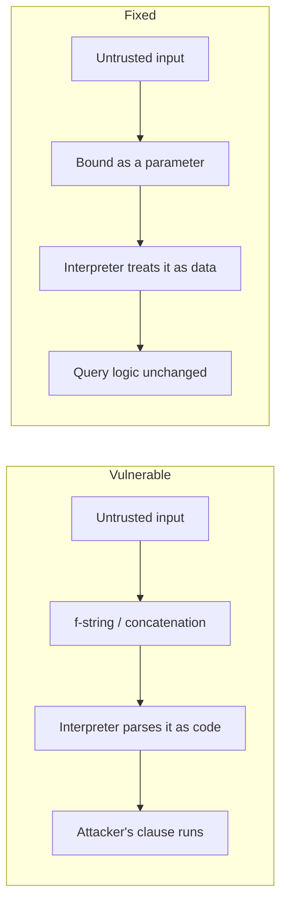

# Injection Vulnerabilities

> Every transcript in this lesson was executed on the authoring machine (Windows 11,
> Python 3.13.5, standard library only) in the batch-17 `seclab-B` scratch lab. Both
> families — SQL injection and OS command injection — are demonstrated against a real
> in-memory database and a real shell. Tooling we did not run — sqlmap, DAST scanners,
> NoSQL/LDAP/template injection against live targets — is marked *labelled reference*.

## 1. Learning Objectives

After this lesson you will be able to:

- [ ] State the root cause of injection in one sentence: untrusted data reaches an interpreter as syntax
- [ ] Demonstrate SQL injection through string concatenation — a tautology returning every row and a `UNION` row injected — then reproduce both payloads against a parameterized query and watch them become literals
- [ ] Demonstrate OS command injection through a `shell=True` string and eliminate it by passing arguments as a list
- [ ] List the interpreter families where the same mistake appears (SQL, shell, LDAP, templates, path handling) and say which control fixes all of them
- [ ] Choose between parameterization, allowlists, and escaping for a given sink, and justify the choice

## 2. Prerequisites

- [Security Fundamentals](security-fundamentals.md) — defense in depth: parameterization is a layer, and the probe proves it by construction
- [11-BACKEND-ENGINEERING](../11-BACKEND-ENGINEERING/README.md) — the query-building and subprocess code where sinks live
- [06-INTERNET-AND-WEB-FOUNDATIONS](../06-INTERNET-AND-WEB-FOUNDATIONS/README.md) — where request data enters an application

*No code prerequisite beyond reading Python — the probe is printed in full and uses only the standard library.*

## 3. Introduction

An **injection** happens when data an attacker controls is read by an interpreter — a
database, a shell, a template engine — as *part of the program*, not as a value. The
attacker does not break in; they add to the sentence your code was writing. The classic
form is SQL: your query says `WHERE name = '...'`, and their input supplies its own
closing quote and a new clause. This lesson runs both dominant families against real
interpreters: an in-memory SQLite database that returns four rows for a tautology and an
attacker-authored row for a `UNION` payload, and a Windows shell where a name field runs
a second command. Then both fixes are shown the same way — same payloads, dead results.

## 4. The Problem It Solves

In the 2000s, string-built queries were the default everywhere: `"... WHERE id = " +
userId` read like ordinary code, and it worked for the data its authors imagined —
integers from their own pages. Two properties made it a catastrophe:

- **Any string field is enough.** Search boxes, sort orders, user names, HTTP headers
  that land in logs queried later — every interpolation is a syntax channel.
- **The damage is the interpreter's.** Whatever the database account can do, the
  attacker can do: read other tables, modify data, sometimes run OS commands
  (`xp_cmdshell`, `COPY TO`). The application's own logic is bypassed entirely.

Injection topped breach-pattern lists for decades not because it is subtle, but because
it is *ubiquitous* — every language has string formatting, and string formatting looks
nothing like a vulnerability. The fix had to be structural: make it impossible for data
to become syntax, which is exactly what **parameterized queries** do — the database
receives the query and the data as two separate things and never re-parses the data.

## 5. Core Concepts

### Sink, source, flow

- **Source** — where untrusted data enters (request body, query string, header, file).
- **Sink** — where an interpreter consumes input (a SQL statement, a shell command, a
  template, a file path).
- **Flow** — the path between them. Injection exists when *attacker-controlled data
  reaches a sink as code*. Cut the flow (validate) or change the sink's mode
  (parameterize, allowlist, escape).

### SQL injection, demonstrated two ways

The probe's vulnerable function is one line: `query = f"SELECT * FROM users WHERE name =
'{name}'"`. Against it:

- **Tautology** — `' OR '1'='1` closes the quote and adds a condition that is always
  true: the query returns *every* row. Authentication bypasses are built from this
  shape (`WHERE user='x' AND pass='x' OR '1'='1'`).
- **UNION injection** — `' UNION SELECT 99, 'pwned', 'admin' --` appends a second
  `SELECT` whose output the application treats as more of its own rows: an attacker-made
  record (the `--` comments out the remains of the original query).

### Parameterization

`cursor.execute("SELECT * FROM users WHERE name = ?", (name,))` sends the statement and
the value separately. The database binds `name` as *data* — quotes, dashes, and all —
so the payload's characters never get a chance to mean anything. Note the probe's output:
the executed SQL line is `... WHERE name = ?` **identically** for every payload, because
the payload never enters the SQL text at all.

### OS command injection

When input is interpolated into a string handed to a shell (`subprocess` with
`shell=True`, backticks, `os.system`), the shell parses it — and shells have their own
syntax: `&`, `|`, `;`, `&&`, backticks. The probe's name field `x & echo PWNED-BY-ARGUMENT`
splits the command in two. The fix is to skip the shell entirely: pass arguments as a
list, and each element arrives as one literal argument.

### Other interpreter families, same root

| Sink | Payload flavor | Fix |
|---|---|---|
| SQL | `' OR '1'='1`, `UNION SELECT` | parameterized query |
| OS shell | `& echo pwned`, `; rm -rf` | list arguments, no shell; allowlist |
| LDAP | `*)(uid=*))(|(uid=*` | escape per RFC 4515 / use APIs with filters |
| Template (SSTI) | `{{7*7}}`, `__class__` chains | auto-escaping + never eval input as template |
| Path | `../../etc/passwd` | canonicalize + prefix check (see [secure-file-uploads.md](secure-file-uploads.md)) |

The control that fixes *all* of them is the same: **data never becomes syntax** —
parameterize where the interpreter supports it, allowlist what cannot be parameterized,
escape only at the final output layer for its specific context.

## 6. How It Works



The two branches never mix: on the top path the payload's quotes *close* the query
syntax; on the bottom path they are just characters inside a bound value. The probe's
output makes the difference observable — the same payload text, `4 row(s)` above and
`0 row(s)` below.

## 7. Practical Examples

**Example 1 — the full probe: SQL injection and command injection, broken and fixed**

```python
# SEC-07 injection probe: SQL injection (concat vs parameterised) and OS command
# injection (shell string vs argv list). Standard library only.
# Run: python inject_probe.py
import sqlite3
import subprocess
import sys

print("=== 1. SQL injection: query built by string concatenation ===")
db = sqlite3.connect(":memory:")
db.execute("CREATE TABLE users (id INTEGER, name TEXT, role TEXT)")
db.executemany("INSERT INTO users VALUES (?, ?, ?)",
               [(1, "alice", "user"), (2, "bob", "user"),
                (3, "carol", "user"), (4, "dave", "user")])


def vulnerable_lookup(name):
    query = f"SELECT * FROM users WHERE name = '{name}'"      # the vulnerable line
    print(f"  executed SQL: {query}")
    return db.execute(query).fetchall()


for attempt in ["alice", "' OR '1'='1",
                "' UNION SELECT 99, 'pwned', 'admin' --"]:
    rows = vulnerable_lookup(attempt)
    print(f"  payload {attempt!r} -> {len(rows)} row(s): {rows}")
    print()

print("=== 2. the same payloads against a parameterised query ===")


def fixed_lookup(name):
    query = "SELECT * FROM users WHERE name = ?"              # data never becomes syntax
    print(f"  executed SQL: {query}")
    return db.execute(query, (name,)).fetchall()


for attempt in ["alice", "' OR '1'='1",
                "' UNION SELECT 99, 'pwned', 'admin' --"]:
    rows = fixed_lookup(attempt)
    print(f"  payload {attempt!r} -> {len(rows)} row(s): {rows}")
    print()

print("=== 3. OS command injection: user input inside a shell string ===")
GREET = "import sys; print('greeting', sys.argv[1])"
name = "x & echo PWNED-BY-ARGUMENT"

vuln_cmd = f'{sys.executable} -c "{GREET}" {name}'
print(f"  shell command: {vuln_cmd}")
out = subprocess.run(vuln_cmd, shell=True, capture_output=True, text=True)
combined = (out.stdout + out.stderr).strip().splitlines()
print(f"  output lines : {combined}")
print(f"  injected second command ran: {'PWNED-BY-ARGUMENT' in combined}")

print()
print("=== 4. the same name passed as an argv element (no shell) ===")
safe_cmd = [sys.executable, "-c", GREET, name]
print(f"  argv list    : {safe_cmd[:2]}[..., {name!r}]")
out = subprocess.run(safe_cmd, capture_output=True, text=True)
combined = (out.stdout + out.stderr).strip().splitlines()
print(f"  output lines : {combined}")
print(f"  injected second command ran: {'PWNED-BY-ARGUMENT' in combined}")
```

- Phases 1 and 3 are the attacks; phases 2 and 4 are the *same payloads* through the
  fixed sinks — the comparison isolates the sink, not the input.
- **Expected output:** the capture below.
- **How to run it:** `python inject_probe.py` (Windows 11, Python 3.13.5; the shell
  phases deliberately use `cmd.exe` semantics via `shell=True`).
- **Assumptions:** standard library only; no network.

**Executed capture:**

```text
=== 1. SQL injection: query built by string concatenation ===
  executed SQL: SELECT * FROM users WHERE name = 'alice'
  payload 'alice' -> 1 row(s): [(1, 'alice', 'user')]

  executed SQL: SELECT * FROM users WHERE name = '' OR '1'='1'
  payload "' OR '1'='1" -> 4 row(s): [(1, 'alice', 'user'), (2, 'bob', 'user'), (3, 'carol', 'user'), (4, 'dave', 'user')]

  executed SQL: SELECT * FROM users WHERE name = '' UNION SELECT 99, 'pwned', 'admin' --'
  payload "' UNION SELECT 99, 'pwned', 'admin' --" -> 1 row(s): [(99, 'pwned', 'admin')]

=== 2. the same payloads against a parameterised query ===
  executed SQL: SELECT * FROM users WHERE name = ?
  payload 'alice' -> 1 row(s): [(1, 'alice', 'user')]

  executed SQL: SELECT * FROM users WHERE name = ?
  payload "' OR '1'='1" -> 0 row(s): []

  executed SQL: SELECT * FROM users WHERE name = ?
  payload "' UNION SELECT 99, 'pwned', 'admin' --" -> 0 row(s): []

=== 3. OS command injection: user input inside a shell string ===
  shell command: C:\Users\PC\AppData\Local\Programs\Python\Python313\python.exe -c "import sys; print('greeting', sys.argv[1])" x & echo PWNED-BY-ARGUMENT
  output lines : ['greeting x', 'PWNED-BY-ARGUMENT']
  injected second command ran: True

=== 4. the same name passed as an argv element (no shell) ===
  argv list    : ['C:\\Users\\PC\\AppData\\Local\\Programs\\Python\\Python313\\python.exe', '-c'][..., 'x & echo PWNED-BY-ARGUMENT']
  output lines : ['greeting x & echo PWNED-BY-ARGUMENT']
  injected second command ran: False
```

Read phase 1 carefully: the *first* payload proves the mechanism honestly — a legitimate
name still returns its one row; the tautology turns one lookup into a full-table read of
4 rows; the `UNION` payload injects a row that never existed in the table. In phase 2 the
executed SQL line never changes (`name = ?`), and both attacks collapse to `0 row(s)` —
not because the payloads were recognized, but because they were never parsed as SQL.
Phase 3's output list has two lines: the shell split the command at `&` and ran the
attacker's `echo`. Phase 4 passes the identical string as one argv element — one line of
output, `False`.

**Example 2 — the safe shapes in application code (illustration)**

```python
# SQL: one statement text, values bound — never f-strings in queries
rows = db.execute("SELECT * FROM users WHERE name = ?", (name,)).fetchall()

# shell: no shell at all; each element is one literal argument
subprocess.run(["git", "clone", "--depth", "1", repo_url], check=True)

# when a command cannot be a list (a true allowlist case): validate, then build
if not re.fullmatch(r"[a-z0-9-]{1,63}", image_tag):
    raise ValueError("bad image tag")
```

- **Expected output:** no output — these are the three sink shapes: parameterize,
  don't-shell, allowlist.
- **Assumptions:** a DB-API connection, `re` from the standard library.

## 8. Real-World Applications

- **Every query built from user input** — search, filters, reporting — is parameterized
  in modern DB libraries; the habit that needs maintaining is *never* falling back to
  formatting "just for this ORDER BY" (sort columns are still injection-prone — use an
  allowlist map, as in Example 2).
- **DevOps and CI tooling** shells out constantly (`git`, `ffmpeg`, `kubectl`); list
  arguments are the default there.
- **Template engines** on untrusted templates (user themes, email builders) are the
  SSTI family — the same lesson, different interpreter.
- Paired with: input validation practices, least-privilege DB accounts
  ([security-fundamentals.md](security-fundamentals.md)), and the file-path half of
  [secure-file-uploads.md](secure-file-uploads.md).

## 9. Common Mistakes

| Mistake | Why it happens | How to recognize it | How to prevent it |
|---|---|---|---|
| `f"SELECT ... '{value}'"` | Works for the integer you imagined | Any string interpolation inside SQL text | Parameterize every value; grep for `SELECT` near f-strings |
| Parameterized query, but concatenated `ORDER BY`/table name | Parameters can't hold identifiers | `?` used everywhere except one `ORDER BY {col}` | Allowlist maps: `{"date": "created_at"}`, reject unknowns |
| `shell=True` with interpolated args | Needed a pipe or redirect once | `subprocess`/`os.system` with an f-string | List arguments; if a shell feature is truly needed, validate every input against a strict pattern first |
| "We escape quotes, so we're safe" | Escaping confused with parameterization | A blacklist of `'`, `--`, `;` in validators | Parameterize; validation is a second layer, never the first |
| ORM assumed = immune | ORM's raw-SQL escape hatches | `.raw()`, `text()`, `extra()` with formatting | The sink rule applies to raw SQL inside ORMs too |
| Blocking payloads instead of fixing the sink | WAF-first response | Payloads work with a space or a comment variant | Fix the interpreter boundary; a filter can be bypassed, binding cannot |

## 10. Best Practices

- **Parameterize by default — every value, every time.** The rule has almost no
  exceptions; where one appears (identifiers, sort order), use an allowlist and say so
  in a comment, because that line is the review target.
- **Never pass a shell unless you need shell features**, and then only with validated
  input. `shell=False` with a list is the default shape of `subprocess`.
- **Validate early for usability, not as the security control.** Length, type, and
  format checks give good errors; the sink-side control is what stops the payload.
- **Least privilege for interpreters** — a database account that cannot read other
  schemas caps the blast radius of any mistake that slips through (the third layer in
  [security-fundamentals.md](security-fundamentals.md)'s ladder).
- **Keep frameworks' built-in protections on** (ORMs, query builders) and treat every
  raw escape hatch as a review point.
- **Write the failing test first** — the subject's rule: exploit locally (phases 1 and 3
  of this probe), fix, watch the same payload fail (phases 2 and 4).

## 11. Limitations and Trade-Offs

- **Parameterization cannot express everything.** Dynamic table names, ad-hoc reporting
  queries, and full-text search syntax sometimes force string construction; the honest
  answer is a tight allowlist plus tests, not pretending `?` works everywhere.
- **Validation rules strong enough to block injection often block legitimate data** —
  names with apostrophes, emoji, or `--` in text are real. That is why validation is a
  usability layer and the sink does the security work.
- **The probe is SQLite on loopback with four rows.** Real SQLi findings involve schema
  discovery, error-based or blind techniques against opaque responses, and WAFs —
  none of which this capture covers. Automated exploitation tools (sqlmap) and DAST
  scanning were not run — *labelled reference*; the probe demonstrates the mechanism,
  not the tooling workflow.
- **Injection is not only SQL.** The other families in section 5's table share the root
  cause but need their own demonstrations; this lesson executes SQL and shell only.

## 12. Practical Exercises

### Introductory

1. **Exercise 7.1** — Run the probe and, for each of the four phases, write one
   sentence naming why the payload did or did not execute. **Completion criteria:** four
   sentences that reference the sink, not the payload's content.
2. **Exercise 7.2** — Add a third SQL payload that comments out the rest of the query
   (`alice' --`) and show it against both queries. **Completion criteria:** a capture
   where the vulnerable lookup returns alice's row regardless of what followed the quote,
   and the parameterized lookup returns `0 row(s)` for the whole string.

### Intermediate

3. **Exercise 7.3** — Find and fix a string-built query in code you have written
   (any project). **Completion criteria:** the original query and payload capture, then
   the parameterized version where the same payload returns `0 row(s)`.
4. **Exercise 7.4** — Repeat phase 3/4 for a real subprocess in one of your scripts
   (a `git` or file-conversion call). **Completion criteria:** captures showing an
   injected `&`-chain executing through `shell=True` and inert as a list argument.

### Independent problem-solving

5. **Exercise 7.5** — A reporting feature must sort by one of six columns chosen by the
   user. Design the implementation without parameterizing identifiers (you can't).
   **Completion criteria:** a written design plus code where an unknown sort key is
   rejected before any SQL is built, and a test demonstrating rejection of
   `created_at; DROP TABLE reports`.

*Solutions: attempt first. They live in `solutions/` of this subject.*

## 13. Knowledge Check

1. Why does the parameterized version print the same `executed SQL` line for every
   payload — and why is that, rather than "the payload was blocked", the important
   observation?
2. A teammate says: "we sanitize quotes with `replace("'", "")`, so concatenation is
   safe now." Construct one input that argues with them (encoding, double quotes, or a
   non-quoted context), and state why the fix belongs at the sink instead.
3. When is `shell=True` genuinely the right tool? Name one case and the validation it
   would require.

## 14. Completion Criteria

Observable evidence that you have understood this lesson:

- [ ] You can state the root cause of injection in one sentence, independent of language
- [ ] You can reproduce phases 1–4 from a blank editor and explain each result line
- [ ] You can convert any string-built query you find into a parameterized one
- [ ] You can refactor a `shell=True` call into list form, or justify it with validation
- [ ] You can name the right control for five interpreter families without a cheat sheet

## 15. Summary

- Injection is untrusted data reaching an interpreter as syntax — the attacker writes
  part of your program.
- Demonstrated: tautology (4 rows), `UNION` row injection, and a shell `&` chain — all
  real captures, all dead against parameterization and list arguments.
- Parameterization works because the payload is never parsed: the SQL text does not
  change.
- Where you cannot parameterize (identifiers, commands), allowlist explicitly; escaping
  is only for the final output layer, per context.
- Exploit first, fix, re-run: a control is what you watched stop something.

## 16. Next Steps

- Next lesson: [Cross-Site Scripting](cross-site-scripting.md) — injection aimed at the
  browser instead of the server
- Practice: the subject's exercise set (written with its exercise installment)
- Where it is applied: [Project 07](../20-PROJECT-LABORATORY/project-07-secure-production-application/README.md)'s
  security checklist, and the safe-use rules in [SECURITY.md](../SECURITY.md)