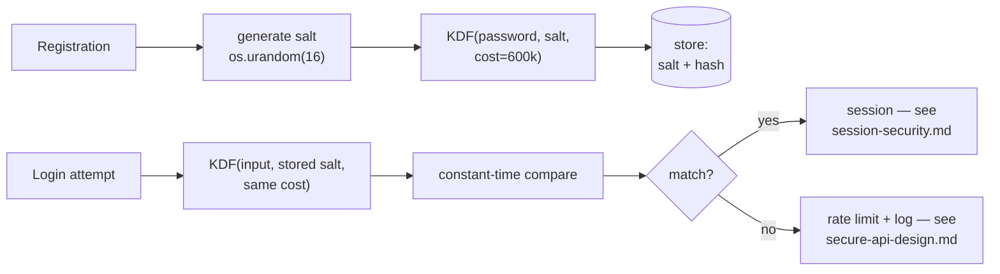

# Password Security

> Every transcript in this lesson was executed on the authoring machine (Windows 11,
> Python 3.13.5, standard library only) in the batch-17 `seclab-A` scratch lab.
> Library choices we did not run here — bcrypt, scrypt, Argon2id — and hosted
> breach-list services are marked *labelled reference*.

## 1. Learning Objectives

After this lesson you will be able to:

- [ ] Explain why a password must be *hashed* (not encrypted, not encoded) and why plain SHA-256 fails at that job even though it is irreversible
- [ ] Demonstrate what a per-user salt changes — same password, different stored bytes — and say exactly what it costs an attacker
- [ ] Measure a work factor on your own machine and justify a chosen iteration count from the measurement, not from a blog post
- [ ] Distinguish a password *policy* from password *strength* by testing candidates against both
- [ ] State the four controls that must surround a hashed password store (salt, work factor, rate limiting, breach checking) and which lesson implements each

## 2. Prerequisites

- [Security Fundamentals](security-fundamentals.md) — hashing vs encoding vs
  encryption, and the demonstration habit these four probes continue
- [Threat Modeling](threat-modeling.md) — this lesson is the first threat taken
  from a model and taken apart
- [14-TESTING-AND-QUALITY](../14-TESTING-AND-QUALITY/README.md) — timing
  measurements and reading a benchmark honestly

*No code prerequisite — all four probes are printed in full and use only the
standard library (`hashlib`, `os`, `re`, `time`).*

## 3. Introduction

The password hash is the one secret in most systems that is both **ubiquitous** and
**adversarially exposed**: the moment a database leaks, every stored hash is in an
attacker's hands, offline, with no rate limit anyone else controls. That single
sentence — *the defender's controls end at the hash, so the hash must carry the
cost* — explains every design decision in this lesson. Four executed probes build
it: salting (`salt_probe`), the cost of guessing (`crack_probe`), the cost of
verifying (`workfactor_probe`), and why the rules apps ship don't predict strength
(`policy_probe`).

## 4. The Problem It Solves

The history is short and repetitive:

- **"We encrypt passwords"** — encryption is reversible, so the key becomes the
  real crown jewel, usually stored next to the data it protects. One breach, both.
- **"We hash them — SHA-256, one line"** — SHA-256 is irreversible but *fast*:
  a single modern CPU computes hundreds of millions of guesses per second against
  a leaked store, and GPUs do far more. Speed that helps login helps the attacker
  1000× more (Example 2 measures the ratio).
- **"We salt them"** — correct, but only per-user and only with a random value;
  a static salt just gives everyone the same new rainbow table.
- **"We enforce strong passwords"** — policies are enforced at *registration*,
  while attacks happen *at verification*; Example 4 shows the two questions
  disagreeing five times out of five on the first four candidates.

Each mistake is a category error: using a reversible tool where a one-way one
belongs, a fast tool where cost belongs, a registration-time answer for a
verification-time problem. This lesson corrects them in order, with captures.

## 5. Core Concepts

### Hash, not encrypt, not encode

Passwords must satisfy one property: verification without storage of the secret.
`verify(pw, stored) → true/false` and no path back from `stored` to `pw`. Encoding
fails (trivially reversible — see
[security-fundamentals.md](security-fundamentals.md) Example 1); encryption fails
(reversible with a key); a hash passes — for an attacker who must brute-force
instead of decrypt. From this, the corollary the whole lesson rests on: **anything
that makes verification slower for you makes guessing slower for them — and they
are the party who needs to be slowed.**

### Salt: uniqueness, not secrecy

A salt is a random value per user, stored alongside the hash, prepended (or fed as
the salt parameter) before hashing. Its jobs:

- **Defeat precomputation** — no rainbow table exists for a salt you invented.
- **Defeat correlation** — two users with `summer2026!` store different bytes, so a
  single cracked hash no longer reveals every account sharing that password
  (Example 1, `identical hashes: False`).
- **Not a secret** — the salt lives in the row it protects; leaking it leaks
  nothing. Confusing salt with a secret leads people to hide it in code, which then
  cannot be rotated and gets shared across users, destroying the uniqueness.

### Work factor: the defender's only knob

The KDF (key-derivation function) wraps hashing in a deliberate cost.
`PBKDF2-HMAC-SHA256` (standard library, used in Example 2 and 3), bcrypt, scrypt,
and Argon2id (the current first choice for new systems — *labelled reference*: not
executed in this lab) differ in *what* they spend the cost on — iterations, memory,
or both — but share one contract: **a tunable, measured cost per verification**.
Work factor is the only property of the store that changes an attacker's arithmetic
without changing yours by much, because you verify once per login while they guess
millions of times.

### Pepping and timing-safe comparison — two different layers

- **Pepper**: a secret kept *outside* the database (app config/secret manager),
  concatenated before hashing. If the DB alone leaks, hashes remain unverifiable
  without the pepper. It inherits a real operational cost — losing the pepper locks
  everyone out — so it is a deliberate extra layer, implemented with
  [secrets-management.md](secrets-management.md)'s machinery, not with a constant
  in source (*labelled reference*: not run in this lab).
- **Timing-safe comparison**: compare hashes with a constant-time routine so an
  attacker cannot learn the correct prefix byte-by-byte over the network. It
  matters *after* rate limiting, because network jitter swamps the signal at
  millisecond scales; ordering the controls honestly matters more than the exotic
  fix (*labelled reference*, covered in depth with
  [session-security.md](session-security.md)).

### Policy vs strength

- **Policy** = rules enforced by the *application* at registration: length,
  character classes, dictionary denylists.
- **Strength** = entropy against the attacks that will actually be run: offline
  guessing against the hash, and online guessing against the endpoint.
- They are different questions, and they disagree routinely (Example 4): policy
  answers "does the string match a pattern", strength answers "how long does an
  attacker need". Policy also causes predictable *substitution* behavior
  (`Password1!` from `password`), which is why policies that mandate classes can
  make a common password *fit* the rules while remaining one of the first guesses.

### What surrounds the hash

A correct store is necessary and not sufficient — the four layers:

| Layer | Mechanism | Lesson |
|---|---|---|
| unique salt | random per user, stored in the row | this lesson, Example 1 |
| work factor | measured KDF cost | this lesson, Examples 2–3 |
| rate limiting | per-account, per-IP, escalating | [secure-api-design.md](secure-api-design.md) |
| breach checking | reject known-breached passwords | this lesson, section 8 |

## 6. How It Works



Two properties make the diagram hold: the cost lives **inside** the KDF (so every
implementation pays it, not just careful call sites), and the salt is **read from
storage** (so verification uses *that user's* salt without any lookup trickery).

## 7. Practical Examples

**Example 1 — same password, different store** (executed)

```python
# Password probe 1: salting — same password, different stored form.
import hashlib, os

pw = "summer2026!"

# unsalted: every account with this password stores the identical string
h1 = hashlib.sha256(pw.encode()).hexdigest()
h2 = hashlib.sha256(pw.encode()).hexdigest()
print("no salt, same password -> identical hashes:", h1 == h2)
print("  alice:", h1)
print("  carol:", h2)

# per-user salt: same password, different stored form
s1 = os.urandom(8); s2 = os.urandom(8)
h1s = hashlib.sha256(s1 + pw.encode()).hexdigest()
h2s = hashlib.sha256(s2 + pw.encode()).hexdigest()
print("salted, same password  -> identical hashes:", h1s == h2s)
print("  alice:", h1s, "salt", s1.hex())
print("  carol:", h2s, "salt", s2.hex())

# one lookup now needs the salt first — the point of the exercise
print("verify alice:", hashlib.sha256(s1 + pw.encode()).hexdigest() == h1s)
```

- **Executed output** (authoring machine, Python 3.13.5 — salts are random, so
  those six runs of your own will print different hex while keeping every
  *relationship* identical):

```
no salt, same password -> identical hashes: True
  alice: 968ebd645ad900b8b93efe855a5ea0bb0faffc7c8b6abbcd63ecf994c39b0b55
  carol: 968ebd645ad900b8b93efe855a5ea0bb0faffc7c8b6abbcd63ecf994c39b0b55
salted, same password  -> identical hashes: False
  alice: 52478f387c4c1fc13f8411bda2112d493d20fe0212f9e16c8376ba4dd18396a1 salt 13012cb0522f14dc
  carol: 9855951f79af87f64115948988209dc42cae0f27bbfda95f300bca0e0da6a26f salt 1a4f23bf316d6ba3
verify alice: True
```

- **What the important lines do:** the unsalted pair is byte-identical — one crack
  reveals *both* accounts. The salted pair diverges even though the password is the
  same, so each account must be attacked separately with its own salt. The last
  line confirms verification still works: salting costs the defender nothing but a
  stored byte string.
- **How to run it:** `python salt_probe.py` — file printed above in full.
- **Assumptions:** Windows 11, Python 3.13.5 (`hashlib`, `os.urandom` — stdlib).

**Example 2 — what an attacker pays** (executed)

```python
# Password probe 2: what a dictionary attack costs the attacker against an
# unsalted SHA-256 store vs a salted, iterated PBKDF2 store.
import hashlib, time, os

DICT = [b"password", b"123456", b"qwerty", b"letmein", b"summer2026!",
        b"admin", b"iloveyou", b"welcome", b"monkey", b"dragon",
        b"correct-horse", b"battery-staple", b"Passw0rd!", b"abc123",
        b"football", b"baseball", b"princess", b"sunshine", b"trustno1", b"master"]

PW = b"summer2026!"
TARGET = hashlib.sha256(PW).hexdigest()   # what the store holds

# --- attacker against an unsalted SHA-256 store ---
t0 = time.perf_counter()
cracked = None
for pw in DICT:
    if hashlib.sha256(pw).hexdigest() == TARGET:
        cracked = pw
        break
fast_ms = (time.perf_counter() - t0) * 1000
print("unsalted sha256 : tried %d of %d candidates -> %s in %.4f ms"
      % (DICT.index(cracked) + 1, len(DICT), cracked.decode(), fast_ms))

# --- the same 20 guesses against salted PBKDF2-SHA256, 600k iterations ---
salt = os.urandom(16)
stored = hashlib.pbkdf2_hmac("sha256", PW, salt, 600_000)

t0 = time.perf_counter()
hits = 0
for pw in DICT:
    if hashlib.pbkdf2_hmac("sha256", pw, salt, 600_000) == stored:
        hits += 1
total = time.perf_counter() - t0
print("pbkdf2 600k     : tried %d candidates in %.2f s" % (len(DICT), total))
print("  ->", "CRACKED: the password was in the 20-word dictionary"
      if hits else "dictionary exhausted: NOT CRACKED")
print("  per-attempt cost: %.0f ms (%.1f attempts/s)"
      % (total / len(DICT) * 1000, len(DICT) / total))
print("  attacker slowdown vs the unsalted store: %.0fx" % (total * 1000 / fast_ms))
```

- **Executed output**:

```
unsalted sha256 : tried 5 of 20 candidates -> summer2026! in 0.0176 ms
pbkdf2 600k     : tried 20 candidates in 16.12 s
  -> CRACKED: the password was in the 20-word dictionary
  per-attempt cost: 806 ms (1.2 attempts/s)
  attacker slowdown vs the unsalted store: 915776x
```

- **Read it honestly, both ways:** line 1 is the indictment of plain SHA-256 — a
  real password recovered in **0.0176 ms**, i.e. the whole 20-word dictionary in
  well under a millisecond; on a leaked store the dictionary would be millions of
  words and still finish in seconds. Line 3 admits the important counterpoint:
  PBKDF2 did **not** save this password — it was in the 20-word list, and offline
  the attacker sets their own clock. What the KDF bought is line 5: **~915,776×
  fewer guesses per hour** (1.2/s vs ~77,000/s here). The lesson: work factor
  shrinks the *feasible* dictionary; it cannot rescue a password already in the
  attacker's top-20. That job belongs to breach checking (section 8) and rate
  limiting (Example 4's companion, [secure-api-design.md](secure-api-design.md)).
- **How to run it:** `python crack_probe.py` — file printed above in full.
- **Assumptions:** Windows 11, Python 3.13.5; single process, one core — GPU
  numbers for the unsalted case are worse for the defender, not better
  (*labelled reference*: no GPU was used).

**Example 3 — the cost the defender chooses** (executed)

```python
# Password probe 3: work factor — what each iteration count costs the defender.
import hashlib, time, os

pw = b"correct-horse-battery-staple"
salt = os.urandom(16)
for iters in (1, 10_000, 100_000, 600_000):
    t0 = time.perf_counter()
    hashlib.pbkdf2_hmac("sha256", pw, salt, iters)
    t1 = time.perf_counter()
    print(f"pbkdf2 iterations={iters:>7}  {(t1-t0)*1000:8.2f} ms")
```

- **Executed output**:

```
pbkdf2 iterations=      1      1.02 ms
pbkdf2 iterations=  10000     12.61 ms
pbkdf2 iterations= 100000    128.29 ms
pbkdf2 iterations= 600000    796.54 ms
```

- **What the lines establish:** cost is linear in iterations (100k ≈ 10× the
  10k time), so the knob is predictable — you can *pick* a verification budget and
  solve for iterations on your own hardware. On this machine 600k ≈ 0.8 s per
  login, which is too slow for a login endpoint users hammer; the practical target
  for interactive logins is a few hundred milliseconds, tuned by measuring
  (Example 2's 806 ms/attempt was also the *attacker's* per-guess cost — the same
  number, wanted from two directions).
- **How to run it:** `python workfactor_probe.py` — file printed above in full.
- **Assumptions:** Windows 11, Python 3.13.5, single core; production targets must
  be re-measured on production-class hardware — never copy a number from a blog
  (including this one).

**Example 4 — policy says yes, strength says no** (executed)

```python
# Password probe 4: policy says yes, strength says no.
import re

def policy_ok(pw: str) -> bool:
    """The rules most apps ship: length + four character classes."""
    return (len(pw) >= 8 and re.search(r"[a-z]", pw) and re.search(r"[A-Z]", pw)
            and re.search(r"[0-9]", pw) and re.search(r"[^a-zA-Z0-9]", pw))

COMMON = {"password", "password1", "password1!", "passw0rd!", "letmein",
          "summer2026!", "qwerty123!", "admin123!", "welcome1!", "iloveyou1!"}

def strength_ok(pw: str) -> bool:
    """Minimal bar: not a known-common password, not a trivial pattern."""
    if pw.lower() in COMMON:
        return False
    if re.fullmatch(r"(.)\1+", pw):          # aaaaaaa
        return False
    if re.fullmatch(r"\d+", pw):             # 12345678
        return False
    return len(pw) >= 12

for pw in ("Password1!", "Summer2026!", "correct horse battery staple",
           "Tr0ub4dor&3", "kx7-Queen-Mirror-42"):
    print(f"{pw!r:34} policy={'PASS' if policy_ok(pw) else 'FAIL':4}"
          f" strength={'PASS' if strength_ok(pw) else 'FAIL'}")
```

- **Executed output**:

```
'Password1!'                       policy=PASS strength=FAIL
'Summer2026!'                      policy=PASS strength=FAIL
'correct horse battery staple'     policy=FAIL strength=PASS
'Tr0ub4dor&3'                      policy=PASS strength=FAIL
'kx7-Queen-Mirror-42'              policy=PASS strength=PASS
```

- **Read the disagreements:** rows 1–2 satisfy every class rule and are still
  first-tier guesses (`Summer2026!` appears in Example 2's own dictionary). Row 3
  fails the class rule while carrying far more entropy than rows 1–2 — the policy
  pushed this user *toward* a weaker choice. Row 4 (`Tr0ub4dor&3`, the classic
  diceware-adjacent passphrase) passes policy and misses the 12-char-plus bar only
  by construction of `strength_ok` — a reminder that both functions are heuristics
  and neither measures true entropy. Row 5 satisfies both, which is what good
  looks like: long, unstructured, not on any list.
- **How to run it:** `python policy_probe.py` — file printed above in full.
- **Assumptions:** Windows 11, Python 3.13.5; the denylist is 10 words for a lab —
  real checks use a breached-password service (section 8).

## 8. Real-World Applications

- **Registration and login paths** — the four layers of section 5's table are the
  default checklist for any credential store; each layer has an owner and a lesson.
- **Password-manager-friendly design** — passphrases and no composition rules
  (row 3 of Example 4, and the NIST SP 800-63B direction — *labelled reference*:
  the standard itself was not executed here) improve both user entropy and
  usability; policy rules that fight managers (no paste, forced rotation) are now
  considered harmful defaults.
- **Breach checking at set/reset time** — reject passwords found in known-breached
  corpora (HIBP-style k-anonymity lookups — *labelled reference*: no network call
  was made in this lab). It is the only control in this lesson that addresses
  Example 2's residual finding: strong-but-listed passwords.
- **Hash upgrades on login** — transparent re-hash under the current KDF when a
  user next authenticates, so work factor can be raised without a reset campaign.
  The mechanism is "verify with old parameters, store with new" — scheduled by
  measuring like Example 3, not by calendar folklore.
- **Rotation after a suspected leak** — the threat model's ranking decides who
  resets: unauthenticated-read of the hash table (Example 2's scenario) means
  *everyone*; an access-controlled snapshot means the exposed cohort.

## 9. Common Mistakes

| Mistake | Why it happens | How to recognize it | How to prevent it |
|---|---|---|---|
| Fast hash (plain SHA-256/MD5) | "it's one-way, so we're safe" | a leaked store verified at >10⁵ guesses/s | KDF with a measured cost, always (`pbkdf2_hmac` at minimum) |
| Shared or static salt | salt written as a config constant | identical hashes across accounts, again | `os.urandom` per user, stored in the row (Example 1) |
| Work factor copied from a tutorial | numbers age silently | logins slow on your hardware, or instant verify in prod | measure on production-class hardware (Example 3's method) |
| Policy treated as strength | rules are easy to ship | `Password1!`-shaped passwords everywhere | policy for floor (length), strength check for reality (lists + length) |
| Rate limiting skipped | "the hash is slow enough" | unlimited online attempts against one account | per-account + per-IP limits in [secure-api-design.md](secure-api-design.md) |
| Checking only at registration | passwords age into breaches | users keep a password later listed | re-check at login/reset, not just at set time |

## 10. Best Practices

- **Store: random per-user salt + KDF with a measured work factor** — PBKDF2-SHA256
  ≥ 600k iterations is the stdlib floor demonstrated here; bcrypt (cost ~12) or
  Argon2id for new designs (*labelled reference*: not run in this lab).
- **Tune the cost from measurement** — Example 3's loop, on the hardware that will
  verify, targeting a few hundred ms per verification.
- **Verify with constant-time comparison** — `hmac.compare_digest`, not `==`.
- **Set policy at length, not at symbols** — a ≥12-char floor plus a breached-list
  check beats class rules (Example 4's rows 1–3 are the argument).
- **Layer online controls too** — offline attacks can't be rate-limited, so the
  *online* path must be: lockouts/limits, breach checks, and logging, wired in
  [secure-api-design.md](secure-api-design.md).
- **Plan the upgrade path now** — re-hash-on-login means today's cost choice is
  revisable; that reversibility is worth building before the first migration.

## 11. Limitations and Trade-Offs

- **Work factor trades login latency for attack cost** — every millisecond you add
  is felt once by a real user and millions of times by an attacker, but push too
  far and logins time out; Example 3 gives the numbers to argue the setting, not
  the setting itself.
- **Offline attacks cannot be rate-limited** — if the hash store leaks, you have
  *already* lost control of the clock; salt and work factor only set the price.
  Nothing in this lesson prevents a leak — that is the access-control and
  secrets material ([access-control.md](access-control.md),
  [secrets-management.md](secrets-management.md)).
- **Passwords themselves are the weak factor** — no hashing scheme fixes reuse,
  phishing, or social engineering; passkeys/webauthn are the structural answer
  (*labelled reference*: not covered in this subject's executed labs).
- **Both heuristics in Example 4 are toy implementations** — the denylist is ten
  words, `strength_ok` is a three-rule approximation; use them to understand the
  *disagreement pattern*, not as shippable checks.
- **Timings are single-run, single-machine** — no warm-up, no repeat distribution;
  adequate for choosing an order of magnitude, not for publishing a benchmark.

## 12. Practical Exercises

### Introductory

1. **Exercise 3.1** — run Example 1, then modify it so the salt is a *single*
   config constant reused for all users. Capture the output and state which of the
   salt's three jobs survives. **Completion criteria:** capture showing
   `identical hashes: True` again, plus a one-line verdict per job (precomputation,
   correlation, secrecy).
2. **Exercise 3.2** — take five passwords of your choosing through Example 4's
   functions, including two that are ≥14 characters. **Completion criteria:** a
   table of both verdicts, and one sentence naming a candidate that policy *and*
   strength both get wrong (they exist).

### Intermediate

3. **Exercise 3.3** — rerun Example 3 on your own machine and compute the
   iterations needed for a 250 ms budget. **Completion criteria:** the four timing
   lines, the linear extrapolation shown, and the iteration count you would ship —
   with the hardware noted next to it.
4. **Exercise 3.4** — extend Example 2 with a third store: PBKDF2 at **10,000**
   iterations (a real legacy setting). **Completion criteria:** three slowdown
   factors against the unsalted baseline, and a one-sentence argument for which of
   the three you would migrate first.

### Independent problem-solving

5. **Exercise 3.5** — you have only a leaked dump of 1,000 unsalted SHA-256
   hashes *in a CTF/authorized lab* and a 20-word dictionary. Write the attacker's
   procedure and the defender's remediation plan. **Completion criteria:** the
   exact commands run in an authorized environment only (see
   [SECURITY.md](../SECURITY.md)), the capture of what fell, and a remediation
   listing all four layers of section 5's table — including the two that hashing
   alone does not provide.

*Solutions: attempt first. They live in `solutions/` of this subject (written with
the subject's exercise installment).*

## 13. Knowledge Check

1. Why is encrypting passwords worse than hashing them, even with a "good" cipher?
   Where does the trust boundary end up in each case?
2. Example 2's password was still cracked under PBKDF2. Which of the four layers of
   section 5's table would have stopped *this specific* attack, and which layers
   only make it more expensive?
3. A teammate proposes policy `len ≥ 8` plus all four classes, and no breached-list
   check. Using Example 4's output, write the two-sentence rebuttal.

## 14. Completion Criteria

- [ ] You can state, from memory, why salt is stored (not secret) and what breaks when it is shared
- [ ] You can reproduce Example 2's two-store comparison and quote both slowdown numbers
- [ ] You can derive a work-factor setting from your own measurement and say what hardware it is valid for
- [ ] You can explain which attacks rate limiting stops that hashing cannot
- [ ] You can list the four surrounding controls and the lesson that implements each

## 15. Summary

- Passwords are verified, never recovered — encoding and encryption both violate
  that, and a fast hash hands the attacker the clock.
- Salt buys *uniqueness*: no precomputed tables, no cross-account correlation; it
  is random, stored, and worthless to an attacker without the hash.
- The work factor is the defender's knob: cost linear in iterations, measured on
  your hardware (Examples 2–3), and it prices out dictionary depth — not listed
  passwords.
- Policy and strength are different questions that disagree routinely; enforce a
  length floor and a breached-list check instead of composition theater.
- Hashing is one layer of four — salt, work factor, rate limiting, breach checking —
  and the layers live in three different lessons.

## 16. Next Steps

- Next lesson: [Session Security](session-security.md) — what happens *after* the
  password verifies, when the attacker has a valid session instead
- Earlier lessons: [Security Fundamentals](security-fundamentals.md),
  [Threat Modeling](threat-modeling.md)
- Practice: the subject's exercise set (written with its exercise installment)
- Where it is applied: [Project 07](../20-PROJECT-LABORATORY/project-07-secure-production-application/README.md)
  ships a password store as part of its scope; safe-use rules in
  [SECURITY.md](../SECURITY.md)