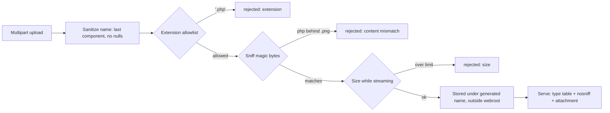

# Secure File Uploads

> Every transcript in this lesson was executed on the authoring machine (Windows 11,
> Python 3.13.5, standard library only) in the batch-17 `seclab-C` scratch lab. Files are
> written to a lab directory, never served to a browser; image re-encoding, antivirus
> scanning, sandboxed rendering, and storage-bucket policies were not run and are marked
> *labelled reference*.

## 1. Learning Objectives

After this lesson you will be able to:

- [ ] Explain why an upload endpoint is four attack surfaces at once (storage, filesystem, renderer, distribution) and name one exploit per surface
- [ ] Demonstrate filename traversal escaping the upload directory through a naive join, and the same filename safely stored under a generated name
- [ ] Cross-check content against extension with magic-byte sniffing, catching PHP payloads behind image names — including double extensions
- [ ] Enforce a size limit while streaming, so an oversize upload is aborted instead of buffered
- [ ] Specify the serving rules (type tables, `nosniff`, attachment disposition, storage outside the webroot) that complete the defense

## 2. Prerequisites

- [Injection Vulnerabilities](injection-vulnerabilities.md) — the same rule, "hostile data must not become behavior", applied to filenames instead of queries
- [Cross-Site Scripting](cross-site-scripting.md) — what an uploaded `.svg` or `.html` file becomes when the browser renders it on your origin
- [11-BACKEND-ENGINEERING](../11-BACKEND-ENGINEERING/README.md) — the multipart endpoint and storage layer this lesson hardens

*No code prerequisite beyond reading Python — the probe is printed in full and uses only the standard library.*

## 3. Introduction

A file upload hands the attacker three things at once: a **name** (attacker-chosen text
that will become a path), **content** (attacker-chosen bytes that will be stored, and
later parsed and rendered), and a **size** (attacker-chosen cost). Every upload
vulnerability is one of those three being trusted: traversal from the name, a web shell
from the content, a denial of service from the size. This lesson attacks all three
against a naive saver — a name that escapes the directory, PHP bytes hiding behind
`avatar.png`, a payload one byte over the limit — and then runs the same inputs through
one function that answers each with a rejection.

## 4. The Problem It Solves

Upload features fail in public constantly because the obvious code is wrong in four
directions at once:

- **The filename becomes a path.** `os.path.join(UPLOAD_DIR, name)` with a client-supplied `../../avatar.png` walks right out of the directory (phase 1: `naive resolves outside uploads dir : True`) — toward overwrite targets anywhere the process can write.
- **The extension becomes the verdict.** "Only images allowed" checked as `name.endswith(".png")` passes `shell.php.png` — and phase 2 shows why even an *exact* `.png` check is insufficient: the PHP payload behind `avatar.png` is rejected only by sniffing the bytes, not by reading the name.
- **The whole file arrives before anyone objects.** A `Content-Length` of 2 GB written to disk after full buffering is a memory/disk exhaustion you validated too late — phase 4 stops the stream at the first byte over the limit.
- **Stored files become served files.** Once content sits in a webroot, every parser bug, every `Content-Type` guess, and every same-origin `svg` execution is yours. The fix for that half lives in the *serving* rules (Example 2), not the saving code.

Before disciplined upload handling, the workflow was "save it to `/uploads`, hope the
name is clean, and let the web server figure out the type."

## 5. Core Concepts

### The four surfaces

| Surface | Attacker controls | Exploit class | Control in this lesson |
|---|---|---|---|
| **Filesystem** | the filename | path traversal, overwrite | drop directory parts; generated stored name (phase 1) |
| **Parser/executor** | the content | web shell, image-parser bugs | extension allowlist + magic-byte sniff (phase 2) |
| **Resources** | the size | disk/memory exhaustion | streaming size limit (phase 4) |
| **Serving** | the type the browser assumes | stored XSS, malware distribution | type table, `nosniff`, attachment (Example 2) |

### Filename sanitization

Treat the client's filename as hostile *text*. **Path traversal** sequences (`../`,
`..\`, absolute paths) are stripped by taking the final path component only —
`name.replace("\\", "/").split("/")[-1]`. **Null bytes** (`photo.png\x00.php`) come
from the pre-2010 trick where C-level APIs truncated at `\0`, so the checker saw
`photo.png` while the filesystem wrote `photo.php`; the probe's sanitizer *removes* the
byte and the remaining `.php` extension is then rejected by the allowlist (phase 3) —
defense in the current layer, not reliance on an old bug staying dead.

### Content sniffing

**Sniffing** inspects leading bytes against known **magic numbers**: `b"\x89PNG\r\n\x1a\n"`
for PNG, `b"\xff\xd8\xff"` for JPEG, `GIF87a`/`GIF89a` for GIF, `<?php` for a PHP
program. The stored verdict must satisfy *both* the extension allowlist and the sniff —
phase 2's `avatar.png` and `shell.php.png` both die at `content is php but extension
says .png`, while the genuine `photo.jpg` passes to storage.

### Content-addressed names

The probe stores files as `sha256(name + data)[:12] + ext` — the attacker loses control
of the final path (killing traversal and overwrite-by-name entirely), duplicate uploads
deduplicate, and the name in Example 1's capture is deterministic yet meaningless to the
attacker. The stored name is *data your system generates*, never one the request named.

### Limits, enforced while streaming

A size limit that runs after `read()` into memory has already spent the memory. The
probe reads in 8 KiB chunks and aborts the moment `read > MAX_BYTES` (phase 4:
`reader stopped at 65537 bytes`) — the same shape as an HTTP layer that stops at
`Content-Length` or at the first over-limit chunk, whichever comes first.

## 6. How It Works



Each diamond is one attacker-controlled dimension answered by one check — and the order
matters: the cheapest refusals (name, extension) come before any byte of content is
parsed, and the size check happens *during* the read, not after it.

## 7. Practical Examples

**Example 1 — the full probe: traversal, sniffing, null byte, streaming limit**

```python
# SEC-15 file-upload probe: filename traversal, content sniffing vs extension,
# null-byte stripping, and a streaming size limit. Standard library only.
# Run: python upload_probe.py
import hashlib
import os
from pathlib import Path

UPLOADS = Path("uploads-lab")
UPLOADS.mkdir(exist_ok=True)
MAX_BYTES = 64 * 1024

ALLOWED = {".png", ".jpg", ".gif", ".webp", ".txt"}
MAGIC = {
    "png": (b"\x89PNG\r\n\x1a\n",),
    "jpg": (b"\xff\xd8\xff",),
    "gif": (b"GIF87a", b"GIF89a"),
}


def sniff(data: bytes) -> str:
    if data.startswith(b"<?php") or data.startswith(b"<?="):
        return "php"
    for kind, sigs in MAGIC.items():
        if data.startswith(sigs):
            return kind
    if data.startswith(b"RIFF") and data[8:12] == b"WEBP":
        return "webp"
    return "text/unknown"


def naive_join(filename: str) -> Path:
    # typical beginner code: join the client-supplied name straight onto the dir
    return Path(os.path.join(str(UPLOADS), filename))


def safe_save(filename: str, data: bytes) -> str:
    if len(data) > MAX_BYTES:
        return f"rejected: size {len(data)} > {MAX_BYTES} bytes"
    name = filename.replace("\\", "/").split("/")[-1]      # drop any directory part
    name = name.replace("\x00", "")                        # drop null bytes
    ext = Path(name).suffix.lower()
    if ext not in ALLOWED:
        return f"rejected: extension {ext!r} not allowed"
    kind = sniff(data)
    if kind != "text/unknown" and ext[1:] != kind:
        return f"rejected: content is {kind} but extension says {ext}"
    digest = hashlib.sha256(name.encode() + data).hexdigest()[:12]
    stored = f"{digest}{ext}"
    (UPLOADS / stored).write_bytes(data)
    return f"stored as uploads-lab/{stored} (name kept inside: True)"


PNG = b"\x89PNG\r\n\x1a\n" + b"fake-lab-png-bytes"
JPG = b"\xff\xd8\xff\xe0" + b"fake-lab-jpeg-bytes"
PHP = b"<?php system($_GET['c']); ?>"

print("=== 1. filename traversal: where does the filename put the file? ===")
raw = "../../avatar.png"
naive = naive_join(raw)
outside = not naive.resolve().is_relative_to(UPLOADS.resolve())
print(f"  raw upload name : {raw}")
print(f"  naive join      : {naive}")
print(f"  naive resolves outside uploads dir : {outside}")
print(f"  safe            : {safe_save(raw, PNG)}")

print()
print("=== 2. sniffing beats naming (php payload behind image names) ===")
print(f"  avatar.png  payload starts '<?php' -> {safe_save('avatar.png', PHP)}")
print(f"  shell.php.png payload starts '<?php' -> {safe_save('shell.php.png', PHP)}")
print(f"  photo.jpg   real JPEG header      -> {safe_save('photo.jpg', JPG)}")

print()
print("=== 3. null byte in the filename ===")
raw = "photo.png\x00.php"
print(f"  raw name         : {raw!r}")
print(f"  after strip/join : photo.png.php")
print(f"  safe             : {safe_save(raw, PNG)}")

print()
print(f"=== 4. streaming size limit ({MAX_BYTES} bytes) ===")
oversize = b"A" * (MAX_BYTES + 1)
read = 0
aborted_at = None
for chunk_start in range(0, len(oversize), 8192):
    chunk = oversize[chunk_start:chunk_start + 8192]
    read += len(chunk)
    if read > MAX_BYTES:
        aborted_at = read
        break
print(f"  declared upload size : {len(oversize)} bytes")
print(f"  reader stopped at    : {aborted_at} bytes (limit {MAX_BYTES})")
print(f"  safe_save            : {safe_save('big.png', oversize)}")
print()
print("stored files:")
for f in sorted(UPLOADS.iterdir()):
    print(f"  {f.name} ({f.stat().st_size} bytes)")
```

- Phase 1 is the traversal in both directions: the naive join resolves *outside* the
  uploads directory (`True`), while `safe_save` strips to the final component and stores
  under a generated name — `stored as uploads-lab/2edafaa21107.png (name kept inside: True)`.
- Phase 2 shows the name lying twice: `avatar.png` and `shell.php.png` both carry PHP
  bytes and both are rejected by the sniff (`content is php but extension says .png`);
  the real JPEG passes. Note `shell.php.png`'s allowlisted extension never got it past
  the content check — this is why you need *both* gates, not either.
- Phase 3 dissects the null-byte trick: the raw name `'photo.png\x00.php'` becomes
  `photo.png.php` after stripping, and the leftover `.php` hits the allowlist.
- Phase 4 enforces the limit *during* the chunked read (`stopped at 65537`) and
  `safe_save` refuses before any write.
- **Expected output:** the capture below.
- **How to run it:** `python upload_probe.py` (Windows 11, Python 3.13.5).
- **Assumptions:** standard library only; `uploads-lab/` created fresh by the probe; sizes in the `stored files` listing are the fixture byte counts (26 and 23).

**Executed capture:**

```text
=== 1. filename traversal: where does the filename put the file? ===
  raw upload name : ../../avatar.png
  naive join      : uploads-lab\..\..\avatar.png
  naive resolves outside uploads dir : True
  safe            : stored as uploads-lab/2edafaa21107.png (name kept inside: True)

=== 2. sniffing beats naming (php payload behind image names) ===
  avatar.png  payload starts '<?php' -> rejected: content is php but extension says .png
  shell.php.png payload starts '<?php' -> rejected: content is php but extension says .png
  photo.jpg   real JPEG header      -> stored as uploads-lab/d1680d18e218.jpg (name kept inside: True)

=== 3. null byte in the filename ===
  raw name         : 'photo.png\x00.php'
  after strip/join : photo.png.php
  safe             : rejected: extension '.php' not allowed

=== 4. streaming size limit (65536 bytes) ===
  declared upload size : 65537 bytes
  reader stopped at    : 65537 bytes (limit 65536)
  safe_save            : rejected: size 65537 > 65536 bytes

stored files:
  2edafaa21107.png (26 bytes)
  d1680d18e218.jpg (23 bytes)
```

**Example 2 — serving the stored file safely (illustration)**

```python
# The save() in Example 1 is only half the defense; the other half is how the
# bytes come back out. Neither endpoint executes stored files.

CONTENT_TYPES = {           # YOUR table, not the client's Content-Type header
    ".png": "image/png", ".jpg": "image/jpeg", ".gif": "image/gif",
    ".webp": "image/webp", ".txt": "text/plain; charset=utf-8",
}

def download(stored_name: str):
    path = (UPLOADS / stored_name)            # generated name: no client input left
    if not path.is_file():
        return 404
    return Response(path.read_bytes(), headers={
        "Content-Type": CONTENT_TYPES[Path(stored_name).suffix],
        "X-Content-Type-Options": "nosniff",           # never let the browser guess
        "Content-Disposition": f'attachment; filename="{stored_name}"',
        "Content-Security-Policy": "default-src 'none'; sandbox",
    })

# + store outside any webroot (private bucket / non-executable volume: R2/D1 style
#   bindings in your project), so no interpreter can ever map a URL to the file
# + re-encode images through a real library before serving (labelled reference)
# + never render user HTML/SVG inline on your origin — see cross-site-scripting.md
```

- **Expected output:** no output — the serving-side contract the probe's saving side
  pairs with; no browser was used in this lab (*labelled reference* for header behavior).
- **Assumptions:** illustration; the probe executed the save-side phases only.

## 8. Real-World Applications

- **Profile pictures, attachments, imports, and backups** are the standard upload surfaces; each gets the same four-phase treatment (name → type → content → size).
- **Object storage with private buckets** (the R2/D1-style storage in your own projects) implements "outside the webroot" structurally: objects are read through an authorized handler, never served directly as executable paths.
- **Antivirus and content disarm** (CDR) pipelines scan/rebuild uploads for malware in regulated environments — *labelled reference*, not run here; sniffing is the cheap first gate, not the last.
- **User-facing document previews** must render in a sandboxed, non-origin context — the failure mode behind "PDF preview XSS" reports.
- Paired with: [cross-site-scripting.md](cross-site-scripting.md) for the SVG/HTML case, [secure-api-design.md](secure-api-design.md) for the rate limit that keeps the endpoint from becoming free storage, and [secrets-management.md](secrets-management.md) for what must *never* be an uploadable file (keys, in phase 1's `server.key` spirit).

## 9. Common Mistakes

| Mistake | Why it happens | How to recognize it | How to prevent it |
|---|---|---|---|
| Client filename used as the stored path | Convenience | Phase 1: `naive resolves outside uploads dir : True` | Final component only + generated stored name |
| Extension check only | "Only images allowed" | `shell.php.png` passes `endswith(".png")` | Allowlist **and** magic-byte sniff (phase 2) |
| Client's `Content-Type` echoed back | Trusting the header | Browser renders `image/svg+xml` for attacker XML | Type from *your* table keyed by stored extension (Example 2) |
| Buffer whole file, then check size | Simplest code path | Memory spikes on `Content-Length` lies | Stream and abort at the limit (phase 4) |
| Files stored in the webroot | "Serving is easier" | Uploaded `.php`/`.html` executes on your domain | Non-executable storage + authorized download handler |
| Null-byte handling left to the OS | Legacy code ported | `photo.png\0.php` written as `.php` | Strip bytes and validate the *result* (phase 3) |
| No per-user quota | Trusting global limits | One account fills the bucket | Quotas + rate limit per client |
| Serving user HTML/SVG inline | Inline previews | Stored XSS under your origin (§[XSS](cross-site-scripting.md)) | Attachment/sandbox; never inline on your origin |
| Re-encoding skipped | Pillow "too heavy" | Parser CVEs reachable via uploads | Re-encode through a maintained library (*labelled reference*) |

## 10. Best Practices

- **Answer the four dimensions in this order**: name → extension → content → size, cheapest refusal first, all before any byte is written to durable storage.
- **Generate the stored name yourself** (phase 1's content hash or a UUID); keep the original name only as *metadata* for display, escaped like any text.
- **Allowlist, never denylist**, for extensions — and make the sniff authoritative over the name: content wins disagreements by rejecting, not by renaming.
- **Enforce limits at multiple layers**: request size at the HTTP layer, per-file limit in the handler, per-user quota at storage — the rule stops only where the platform enforces the same bound for you (a bucket's own max object size still wants an app-level limit for error quality).
- **Store outside the webroot, serve through one handler** with `nosniff`, attachment disposition, and a type table you own (Example 2).
- **Rate-limit the endpoint** ([secure-api-design.md](secure-api-design.md)) — even a perfect validator is a free disk-fill target without one.
- **Keep the failing test**: every phase here is a test — traversal input, PHP-in-png, null byte, oversize — run in CI against the real handler.

## 11. Limitations and Trade-Offs

- **Sniffing checks headers, not semantics.** A valid PNG with a polyglot tail, a zip-as-gif, or an exploit aimed at a downstream image library passes magic-byte checks — that is why re-encoding, scanning, and non-executable storage exist as *separate* layers (*labelled reference*; none ran here).
- **The probe serves nothing.** Browser behavior on `Content-Type`, `nosniff`, and `Content-Disposition` — and any sandboxing effect — was not observed in this lab.
- **Generated names hide the original.** Users lose meaningful filenames unless you store the original as display metadata (escaped); the trade-off is worth it, but handle it deliberately.
- **`.txt` in the allowlist is a decision.** Every allowed type is a type you must serve safely; many teams drop raw-text types entirely, or restrict uploads to images plus a hard size cap.
- **Windows path quirks are not fully covered.** `naive_join` demonstrates `../` on this machine; reserved names (`CON`, `NUL`), trailing dots/spaces, and alternate data streams deserve their own treatment in cross-platform code — stated, not demonstrated.

## 12. Practical Exercises

### Introductory

1. **Exercise 15.1** — Run the probe and compute where phase 1's naive path actually points (resolve it against the lab directory), then state what a file written there could overwrite. **Completion criteria:** the resolved path and one concrete overwrite scenario.
2. **Exercise 15.2** — Add a `.svg` upload containing `<script>` to the probe's fixtures and show the current allowlist's verdict; then argue from [cross-site-scripting.md](cross-site-scripting.md) whether `.svg` should be allowed at all. **Completion criteria:** the capture line plus a one-paragraph decision with the serving implication.

### Intermediate

3. **Exercise 15.3** — Extend the sniff table with `webp` (`RIFF....WEBP`) as an *enforced* check — not just detection — and show a `webp` extension with GIF bytes rejected. **Completion criteria:** a capture with `content is gif but extension says .webp`.
4. **Exercise 15.4** — Add a per-upload byte counter *before* reading (reject on `Content-Length`) and a chunk cap during reading, then capture both refusals: a lied header and a genuinely oversize body. **Completion criteria:** two distinct rejection lines.

### Independent problem-solving

5. **Exercise 15.5** — Design the upload pipeline for Project 07's document feature end to end. **Completion criteria:** a written spec covering the four surfaces (§5) with one control each, the serving headers (Example 2), the quota/rate-limit decision, and a test list whose entries map one-to-one to this lesson's four phases — including the layer that handles a file that passes all checks but is malicious (your scanning/redaction choice, justified).

*Solutions: attempt first. They live in `solutions/` of this subject.*

## 13. Knowledge Check

1. Phase 2 rejects `avatar.png` *and* `shell.php.png` with the same verdict despite their different names. What does that prove about which of the two gates (extension vs content) carries the weight — and why keep both?
2. Phase 3's null byte is stripped rather than truncated. What did the historical bug do differently, and why is validating the *post-sanitization* name the right habit regardless?
3. Phase 4's limit fires at `65537`, not after the full write. What failure mode does the ordering eliminate, and which layer of your stack should own each of the two checks (header vs stream)?
4. A file passes every check in Example 1. Which surface in §5 is still uncovered, and which control from Example 2 addresses it?

## 14. Completion Criteria

Observable evidence that you have understood this lesson:

- [ ] You can name the four attacker-controlled dimensions of an upload and the control for each
- [ ] You can reproduce phases 1–4 from a blank editor and interpret every rejection string
- [ ] You can write the sanitize → allowlist → sniff → limit sequence from memory
- [ ] You can specify the serving headers and say why the client's `Content-Type` is never used
- [ ] You can diagnose the nine mistakes in section 9 in a code review

## 15. Summary

- An upload is three attacker inputs — name, content, size — each needing its own refusal.
- Traversal dies at sanitization plus a generated stored name (phase 1); the name is never the path.
- Extensions gate, content decides: PHP behind `avatar.png` and `shell.php.png` share one verdict (phase 2).
- Null bytes are stripped and the *result* re-validated (phase 3); size is enforced mid-stream (phase 4).
- Saving is half the defense: type table, `nosniff`, attachment, non-executable storage finish it.

## 16. Next Steps

- Next: [Security Testing Labs](security-testing-labs/README.md) — pull every lesson's probe together into one authorized local practice loop: exploit, fix, prove
- Practice: the subject's exercise set (written with its exercise installment)
- Where it is applied: [Project 07](../20-PROJECT-LABORATORY/project-07-secure-production-application/README.md)'s
  security checklist, and the safe-use rules in [SECURITY.md](../SECURITY.md)