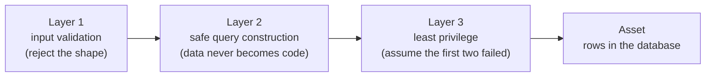

# Security Fundamentals

> Every transcript in this lesson was executed on the authoring machine (Windows 11,
> Python 3.13.5, standard library only) in the batch-17 `seclab-A` scratch lab. Tooling
> we did not run — packet capture, cloud IAM audits, DAST scanners — is marked
> *labelled reference*.

## 1. Learning Objectives

After this lesson you will be able to:

- [ ] State the CIA triad and classify a real incident under confidentiality, integrity, or availability *with the asset named*
- [ ] Distinguish encoding, hashing, and encryption — and demonstrate that an encoded string is not a protected one by decoding it in one line
- [ ] Arrange a system's controls as layers of defense in depth and show, by switching layers off, which layer catches a given attack
- [ ] Apply least privilege and fail-safe defaults to a design you can point at
- [ ] Say exactly what a control you have not tested is worth, and name the lesson that teaches you the test

## 2. Prerequisites

- [06-INTERNET-AND-WEB-FOUNDATIONS](../06-INTERNET-AND-WEB-FOUNDATIONS/README.md) — HTTP, TLS, and the browser's trust model; the network this subject assumes
- [14-TESTING-AND-QUALITY](../14-TESTING-AND-QUALITY/README.md) — the verification habit: a control you have not tested is a control you merely hope for
- [11-BACKEND-ENGINEERING](../11-BACKEND-ENGINEERING/README.md) — the API whose every boundary this subject hardens

*No code prerequisite — the concepts in section 5 assume nothing; the probes use Python's standard library and are printed in full.*

## 3. Introduction

Security is not a feature you add at the end; it is a property of the design, and
right now it is either present or absent in your design already. This lesson builds
the vocabulary the rest of the subject assumes — the triad, the layers, the three
different things people call "encryption" — and it installs the one habit that makes
the vocabulary useful: **every claim about a control is a claim you must be able to
demonstrate**. Two demonstrations run right here: an "obfuscated" credential decoded
in one line, and a SQL-injection attempt walked down a three-layer defense while
layers are switched off one at a time.

## 4. The Problem It Solves

For most of the industry's history, security was a review at the end — a person
reading code shortly before release, attention already split, with no way to know
whether they looked at the right file. The vocabulary existed, but it was used
*descriptively* ("this system is confidential") rather than *testably* ("an attacker
with this access cannot read these rows"). Two consequences follow, and both are
reproduced in this lesson:

- **Descriptions drift from reality.** A field called `obfuscated` in a URL
  parameter is not protected; anyone who reads the URL has the value. Section 7's
  Example 1 decodes one in three statements.
- **Single controls fail silently.** One validation rule, one firewall port, one
  "we check permissions" comment — any of them can be wrong, and none of them tells
  you when. Example 2 switches three layers off in turn and shows what each one was
  actually doing.

The fix is not more diligence at review time; it is *mechanisms you can switch off
and watch*.

## 5. Core Concepts

### The CIA triad

Three questions to ask of any asset (the thing worth protecting: user data, money,
configuration, availability of the service itself):

- **Confidentiality** — who is allowed to *see* it? A leaked customer list is a
  confidentiality failure.
- **Integrity** — who is allowed to *change* it, and can we detect unauthorized
  change? An altered price or a tampered audit log is an integrity failure.
- **Availability** — can authorized users *use* it when they need to? A ransomwiped
  database is an availability failure.

Almost every real incident is classifiable under one head, and naming the head tells
you which control family applies (secrecy → access control and encryption;
alteration → authorization and logging; unusability → limits and recovery).

### Threat, vulnerability, risk

- **Threat** — a *who/what* that could cause harm (a hostile client, a curious
  insider, a dependency maintainer, a disk).
- **Vulnerability** — the *property of your system* that lets the threat act (no
  ownership check on a query, a predictable session token).
- **Risk** — the expected damage: likelihood × impact, judged for *your* system.
  Risk is the only one of the three you prioritize by; threats and vulnerabilities
  are facts.

### Encoding, hashing, encryption — three different things

| | Reversible? | Needs a key? | Purpose |
|---|---|---|---|
| **Encoding** (base64, hex, URL) | yes, trivially, by anyone | no | transport format; provides *no* protection |
| **Hashing** (SHA-256, bcrypt) | no (one-way) | no | fingerprints and stored passwords |
| **Encryption** (AES-GCM, ChaCha20) | yes, with the key | yes | confidentiality of data at rest/in transit |

The first row is the trap: encoding looks like transformation, so it gets used to
"hide" secrets. Nothing about it requires attacker ignorance to undo.

### Defense in depth

No single control is trusted to be correct. Instead the same asset is protected by
**independent layers** with different failure modes — input validation, parameterized
queries, least-privilege database accounts — so that an attacker must defeat *all*
of them, and a bug in one is caught by another. The operative test (Example 2): if
switching a layer off doesn't change any outcome, that layer is not defense, it is
decoration.

### Least privilege and fail-safe defaults

- **Least privilege** — every component holds the *minimum* authority its job needs,
  for the *minimum* time. A read-only analytics job does not need a write-capable
  database user; a web tier does not need DDL rights.
- **Fail-safe defaults** — denial is the default; access must be granted explicitly.
  A missing configuration value should mean *closed*, never *open*.
- **Separation of duties** — the person who can approve a change should not be the
  person who can deploy it, so that one compromised account is never sufficient.

### Security through obscurity

Hiding an endpoint, a header, or a filename may raise cost slightly, but it is never
the control: obscurity is *recoverable* information (the "obfuscated" parameter in
Example 1 is recovered in one line). Keep secrets as secrets (keys, tokens — see
[password-security.md](password-security.md) and the subject's secrets lesson), and
keep designs as designs.

### The verification habit

A control exists only when you can demonstrate it. The subject's rule, inherited
from [14's security testing lesson](../14-TESTING-AND-QUALITY/security-testing.md):
**write the failing demonstration first** — attack, watch it succeed, then fix,
watch it fail. A control that has never been observed stopping something is an
*hypothesis*, and every lesson in this subject follows it with its demonstration.

## 6. How It Works

The layers are ordered so that the cheapest, most general check runs first and each
deeper layer assumes the one above it might be wrong:



The sequence matters less than the *independence*: the layers fail for different
reasons (a regex misses; a query builder has a bug; a permission is wrong), so their
failure modes do not correlate. A thousand copies of one control are still one
control. Example 2 executes the ladder and removes each rung to show what remains.

## 7. Practical Examples

**Example 1 — "obfuscated" is not protected** (executed)

```python
import base64, hashlib

leaked = "cGFzc3dvcmQ9dXNlcm5hbWU6c3VtbWVyMjAyNiE="   # what the app ships to the browser
print("PARAM :", leaked)
print("DECOD :", base64.b64decode(leaked).decode())

# same mistake with hex
secret = b"api_key=sk_live_51H8demo"
print("HEX   :", secret.hex())
print("UNHEX :", bytes.fromhex(secret.hex()).decode())

# what real protection looks like, for contrast
print("SHA256:", hashlib.sha256(secret).hexdigest())
```

- **Executed output** (authoring machine, Python 3.13.5):

```
PARAM : cGFzc3dvcmQ9dXNlcm5hbWU6c3VtbWVyMjAyNiE=
DECOD : password=username:summer2026!
HEX   : 6170695f6b65793d736b5f6c6976655f3531483864656d6f
UNHEX : api_key=sk_live_51H8demo
SHA256: 67794d4771089949e7bb698caf948b439b0f5b5d499298e072c0c41675246325
```

- **What the important lines do:** `b64decode` and `bytes.fromhex` are the tools
  *any* viewer has; the credential in the URL parameter is fully recovered, in one
  statement, with no secret knowledge. The last line is the contrast: a hash is not
  reversible even though it is equally "just characters".
- **How to run it:** `python encoding_probe.py` — the file is printed in full above.
- **Assumptions:** Windows 11, Python 3.13.5 — see [VERSIONS.md](../VERSIONS.md).

**Example 2 — the defense-in-depth ladder, rung by rung** (executed)

Three independent layers protecting the same `users` table, attacked with the
classic `' OR '1'='1`, with layers switched off in turn:

```python
import sqlite3, re, os, tempfile

DB = os.path.join(tempfile.mkdtemp(), "accounts.db")
con = sqlite3.connect(DB)
con.execute("CREATE TABLE users(id INTEGER PRIMARY KEY, name TEXT, pass TEXT)")
con.executemany("INSERT INTO users(name, pass) VALUES(?,?)",
                [("alice", "correct-horse"), ("bob", "battery-staple"),
                 ("mallory", "letmein")])
con.commit()
ro = sqlite3.connect(f"file:{DB}?mode=ro", uri=True)   # layer 3: read-only handle

PAYLOAD = "' OR '1'='1"

# layer 1: allowlist — only [a-z0-9] may reach the query
def layer1_validate(u, p):
    if not re.fullmatch(r"[a-z0-9]+", u) or not re.fullmatch(r"[a-z0-9]+", p):
        return None
    return (u, p)

print("payload:", PAYLOAD)
ok = layer1_validate("alice", PAYLOAD)
print("L1+L2+L3 : layer 1 verdict ->", "REJECTED before query" if ok is None else "passed")

# layer 1 off: raw concatenation reaches the database
print("L1 off   : concat query returned",
      len(con.execute(f"SELECT name FROM users WHERE name='alice' AND pass='{PAYLOAD}'"
                      ).fetchall()), "row(s)")

# layer 1 off, layer 2 correct: parameters, so the payload is data
print("L1 off, L2 on : parameterised query returned",
      len(con.execute("SELECT name FROM users WHERE name=? AND pass=?",
                      ("alice", PAYLOAD)).fetchall()), "row(s)")

# layers 1 and 2 off, layer 3 read-only: the injection runs but cannot write
try:
    ro.execute("DELETE FROM users")
    print("L1/L2 off, L3 ON : WRITE ALLOWED")
except sqlite3.OperationalError as e:
    print("L1/L2 off, L3 ON : WRITE BLOCKED:", e)
print("rows still readable through the L3 handle:",
      ro.execute("SELECT COUNT(*) FROM users").fetchone()[0])
```

- **Executed output:**

```
payload: ' OR '1'='1
L1+L2+L3 : layer 1 verdict -> REJECTED before query
L1 off   : concat query returned 3 row(s)
L1 off, L2 on : parameterised query returned 0 row(s)
L1/L2 off, L3 ON : WRITE BLOCKED: attempt to write a readonly database
rows still readable through the L3 handle: 3
```

- **Read the ladder:** with layer 1 on, the attack never reaches the database.
  With layer 1 off, concatenation turns the payload into *code* and returns **all
  three rows** — that line is the vulnerability class itself (see
  [injection-vulnerabilities.md](injection-vulnerabilities.md) for the full lesson).
  With layer 2 correct, the same payload is a *string* and matches nothing. With
  layers 1 and 2 both off, layer 3 alone still stops the `DELETE` — the attacker
  got a read, not a wipe, because the handle was read-only.
- **The honest detail:** row 4 (`WRITE BLOCKED`) is SQLite's message, not a generic
  success line; a real system's layer 3 is a database role with no `DELETE` grant.
- **How to run it:** `python depth_probe.py` — file printed above in full.
- **Assumptions:** Windows 11, Python 3.13.5 (`sqlite3` is standard library).

**Example 3 — what this lesson does *not* prove** (labelled reference)

Neither probe exercises a production stack: no browser, no framework, no network.
They demonstrate *mechanisms* (irreversibility claims, independent layers), not that
any particular application is secure. The tiers that answer the bigger questions —
dynamic scanning against a running app, dependency auditing, hostile review — are
named in [dependency-security.md](dependency-security.md) and
[14's security testing lesson](../14-TESTING-AND-QUALITY/security-testing.md); tools
we did not run here are labelled reference throughout this subject.

## 8. Real-World Applications

- **Design review / threat modeling** — the triad and the asset list are the raw
  input of [threat-modeling.md](threat-modeling.md): you cannot model a threat
  without naming what is being threatened and under which head.
- **Least privilege as architecture** — production systems scope every credential:
  an API key that can read one bucket, a migration role used only during deploys, a
  service account that cannot assume other roles. Revoking the wrong thing is cheap;
  an over-broad credential is not.
- **Fail-safe defaults in code and config** — `if debug:` blocks that disable auth,
  CORS defaults of `*`, storage buckets that start public: each is a defaults
  decision, and the safe default is the one that stays safe when nobody configures it.
- **Layered controls in review checklists** — reviewers ask "where else is this
  checked?" because the answer "only there" is the finding.

## 9. Common Mistakes

| Mistake | Why it happens | How to recognize it | How to prevent it |
|---|---|---|---|
| Treating encoding as encryption | it "looks" unreadable | base64/hex in a URL, header, or localStorage | ask "can a stranger reverse this without a key?" — if yes, it is not protection |
| One layer only, called "defense in depth" | the layers were never enumerated | removing the one control makes the asset fully exposed | require two controls with *different* failure modes for each critical asset |
| Security by obscurity | shipping an undocumented route feels like a secret | security depends on nobody finding `/debug/config` | assume the full source and routes are public; make the *check* the control |
| Confusing threat with vulnerability | both feel like "problems" | a threat list with no system properties, or bugs with no threat attached | write both columns: the actor, and the property that lets it act |
| "It's secure, we reviewed it" | review is cheaper than demonstration | no capture, no test, no failing-first evidence | pair every claimed control with the demonstration that shows it working |

## 10. Best Practices

- **Name the asset before the control** — "protect the database" is unactionable;
  "bob's note titles are readable only by bob" is testable, and becomes an
  authorization test in [access-control.md](access-control.md).
- **One head per question** — when a design discussion gets vague, ask which of
  confidentiality/integrity/availability is at stake; it reliably collapses a
  twenty-minute debate into a decision.
- **Layer for independence, not count** — two validations of the same kind share one
  bug. Pair a *shaping* check (allowlist) with a *construction* check (parameters)
  with a *power* check (privilege).
- **Fail closed, loudly** — a denied request should return a deliberate response and
  an event you can see; silent denial makes incidents invisible.
- **Demonstrate before you believe** — Example 2's habit: switch the layer off and
  watch the outcome change, or admit the layer does nothing.

## 11. Limitations and Trade-Offs

- **Defense in depth costs latency and friction** — every layer is code that runs on
  the hot path; on a high-throughput endpoint, redundant checks are budgeted, not
  stacked. The trade is decided per asset: money paths get layers, health checks may
  get one.
- **Least privilege fights convenience** — the broad credential that makes deploys
  easy is broad for a reason. Where the fight is real, automate the short-lived grant
  instead of lengthening the standing one.
- **The triad is a lens, not a checklist** — it does not rank risks, model attackers,
  or tell you what to build first. That is [threat-modeling.md](threat-modeling.md)'s
  job; using the triad *as* the method produces three bullets and no decisions.
- **These probes prove mechanisms, not products** — a green ladder run in a scratch
  directory says nothing about your framework's query builder, your cloud IAM
  policy, or your team's review habits.

## 12. Practical Exercises

### Introductory

1. **Exercise 1.1** — classify five incidents (a leaked API key, an altered invoice,
   a DNS outage, a read-only log that got wiped, a customer list in a public bucket)
   under the triad, naming the asset in each. **Completion criteria:** each line has
   one head *and* one asset; two heads applied to the same line are argued, not
   listed.
2. **Exercise 1.2** — take any client of yours that stores something and decide,
   for each stored value, encoding/hashing/encryption/none. **Completion criteria:** a
   table where every "encoding" row has a one-line justification of what it is *for*
   (transport, not protection).

### Intermediate

3. **Exercise 1.3** — reproduce Example 2, then remove layer 2 permanently and
   re-run: capture the `3 row(s)` result and state precisely what layer 1 and layer
   3 still prevent (a full table dump? a wipe?). **Completion criteria:** all three
   captures plus a one-sentence residual-risk statement per remaining layer.
4. **Exercise 1.4** — for a service you own, list its five widest privileges (roles,
   keys, tokens) and propose the least-privilege form of each. **Completion criteria:**
   each proposal states what breaks if the reduced grant is wrong (so you know the
   rollback).

### Independent problem-solving

5. **Exercise 1.5** — a teammate claims their endpoint is secure because "the URL is
   unguessable". Investigate and produce a verdict. **Completion criteria:** executed
   evidence — either a reversible encoding/observable pattern that defeats the claim
   (the shape of Example 1), or an honest statement of what was tested and what
   remains untested.

*Solutions: attempt first. They live in `solutions/` of this subject (written with
the subject's exercise installment).*

## 13. Knowledge Check

1. A teammate says "we encrypt the password with SHA-256." Which word is wrong, and
   what is the actual operation? Why does the confusion matter for storage?
2. In Example 2, layer 3 alone still let the attacker *read* three rows in the
   unparameterized run — is the system then "secure"? What does the answer depend on?
3. When is security through obscurity a reasonable *additional* cost, and when is it
   never acceptable?

## 14. Completion Criteria

- [ ] You can classify an unseen incident under the triad with the asset named, without notes
- [ ] You can demonstrate encoding's reversibility from a blank editor in three lines
- [ ] You can reproduce Example 2's ladder and say what each rung catches when the others are off
- [ ] You can point at two of your own system's privileges and state the least-privilege form of each
- [ ] You can state the exact demonstration that would convince you a control exists

## 15. Summary

- The triad sorts every incident into secrecy, alteration, or availability — always
  with an asset named, because an asset-less control is untestable.
- Encoding is transport, hashing is one-way, encryption needs a key; the first is
  the one that gets mistaken for protection.
- Defense in depth means *independent* layers: prove independence by switching a
  layer off and watching an outcome change.
- Least privilege and fail-safe defaults are defaults decisions — they hold when
  nobody configures anything.
- A control you cannot demonstrate is a hope; this subject demonstrates every claim.

## 16. Next Steps

- Next lesson: [Threat Modeling](threat-modeling.md) — finding these failures *on
  paper*, before code exists
- Practice: the subject's exercise set (written with its exercise installment)
- Where it is applied: [Project 07](../20-PROJECT-LABORATORY/project-07-secure-production-application/README.md)'s
  security checklist, and the safe-use rules in [SECURITY.md](../SECURITY.md)