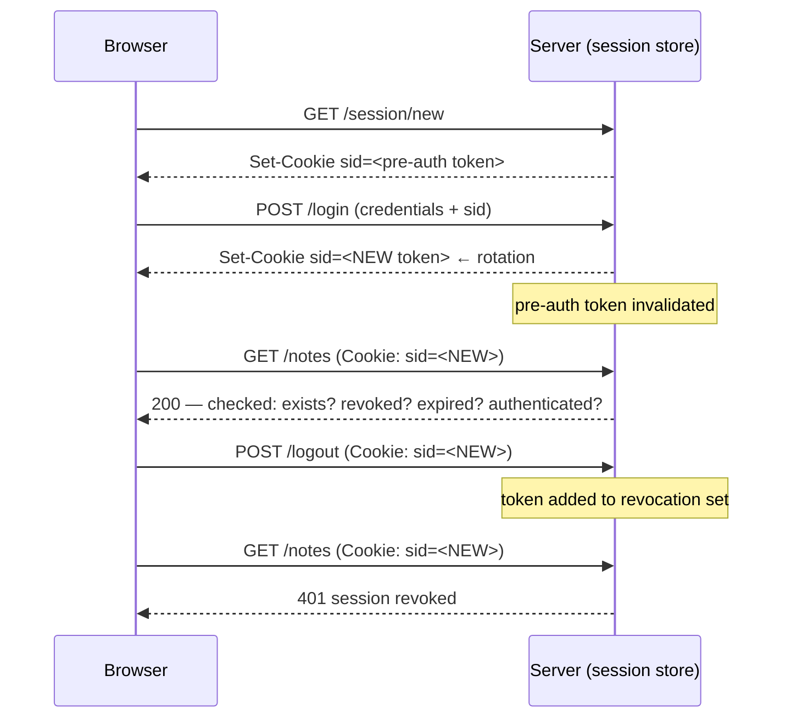

# Session Security

> Every transcript in this lesson was executed on the authoring machine (Windows 11,
> Python 3.13.5, standard library only) in the batch-17 `seclab-B` scratch lab. The probe
> runs its own HTTP server and client in one process, so the whole capture is a single
> transcript. Tooling we did not run — browser DevTools cookie inspection, real TLS
> deployments, session-store load tests — is marked *labelled reference*.

## 1. Learning Objectives

After this lesson you will be able to:

- [ ] Explain what a session actually is on the wire (a server-side record keyed by an opaque token) and why the token alone is not the session
- [ ] Demonstrate session fixation by planting a pre-authentication token, then eliminate it by rotating the token at login and replaying the old one
- [ ] State what each `Set-Cookie` attribute (`HttpOnly`, `Secure`, `SameSite`) defends against, and read them off a real response header
- [ ] Distinguish idle/expiring sessions from revoked ones, and show both a rejected expired token and a rejected logged-out token
- [ ] Diagnose a session design where logout "works" in the UI but the token still authorizes requests

## 2. Prerequisites

- [Security Fundamentals](security-fundamentals.md) — confidentiality, defense in depth, and the verification habit this lesson's probes follow
- [06-INTERNET-AND-WEB-FOUNDATIONS](../06-INTERNET-AND-WEB-FOUNDATIONS/README.md) — HTTP headers, cookies, and what the browser attaches automatically
- [11-BACKEND-ENGINEERING](../11-BACKEND-ENGINEERING/README.md) — the server whose login and logout handlers we harden

*No code prerequisite beyond reading Python — the probe is printed in full and uses only the standard library.*

## 3. Introduction

HTTP has no memory: every request is independent, so "who are you?" must be answered
fresh each time. A **session** is the standard answer — the server stores a small record
("this token belongs to alice, signed in at 10:02, expires at 11:02") and the client
presents the token on every request, normally in a cookie. Everything a user does after
logging in rides on that one string. This lesson hardens the string and the record behind
it: how it is issued, what flags ride with it, when it dies, and — the part applications
get wrong most often — whether logout actually kills it. Every claim below is
demonstrated against a live local server that starts inside the probe.

## 4. The Problem It Solves

The classic failures all predate deliberate design of sessions:

- **Session fixation.** Early apps let the client choose or reuse a session id across
  login. An attacker who plants a known id (in a link, or a `Set-Cookie` they can write)
  waits for the victim to log in, then presents the *same id* and is logged in as the
  victim. Phase 1 of the probe reproduces this exactly: the pre-auth id and the
  post-login id are identical.
- **Tokens readable by scripts.** Without `HttpOnly`, any injected script can read the
  cookie and exfiltrate the whole session. Without `Secure`, the cookie travels in
  cleartext on any plain-HTTP hop. Without `SameSite`, the browser attaches it to
  cross-site requests — the raw material of CSRF (covered in [csrf.md](csrf.md)).
- **Logout that only changes the page.** If the server keeps the token valid, "logged
  out" is a client-side illusion: anyone holding the token keeps full access.

The fix is not a cleverer token; it is a token with an explicit lifecycle — created at
login, *replaced* at login, constrained by flags, and destroyed on demand.

## 5. Core Concepts

### Session, token, cookie

- **Session** — a server-side record associating a sequence of requests with one user.
- **Token** — the opaque, unguessable string that names that record. It is a *reference*,
  not the data: the user's identity, role, and expiry live server-side.
- **Cookie** — the transport the browser uses to return the token automatically. The
  browser never interprets the token; it only obeys the cookie's attributes.

### Session fixation and rotation

**Fixation** is when a session id that existed *before* authentication is still accepted
*after* authentication. The defense is **rotation**: on successful login, issue a brand-new
token and invalidate the pre-auth one, so a planted id dies at the moment of login.

### Cookie attributes

| Attribute | Meaning | What it stops |
|---|---|---|
| `HttpOnly` | JavaScript cannot read the cookie | XSS token theft (`document.cookie`) |
| `Secure` | Cookie only sent over HTTPS | Eavesdropping on plain-HTTP hops |
| `SameSite=Lax/Strict` | Not attached to cross-site requests | Most CSRF, by default |
| `Path` / `Max-Age` | Scope and lifetime | Over-broad exposure and immortal cookies |

### Expiry versus revocation

- **Expiry** is passive: the record ages out (`exp < now`), so an idle token stops
  working on its own. Two flavours: *idle timeout* (no activity for N minutes) and
  *absolute lifetime* (hard cap regardless of activity).
- **Revocation** is active: the server deliberately kills a specific token (logout,
  password change, "sign out all devices", admin ban). Revocation must be checked
  server-side against the session store — deleting a cookie in the browser proves
  nothing.

### Entropy

A token must be unguessable: with 16 bytes from `secrets.token_urlsafe` a token carries
128 bits, so guessing is not a threat. Predictable tokens (sequential ids, timestamps)
make every other control irrelevant — see [password-security.md](password-security.md)
for the same argument applied to passwords.

## 6. How It Works



The four checks on every request — *exists, not revoked, not expired, authenticated* —
are the whole lesson in one line. They run in that order in the probe's `do_GET`, and
each phase of the capture fails exactly one of them to show which check is doing the work.

## 7. Practical Examples

**Example 1 — the full probe: fixation, rotation, flags, expiry, revocation**

```python
# SEC-05 session-security probe: fixation, rotation, cookie flags, expiry, revocation.
# Standard library only. Server and client run in one process so the whole run is
# one transcript. Run: python session_probe.py
import json
import secrets
import threading
import time
import http.client
from http.server import BaseHTTPRequestHandler, HTTPServer

MODE = {"rotate": False, "flags": "insecure"}
SESSIONS = {}   # sid -> {"user": str|None, "exp": float}
REVOKED = set()


class Handler(BaseHTTPRequestHandler):
    def log_message(self, *a):
        pass

    def _send(self, code, obj, sid=None):
        body = json.dumps(obj).encode()
        self.send_response(code)
        self.send_header("Content-Type", "application/json")
        self.send_header("Content-Length", str(len(body)))
        if sid is not None:
            if MODE["flags"] == "secure":
                cookie = f"sid={sid}; Path=/; HttpOnly; Secure; SameSite=Strict"
            else:
                cookie = f"sid={sid}; Path=/"
            self.send_header("Set-Cookie", cookie)
        self.end_headers()
        self.wfile.write(body)

    def do_GET(self):
        if self.path == "/session/new":                      # pre-auth session (login page)
            sid = secrets.token_urlsafe(16)
            SESSIONS[sid] = {"user": None, "exp": time.time() + 3600}
            self._send(201, {"sid": sid})
        elif self.path == "/notes":
            sid = cookie_sid(self.headers.get("Cookie", ""))
            if sid is None or sid not in SESSIONS:
                self._send(401, {"error": "no such session"})
            elif sid in REVOKED:
                self._send(401, {"error": "session revoked"})
            elif SESSIONS[sid]["exp"] < time.time():
                self._send(401, {"error": "session expired"})
            elif SESSIONS[sid]["user"] is None:
                self._send(401, {"error": "not authenticated"})
            else:
                self._send(200, {"user": SESSIONS[sid]["user"],
                                 "notes": ["groceries", "dentist"]})
        else:
            self._send(404, {"error": "not found"})

    def do_POST(self):
        n = int(self.headers.get("Content-Length", 0))
        data = json.loads(self.rfile.read(n) or b"{}")
        if self.path == "/login":
            presented = self.headers.get("X-Session")        # cookie the client already holds
            if MODE["rotate"]:                                # fix: never let a pre-auth id survive login
                old = presented
                sid = secrets.token_urlsafe(16)
                SESSIONS[sid] = {"user": data["user"], "exp": time.time() + 3600}
                if old in SESSIONS:
                    del SESSIONS[old]                         # pre-auth id is dead after login
            else:                                             # vulnerable: authenticate in place
                sid = presented
                SESSIONS[sid]["user"] = data["user"]
            self._send(200, {"user": data["user"]}, sid=sid)
        elif self.path == "/logout":
            sid = cookie_sid(self.headers.get("Cookie", ""))
            if sid:
                REVOKED.add(sid)
            self._send(204, {})
        else:
            self._send(404, {"error": "not found"})


def cookie_sid(header):
    for part in header.split(";"):
        k, _, v = part.strip().partition("=")
        if k == "sid":
            return v
    return None


def req(method, path, body=None, sid=None, x_session=None, port=8093):
    c = http.client.HTTPConnection("127.0.0.1", port, timeout=5)
    headers = {}
    if sid:
        headers["Cookie"] = f"sid={sid}"
    if x_session:
        headers["X-Session"] = x_session
    payload = json.dumps(body) if body is not None else None
    if payload:
        headers["Content-Type"] = "application/json"
    c.request(method, path, payload, headers)
    r = c.getresponse()
    raw = r.read().decode()
    cookie = r.getheader("Set-Cookie")
    c.close()
    return r.status, raw, cookie


def flags_of(set_cookie):
    return {"HttpOnly": "HttpOnly" in set_cookie,
            "Secure": "Secure" in set_cookie,
            "SameSite": next((p.split("=")[1] for p in set_cookie.split(";")
                              if "SameSite" in p), "absent")}


server = HTTPServer(("127.0.0.1", 8093), Handler)
threading.Thread(target=server.serve_forever, daemon=True).start()

print("=== 1. session fixation: insecure mode (no rotation on login) ===")
_, body, _ = req("GET", "/session/new")
planted = json.loads(body)["sid"]
print(f"pre-auth sid planted by attacker : {planted}")
st, _, cookie = req("POST", "/login", {"user": "alice"}, x_session=planted)
after = cookie.split(";")[0].split("=")[1]
print(f"login -> {st}, Set-Cookie         : {cookie}")
st, body, _ = req("GET", "/notes", sid=after)
print(f"GET /notes with that sid -> {st}  : {body[:70]}")
print(f"same sid before and after login  : {planted == after}")

print()
print("=== 2. rotation on login (fixed mode) ===")
MODE["rotate"] = True
_, body, _ = req("GET", "/session/new")
old = json.loads(body)["sid"]
st, _, cookie = req("POST", "/login", {"user": "alice"}, x_session=old)
new = cookie.split(";")[0].split("=")[1]
print(f"pre-auth sid                      : {old}")
print(f"login -> {st}, Set-Cookie         : {cookie}")
st, body, _ = req("GET", "/notes", sid=old)
print(f"replay old sid -> {st}            : {body}")
st, body, _ = req("GET", "/notes", sid=new)
print(f"new sid -> {st}                   : {body[:60]}")

print()
print("=== 3. cookie flags ===")
MODE["flags"] = "insecure"
_, _, insecure = req("POST", "/login", {"user": "alice"},
                     x_session=secrets.token_urlsafe(8))
MODE["flags"] = "secure"
_, _, secure = req("POST", "/login", {"user": "alice"},
                   x_session=secrets.token_urlsafe(8))
print(f"insecure Set-Cookie: {insecure}")
print(f"  parsed          : {flags_of(insecure)}")
print(f"secure   Set-Cookie: {secure}")
print(f"  parsed          : {flags_of(secure)}")

print()
print("=== 4. expiry ===")
sid = secrets.token_urlsafe(16)
SESSIONS[sid] = {"user": "alice", "exp": time.time() - 60}   # age forced past TTL
st, body, _ = req("GET", "/notes", sid=sid)
print(f"GET /notes with an expired sid -> {st}: {body}")

print()
print("=== 5. revocation (logout) ===")
st, _, cookie = req("POST", "/login", {"user": "alice"},
                    x_session=secrets.token_urlsafe(8))
sid = cookie.split(";")[0].split("=")[1]
st, body, _ = req("GET", "/notes", sid=sid)
print(f"GET /notes before logout -> {st}   : {body[:60]}")
st, _, _ = req("POST", "/logout", {}, sid=sid)
print(f"POST /logout -> {st}")
st, body, _ = req("GET", "/notes", sid=sid)
print(f"GET /notes after  logout -> {st}   : {body}")

server.shutdown()
```

- The vulnerable and fixed behaviors differ in exactly one branch (`MODE["rotate"]`),
  so the comparison isolates rotation rather than a rewrite.
- The four authorization checks run before any data is returned; each phase of the
  output trips a different one.
- **Expected output:** the capture below.
- **How to run it:** `python session_probe.py` (Windows 11, Python 3.13.5; server and
  client share one process, so no second terminal is needed).
- **Assumptions:** standard library only; port 8093 free on loopback.

**Executed capture:**

```text
=== 1. session fixation: insecure mode (no rotation on login) ===
pre-auth sid planted by attacker : axP9bDHP0XbS0oYUxlVhQw
login -> 200, Set-Cookie         : sid=axP9bDHP0XbS0oYUxlVhQw; Path=/
GET /notes with that sid -> 200  : {"user": "alice", "notes": ["groceries", "dentist"]}
same sid before and after login  : True

=== 2. rotation on login (fixed mode) ===
pre-auth sid                      : 9dlGFBBaG1LRqpBjVk_CRg
login -> 200, Set-Cookie         : sid=j993DjU47gLBStT6zz4l7A; Path=/
replay old sid -> 401            : {"error": "no such session"}
new sid -> 200                   : {"user": "alice", "notes": ["groceries", "dentist"]}

=== 3. cookie flags ===
insecure Set-Cookie: sid=sgXQW_Gh41PW_H4YCy5tnQ; Path=/
  parsed          : {'HttpOnly': False, 'Secure': False, 'SameSite': 'absent'}
secure   Set-Cookie: sid=y-3Tt__GSTnyrUmIJtDFdg; Path=/; HttpOnly; Secure; SameSite=Strict
  parsed          : {'HttpOnly': True, 'Secure': True, 'SameSite': 'Strict'}

=== 4. expiry ===
GET /notes with an expired sid -> 401: {"error": "session expired"}

=== 5. revocation (logout) ===
GET /notes before logout -> 200   : {"user": "alice", "notes": ["groceries", "dentist"]}
POST /logout -> 204
GET /notes after  logout -> 401   : {"error": "session revoked"}
```

Reading the five phases: in phase 1 the planted id survives login (`True`) — that single
boolean is the entire fixation vulnerability. In phase 2 the same flow with rotation
leaves the old id dead (`no such session`) while the new one works. Phase 3 shows the
attribute difference as the server actually sends it. Phases 4 and 5 produce different
*reasons* on purpose: expiry and revocation are separate checks, and confusing them is
how "sign out everywhere" ends up unimplemented.

**Example 2 — checking a real response header (illustration of the same idea in curl)**

```bash
# after login against any local app you own:
curl -i -s http://127.0.0.1:8000/login -X POST -d 'user=alice' | grep -i set-cookie
```

- **Expected output:** a `Set-Cookie:` line; compare it against the table in section 5 —
  if `HttpOnly`, `Secure`, and `SameSite` are missing, phase 3's insecure row is what
  your users are shipping.
- **Assumptions:** curl installed; a local app of your own (see
  [SECURITY.md](../SECURITY.md) for the authorization boundary).

## 8. Real-World Applications

- **Web apps of every kind** store login state in a session cookie; frameworks expose
  the flags above as one-line settings (Django `SESSION_COOKIE_SECURE`, Express
  `cookie: {httpOnly, secure, sameSite}`).
- **"Log out of all devices"** is revocation at scale — a per-user token epoch in the
  session store, checked on every request exactly like the probe's `REVOKED` set.
- **Password change flows** rotate or revoke sessions because a credential change is the
  moment you assume compromise.
- Paired with: TLS (which makes `Secure` cookies actually safe), CSRF tokens
  ([csrf.md](csrf.md)), and the login rate limiting from
  [secure-api-design.md](secure-api-design.md).

## 9. Common Mistakes

| Mistake | Why it happens | How to recognize it | How to prevent it |
|---|---|---|---|
| Session fixation: pre-auth id survives login | Login handler authenticates the existing record instead of creating a new one | Copy the pre-login cookie, log in, replay it successfully | Rotate the token at every privilege change; delete the old record |
| Logout only clears the browser cookie | Handler never touches the session store | Replay the old cookie after logout and still get 200 | Revoke server-side; treat the cookie deletion as cosmetic |
| No `Secure` flag "because localhost is HTTP" | Dev settings shipped to production | `Set-Cookie` line lacks `Secure` on an HTTPS site | Set flags in config per environment, not in code |
| Tokens in `localStorage` for SPA convenience | Framework tutorial defaults | Token readable via `document.cookie`-style JS inspection; XSS = full account theft | Cookies with `HttpOnly` + a CSRF strategy |
| Expiry checked client-side (JWT `exp` never re-validated) | "The token already says when it expires" | Banned/compromised sessions keep working until natural expiry | Keep a server-side check — the store is authoritative, as in phases 4–5 |
| Predictable session ids (`randint`, timestamp) | `random` used instead of `secrets` | Tokens look like `1719432000` or increment | `secrets.token_urlsafe(16+)` |

## 10. Best Practices

- **Rotate at every privilege change** (login, elevation, password change). The rule
  stops being free only if your session store cannot delete records — then fix the
  store, not the rule.
- **Send all four attributes by default.** `SameSite=Lax` is the modern browser
  default and a good floor; use `Strict` where navigation from external links must never
  carry a session (it breaks some SSO return links — that is the trade-off).
- **Check revocation and expiry server-side on every request**, in this order: exists →
  revoked → expired → authenticated. The probe's phase outputs are your test cases.
- **Store identity server-side; the token is only a reference.** Putting roles or
  permissions in the token turns every revocation into a wait-for-expiry problem.
- **Idle timeout for usability, absolute lifetime for security.** Short idle windows
  with a longer absolute cap is the usual combination; the exact numbers are a product
  decision, not a constant.
- **Use `secrets`, never `random`, for tokens.** Same reasoning as
  [password-security.md](password-security.md): `random` is predictable and exists for
  simulations.

## 11. Limitations and Trade-Offs

- **Server-side sessions need shared state.** In a multi-instance deployment the store
  must be shared (Redis/DB), adding a hop and a dependency; stateless tokens (JWT) trade
  revocation latency for that dependency and are covered in
  [secure-api-design.md](secure-api-design.md).
- **Strict `SameSite` can break cross-site flows** — OAuth return legs, some SSO
  redirects. Every relaxation is a CSRF-surface increase; see [csrf.md](csrf.md).
- **`Secure` requires working TLS everywhere the cookie is used**, including local
  development over plain HTTP; that is why the flag belongs in environment config.
- **The probe is a single process on loopback.** It demonstrates logic, not
  concurrency: real session stores must handle rotation races (two parallel logins),
  clock skew between nodes on expiry, and load — none of which this capture covers.
  Load testing and real-browser cookie behavior were not run — *labelled reference*.

## 12. Practical Exercises

### Introductory

1. **Exercise 5.1** — Take any local app you own, log in, and collect its `Set-Cookie`
   line. **Completion criteria:** you can name, for each attribute present or absent,
   which attack from section 9 it does and does not stop.
2. **Exercise 5.2** — Reproduce phase 1 against your own login route by carrying a
   pre-auth cookie into the login request. **Completion criteria:** a capture where the
   pre- and post-login tokens are equal, or a written explanation of why they cannot be.

### Intermediate

3. **Exercise 5.3** — Add an idle timeout (15 minutes of no activity) to the probe's
   session store and re-run it. **Completion criteria:** a captured 401 with reason
   `session expired` produced by *waiting*, not by editing `exp` by hand.
4. **Exercise 5.4** — Implement "log out of all devices": a per-user token epoch, so
   changing password invalidates every existing session. **Completion criteria:** two
   concurrent sessions both return 401 after the password change, with the capture
   showing both.

### Independent problem-solving

5. **Exercise 5.5** — A teammate's design stores the session token in `localStorage`
   "to support the mobile WebView", with revocation deferred to token expiry. Redesign
   it. **Completion criteria:** a short design note stating where the token lives, which
   attributes its cookie carries, how logout revokes it server-side, and what breaks in
   the WebView as a result — with each trade-off explicit.

*Solutions: attempt first. They live in `solutions/` of this subject.*

## 13. Knowledge Check

1. If the server-side record is deleted but the browser cookie remains, what does the
   next request do — and why is that the correct answer?
2. Phase 1 and phase 2 differ only in one branch. What single line of server logic
   changes the outcome of `same sid before and after login` from `True` to a dead token?
3. When would you *not* set `SameSite=Strict`? Name a real navigation flow it breaks.

## 14. Completion Criteria

Observable evidence that you have understood this lesson:

- [ ] You can explain the four per-request checks (exists, revoked, expired, authenticated) without notes
- [ ] You can reproduce phases 1–5 from a blank editor and say which check each phase trips
- [ ] You can read a `Set-Cookie` line and name the attack each missing attribute allows
- [ ] You can implement revocation that survives a page refresh and prove it with a replayed request
- [ ] You can state one situation where server-side sessions are the wrong tool (and what to use instead)

## 15. Summary

- A session is a server-side record; the token is an opaque reference to it — never
  the data itself.
- Rotate the token at every privilege change: fixation dies when the pre-auth id dies.
- `HttpOnly`, `Secure`, `SameSite` each defend a different channel; the capture shows
  them exactly as the server sends them.
- Expiry is passive aging; revocation is an active kill — logout must be revocation.
- Every claim here was demonstrated against a running local server; your app deserves
  the same five-phase test.

## 16. Next Steps

- Next lesson: [Access Control](access-control.md) — once a session says *who*, the
  next question is *what they may do*
- Practice: the subject's exercise set (written with its exercise installment)
- Where it is applied: [Project 07](../20-PROJECT-LABORATORY/project-07-secure-production-application/README.md)'s
  security checklist, and the safe-use rules in [SECURITY.md](../SECURITY.md)