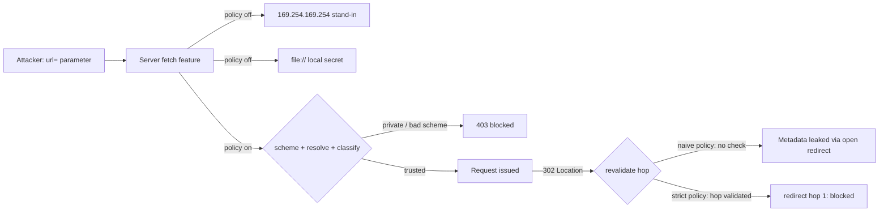

# SSRF

> Every transcript in this lesson was executed on the authoring machine (Windows 11,
> Python 3.13.5, standard library only) in the batch-17 `seclab-C` scratch lab. The
> cloud metadata service and remote hosts are **loopback stand-ins on fixed ports** — no
> real cloud metadata endpoint, internal network, or third-party host was contacted; real
> IMDS behaviour, DNS rebinding, and out-of-band blind-SSRF confirmation were not run and
> are marked *labelled reference*.

## 1. Learning Objectives

After this lesson you will be able to:

- [ ] Define SSRF as the server being turned into the attacker's HTTP client, and distinguish it from CSRF
- [ ] Demonstrate a vulnerable fetch feature pulling a metadata response and a local file, then blocking both with a strict policy
- [ ] Explain why a naive hostname allowlist still escapes through an open redirect, and implement hop-by-hop redirect revalidation
- [ ] Apply the full defense stack: scheme allowlist, DNS resolution and private-address classification, explicit partner allowlist, redirect revalidation
- [ ] State what *blind* SSRF still achieves and why "the user never sees the response" is not a defense

## 2. Prerequisites

- [Injection Vulnerabilities](injection-vulnerabilities.md) — the shared root cause: data crossing a trust boundary and becoming behavior
- [Security Fundamentals](security-fundamentals.md) — trust boundaries and defense in depth, both used heavily here
- [06-INTERNET-AND-WEB-FOUNDATIONS](../06-INTERNET-AND-WEB-FOUNDATIONS/README.md) — URLs, DNS, HTTP redirects, and private address ranges
- [11-BACKEND-ENGINEERING](../11-BACKEND-ENGINEERING/README.md) — the API feature (webhook, importer, proxy) that becomes the vulnerability

*No code prerequisite beyond reading Python — the probe is printed in full and uses only the standard library.*

## 3. Introduction

Server-side request forgery (SSRF) is when an application that *fetches URLs on your
behalf* can be handed a URL the attacker chose. Your server has something the attacker's
browser does not: a position inside the network. It can reach loopback services, private
ranges, and — on any cloud host — the instance metadata service that hands out
credentials. The attacker never sees your network; they just write a URL and your server
goes there for them. This lesson runs a `/fetch?url=` feature against a stand-in metadata
service and a local secret file, watches both leak with the policy off, then turns on a
strict policy and watches both die — including the escape route through an open redirect
that the strict policy catches and the naive one does not.

## 4. The Problem It Solves

SSRF exists because *fetching URLs is a feature*:

- **Webhooks, link previews, PDF exporters, image importers, RSS readers, "ping this URL" integrations** — every one takes a URL from a user or third party and requests it from the server.
- **The cloud made the inside valuable.** `http://169.254.169.254/latest/meta-data/` is the classic prize: on cloud hosts it returns role credentials the server's own IAM role can use. Phase 1 fetches the loopback stand-in and returns its `AccessKeyId` body verbatim.
- **`file://` is still a scheme.** A fetcher that accepts any scheme reads local files — phase 2's `LAB-ONLY-LOCAL-FILE-SECRET` is the whole file, returned as the response body.
- **"We don't show the response" felt like safety.** Blind SSRF (error-only, timing-only, DNS-only) still lets an attacker map internal hosts, hit unauthenticated internal APIs, and trigger side effects. The response body is a bonus, not the requirement.

Before validating URLs, the defense was *knowing the endpoint wasn't guessable* —
security through obscurity, defeated by the feature being advertised in its own docs.

## 5. Core Concepts

### SSRF is not CSRF

CSRF ([csrf.md](csrf.md)) makes the *victim's browser* send a request with the victim's
cookie. SSRF makes the *victim's server* send a request from the victim's network
position. The cookie is irrelevant in SSRF; the network vantage point is everything.

### The targets

- **Cloud metadata** — link-local `169.254.169.254`: credentials, user-data, sometimes startup scripts.
- **Loopback services** — admin panels bound to `127.0.0.1` with no auth "because it's internal".
- **Private ranges** — `10.0.0.0/8`, `172.16.0.0/12`, `192.168.0.0/16`: databases, Redis, internal APIs.
- **Dangerous schemes** — `file://`, `gopher://`, `dict://`: local files and raw-protocol request smuggling (the latter two are blocked by most modern HTTP clients — *labelled reference*).

### The validation stack (what phase 3 enforces)

1. **Scheme allowlist** — `http`, `https` only. Kills `file://` (`blocked: scheme 'file' not allowed`).
2. **Resolve, then classify** — `socket.getaddrinfo` turns the hostname into an address; `is_private` classifies it against loopback, RFC 1918, and link-local ranges. Kills the metadata fetch (`blocked: 127.0.0.1 resolves to private address 127.0.0.1`).
3. **Explicit allowlist for partners** — known-good hosts are admitted by exact `host:port` entry (`TRUSTED`), before any DNS question.

A **blocklist** ("deny internal addresses") is the weaker form: it must anticipate every
representation — `127.1`, `0`, `2130706433` (decimal), `[::1]`, trailing-dot hostnames —
while an **allowlist** ("admit only these") only has to enumerate what it truly trusts.

### Redirects are new requests

`urlopen` follows `302`s by default, so a URL that passed validation can *land* on
`169.254.169.254`. Phase 4 is the proof: the naive policy admits the allowlisted CDN host,
follows its redirect, and leaks the metadata body; the strict policy revalidates **every
hop** and raises `redirect hop 1: blocked: ...` before the second request's target is ever
fetched.

### Validation time is not fetch time (TOCTOU)

Resolve-then-fetch leaves a gap: the name can resolve differently the second time (**DNS
rebinding**), so a validated public address can become a private one before the connection.
The robust shape is to *connect to the IP you validated*, not to the name again — and,
beyond the app, to let the network enforce the policy (*egress filtering*). Neither was
run here — *labelled reference*.

### Blind SSRF

**Blind SSRF** means the attacker gets no response body — only timing, errors, or an
out-of-band callback they control. It is still enough to scan internal ports, trigger
one-way actions (a metadata token *used* elsewhere), and exfiltrate via DNS names
resolved on the attacker's server. "The user can't see the response" describes the
attacker's view, not the server's exposure.

## 6. How It Works



The judge in this lesson is the app's own `validate()` function, and the three
interesting verdicts are all in the capture: what it returns when the policy is off
(`None`, fetch proceeds), and the two exact `blocked:` strings the strict policy produces
for the metadata URL and the `file://` URL.

## 7. Practical Examples

**Example 1 — the full probe: two leaks, two blocks, and the redirect escape**

```python
# SEC-10 SSRF probe: server-side fetch of attacker-chosen URLs (metadata service,
# local file, redirect escape) and the validation that stops each.
# Standard library only; all "remote" hosts are loopback stand-ins. Run: python ssrf_probe.py
import json
import pathlib
import socket
import threading
import urllib.error
import urllib.parse
import urllib.request
from http.server import BaseHTTPRequestHandler, HTTPServer

META_SECRET = {"AccessKeyId": "AKIA-LOOPBACK-STANDIN-0001",
               "SecretAccessKey": "lab-only-not-a-real-key"}
MODE = {"policy": "off"}        # off = fetch anything; naive = hostname only; strict = full
APP_PORT, META_PORT, CDN_PORT = 8096, 8097, 8100
LOCAL_SECRET_FILE = "local_secret.txt"
TRUSTED = {f"127.0.0.1:{CDN_PORT}"}    # explicit partner allowlist entry (strict mode)


class MetaHandler(BaseHTTPRequestHandler):          # stand-in for 169.254.169.254
    def log_message(self, *a):
        pass

    def do_GET(self):
        body = json.dumps(META_SECRET).encode()
        self.send_response(200)
        self.send_header("Content-Type", "application/json")
        self.send_header("Content-Length", str(len(body)))
        self.end_headers()
        self.wfile.write(body)


class CdnHandler(BaseHTTPRequestHandler):           # allowlisted host that redirects
    def log_message(self, *a):
        pass

    def do_GET(self):
        self.send_response(302)
        self.send_header("Location", f"http://127.0.0.1:{META_PORT}/latest/meta-data/")
        self.end_headers()


class AppHandler(BaseHTTPRequestHandler):           # the vulnerable feature: /fetch?url=
    def log_message(self, *a):
        pass

    def _send(self, code, obj):
        body = json.dumps(obj).encode()
        self.send_response(code)
        self.send_header("Content-Type", "application/json")
        self.send_header("Content-Length", str(len(body)))
        self.end_headers()
        self.wfile.write(body)

    def do_GET(self):
        if "url=" not in self.path:
            return self._send(404, {"error": "missing url"})
        url = self.path.split("url=", 1)[1]
        verdict = validate(url)
        if verdict:
            return self._send(403, {"error": verdict})
        try:
            with urllib.request.urlopen(fetch(url), timeout=5) as r:
                text = r.read(200).decode(errors="replace")
            self._send(200, {"fetched": text})
        except Exception as e:
            self._send(502, {"error": f"{type(e).__name__}: {e}"})

    def do_POST(self):                                # flip the policy from the app itself
        n = int(self.headers.get("Content-Length", 0))
        data = json.loads(self.rfile.read(n or 0) or b"{}")
        MODE["policy"] = data["policy"]
        self._send(200, {"policy": MODE["policy"]})


def authority_of(url):
    return url.split("://", 1)[1].split("/", 1)[0].split("@")[-1]


def is_private(ip):
    parts = [int(p) for p in ip.split(".")]
    if parts[0] in (127, 10):
        return True
    if parts[0] == 192 and parts[1] == 168:
        return True
    if parts[0] == 172 and 16 <= parts[1] <= 31:
        return True
    if parts[0] == 169 and parts[1] == 254:          # link-local: the metadata range
        return True
    return False


def validate(url):
    if MODE["policy"] == "off":
        return None                                   # vulnerable: anything goes
    scheme = url.split("://", 1)[0]
    if scheme not in ("http", "https"):
        return f"blocked: scheme '{scheme}' not allowed"
    authority = authority_of(url)
    host = authority.split(":")[0]
    if MODE["policy"] == "naive":
        if host not in ("127.0.0.1", "cdn.lab"):      # hostname allowlist, redirects unchecked
            return f"blocked: host '{host}' not allowlisted"
        return None
    if authority in TRUSTED:                          # strict: explicit partner entry
        return None
    ip = socket.getaddrinfo(host, None)[0][4][0]      # strict: resolve and classify
    if is_private(ip):
        return f"blocked: {host} resolves to private address {ip}"
    return None


class NoRedirect(urllib.request.HTTPRedirectHandler):
    def redirect_request(self, req, fp, code, msg, headers, newurl):
        return None


def fetch(url):
    """off/naive: plain urlopen (follows redirects). strict: hop-by-hop validation."""
    if MODE["policy"] != "strict":
        return urllib.request.Request(url)
    opener = urllib.request.build_opener(NoRedirect)
    hops = 0
    while True:
        try:
            return opener.open(url, timeout=5)
        except urllib.error.HTTPError as e:
            if e.code in (301, 302, 303, 307, 308):
                loc = e.headers.get("Location")
                hops += 1
                if hops > 5:
                    raise RuntimeError("blocked: too many redirect hops")
                verdict = validate(loc)
                if verdict:
                    raise RuntimeError(f"redirect hop {hops}: {verdict}")
                url = loc
                continue
            raise


for handler, port in ((MetaHandler, META_PORT), (CdnHandler, CDN_PORT),
                      (AppHandler, APP_PORT)):
    srv = HTTPServer(("127.0.0.1", port), handler)
    threading.Thread(target=srv.serve_forever, daemon=True).start()

with open(LOCAL_SECRET_FILE, "w", encoding="utf-8") as f:
    f.write("LAB-ONLY-LOCAL-FILE-SECRET")


def app_fetch(url):
    target = f"http://127.0.0.1:{APP_PORT}/fetch?url={urllib.parse.quote(url, safe=':/?=&')}"
    try:
        with urllib.request.urlopen(target, timeout=10) as r:
            return json.loads(r.read())
    except urllib.error.HTTPError as e:          # the app's 403/502 answers are the payload
        return json.loads(e.read())


def set_policy(p):
    req = urllib.request.Request(f"http://127.0.0.1:{APP_PORT}/policy",
                                 data=json.dumps({"policy": p}).encode(),
                                 headers={"Content-Type": "application/json"})
    urllib.request.urlopen(req, timeout=5).read()


print("=== 1. policy off: fetch the metadata service ===")
print(f"  {app_fetch(f'http://127.0.0.1:{META_PORT}/latest/meta-data/')}")

print()
print("=== 2. policy off: file:// reads a local file ===")
local = pathlib.Path(LOCAL_SECRET_FILE).resolve().as_uri()
print(f"  {app_fetch(local)}")

print()
print("=== 3. strict policy blocks both ===")
set_policy("strict")
print(f"  {app_fetch(f'http://127.0.0.1:{META_PORT}/latest/meta-data/')}")
print(f"  {app_fetch(local)}")

print()
print("=== 4. naive allowlist escapes through an open redirect ===")
set_policy("naive")
print(f"  allowlisted CDN redirect -> {app_fetch(f'http://127.0.0.1:{CDN_PORT}/img.png')}")
set_policy("strict")
print(f"  strict, same redirect    -> {app_fetch(f'http://127.0.0.1:{CDN_PORT}/img.png')}")
```

- Phases 1–2 are the vulnerability in full: the fetch feature returns the metadata JSON and the local file's contents as ordinary `200` bodies — no error, no log line, nothing the app would notice.
- Phase 3 is the same two URLs against the strict policy: the metadata URL dies at the `is_private` classification, the `file://` URL dies earlier, at the scheme check — two different layers, one per threat.
- Phase 4 is the lesson's trap: the *naive* policy passes validation on the CDN hostname, follows the redirect, and leaks the metadata anyway; the strict policy's `NoRedirect` opener revalidates the `Location` and raises on hop 1.
- **Expected output:** the capture below.
- **How to run it:** `python ssrf_probe.py` (Windows 11, Python 3.13.5).
- **Assumptions:** standard library only; all hosts are `127.0.0.1` stand-ins; `TRUSTED` admits the CDN by exact `host:port`, which is why phase 4's first hop passes and its second does not.

**Executed capture:**

```text
=== 1. policy off: fetch the metadata service ===
  {'fetched': '{"AccessKeyId": "AKIA-LOOPBACK-STANDIN-0001", "SecretAccessKey": "lab-only-not-a-real-key"}'}

=== 2. policy off: file:// reads a local file ===
  {'fetched': 'LAB-ONLY-LOCAL-FILE-SECRET'}

=== 3. strict policy blocks both ===
  {'error': 'blocked: 127.0.0.1 resolves to private address 127.0.0.1'}
  {'error': "blocked: scheme 'file' not allowed"}

=== 4. naive allowlist escapes through an open redirect ===
  allowlisted CDN redirect -> {'fetched': '{"AccessKeyId": "AKIA-LOOPBACK-STANDIN-0001", "SecretAccessKey": "lab-only-not-a-real-key"}'}
  strict, same redirect    -> {'error': 'RuntimeError: redirect hop 1: blocked: 127.0.0.1 resolves to private address 127.0.0.1'}
```

**Example 2 — the safe shape: validate once, connect to the validated address (illustration)**

```python
import ipaddress
import socket
import urllib.request

ALLOWED_HOSTS = {"api.partner.example"}          # explicit allowlist, not a blocklist


def checked_request(url: str) -> urllib.request.Request:
    parts = urllib.parse.urlsplit(url)
    if parts.scheme not in ("http", "https"):
        raise ValueError("scheme not allowed")
    if parts.hostname not in ALLOWED_HOSTS:
        raise ValueError("host not allowlisted")
    # resolve ONCE, validate the address, then connect to THAT address so a
    # second lookup cannot resolve differently (DNS rebinding / TOCTOU)
    infos = socket.getaddrinfo(parts.hostname, parts.port or 443,
                               proto=socket.IPPROTO_TCP)
    ip = ipaddress.ip_address(infos[0][4][0])
    if ip.is_private or ip.is_loopback or ip.is_link_local:
        raise ValueError("resolved to a private address")
    # ...rebuild the URL on the validated IP, keep Host header for the vhost/TLS name
    # and drive redirects manually, re-running this function for every Location
    return urllib.request.Request(url)


# layer below the app: the firewall/egress proxy only allows 443 to the allowlist
# ranges — app bugs then cannot reach 169.254.169.254 at all (defence in depth)
```

- **Expected output:** no output — this maps phase 3's checks into the shape you'd ship, with the rebinding gap closed.
- **Assumptions:** illustration; the lab's probe stops at resolve-and-classify, and the network layer was not exercised here.

## 8. Real-World Applications

- **Webhook senders, PDF/HTML renderers, image importers, link unfurling, RSS ingestion** — the standard feature-shaped causes; each takes a third-party URL and fetches it server-side.
- **Cloud credential theft** via the metadata endpoint is the canonical impact — the loopback stand-in in phase 1 mirrors reports of SSRF→IAM-role escalation on major clouds (real IMDS interaction not performed — *labelled reference*).
- **Internal port mapping and protocol smuggling** (`gopher://` to Redis/Memcached) is the classic blind-SSRF escalation path.
- **Redirect-based bypasses** are common in bug bounties precisely because validators check the URL the user typed and `urlopen`/browsers follow the one they didn't (phase 4).
- Paired with: [secure-api-design.md](secure-api-design.md) for what these endpoints should look like once hardened, and network egress policy as the layer beneath the code.

## 9. Common Mistakes

| Mistake | Why it happens | How to recognize it | How to prevent it |
|---|---|---|---|
| Fetching the user's URL raw | "It's just a link preview" | Phase 1: metadata body returned as data | Scheme allowlist + resolve/classify before any socket work |
| Accepting any scheme | `urlopen` treats `file://` as valid | Phase 2: local file contents in the response | `http`/`https` only, checked first |
| Hostname-only allowlist | Easy to write, looks strict | Phase 4 naive: leak via one `302` | Manual redirect handling; revalidate every hop |
| Blocking "internal" by string match | `127.0.0.1` blacklisted | `127.1`, `0`, decimal/octal, `[::1]` slip through | Resolve first, then classify the *address* (allowlist form) |
| Validate, then `urlopen(name)` again | Two separate lookups | Rebinding between check and fetch | Connect to the address you validated |
| "Response isn't returned to the user" | Blind = safe assumed | Timing/error or OOB callback still works | Treat as SSRF anyway; egress controls |
| Credentials embedded in fetched URLs | Tokens in query strings for convenience | SSRF or proxy logs leak them | Auth via headers; never put secrets in the URL |
| One validator, no layers | Policy lives only in app code | Any parser difference bypasses it | App checks + network egress allowlist together |

## 10. Best Practices

- **Allowlist outbound destinations by default.** The rule stops where genuinely open fetches are the product (a public link-checker) — then the network layer must carry the burden, because app validation alone will lose.
- **Scheme allowlist first** — it is one comparison and it removes `file://`, `gopher://`, and `ftp://` before any parsing edge case matters.
- **Resolve once, classify the address, connect to that address.** Private, loopback, link-local, and CGNAT ranges all fail closed.
- **Revalidate every redirect hop** or disable automatic redirects (the probe's `NoRedirect` handler) and treat each `Location` as a fresh URL through the whole stack.
- **Bound the request**: timeouts (the probe's `timeout=5`), response size limits (`r.read(200)` in the app), and a hop cap (`hops > 5`).
- **Egress-filter at the network**: a server that *cannot* route to `169.254.169.254` or RFC 1918 survives app-level mistakes — the standard defense-in-depth pairing from [security-fundamentals.md](security-fundamentals.md).
- **Log and alert** on blocked fetches; a spike of `blocked:` verdicts is reconnaissance.

## 11. Limitations and Trade-Offs

- **The lab fakes the internet.** Metadata and CDN are loopback stand-ins on fixed ports; no real cloud metadata service, no internal network, no external host was contacted. Real IMDS hop limits and token requirements (IMDSv2), `gopher://` behavior in current clients, and out-of-band confirmation servers are *labelled reference*.
- **`is_private` in the probe is IPv4-only and educational.** Production code needs `ipaddress.ip_address(...)` with IPv4 *and* IPv6 handling, plus multicast/unspecified/CGNAT classes; hand-rolled parsers are how bypasses happen.
- **Allowlists hurt integration surface.** Every partner URL and webhook target must be enumerated; teams respond by widening `TRUSTED` until it means nothing — governance, not code, is the real control.
- **DNS rebinding is not closed by this probe.** Resolve-classify-fetch still contains a time gap; closing it needs connecting by IP or network-layer enforcement — stated, not demonstrated.
- **Redirect policy trades compatibility.** Some legitimate integrations live behind redirects; each hop revalidation costs a round trip and occasionally breaks a partner that misconfigures `Location`.

## 12. Practical Exercises

### Introductory

1. **Exercise 10.1** — Run the probe and write the two policy verdicts for the metadata URL, naming the exact function line each verdict comes from (`validate`'s scheme check vs `is_private`). **Completion criteria:** the two `blocked:` strings quoted with the function responsible for each.
2. **Exercise 10.2** — Add a phase fetching `ftp://127.0.0.1/pub` with the strict policy on; show it rejected at the scheme layer. **Completion criteria:** a capture where the response is `blocked: scheme 'ftp' not allowed`.

### Intermediate

3. **Exercise 10.3** — Extend `is_private` to use `ipaddress` (IPv4 and IPv6) and show `http://[::1]:8097/latest/meta-data/` blocked. **Completion criteria:** a capture with an IPv6 loopback verdict.
4. **Exercise 10.4** — Add a redirect-hop counter: make the CDN redirect twice before reaching metadata and show the strict policy refusing at hop 1 while the naive policy follows both. **Completion criteria:** two captures — naive leaked metadata, strict `redirect hop 1: blocked`.

### Independent problem-solving

5. **Exercise 10.5** — A product manager wants an open "fetch any URL" endpoint for a customer-facing feature. Design the defense across app *and* network layers. **Completion criteria:** a written policy naming scheme rules, allowlist vs open-fetch trade-off, redirect handling, timeout/size bounds, and the egress rule — with one paragraph on why each layer alone fails, referencing phases 1–4.

*Solutions: attempt first. They live in `solutions/` of this subject.*

## 13. Knowledge Check

1. Phase 4's naive policy *did* validate the URL — what exactly passed validation, and what made the second request different from the first?
2. Why is `file://` blocked by the scheme check rather than the address classifier, and what does that ordering buy you?
3. What can an attacker learn from blind SSRF (no response body), and which of the probe's controls would still stop it?
4. When is a blocklist (deny internal addresses) acceptable instead of an allowlist — and what does it force you to enumerate forever?

## 14. Completion Criteria

Observable evidence that you have understood this lesson:

- [ ] You can explain SSRF in terms of network vantage point, and distinguish it from CSRF in one sentence each
- [ ] You can reproduce phases 1–4 from a blank editor and interpret every verdict string
- [ ] You can write the scheme + resolve + classify checks and say why each order matters
- [ ] You can diagnose the eight mistakes in section 9 in a code review
- [ ] You can state what blind SSRF achieves and where the network layer fits under your code

## 15. Summary

- SSRF turns the server's network position against it: loopback, private ranges, and metadata services are reachable from inside, not from the attacker's browser.
- The probe's policy-off phases leak a metadata body and a local file with plain `200`s; nothing in the app's own logs objects.
- Defense in layers: scheme allowlist → resolve and classify → explicit partner allowlist → hop-by-hop redirect revalidation.
- The naive allowlist leaks through one `302`; the strict one refuses at `redirect hop 1` — validating the input URL is not validating the request you send.
- Blind SSRF is still SSRF; egress filtering is the layer that survives your parser bugs.

## 16. Next Steps

- Next lesson: [Secure API Design](secure-api-design.md) — rate limits, error hygiene, and the design choices that make the endpoints above safer by default
- Practice: the subject's exercise set (written with its exercise installment)
- Where it is applied: [Project 07](../20-PROJECT-LABORATORY/project-07-secure-production-application/README.md)'s
  security checklist, and the safe-use rules in [SECURITY.md](../SECURITY.md)