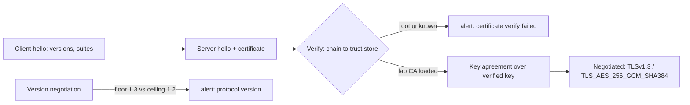

# TLS and Certificates

> Every transcript in this lesson was executed on the authoring machine (Windows 11,
> Python 3.13.5 with OpenSSL 3.0.16, `openssl` CLI 3.5.9) in the batch-17 `seclab-C`
> scratch lab. The lab CA and server certificate were generated by the probe itself;
> public-CA issuance, ACME/Let's Encrypt renewal, HSTS, and browser certificate
> warnings were not run and are marked *labelled reference*.

## 1. Learning Objectives

After this lesson you will be able to:

- [ ] Explain what TLS's three guarantees — confidentiality, integrity, authentication — each prevent, and why encryption alone is not enough
- [ ] Demonstrate certificate verification failing against an unknown CA and succeeding once that CA is explicitly trusted, with the same server in both cases
- [ ] Read an X.509 certificate with `openssl x509`: subject, issuer, validity window, and SAN entries — and say which field hostname verification actually uses
- [ ] Configure a protocol version floor and interpret the handshake alert a mismatched peer produces
- [ ] Choose the right trust configuration for each context (public PKI, private lab CA, pinned internal service) and name what each choice gives up

## 2. Prerequisites

- [06-INTERNET-AND-WEB-FOUNDATIONS](../06-INTERNET-AND-WEB-FOUNDATIONS/README.md) — HTTP, DNS, and the web's security model this lesson secures in transit
- [Security Fundamentals](security-fundamentals.md) — authenticity and the "verify, don't hope" habit the probe follows
- [11-BACKEND-ENGINEERING](../11-BACKEND-ENGINEERING/README.md) — the servers and API clients whose connections this lesson configures

*No code prerequisite beyond reading Python — the probe is printed in full and uses the standard library plus the `openssl` CLI.*

## 3. Introduction

TLS is how two parties who have never met agree that they are talking to each other and
nobody else. The **encryption** is the part everyone knows; the part that fails in
practice is **authentication** — proving the endpoint is who it claims to be. That proof
is a **certificate**: a public statement, signed by a **certificate authority** (CA),
binding a name to a public key. This lesson generates its own lab CA and a server
certificate with `openssl`, then runs the same connection twice: once with the default
trust store (which has never heard of the lab CA — verification fails), once with the lab
CA explicitly loaded (handshake succeeds at TLS 1.3). Then it dissects the certificate
field by field and forces a protocol-version mismatch to watch negotiation refuse the
connection.

## 4. The Problem It Solves

Before certificates, secure channels needed pre-shared knowledge — and there was no way
to scale it:

- **Encryption without authentication is a gift to interception.** An attacker who can sit in the path can present *their own* perfectly valid TLS handshake: the channel is encrypted — to the wrong peer. Every guarantee collapses without authentication.
- **"It's a self-signed cert, click continue."** When every cert looked alike, users were trained to dismiss the one warning that mattered; certificate warnings train humans to say yes, which is why phase 1's failure must be *automatic*, not a dialog (*browser warning behavior — labelled reference*).
- **Trust had to come from somewhere.** The PKI model solves distribution: your device ships with a trust store of root CAs, and any certificate chaining to one is accepted without prior knowledge of that specific server.
- **Old protocol versions keep old attacks.** SSL 3.0, TLS 1.0/1.1 carry downgrade and padding-oracle history; a modern endpoint must *refuse* them, not merely prefer otherwise — phase 4 is that refusal, made visible as a handshake alert.

The probe's two-error arc — `unable to get local issuer certificate`, then a clean
TLS 1.3 session — is the entire trust model in two lines.

## 5. Core Concepts

### The three guarantees

- **Confidentiality** — only the endpoints hold the keys; eavesdroppers get ciphertext.
- **Integrity** — every record is authenticated; tampering breaks the MAC and the connection dies.
- **Authentication** — the server (and optionally the client) proves its identity via a certificate. Without this, the first two protect the wrong conversation.

### Certificates and the chain of trust

An **X.509 certificate** contains: **subject** (whose key it is), **issuer** (who signed
it), **validity window** (`notBefore`/`notAfter`), **SAN** entries (which hostnames/IPs
it covers), and extensions like **basicConstraints** (may this cert sign others? is it a
CA?) and **keyUsage**. Verification walks *issuer → subject* up to a root in your
**trust store**. The lab's chain is minimal — `CN=Lab Root CA` signs `CN=localhost`
directly (phase 3 shows both halves) — but real chains add intermediates; the signature
checks are the same.

### Hostname verification uses SAN

Modern verification checks the requested hostname against the certificate's **Subject
Alternative Name** list, not the legacy Common Name. The lab cert carries
`DNS:localhost, IP Address:127.0.0.1` because the client connects to `localhost` — miss
the SAN, and `wrap_socket` fails *even with a chain that verifies*. Python's
`create_default_context()` turns on both `CERT_REQUIRED` and hostname checking; the
probe disables hostname checking only in phase 1's no-CA case so the failure shown is
the *trust* failure, not the name mismatch.

### Protocol versions and the floor

**TLS 1.3** and **TLS 1.2** are the versions you support; everything older is refused.
Each side advertises what it speaks; negotiation picks the mutual best. A **minimum
version** on one side and a lower **maximum** on the other means *no* overlap — phase 4
capped the server at TLS 1.2 and required 1.3 on the client, producing
`tlsv1 alert protocol_version`: negotiation doing its job. The negotiated **cipher
suite** (phase 2: `TLS_AES_256_GCM_SHA384`) is the authenticated-encryption algorithm
both sides just agreed on.

### Trust configuration has exactly three shapes

1. **Public PKI** — trust the system store (the default; works for public sites).
2. **Private CA** — add your org's root to the client (`load_verify_locations(ca.crt)`, phase 2), ideally pushed by device management.
3. **Pinning** — trust one specific certificate or key for one endpoint (mobile apps, mesh services), which resists compromised public CAs but breaks on rotation unless you ship the backup too.

## 6. How It Works



The two failure paths in the diagram are both *refusals to proceed* — one because the
peer's identity can't be proven, one because no mutually acceptable version exists.
Neither is a warning; both abort the handshake before any application byte moves.

## 7. Practical Examples

**Example 1 — the full probe: generate a PKI, fail trust, pass trust, inspect, downgrade**

```python
# SEC-14 TLS probe: generate a lab CA + server cert with openssl, then demonstrate
# default-trust failure, pinned-CA success, certificate inspection, and a protocol
# version floor. Standard library + openssl CLI. Run: python tls_probe.py
import ssl
import socket
import subprocess
import threading
import time
from http.server import BaseHTTPRequestHandler, HTTPServer

PORT, PORT_LOW = 8443, 8444


def run(*args):
    subprocess.run(args, check=True, capture_output=True)


# --- lab PKI: a root CA and a server certificate signed by it -----------------
run("openssl", "req", "-x509", "-newkey", "rsa:2048", "-keyout", "ca.key",
    "-out", "ca.crt", "-days", "365", "-nodes", "-subj", "/CN=Lab Root CA",
    "-addext", "basicConstraints=critical,CA:TRUE",
    "-addext", "keyUsage=critical,keyCertSign,cRLSign")
with open("san.cnf", "w", encoding="utf-8") as f:
    f.write("subjectAltName=DNS:localhost,IP:127.0.0.1\n")
run("openssl", "req", "-newkey", "rsa:2048", "-keyout", "server.key",
    "-out", "server.csr", "-nodes", "-subj", "/CN=localhost")
run("openssl", "x509", "-req", "-in", "server.csr", "-CA", "ca.crt",
    "-CAkey", "ca.key", "-CAcreateserial", "-out", "server.crt",
    "-days", "825", "-extfile", "san.cnf")


class Handler(BaseHTTPRequestHandler):
    def log_message(self, *a):
        pass

    def do_GET(self):
        body = b"hello over TLS"
        self.send_response(200)
        self.send_header("Content-Length", str(len(body)))
        self.end_headers()
        self.wfile.write(body)


def start_server(port, maximum=None):
    httpd = HTTPServer(("127.0.0.1", port), Handler)
    ctx = ssl.SSLContext(ssl.PROTOCOL_TLS_SERVER)
    ctx.load_cert_chain("server.crt", "server.key")
    if maximum:
        ctx.maximum_version = maximum
    httpd.socket = ctx.wrap_socket(httpd.socket, server_side=True)
    threading.Thread(target=httpd.serve_forever, daemon=True).start()
    return httpd


start_server(PORT)
start_server(PORT_LOW, maximum=ssl.TLSVersion.TLSv1_2)
time.sleep(0.2)


def handshake(port, cafile=None, minimum=None):
    ctx = ssl.create_default_context()
    if cafile:
        ctx.load_verify_locations(cafile)
    else:
        ctx.check_hostname = False
        ctx.verify_mode = ssl.CERT_REQUIRED   # default store only: our CA is not in it
    if minimum:
        ctx.minimum_version = minimum
    with socket.create_connection(("127.0.0.1", port), timeout=5) as sock:
        with ctx.wrap_socket(sock, server_hostname="localhost") as tls:
            # capture session facts immediately, before any application I/O
            facts = {
                "version": tls.version(),
                "cipher": tls.cipher()[0],
                "peer_subject": tls.getpeercert()["subject"],
            }
            tls.sendall(b"GET / HTTP/1.0\r\n\r\n")
            data = b""
            while b"hello over TLS" not in data:
                chunk = tls.recv(4096)
                if not chunk:
                    break
                data += chunk
            facts["response"] = data.split(b"\r\n\r\n", 1)[-1].decode()
            return facts


print("=== 1. default trust store does not know our lab CA ===")
try:
    handshake(PORT)
    print("  unexpected: handshake succeeded")
except ssl.SSLCertVerificationError as e:
    print(f"  {type(e).__name__}: {e}")

print()
print("=== 2. same server, client trusts the lab CA ===")
info = handshake(PORT, cafile="ca.crt")
print(f"  negotiated : {info['version']} / {info['cipher']}")
print(f"  peer subject: {info['peer_subject']}")
print(f"  response    : {info['response']}")

print()
print("=== 3. inspect the certificate with openssl ===")
out = subprocess.run(
    ["openssl", "x509", "-in", "server.crt", "-noout",
     "-subject", "-issuer", "-dates", "-ext", "subjectAltName"],
    capture_output=True, text=True)
print("  " + out.stdout.strip().replace("\n", "\n  "))
out = subprocess.run(["openssl", "x509", "-in", "server.crt", "-noout", "-checkend", "0"],
                     capture_output=True, text=True)
print(f"  checkend 0 : exit {out.returncode} -> {out.stdout.strip() or out.stderr.strip()}")

print()
print("=== 4. protocol floor: server capped at TLS 1.2, client demands 1.3 ===")
try:
    handshake(PORT_LOW, cafile="ca.crt", minimum=ssl.TLSVersion.TLSv1_3)
    print("  unexpected: handshake succeeded")
except ssl.SSLError as e:
    print(f"  SSLError: {e}")
```

- Phase 1 vs phase 2 differ by **one call** — `load_verify_locations("ca.crt")`. Same server, same cipher code: first refuses with `unable to get local issuer certificate`, then completes at `TLSv1.3 / TLS_AES_256_GCM_SHA384` and carries `hello over TLS` across.
- Phase 3 is the certificate read the way a reviewer does: who signed whom (`issuer=CN=Lab Root CA` → `subject=CN=localhost`), the validity window, the SAN that made hostname verification pass, and `-checkend 0` returning exit 0 (`Certificate will not expire`).
- Phase 4 removes the common ground between the versions the two sides speak; the `tlsv1 alert protocol_version` is the peer being told the proposal is unacceptable — a *clean* refusal, not a silent fallback.
- The CA's `basicConstraints`/`keyUsage` extensions are generated explicitly (OpenSSL 3 refuses to treat an extension-less self-signed cert as a signing CA).
- **Expected output:** the capture below.
- **How to run it:** `python tls_probe.py` (Windows 11, Python 3.13.5, OpenSSL 3.0.16/3.5.9).
- **Assumptions:** standard library + `openssl` CLI; ports 8443/8444 loopback; files `ca.crt`, `server.crt` written by the probe.

**Executed capture:**

```text
=== 1. default trust store does not know our lab CA ===
  SSLCertVerificationError: [SSL: CERTIFICATE_VERIFY_FAILED] certificate verify failed: unable to get local issuer certificate (_ssl.c:1028)

=== 2. same server, client trusts the lab CA ===
  negotiated : TLSv1.3 / TLS_AES_256_GCM_SHA384
  peer subject: ((('commonName', 'localhost'),),)
  response    : hello over TLS

=== 3. inspect the certificate with openssl ===
  subject=CN=localhost
  issuer=CN=Lab Root CA
  notBefore=Nov  2 20:45:15 2026 GMT
  notAfter=Feb  4 20:45:15 2029 GMT
  X509v3 Subject Alternative Name: 
      DNS:localhost, IP Address:127.0.0.1
  checkend 0 : exit 0 -> Certificate will not expire

=== 4. protocol floor: server capped at TLS 1.2, client demands 1.3 ===
  SSLError: [SSL: TLSV1_ALERT_PROTOCOL_VERSION] tlsv1 alert protocol version (_ssl.c:1028)
```

**Example 2 — the production shapes (illustration)**

```python
import ssl

# --- client (requests to public APIs, internal services) ---------------------
ctx = ssl.create_default_context()          # CERT_REQUIRED + hostname check, by default
ctx.minimum_version = ssl.TLSVersion.TLSv1_2   # explicit floor; 1.3-only if all peers allow
# NEVER ship:  ctx.check_hostname = False / ctx.verify_mode = ssl.CERT_NONE
# Private service mesh CA:  ctx.load_verify_locations("/etc/cluster/ca.pem")

# --- server ------------------------------------------------------------------
srv = ssl.SSLContext(ssl.PROTOCOL_TLS_SERVER)
srv.minimum_version = ssl.TLSVersion.TLSv1_2
srv.load_cert_chain("fullchain.pem", "privkey.pem")   # leaf + intermediates, leaf first
# expiry: alert well before notAfter — openssl x509 -in fullchain.pem -checkend 2592000

# --- issuance (both were run as CLI calls by the probe's phase 3) ------------
# Public CA:    ACME/Let's Encrypt + auto-renew (certbot/acme.sh) — labelled reference
# Private CA:   openssl req/x509 exactly as in Example 1, distributed via your trust store
```

- **Expected output:** no output — the configuration the probe's phases imply; phases 1–4 executed each line's behavior directly.
- **Assumptions:** illustration; no public CA or renewal daemon was contacted.

## 8. Real-World Applications

- **Every HTTPS endpoint**: public sites terminate TLS at the load balancer or edge with ACME-issued certificates and automated renewal; expiry monitoring watches the chain even when automation is assumed to work.
- **Internal service traffic** uses a private CA (Kubernetes service-mesh style): phase 2's `load_verify_locations` is exactly how each side trusts it — pushed as a managed trust root, never pasted into `verify=False`.
- **API clients** enforce the floor and hostname rules in Example 2; SDK defaults do the right thing only if nobody has "fixed" the warnings by disabling verification.
- **Mobile apps** additionally pin the server certificate or public key — stronger against a compromised public CA, costlier on every rotation (trade-off noted in section 11).
- Paired with: [dependency-security.md](dependency-security.md) for the channel your installs ride, and [session-security.md](session-security.md)'s `Secure` cookie flag, which depends on this channel being real.

## 9. Common Mistakes

| Mistake | Why it happens | How to recognize it | How to prevent it |
|---|---|---|---|
| `verify_mode = CERT_NONE` / `check_hostname = False` | "Fixing" a local cert error | Any client accepts an impersonated server | Trust the CA properly (phase 2's one-line fix) |
| Click-through on warnings in prod | Self-signed convenience hardens into habit | Users trained to dismiss the only signal | Automate real issuance; make trust automatic |
| Certificate missing the SAN | CN-only certs from old tooling | Chain verifies, hostname fails | Generate with `-extfile san.cnf` for every name/IP |
| No expiry monitoring | ACME assumed infallible | Outage at `notAfter` | `-checkend`-style alerts 30 days out (phase 3's flag) |
| TLS 1.0/1.1 still enabled | Legacy client compatibility | Old suites negotiable | `minimum_version = TLSv1.2` both sides (phase 4) |
| CA cert without `basicConstraints`/`keyUsage` | Minimal self-signed generation | OpenSSL 3: `CA cert does not include key usage extension` | Sign with `basicConstraints=critical,CA:TRUE` + `keyCertSign` |
| Private CA installed machine-wide for one test | One-off debugging | Lab root trusted for *everything* | Scoped trust: load per-context (phase 2), never global |
| Pinning without a backup key | First cert rotated | App bricks on rotation | Pin leaf + backup, or pin the issuing CA |
| Mixing HTTP and HTTPS assets | Migration incomplete | Credentials crossed in cleartext first | HSTS after the site is fully HTTPS (*labelled reference*) |

## 10. Best Practices

- **Keep default verification on.** The rule relaxes only for throwaway local experiments — and the moment a lab value ships, the exception becomes the product's trust model.
- **Set an explicit `minimum_version = TLSv1.2`** even where defaults already do; defaults are a version argument away from changing, your config is reviewable.
- **Generate certificates with SANs from the start**, covering every name clients use — `localhost`, the service DNS name, and any IP (phase 3's SAN line).
- **Automate issuance and renewal, and monitor independently** — automation and monitoring are different controls; phase 3's `checkend` is the monitor.
- **Trust private CAs per-context** (`load_verify_locations`) rather than editing the system store, so a test root can't vouch for the real internet.
- **Fail closed and loudly**: phase 1's exception *is* the feature — treat any "accept anyway" fallback in code as a finding.
- **Negotiate explicitly**: floor on both sides, and review the negotiated cipher in tests the way phase 2 prints it.

## 11. Limitations and Trade-Offs

- **This lab has a one-level chain.** Real chains carry intermediates (and sometimes cross-signs); the signature logic is identical, but chain-building quirks and `fullchain.pem` ordering are *labelled reference* — no public CA was contacted.
- **No browser was involved.** Warning UX, HSTS, certificate transparency (CT) logs, and revocation (OCSP/CRL) are standard parts of the model that this capture does not demonstrate — *labelled reference*.
- **Version floors age.** Pinning `=TLSv1.2` forever keeps TLS 1.2's larger attack surface alive once 1.3 is universal; the floor is a *policy* you revisit, not a constant.
- **Pinning trades flexibility for resistance.** It defends against a mis-issued certificate but turns every rotation into a release; most public-web deployments are better served by public PKI plus CT monitoring.
- **`-checkend 0` proves only the moment it ran.** Expiry needs scheduled checks, not one-shot ones; and a certificate can be revoked long before `notAfter` — revocation machinery was not exercised here.

## 12. Practical Exercises

### Introductory

1. **Exercise 14.1** — Run the probe and explain phase 1's failure in terms of the trust store: which store was consulted, why the lab CA isn't in it, and what single change phase 2 makes. **Completion criteria:** a paragraph naming the store, the missing chain link, and `load_verify_locations` as the fix.
2. **Exercise 14.2** — Re-issue the server certificate *without* `san.cnf` and show phase 2's hostname check failing while phase 1's failure stays the trust failure. **Completion criteria:** two captures distinguishing "chain unknown" from "name not covered".

### Intermediate

3. **Exercise 14.3** — Add a second server certificate for `IP:127.0.0.1` only, connect with `server_hostname="localhost"`, and capture the verification error; then connect by IP with `check_hostname` adapted. **Completion criteria:** one failing capture and one successful handshake showing the SAN's role.
4. **Exercise 14.4** — Invert phase 4: server *requires* TLS 1.3 (`minimum_version`), client capped at 1.2 (`maximum_version`), and capture the refusal from the other side. **Completion criteria:** a capture where the same alert class appears with the roles swapped.

### Independent problem-solving

5. **Exercise 14.5** — An internal tool uses a self-signed certificate and its team wants `verify=False` in three clients. Write the migration plan to a private CA. **Completion criteria:** an ordered plan covering CA generation with proper extensions (phase 3's form), SAN-carrying leaf issuance, per-client trust distribution (phase 2's mechanism), expiry monitoring (`checkend`), and a sentence on what each remaining `verify=False` costs — with no step requiring a global trust-store edit.

*Solutions: attempt first. They live in `solutions/` of this subject.*

## 13. Knowledge Check

1. Phases 1 and 2 hit the same server; only the trust configuration differs. What precisely does `load_verify_locations` change about the verification decision, and what does it *not* change?
2. Phase 3 prints both `issuer` and the SAN list. Which one does hostname verification consult, and why did the legacy Common Name fall out of favor?
3. Phase 4's alert arrives instead of a connection. What would a silent downgrade to an older version mean for an attacker, and which control in this lesson prevents it?
4. When is certificate pinning the right choice over public PKI — and what operational cost does it add?

## 14. Completion Criteria

Observable evidence that you have understood this lesson:

- [ ] You can explain TLS as three separate guarantees and say which one certificates provide
- [ ] You can reproduce phases 1–4 from a blank editor and interpret every error string
- [ ] You can read any certificate with `openssl x509` and identify subject, issuer, dates, and SAN
- [ ] You can configure the three trust shapes (public, private CA, pinned) and justify each
- [ ] You can diagnose the nine mistakes in section 9 in a TLS configuration review

## 15. Summary

- TLS provides confidentiality, integrity, *and* authentication — without certificates, you may be perfectly encrypted to an attacker.
- Trust is a chain to a root your client already knows: phase 1 fails for want of one link, phase 2 loads that root and passes at TLS 1.3.
- The certificate says who, by whom, until when, and for which names — SAN is the one hostname verification reads.
- Version negotiation must have common ground: phase 4's protocol-version alert is the floor and ceiling refusing to overlap.
- Disable nothing. Every bypass (`CERT_NONE`, click-through, CN-only) removes exactly the guarantee the others can't recover.

## 16. Next Steps

- Next lesson: [Secure File Uploads](secure-file-uploads.md) — verifying what arrives *over* a trusted connection, before you store and serve it
- Practice: the subject's exercise set (written with its exercise installment)
- Where it is applied: [Project 07](../20-PROJECT-LABORATORY/project-07-secure-production-application/README.md)'s
  security checklist, and the safe-use rules in [SECURITY.md](../SECURITY.md)