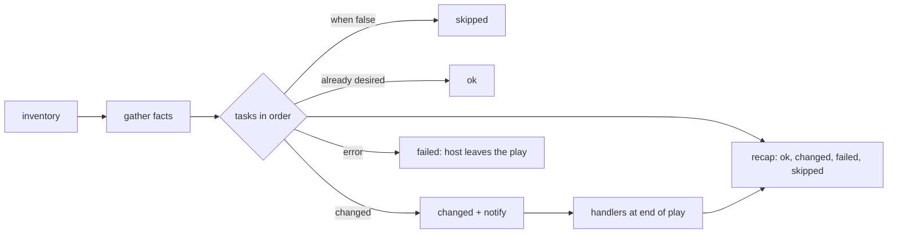

# Ansible

> Executed on the authoring machine (Windows 11, Python 3.13.5) by the batch-18 `ops-lab-B`
> `ansible_probe.py`. The probe implements a play runner — inventory, facts, modules, `when`,
> loops, `run_once`, handlers, `--check`, `ignore_errors` and the recap — and drives it against a
> real multi-host filesystem. **Ansible is not installed on this host**, so `ansible-playbook`
> syntax, module names beyond the four modelled, roles and collections are *labelled reference*;
> every counter below comes from the probe.

## 1. Learning Objectives

After this lesson you will be able to:

- [ ] Explain why a task reports `ok` on the second run and `changed` on the first
- [ ] Write a play with a handler and explain when it runs and why it runs once
- [ ] Use `when` with a fact to target a subset of hosts
- [ ] Read a recap (`ok`, `changed`, `failed`, `skipped`) and say what it proves
- [ ] Use `--check` to preview changes and explain what it cannot predict
- [ ] Explain what a failed task does to the rest of the play, and what `ignore_errors` changes

## 2. Prerequisites

- [Infrastructure as Code](infrastructure-as-code.md) — declarative desired state and why idempotence matters
- [Shell Scripting](shell-scripting.md) — the imperative alternative, and the exit-code discipline Ansible modules encode
- [Linux Administration](linux-administration.md) — services, file modes and directories the tasks manage
- [Networking for DevOps](networking-for-devops.md) — SSH and inventory as a connectivity problem

## 3. Introduction

Terraform creates machines; Ansible configures them. It connects over SSH (or locally), runs
**modules** that each know how to reach one desired state — a file exists, a service is running,
a line is present — and reports whether it had to change anything. The unit of work is a
**task**, tasks are grouped into a **play**, and plays are grouped into a **playbook**.

The one idea to internalise is this: a well-written task asks "is it already like this?" before
doing anything. That is why the second run of a correct playbook prints `changed=0`, and why that
number, not the exit code, is the real test of a playbook.

## 4. The Problem It Solves

- **Scripts cannot be re-run.** A shell script that appends a line appends it again. The probe's
  `lineinfile` task reports `ok` on the second run because the line is already there — and after
  the file is changed by hand, `changed | ensure the workers line: appended line`.
- **Restarts happen too often or not at all.** Two tasks notify the same handler; the probe runs
  it once, printing `restart app (4 notification(s), deduplicated to one run per host)`.
- **The same play must fit different hosts.** One host is Debian and one is Red Hat; `when:
  ansible_os_family == 'Debian'` runs the nginx task on one and reports `SKIPPED` on the other.
- **"What will this change?" is unanswerable.** `--check` reports the two tasks that would change
  and leaves the file byte-identical (`file unchanged by check mode: True`).
- **One broken task hides the rest.** Without `ignore_errors`, the failing module stops the play:
  `failed=1`, and nothing after it ran. With `ignore_errors`, both hosts report `FAILED` and the
  play continues — and the failure is still counted (`failed=2`).
- **A task that must happen once runs everywhere.** `run_once: True` writes the canary to `web1`
  only, which the final directory listing confirms.

## 5. Core Concepts

### Inventory, facts and plays

The **inventory** lists hosts and groups. **Facts** are variables gathered from a host — OS
family, IP addresses, memory — and are what `when` conditions usually test. A **play** binds an
inventory group to an ordered list of tasks; a **playbook** is one or more plays.

### Modules and idempotence

A **module** is a unit of desired state (`file`, `copy`, `lineinfile`, `service`, `package`). A
module returns `changed` only if it altered something, `ok` if the system already matched, and
`failed` if it could not. **Idempotence** is the property that a second run reports `changed=0`;
it lives in the modules, so a playbook built from modules inherits it and a playbook built from
`shell:` usually does not.

### Handlers

A **handler** is a task that runs only when notified, and only once per host per play, no matter
how many tasks notified it. It is how "restart the service" is attached to "the config changed"
without restarting on every run.

### Conditionals and loops

`when` takes an expression evaluated per host against facts and variables; a false result is
`skipped`, not `failed`. `loop` runs one task once per item, and each item is reported
separately, which is why the probe prints two lines for the two data directories.

### Check mode and error handling

`--check` runs the same modules in prediction mode: they report what they would change and do not
write. `ignore_errors: true` lets the play continue after a failure while still recording it;
`any_errors_fatal` and `max_fail_percentage` tighten the opposite way.

## 6. How It Works



For each host, the runner evaluates tasks in order. A task's module compares the host's current
state with the requested state and acts only on the difference. Notifications accumulate per host
and run at the end of the play, deduplicated by handler name. A failure removes that host from the
remaining tasks; handlers already notified still run only with `force_handlers`. The recap
aggregates per-task results, and it is the artifact to read in CI.

## 7. Practical Examples

**Example 1 — the executed probe**

The probe runs the same play eight times under different conditions: first run, second run,
drift, check mode, a failing module, the same failure with `ignore_errors`, and a final listing
of what each host actually has on disk.

```python
"""Ansible-semantics lab: idempotent tasks, handlers, check mode, conditions, recap.

Windows 11, Python 3.13.5.  Ansible is not installed, so this probe is not Ansible: it is
the execution model a playbook depends on, over a directory tree per "host".  Tasks are
real file operations, `changed` is computed by comparing before and after, handlers fire
once, check mode reports without writing, and the recap counts are the ones operators read.
"""
from __future__ import annotations

import shutil
from pathlib import Path

LAB = Path(__file__).with_name("ansible-lab")
HOSTS = ["web1", "web2"]
FACTS = {"web1": {"ansible_os_family": "Debian"}, "web2": {"ansible_os_family": "RedHat"}}
TASKS = [
    {"name": "create app directory", "module": "file", "args": {"path": "/srv/app", "state": "directory"}, "tags": ["base"]},
    {"name": "create two data directories", "module": "file", "args": {"path": "{{ item }}", "state": "directory"},
     "loop": ["/srv/app/cache", "/srv/app/logs"]},
    {"name": "write the config", "module": "copy",
     "args": {"dest": "/srv/app/config.ini", "content": "[app]\nworkers={{ workers }}\nlog_level=info\n"}, "notify": "restart app"},
    {"name": "ensure the workers line", "module": "lineinfile",
     "args": {"path": "/srv/app/config.ini", "line": "log_level=info"}},
    {"name": "start the service", "module": "service", "args": {"name": "app", "state": "started"}, "notify": "restart app"},
    {"name": "install nginx only on Debian", "module": "file", "args": {"path": "/srv/app/nginx.conf", "state": "directory"},
     "when": "ansible_os_family == 'Debian'"},
    {"name": "run once for the whole play", "module": "copy",
     "args": {"dest": "/srv/app/canary", "content": "one\n"}, "run_once": True},
    {"name": "this module does not exist", "module": "kubernetes", "args": {}, "broken": True},
]
HANDLERS = {"restart app": {"module": "service", "args": {"name": "app", "state": "restarted"}}}
VARS = {"workers": 4}
RECAP = {"ok": 0, "changed": 0, "failed": 0, "skipped": 0}


def host_root(host: str) -> Path:
    return LAB / "hosts" / host


def resolve(host: str, template: str) -> str:
    rendered = template
    for key, value in {**VARS, **FACTS[host]}.items():
        rendered = rendered.replace("{{ " + key + " }}", str(value))
    return rendered


def container(host: str, path: str) -> Path:
    return host_root(host) / path.lstrip("/")


def file_module(host: str, args: dict, check: bool) -> str | None:
    target = container(host, resolve(host, args["path"]))
    if args["state"] == "directory":
        if target.is_dir():
            return None
        if not check:
            target.mkdir(parents=True, exist_ok=True)
        return "created directory"
    return None


def copy_module(host: str, args: dict, check: bool) -> str | None:
    target = container(host, resolve(host, args["dest"]))
    content = resolve(host, args["content"])
    if target.exists() and target.read_text(encoding="utf-8") == content:
        return None
    if not check:
        target.parent.mkdir(parents=True, exist_ok=True)
        target.write_text(content, encoding="utf-8")
    return "updated file"


def lineinfile_module(host: str, args: dict, check: bool) -> str | None:
    target = container(host, args["path"])
    line = args["line"]
    if not target.exists():
        raise FileNotFoundError(f"{args['path']} does not exist")
    text = target.read_text(encoding="utf-8")
    if line in text.splitlines():
        return None
    if not check:
        target.write_text(text + line + "\n", encoding="utf-8")
    return "appended line"


def service_module(host: str, args: dict, check: bool) -> str | None:
    state_file = host_root(host) / ".services" / f"{args['name']}.state"
    wanted = "running" if args["state"] in ("started", "restarted") else "stopped"
    current = state_file.read_text(encoding="utf-8").strip() if state_file.exists() else "stopped"
    if current == wanted and args["state"] != "restarted":
        return None
    if not check:
        state_file.parent.mkdir(parents=True, exist_ok=True)
        state_file.write_text(wanted + "\n", encoding="utf-8")
    return f"service {args['state']}"


MODULES = {"file": file_module, "copy": copy_module, "lineinfile": lineinfile_module, "service": service_module}


def condition(host: str, expression: str) -> bool:
    left, _, right = expression.partition("==")
    return str(FACTS[host].get(left.strip(), "")) == right.strip().strip("'\"")


def run_play(check: bool = False, tolerate_failures: bool = False, broken: bool = False) -> dict:
    stats = {"ok": 0, "changed": 0, "failed": 0, "skipped": 0}
    notified: list[str] = []
    run_once_done = False
    for task in TASKS:
        for host in HOSTS:
            if task.get("broken") and not broken:
                continue
            if task.get("run_once") and run_once_done:
                stats["skipped"] += 1
                continue
            if "when" in task and not condition(host, task["when"]):
                stats["skipped"] += 1
                print(f"  {host} | SKIPPED | {task['name']}")
                continue
            items = task.get("loop", [None])
            for item in items:
                label = task["name"] + (f" (item={item})" if item else "")
                try:
                    if task["module"] not in MODULES:
                        raise LookupError(f"module {task['module']} not found")
                    args = {k: (v.replace("{{ item }}", item) if isinstance(v, str) and item else v)
                            for k, v in task["args"].items()}
                    if item:
                        args = {k: (v.replace("{{ item }}", item) if isinstance(v, str) else v) for k, v in args.items()}
                    result = MODULES[task["module"]](host, args, check)
                except Exception as exc:  # noqa: BLE001 - reported, not swallowed
                    stats["failed"] += 1
                    print(f"  {host} | FAILED  | {label}: {type(exc).__name__}: {exc}")
                    if not tolerate_failures:
                        return stats
                    continue
                if result is None:
                    stats["ok"] += 1
                    print(f"  {host} | ok      | {label}")
                else:
                    stats["changed"] += 1
                    print(f"  {host} | changed | {label}: {result}")
                    if "notify" in task:
                        notified.append(task["notify"])
            if task.get("run_once"):
                run_once_done = True
    for name in dict.fromkeys(notified):
        if check:
            print(f"  would run handler {name} (check mode, nothing changed)")
            continue
        stats["changed"] += 1
        n = notified.count(name)
        print(f"  {HOSTS[0]} | RUNNING HANDLER | {name} ({n} notification(s), deduplicated to one run per host)")
    return stats


def recap(stats: dict, label: str) -> None:
    print(f"  {label}: ok={stats['ok']} changed={stats['changed']} failed={stats['failed']} skipped={stats['skipped']}")


def main() -> None:
    if LAB.exists():
        shutil.rmtree(LAB)
    for host in HOSTS:
        host_root(host).mkdir(parents=True)
    print("ansible-lab (Windows 11, Python 3.13.5, ansible not installed)")
    print(f"  hosts: {HOSTS}  facts: {FACTS}")

    print("\n=== 1. first run: everything is new, so everything changes ===")
    first = run_play()
    recap(first, "first run")

    print("\n=== 2. second run: the same playbook changes nothing ===")
    second = run_play()
    recap(second, "second run")
    print("  idempotence is the whole contract: a task reports changed only when it changed something")

    print("\n=== 3. the service was started, then a handler restarted it once ===")
    print("  two tasks notified 'restart app'; deduplicated by name, it ran once at the end of the play")

    print("\n=== 4. drift is detected because the check is the file, not a flag ===")
    target = container("web1", "/srv/app/config.ini")
    target.write_text("[app]\nworkers=99\n", encoding="utf-8")
    third = run_play()
    recap(third, "third run")

    print("\n=== 5. check mode reports what would change and writes nothing ===")
    target.write_text("[app]\nworkers=99\n", encoding="utf-8")
    before = target.read_bytes()
    check = run_play(check=True)
    recap(check, "check mode")
    print(f"  file unchanged by check mode: {target.read_bytes() == before}")

    print("\n=== 6. a failing task stops the play, and the recap says so ===")
    failed = run_play(broken=True)
    recap(failed, "with a broken module")
    print("  without ignore_errors the remaining tasks never ran; the recap is the operator's summary")

    print("\n=== 7. ignore_errors continues and still reports the failure ===")
    tolerant = run_play(tolerate_failures=True, broken=True)
    recap(tolerant, "tolerating failures")
    print(f"  failed count is still reported: {tolerant['failed'] > 0}")

    print("\n=== 8. what the run left behind on disk ===")
    for host in HOSTS:
        files = sorted(p.relative_to(host_root(host)).as_posix() for p in host_root(host).rglob("*") if p.is_file())
        print(f"  {host}: {files}")
    print("\nexit=0")


if __name__ == "__main__":
    main()
```

**Expected output:**

```text
ansible-lab (Windows 11, Python 3.13.5, ansible not installed)
  hosts: ['web1', 'web2']  facts: {'web1': {'ansible_os_family': 'Debian'}, 'web2': {'ansible_os_family': 'RedHat'}}

=== 1. first run: everything is new, so everything changes ===
  web1 | changed | create app directory: created directory
  web2 | changed | create app directory: created directory
  web1 | changed | create two data directories (item=/srv/app/cache): created directory
  web1 | changed | create two data directories (item=/srv/app/logs): created directory
  web2 | changed | create two data directories (item=/srv/app/cache): created directory
  web2 | changed | create two data directories (item=/srv/app/logs): created directory
  web1 | changed | write the config: updated file
  web2 | changed | write the config: updated file
  web1 | ok      | ensure the workers line
  web2 | ok      | ensure the workers line
  web1 | changed | start the service: service started
  web2 | changed | start the service: service started
  web1 | changed | install nginx only on Debian: created directory
  web2 | SKIPPED | install nginx only on Debian
  web1 | changed | run once for the whole play: updated file
  web1 | RUNNING HANDLER | restart app (4 notification(s), deduplicated to one run per host)
  first run: ok=2 changed=13 failed=0 skipped=2

=== 2. second run: the same playbook changes nothing ===
  web1 | ok      | create app directory
  web2 | ok      | create app directory
  web1 | ok      | create two data directories (item=/srv/app/cache)
  web1 | ok      | create two data directories (item=/srv/app/logs)
  web2 | ok      | create two data directories (item=/srv/app/cache)
  web2 | ok      | create two data directories (item=/srv/app/logs)
  web1 | ok      | write the config
  web2 | ok      | write the config
  web1 | ok      | ensure the workers line
  web2 | ok      | ensure the workers line
  web1 | ok      | start the service
  web2 | ok      | start the service
  web1 | ok      | install nginx only on Debian
  web2 | SKIPPED | install nginx only on Debian
  web1 | ok      | run once for the whole play
  second run: ok=14 changed=0 failed=0 skipped=2
  idempotence is the whole contract: a task reports changed only when it changed something

=== 3. the service was started, then a handler restarted it once ===
  two tasks notified 'restart app'; deduplicated by name, it ran once at the end of the play

=== 4. drift is detected because the check is the file, not a flag ===
  web1 | ok      | create app directory
  web2 | ok      | create app directory
  web1 | ok      | create two data directories (item=/srv/app/cache)
  web1 | ok      | create two data directories (item=/srv/app/logs)
  web2 | ok      | create two data directories (item=/srv/app/cache)
  web2 | ok      | create two data directories (item=/srv/app/logs)
  web1 | changed | write the config: updated file
  web2 | ok      | write the config
  web1 | ok      | ensure the workers line
  web2 | ok      | ensure the workers line
  web1 | ok      | start the service
  web2 | ok      | start the service
  web1 | ok      | install nginx only on Debian
  web2 | SKIPPED | install nginx only on Debian
  web1 | ok      | run once for the whole play
  web1 | RUNNING HANDLER | restart app (1 notification(s), deduplicated to one run per host)
  third run: ok=13 changed=2 failed=0 skipped=2

=== 5. check mode reports what would change and writes nothing ===
  web1 | ok      | create app directory
  web2 | ok      | create app directory
  web1 | ok      | create two data directories (item=/srv/app/cache)
  web1 | ok      | create two data directories (item=/srv/app/logs)
  web2 | ok      | create two data directories (item=/srv/app/cache)
  web2 | ok      | create two data directories (item=/srv/app/logs)
  web1 | changed | write the config: updated file
  web2 | ok      | write the config
  web1 | changed | ensure the workers line: appended line
  web2 | ok      | ensure the workers line
  web1 | ok      | start the service
  web2 | ok      | start the service
  web1 | ok      | install nginx only on Debian
  web2 | SKIPPED | install nginx only on Debian
  web1 | ok      | run once for the whole play
  would run handler restart app (check mode, nothing changed)
  check mode: ok=12 changed=2 failed=0 skipped=2
  file unchanged by check mode: True

=== 6. a failing task stops the play, and the recap says so ===
  web1 | ok      | create app directory
  web2 | ok      | create app directory
  web1 | ok      | create two data directories (item=/srv/app/cache)
  web1 | ok      | create two data directories (item=/srv/app/logs)
  web2 | ok      | create two data directories (item=/srv/app/cache)
  web2 | ok      | create two data directories (item=/srv/app/logs)
  web1 | changed | write the config: updated file
  web2 | ok      | write the config
  web1 | ok      | ensure the workers line
  web2 | ok      | ensure the workers line
  web1 | ok      | start the service
  web2 | ok      | start the service
  web1 | ok      | install nginx only on Debian
  web2 | SKIPPED | install nginx only on Debian
  web1 | ok      | run once for the whole play
  web1 | FAILED  | this module does not exist: LookupError: module kubernetes not found
  with a broken module: ok=13 changed=1 failed=1 skipped=2
  without ignore_errors the remaining tasks never ran; the recap is the operator's summary

=== 7. ignore_errors continues and still reports the failure ===
  web1 | ok      | create app directory
  web2 | ok      | create app directory
  web1 | ok      | create two data directories (item=/srv/app/cache)
  web1 | ok      | create two data directories (item=/srv/app/logs)
  web2 | ok      | create two data directories (item=/srv/app/cache)
  web2 | ok      | create two data directories (item=/srv/app/logs)
  web1 | ok      | write the config
  web2 | ok      | write the config
  web1 | ok      | ensure the workers line
  web2 | ok      | ensure the workers line
  web1 | ok      | start the service
  web2 | ok      | start the service
  web1 | ok      | install nginx only on Debian
  web2 | SKIPPED | install nginx only on Debian
  web1 | ok      | run once for the whole play
  web1 | FAILED  | this module does not exist: LookupError: module kubernetes not found
  web2 | FAILED  | this module does not exist: LookupError: module kubernetes not found
  tolerating failures: ok=14 changed=0 failed=2 skipped=2
  failed count is still reported: True

=== 8. what the run left behind on disk ===
  web1: ['.services/app.state', 'srv/app/canary', 'srv/app/config.ini']
  web2: ['.services/app.state', 'srv/app/config.ini']

exit=0
```

**How to run it:**

```bash
cd CodePath-Masterclass/.scratch/ops-lab-B
python ansible_probe.py
```

- **Assumptions:** Python 3.13.5 on Windows 11; no Ansible installed. The probe rebuilds
  `ansible-lab/` on each run, with one directory per host.
- **What the important lines show:** `first run: ok=2 changed=13` versus `second run: ok=14
  changed=0` is idempotence; `SKIPPED | install nginx only on Debian` on `web2` is `when`; the
  `RUNNING HANDLER` line is deduplication; `third run: ok=13 changed=2` after a hand edit is drift;
  `check mode: ok=12 changed=2` with `file unchanged by check mode: True` is prediction without
  writes; `failed=1` shows the play stopping; `failed=2` with `ignore_errors` shows continuation;
  and the final listing shows `.services/app.state` per host and `srv/app/canary` only on `web1`.

**Example 2 — the same play in real YAML** *(labelled reference — not executed)*

```yaml
- name: configure the app hosts
  hosts: web
  become: true
  tasks:
    - name: create the app directory
      ansible.builtin.file:
        path: /srv/app
        state: directory
        mode: "0755"

    - name: write the config
      ansible.builtin.copy:
        dest: /srv/app/config.ini
        content: |
          [app]
          workers={{ workers }}
          log_level=info
      notify: restart app

    - name: start the service
      ansible.builtin.service:
        name: app
        state: started
  handlers:
    - name: restart app
      ansible.builtin.service:
        name: app
        state: restarted
```

The `notify` on the copy task is what makes the restart conditional; the handler is the probe's
deduplicated `restart app`.

## 8. Real-World Applications

- **Bootstrapping a fleet** — users, SSH keys, packages, timezone and monitoring agents on every
  new instance, from the same play, whether there are three hosts or three hundred.
- **Application deployment** — releasing a build, templating configuration, running migrations and
  restarting services, with `--check` as a pre-flight in the pipeline.
- **Network devices** — the same model against switches and firewalls through vendor collections.
- **Compliance remediation** — a play that asserts a baseline (file modes, services disabled,
  kernel parameters) and is run as both audit and fix.
- **Incident runbooks** — a small playbook is easier to review and safer to run at 3 a.m. than a
  wiki page of shell commands.

## 9. Common Mistakes

| Mistake | Why it happens | How to recognize it | How to prevent it |
|---|---|---|---|
| Using `shell:` for everything | It is the shortest path from a script | `changed` on every run; the recap never reaches `changed=0` | Use a module; add `creates:`/`changed_when:` only when no module exists |
| Running the playbook from a dirty working tree | The files are right there | Different results from two operators with the same playbook | Run from a tagged checkout; pin collections and roles |
| Expecting handlers after a failure | "It ran before the failure" | No restart line in the output, config file newer than the service start | `force_handlers: true` when a restart must still happen; fix the failing task |
| Conditional on the wrong fact | Facts vary by OS and by distribution | Task skipped on one host, run on another with the same play | Test with `ansible -m setup`; prefer `ansible_facts` keys you have inspected |
| Secrets in `vars:` files | Convenient and it works | Secret in Git history and in `-vvv` output | Vault or an external secret lookup; `no_log: true` on tasks that touch them |
| Treating `--check` as a guarantee | It reports module predictions | A module without check support reports `skipped` or the wrong change count | Know which modules support check mode; never rely on it for `command`/`shell` |

## 10. Best Practices

- **Make `changed=0` on a second run a test.** A CI job that runs the play twice and fails on a
  non-zero second recap catches non-idempotent tasks early.
- **Name every task and every play.** The recap and the failure output are the operator's interface;
  unnamed tasks make an incident harder.
- **One handler per service, notified by name.** Deduplication is a feature; duplicating handlers
  defeats it.
- **Use `--check --diff` in review, and `--limit` for canaries.** Predict the change, then apply it
  to one host before the fleet.
- **Keep secrets out of the repository.** Vault-encrypted files or a lookup from a secret manager,
  with `no_log` on the tasks that consume them.
- **Pin collections and roles in `requirements.yml`.** An unpinned role is an unversioned dependency
  in your production path.

## 11. Limitations and Trade-Offs

- **SSH and Python on every target.** Hosts without a usable Python, or with restricted shells,
  need workarounds; Windows targets need a different connection path.
- **Slow at scale.** Runs are push-based and mostly sequential per host; hundreds of hosts need
  forks tuning or a different tool.
- **No state file.** That is the strength (nothing to corrupt) and the weakness (no record of what
  was created, so removing a task does not remove its effect).
- **Check mode is only as good as the modules.** `command` and `shell` cannot predict their
  effects, so a play full of them has an unreliable dry run.
- **Ordering is your responsibility.** Tasks run in file order, not by dependency; a missing
  handler or a wrong order shows up as a service that starts before its config exists.

## 12. Practical Exercises

### Introductory

1. **Exercise 15.1** — Run the probe and compare the recap of runs one and two. Explain which
   number changed and why.
   **Completion criteria:** your notes quote `changed=13` then `changed=0`, and the explanation
   attributes it to modules comparing state, not to a flag.
2. **Exercise 15.2** — Find the host where the nginx task is skipped and state which fact caused it.
   **Completion criteria:** you name `web2`, the fact `ansible_os_family == 'RedHat'`, and the
   `SKIPPED` line.

### Intermediate

3. **Exercise 15.3** — Break idempotence deliberately: replace the `copy` task with a `shell`
   append and record the second run's recap. Then restore it and record again.
   **Completion criteria:** the broken version reports a non-zero `changed` on the second run and
   the restored version reports `changed=0`, with both captures recorded.
4. **Exercise 15.4** — Make the play fail mid-way and then make it continue with `ignore_errors`.
   Explain why the handler does not run in the failing case.
   **Completion criteria:** you record `failed=1` then `failed=2`, and your explanation mentions
   the host leaving the play before handlers.

### Independent problem-solving

5. **Exercise 15.5** — Design a rolling deployment play for a three-host web tier that keeps the
   service available: serial batching, health check, rollback step, and the ordering of config
   change, restart and verification.
   **Completion criteria:** a written play outline with `serial`, a health-check task that fails
   the batch, a rollback path, and one sentence per step explaining what happens if it fails.

*Solutions: attempt first. They live in `solutions/` of this subject.*

## 13. Knowledge Check

1. What does `changed=0` on a second run prove, and what does it not prove about the host?
2. Why can a handler notified by two tasks run only once, and when would you *not* want that?
3. When is a shell task the right choice, and what must you add to make it safe to re-run?

## 14. Completion Criteria

Observable evidence that you have understood this lesson:

- [ ] You can write a play with a task, a `when`, a loop and a handler from a blank editor
- [ ] You can read a recap and say whether the play was idempotent
- [ ] You can explain what `--check` does and one thing it cannot tell you
- [ ] You can explain what a failed task does to the rest of the play and to notified handlers
- [ ] You can state one situation where a state-based tool is a better fit than Ansible

## 15. Summary

- Ansible converges hosts toward declared state through idempotent modules; `changed=0` is the test.
- Handlers run at the end of a play, once per host, no matter how many tasks notified them.
- `when` targets hosts by fact; `run_once` and loops change how many times a task executes, not what
  it does.
- `--check` predicts module changes without writing; it is blind to `command`/`shell`.
- A failure removes the host from the play; `ignore_errors` continues while still counting the
  failure.

## 16. Next Steps

- Next lesson: [CI/CD Fundamentals](ci-cd-fundamentals.md) — turning these plays into a pipeline
  that runs on every change
- Practice: [exercise set](README.md#exercises-and-practice)
- Where it is applied: [Secure Production Application](../20-PROJECT-LABORATORY/project-07-secure-production-application/README.md)
