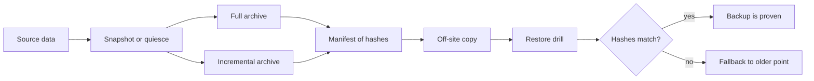

# Backups and Recovery

> Executed on the authoring machine (Windows 11, Python 3.13.5) by the batch-18 `ops-lab-B`
> `backup_probe.py`. The probe builds a real data directory, writes a full and an incremental
> `tar.gz` with SHA-256 manifests, restores them into a fresh tree, proves the result by hash,
> corrupts the newest archive to show what detection requires, measures a torn read against a live
> writer, and computes a retention saving. Borg, restic, pgBackRest, cloud snapshot services and
> object-storage lifecycle rules are not installed, so their commands are *labelled reference*;
> every number below is from the probe.

## 1. Learning Objectives

After this lesson you will be able to:

- [ ] Define RPO and RTO and derive each from a stated business requirement
- [ ] Compare full, incremental and differential backups by restore cost and storage cost
- [ ] Explain why a backup that has never been restored is a hypothesis, not a backup
- [ ] Verify a restore by content hash rather than by exit code
- [ ] Detect a corrupted or incomplete backup and choose the correct fallback
- [ ] Design a retention policy and state what it would have kept over a month

## 2. Prerequisites

- [Linux Administration](linux-administration.md) — file modes, ownership, and why a restore as the
  wrong user fails
- [Docker Compose](docker-compose.md) — volumes are the data that a container cannot recreate
- [Monitoring and Logging](monitoring-and-logging.md) — how you learn that a backup job failed
- [Shell Scripting](shell-scripting.md) — exit codes and pipelines in a backup script

## 3. Introduction

A **backup** is a copy of data kept somewhere other than where the original lives, in a form that
can be restored. A **restore** is the act of turning that copy back into working data. The second
word is the one that matters: a copy that cannot be restored is storage, not a backup.

**RPO** (recovery point objective) is the maximum amount of data loss a business will accept,
expressed as time: "we can lose at most 15 minutes of writes". **RTO** (recovery time objective) is
the maximum time a restore may take: "we must be serving again within one hour". Both are business
decisions; the backup design is the engineering answer to them.

This lesson is deliberately unglamorous. Backups are the part of operations where the failure is
silent for months and then total. The techniques here are cheap; the discipline is the hard part.

## 4. The Problem It Solves

Data loss is not only disk failure. The realistic causes are an operator running the wrong command,
a migration that drops a column, ransomware encrypting a share, a bug that writes zeros over a
table, a bad deploy that corrupts state, and a provider outage in one region. Most of these leave
the hardware perfectly healthy, which is why "the disk is fine" is not a recovery plan.

The other half of the problem is that backups fail quietly. A job that writes a truncated archive
exits 0. A job that copies a database file while it is being written produces an archive that
restores into a corrupt database. A job whose credentials expired three weeks ago may still
"complete" by writing nothing. The only reliable test is a restore whose result is compared to the
original.

## 5. Core Concepts

### Full, incremental and differential

- **Full** — every file, every time. Restore is one archive; cost is the whole data set per run.
- **Incremental** — only what changed since the last backup of any kind. Restore needs the chain:
  full, then every increment in order. A missing link breaks the chain.
- **Differential** — only what changed since the last full. Restore needs the full plus the latest
  differential; storage grows through the cycle.

The probe uses full plus incrementals because it makes the chain explicit: the restore applies two
archives in order and the second overrides files from the first.

### Consistency

A **consistent** backup is a snapshot of data at one instant. Copying a file while a writer appends
to it can capture half a record; copying a database's files without its write-ahead log can capture
a state the engine never had. The fixes are to quiesce the writer, to use the engine's own snapshot
mechanism, or to copy a filesystem snapshot that is atomic.

The probe demonstrates the failure directly: a naive copy taken while a writer is mid-record
contains a line without its closing brace, and the same copy taken after the writer finished parses
cleanly.

### Verification

A **checksum** is a hash of the content, stored with the backup. Verification recomputes it after
restore and compares. This catches truncation, bit rot, and partial uploads that a tool's exit code
does not. A manifest of per-file hashes additionally localises the damage.

### Retention

**Retention** decides which backups survive. The common shape is **GFS**: keep a number of daily,
weekly and monthly copies. Retention is not about disk space alone; it is about how far back an
investigation may need to go, and how long a corrupted backup might go unnoticed.

### The 3-2-1 rule

Three copies of the data, on two different media, with one copy off-site. The rule exists because
every single-copy strategy fails to the same event: the fire, the ransomware, the account
deletion.

### RPO and RTO in practice

- Backup frequency bounds RPO: hourly backups mean up to an hour of writes can be lost.
- Restore speed bounds RTO: it includes finding the backup, fetching it, restoring, verifying and
  switching traffic — not just the copy.
- A restore drill measures both. An untested RTO is a hope.

## 6. How It Works



The probe follows that path and adds the failure branch.

Its steps:

1. Create a known data set and hash every file.
2. Write a full archive with a manifest, then write an incremental containing only changed files.
3. Restore the full, then the incremental, and compare hashes to the source.
4. Flip one byte in the incremental and restore again, to show what fails and what does not.
5. Fall back to the full and count the data that fallback loses.
6. Measure the restore and derive the RTO floor.

## 7. Practical Examples

**Example 1 — the executed probe**

```python
"""OPS-20 probe: backups are only real once a restore has been verified.

Windows 11, Python 3.13.5. The probe builds a small data directory, takes a full and an
incremental backup as real tar.gz archives with SHA-256 manifests, runs a restore drill,
detects a corrupted archive, and demonstrates a torn read against a live writer. Restore
proof comes from hashes, not from the exit code of the backup tool. Borg, restic,
pgBackRest and cloud snapshot services are *labelled reference*.
"""

from __future__ import annotations

import gzip
import hashlib
import io
import json
import shutil
import tarfile
import threading
import time
from pathlib import Path

WORK = Path("backup-lab")
SOURCE = WORK / "source"
BACKUPS = WORK / "backups"
RESTORE = WORK / "restore"


def sha256(path: Path) -> str:
    return hashlib.sha256(path.read_bytes()).hexdigest()


def write_source() -> None:
    if WORK.exists():
        shutil.rmtree(WORK)
    SOURCE.mkdir(parents=True)
    for n in range(40):
        (SOURCE / f"rec-{n:03d}.json").write_text(
            json.dumps({"id": n, "amount": n * 10, "state": "settled"}) + "\n", encoding="utf-8"
        )
    (SOURCE / "index.bin").write_bytes(bytes(range(256)) * 8)


def make_archive(name: str, files: list[Path]) -> tuple[Path, dict[str, str], int]:
    target = BACKUPS / f"{name}.tar.gz"
    manifest: dict[str, str] = {}
    buffer = io.BytesIO()
    with tarfile.open(fileobj=buffer, mode="w") as tar:
        for path in files:
            info = tarfile.TarInfo(path.name)
            payload = path.read_bytes()
            info.size = len(payload)
            info.mtime = 0
            tar.addfile(info, io.BytesIO(payload))
            manifest[path.name] = hashlib.sha256(payload).hexdigest()
    target.write_bytes(gzip.compress(buffer.getvalue(), mtime=0))
    (BACKUPS / f"{name}.manifest.json").write_text(json.dumps(manifest, indent=1), encoding="utf-8")
    return target, manifest, len(files)


def restore_into(destination: Path, archives: list[Path]) -> int:
    if destination.exists():
        shutil.rmtree(destination)
    destination.mkdir(parents=True)
    restored = 0
    for archive in archives:
        with tarfile.open(archive, "r:gz") as tar:
            for member in tar.getmembers():
                handle = tar.extractfile(member)
                assert handle is not None
                (destination / member.name).write_bytes(handle.read())
                restored += 1
    return restored


def verify(destination: Path, manifest: dict[str, str]) -> tuple[int, list[str]]:
    mismatched = []
    for name, digest in manifest.items():
        path = destination / name
        if not path.exists() or sha256(path) != digest:
            mismatched.append(name)
    return len(manifest) - len(mismatched), mismatched


def torn_read_demo() -> tuple[bool, bool]:
    """Naive copy while a writer is mid-record, then a quiesced copy."""
    live = WORK / "live"
    live.mkdir(parents=True)
    ledger = live / "ledger.log"
    ledger.write_text("", encoding="utf-8")

    def writer() -> None:
        with ledger.open("a", encoding="utf-8") as handle:
            for record in range(5):
                handle.write(f'{{"id": {record}')
                handle.flush()
                time.sleep(0.05)
                handle.write(', "amount": 10}\n')
                handle.flush()
                time.sleep(0.05)

    thread = threading.Thread(target=writer)
    thread.start()
    time.sleep(0.02)
    naive = (live / "naive-copy.log")
    naive.write_bytes(ledger.read_bytes())
    torn = any(not line.endswith(b"}") for line in naive.read_bytes().splitlines() if line.strip())
    thread.join()

    quiesced = live / "quiesced-copy.log"
    quiesced.write_bytes(ledger.read_bytes())
    clean = all(line.endswith(b"}") for line in quiesced.read_bytes().splitlines() if line.strip())
    return torn, clean


def main() -> None:
    print("backup-lab (Windows 11, Python 3.13.5)")
    write_source()
    BACKUPS.mkdir(parents=True, exist_ok=True)

    files = sorted(SOURCE.iterdir())
    total_bytes = sum(p.stat().st_size for p in files)
    print(f"\n=== 1. the source set ===")
    print(f"  files: {len(files)}, bytes: {total_bytes}")

    started = time.perf_counter()
    full_path, full_manifest, full_count = make_archive("full-01", files)
    full_seconds = time.perf_counter() - started
    print(f"\n=== 2. full backup ===")
    print(f"  archive: {full_path.name}, files: {full_count}, took {full_seconds:.3f}s")
    print(f"  archive bytes: {full_path.stat().st_size}, manifest entries: {len(full_manifest)}")

    (SOURCE / "rec-000.json").write_text(json.dumps({"id": 0, "amount": 999, "state": "settled"}) + "\n", encoding="utf-8")
    (SOURCE / "rec-001.json").write_text(json.dumps({"id": 1, "amount": 998, "state": "void"}) + "\n", encoding="utf-8")
    (SOURCE / "rec-002.json").write_text(json.dumps({"id": 2, "amount": 997, "state": "settled"}) + "\n", encoding="utf-8")
    (SOURCE / "rec-040.json").write_text(json.dumps({"id": 40, "amount": 400, "state": "new"}) + "\n", encoding="utf-8")
    changed = ["rec-000.json", "rec-001.json", "rec-002.json", "rec-040.json"]

    inc_files = [SOURCE / name for name in changed]
    started = time.perf_counter()
    inc_path, inc_manifest, inc_count = make_archive("inc-01", inc_files)
    inc_seconds = time.perf_counter() - started
    print(f"\n=== 3. incremental backup ===")
    print(f"  changed or new: {changed}")
    print(f"  files captured: {inc_count} of {len(files)}, archive bytes: {inc_path.stat().st_size}")
    print(f"  took {inc_seconds:.3f}s versus {full_seconds:.3f}s: at this size, per-archive overhead dominates")

    print(f"\n=== 4. restore drill: full, then increments in order ===")
    started = time.perf_counter()
    restored_count = restore_into(RESTORE, [full_path, inc_path])
    restore_seconds = time.perf_counter() - started
    merged = dict(full_manifest)
    merged.update(inc_manifest)
    verified, mismatched = verify(RESTORE, merged)
    print(f"  archives applied: 2, files written: {restored_count}, took {restore_seconds:.3f}s")
    print(f"  verified {verified} of {len(merged)} files, mismatched: {mismatched}")
    print(f"  restore identical to source: {verified == len(merged)}")

    print(f"\n=== 5. a corrupted archive must fail loudly ===")
    corrupted = BACKUPS / "inc-01-corrupt.tar.gz"
    raw = bytearray(inc_path.read_bytes())
    raw[len(raw) // 2] ^= 0xFF
    corrupted.write_bytes(bytes(raw))
    try:
        restore_into(WORK / "restore-corrupt", [full_path, corrupted])
        print("  corrupt restore raised: nothing (the archive tool alone proved nothing)")
    except (tarfile.TarError, OSError, EOFError) as error:
        print(f"  corrupt restore raised: {type(error).__name__}")
    corrupt_ok, corrupt_bad = verify(WORK / "restore-corrupt", merged)
    print(f"  hash verification: {corrupt_ok} of {len(merged)} match, bad: {corrupt_bad}")

    good_files = restore_into(WORK / "restore-fallback", [full_path])
    fallback_verified, fallback_bad = verify(WORK / "restore-fallback", full_manifest)
    print(f"  fallback to the full: {fallback_verified} of {len(full_manifest)} verified")
    stale = [name for name in changed if (WORK / "restore-fallback" / name).exists()
             and sha256(WORK / "restore-fallback" / name) != sha256(SOURCE / name)]
    print(f"  data that would be lost: {len(stale)} changed file(s) since the full")

    print(f"\n=== 6. RPO and RTO are measured, not promised ===")
    print(f"  backup interval 15 min -> worst-case RPO 15 min of writes")
    print(f"  measured restore of {len(merged)} files: {restore_seconds * 1000:.0f} ms -> RTO floor")

    print(f"\n=== 7. copying a live file gives you half a record ===")
    torn, clean = torn_read_demo()
    print(f"  naive copy contained a partial record: {torn}")
    print(f"  quiesced copy parsed cleanly: {clean}")

    print(f"\n=== 8. retention: what a policy keeps, and what it costs ===")
    daily, weekly, monthly = 7, 4, 6
    simulated = 30 * 24
    keep_all = simulated
    kept = daily + weekly + monthly
    print(f"  hourly snapshots over 30 days: {simulated}")
    print(f"  GFS policy keeps {daily} daily + {weekly} weekly + {monthly} monthly = {kept}")
    print(f"  snapshots avoided: {keep_all - kept} of {keep_all} "
          f"({100.0 * (keep_all - kept) / keep_all:.1f}%)")

    print("\nexit=0")


if __name__ == "__main__":
    main()
```

**Expected output** (full capture):

```text
backup-lab (Windows 11, Python 3.13.5)

=== 1. the source set ===
  files: 41, bytes: 3907

=== 2. full backup ===
  archive: full-01.tar.gz, files: 41, took 0.147s
  archive bytes: 1101, manifest entries: 41

=== 3. incremental backup ===
  changed or new: ['rec-000.json', 'rec-001.json', 'rec-002.json', 'rec-040.json']
  files captured: 4 of 41, archive bytes: 213
  took 0.019s versus 0.147s: at this size, per-archive overhead dominates

=== 4. restore drill: full, then increments in order ===
  archives applied: 2, files written: 45, took 0.073s
  verified 42 of 42 files, mismatched: []
  restore identical to source: True

=== 5. a corrupted archive must fail loudly ===
  corrupt restore raised: nothing (the archive tool alone proved nothing)
  hash verification: 38 of 42 match, bad: ['rec-000.json', 'rec-001.json', 'rec-002.json', 'rec-040.json']
  fallback to the full: 41 of 41 verified
  data that would be lost: 3 changed file(s) since the full

=== 6. RPO and RTO are measured, not promised ===
  backup interval 15 min -> worst-case RPO 15 min of writes
  measured restore of 42 files: 73 ms -> RTO floor

=== 7. copying a live file gives you half a record ===
  naive copy contained a partial record: True
  quiesced copy parsed cleanly: True

=== 8. retention: what a policy keeps, and what it costs ===
  hourly snapshots over 30 days: 720
  GFS policy keeps 7 daily + 4 weekly + 6 monthly = 17
  snapshots avoided: 703 of 720 (97.6%)

exit=0
```

**How to run it:**

```bash
cd CodePath-Masterclass/.scratch/ops-lab-B
python backup_probe.py
```

- **Assumptions:** Python 3.13.5 on Windows 11; the archives are real `tar.gz` files written with
  `mtime=0` so byte counts are stable; the "database" is a directory of JSON files, so engine-level
  snapshotting is out of scope.
- **What the important lines show:** `files: 41, bytes: 3907` is the data set; `archive: full-01.tar.gz,
  files: 41` with `manifest entries: 41` is a full backup with per-file hashes; `files captured: 4
  of 41, archive bytes: 213` is an incremental whose size follows the change, not the data set;
  `verified 42 of 42 files, mismatched: []` with `restore identical to source: True` is the only
  real proof a backup works; `corrupt restore raised: nothing` with `hash verification: 38 of 42
  match` is the important asymmetry — the archive tool did not complain, the hashes did;
  `data that would be lost: 3 changed file(s)` is the cost of falling back; `naive copy contained
  a partial record: True` is a consistency failure; and `snapshots avoided: 703 of 720 (97.6%)` is
  what a GFS policy actually saves.

**Example 2 — the same policy with restic** *(labelled reference — not executed)*

```bash
restic init --repo s3:https://storage.example.com/backups
restic backup /srv/app/data --tag daily
restic forget --keep-daily 7 --keep-weekly 4 --keep-monthly 6 --prune
restic check --read-data
restic restore latest --target /srv/restore-drill
```

`forget` is the retention policy, `check --read-data` is verification that reads the bytes rather
than trusting metadata, and the restore into a drill directory is the step that turns a repository
into a backup.

**Example 3 — a consistent database backup** *(labelled reference — not executed)*

```bash
pg_dump --format=custom --file=/backups/app-$(date +%F).dump appdb
pg_restore --dbname=appdb_restore_drill --clean /backups/app-$(date +%F).dump
```

`pg_dump` takes a consistent snapshot through the engine rather than copying files, which is the
lesson of the torn-read demonstration. A file-level copy of a live PostgreSQL data directory
without its WAL is not a backup.

## 8. Real-World Applications

- **SaaS products** run continuous WAL archiving for point-in-time recovery, plus daily logical
  dumps for the "someone dropped a table" case.
- **Regulated industries** keep immutable, encrypted copies off-site and test restores on a
  schedule, because an auditor will ask for the last drill's evidence.
- **Laptops and workstations** need the same discipline at a smaller scale: versioned cloud storage
  with a tested restore beats a second copy on the same disk.
- **Ransomware response** depends on an offline or immutable copy; an online backup share is
  frequently encrypted along with the original.

## 9. Common Mistakes

| Mistake | Why it happens | How to recognize it | How to prevent it |
| --- | --- | --- | --- |
| Never testing a restore | The backup job reports success | The first restore happens during an incident | Schedule a drill and record the result |
| Trusting the exit code | Tools return 0 for "wrote something" | A truncated archive restores partially | Verify hashes after restore |
| Copying a live database's files | It looks like a normal directory | Restore produces an inconsistent database | Use the engine's dump or a filesystem snapshot |
| Keeping only incrementals | Storage is cheaper | The chain has a missing link when it matters | Periodic fulls and chain verification |
| One copy, one location | Convenience | A single event destroys original and backup | 3-2-1, with one copy offline or immutable |
| Encryption without key escrow | Security hygiene | The key holder left; the backup is unreadable | Store keys separately with documented recovery |
| Retention chosen by disk size | Nobody owns the policy | A corruption is discovered after every good copy expired | Retention from investigation needs, with a minimum |

## 10. Best Practices

- Write the RPO and RTO down per data set, and design frequency and restore path from them.
- Keep a manifest of per-file hashes and verify after every restore drill.
- Automate the drill: restore into a scratch environment, run integrity checks, delete it, report.
- Keep one copy offline or immutable; ransomware does not respect permissions on a mounted share.
- Encrypt backups and test key recovery separately from data recovery.
- Alert on backup age, not only on job failure: a job that stopped running is silent.
- Record the restore time; it is the number that decides whether the RTO is real.

## 11. Limitations and Trade-Offs

- **Incremental chains trade storage for restore risk**: more archives, more places to break.
- **Verification costs time and I/O**; a full read-data check on a large repository is expensive and
  is why it runs on a schedule rather than every backup.
- **Snapshots are not backups** when they live on the same failed array, and they are not immutable
  when the attacker has the same credentials.
- **The probe's archives are tiny**, so timing numbers are dominated by process overhead; the
  method transfers, the absolute speed does not.
- **A restore drill proves the backup, not the application.** A restored database may still be
  unusable by a new schema version.
- **Retention is a policy, not a guarantee.** Deleting old copies is irreversible; the policy must
  be reviewed before it prunes something an investigation needs.

## 12. Practical Exercises

### Introductory

1. **Exercise 20.1** — Run the probe and identify the three files whose content changed between the
   full and the incremental, and the one file that is new.
   **Completion criteria:** you quote the `changed or new` line and explain why the incremental
   archive is `213` bytes while the full is `1101`.
2. **Exercise 20.2** — State the RPO and RTO this probe demonstrates, and say which is measured and
   which is assumed.
   **Completion criteria:** you quote the restore timing and the 15-minute interval, and label the
   RPO as a policy choice rather than a measurement.

### Intermediate

3. **Exercise 20.3** — Corrupt a different byte in the full archive instead of the incremental.
   Predict the outcome, then run it and explain the difference.
   **Completion criteria:** you record whether extraction failed, how many files failed hash
   verification, and why a corrupted full leaves no usable fallback.
4. **Exercise 20.4** — Add a third incremental and a restore that applies all three in order.
   **Completion criteria:** the restore verifies every file by hash, and you show the file count
   written increasing while the verified count stays at 42.

### Independent problem-solving

5. **Exercise 20.5** — Design backup and recovery for a service with a 15-minute RPO, a one-hour
   RTO, 200 GB of data and a regulatory requirement to keep seven years of monthly copies. Specify
   the mechanism, schedule, retention, encryption, verification and drill cadence, and state the
   cost driver you would monitor.
   **Completion criteria:** a plan where RPO and RTO are each traced to a design decision, the
   restore path is written step by step, and at least one failure mode (ransomware, key loss,
   corrupted chain) has a named mitigation.

*Solutions: attempt first. They live in `solutions/` of this subject.*

## 13. Knowledge Check

1. Why does an incremental backup chain make RTO longer than a full backup of the same data?
2. A backup tool exits 0. What have you proven, and what have you not proven?
3. What makes a file copy inconsistent, and what are two ways to avoid it?
4. Why can a snapshot on the same storage array fail as a backup?

## 14. Completion Criteria

Observable evidence that you have understood this lesson:

- [ ] You can define RPO and RTO and derive frequency and restore path from them
- [ ] You can explain full, incremental and differential restore requirements
- [ ] You can verify a restore by hash and interpret a mismatch
- [ ] You can describe how a torn read happens and how to prevent it
- [ ] You can compute what a GFS retention policy keeps over a month

## 15. Summary

- A backup is proven by a restore whose hashes match, not by a successful job.
- RPO bounds acceptable loss; RTO bounds acceptable downtime; both are business decisions.
- Incrementals save storage and lengthen the restore chain.
- Consistency requires quiescing the writer or using the engine's snapshot, never a naive copy.
- Corruption is caught by verification, because tools often succeed on damaged input.
- 3-2-1, immutability and a rehearsed drill are what separate a backup from a copy.

## 16. Next Steps

- Next lesson: [Troubleshooting Playbooks](troubleshooting/README.md) — the diagnosis procedure that
  turns these signals into a cause
- Practice: [exercise set](README.md#exercises-and-practice)
- Where it is applied: [Secure Production Application](../20-PROJECT-LABORATORY/project-07-secure-production-application/README.md)
