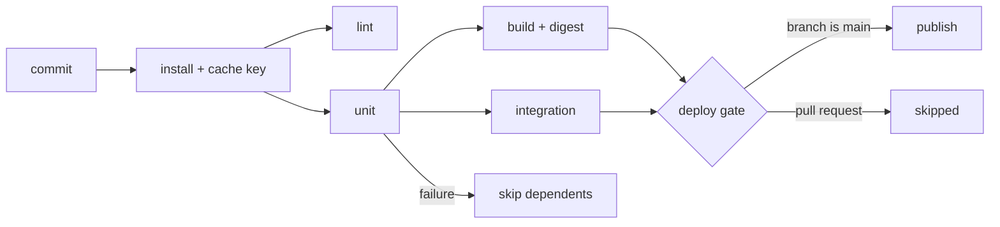

# CI/CD Fundamentals

> Executed on the authoring machine (Windows 11, Python 3.13.5) by the batch-18 `ops-lab-B`
> `ci_probe.py`. The probe is a working pipeline runner: it schedules a dependency graph, runs
> real subprocess jobs in a real workspace, keys and reuses a dependency cache, kills a job that
> exceeds its timeout, retries a flake, gates on a branch, masks a secret, and verifies the
> artifact digest it deploys. Hosted runners (GitHub Actions, GitLab, Jenkins, CircleCI) are not
> available on this host, so their YAML and UI are *labelled reference*; every number below is
> from the probe.

## 1. Learning Objectives

After this lesson you will be able to:

- [ ] Draw a stage graph and say which jobs can run in parallel
- [ ] Explain fail-fast and predict which jobs are skipped when a job fails
- [ ] Design a cache key that invalidates exactly when dependencies change
- [ ] Explain why an artifact needs a digest, and what the deploy job verifies
- [ ] Use timeouts and limited retries so a flaky or hung job cannot block a queue
- [ ] Explain what a branch or environment gate prevents, and where secrets are masked

## 2. Prerequisites

- [Shell Scripting](shell-scripting.md) — exit codes are the entire signal a pipeline gets from a job
- [Linux Administration](linux-administration.md) — the environment a runner provides
- [DevOps Fundamentals](devops-fundamentals.md) — the delivery pipeline this lesson makes concrete
- [Terraform](terraform.md) and [Ansible](ansible.md) — the steps a pipeline usually runs

## 3. Introduction

Continuous integration (CI) is the practice of merging every change into a shared branch and
running automated checks on it immediately. Continuous delivery (CD) is the practice of keeping
the result of those checks in a state that can be released at any time. A **pipeline** is the
machine that implements both: a set of **jobs** with dependencies, an environment they run in,
and rules about what happens when one fails.

Most pipeline failures are not "the tests failed". They are structural: a cache that never
invalidates, an artifact that cannot be traced to the build that produced it, a hung job that
holds the queue, a retry that hides a real regression, or a deploy that a pull request could
trigger. This lesson builds a runner that gets those structural decisions right, and measures
each one.

## 4. The Problem It Solves

- **Everything waits for everything.** A pipeline where each step needs the previous one runs a
  five-minute build after a ten-second lint. The probe's graph runs `lint` and `unit` in parallel
  after `install`, and only then `build`/`integration`, then `deploy`, printing the order it used:
  `['install', 'lint', 'unit', 'integration', 'build', 'deploy']`.
- **A red job wastes the queue.** With fail-fast, `unit` failing means `integration`, `build` and
  `deploy` are `SKIPPED`, while `lint` — independent of `unit` — still ran and reported `success`.
- **Caches that never hit, or hit when they must not.** The probe misses on the first run
  (`cache=miss key=ea395108aba1`), hits in `0.00s` on the second, and misses again with a new key
  (`10d5964191e7`) after one line of the lockfile changes.
- **"It deployed but we don't know what".** The build writes an artifact and a digest
  (`sha256: c6a38316a242653c`); the deploy job checks the digest it was handed against the bytes
  it would ship (`digest matches the build: True`).
- **A hung job holds the queue for an hour.** The probe's `e2e` job is killed at its timeout and
  reported `TIMED_OUT` after `1.04s` instead of running to completion.
- **Retries hide flakes and also hide bugs.** One retry turns `attempt 1: TLS handshake reset by
  peer` into a green `publish` after two attempts — useful only because the attempt count is
  visible.
- **A pull request deploys to production.** The branch gate evaluates
  `branch=feature/login event=pull_request deploy_allowed=False`, so deploy is never scheduled.
- **A secret in the log.** The job prints its token and the log shows `token seen by the job: ***`;
  `literal token present in the log: False`.

## 5. Core Concepts

### Jobs, stages and the dependency graph

A **job** is a unit of work with its own environment and exit status. Jobs declare **dependencies**
(`needs`), and the runner derives a directed acyclic graph. Jobs with no unmet dependency run in
parallel; a **stage** is a level of that graph. The graph, not the file order, decides execution.

### Fail-fast and skip propagation

**Fail-fast** means a failed job stops the pipeline instead of letting dependent work run on a
result that does not exist. Dependents are reported **skipped**, not failed, so the summary
distinguishes "we did not try" from "we tried and it broke".

### Caching

A **cache** stores work between runs — downloaded dependencies, compiled output. It is addressed
by a **key**, usually a hash of the lockfile plus the toolchain version. A cache hit is a key
match, not a warm directory: change the lockfile and the key changes, so the miss is correct.

### Artifacts and traceability

An **artifact** is output a later job consumes: a binary, an image, a test report. An artifact is
only trustworthy if it is **traceable** — the deploy job must be able to prove the bytes it ships
are the bytes the build produced. A digest recorded by the build and verified by the deploy is the
minimum.

### Timeouts, retries and gates

A **timeout** bounds a job so a hang becomes a failure. A **retry** re-runs a job, and should be
reserved for genuinely transient failures with the attempt count visible. A **gate** is a
condition — branch, environment, approval — that decides whether a job is scheduled at all.

### Secrets and masking

**Secrets** are injected as environment variables at run time. Runners **mask** known secret
values in logs, which prevents accidental disclosure but not deliberate exfiltration: a job that
prints a transformed secret is not caught.

## 6. How It Works



The runner computes the ready set — jobs whose dependencies all succeeded — and starts them
concurrently. When a job finishes it records a status; the next iteration recomputes the ready
set and marks every job whose dependency failed as skipped. The cache is consulted before the
install step, the artifact directory is shared between build and deploy, and the gate is evaluated
before the job is scheduled rather than inside it, so a gated job never consumes a runner.

## 7. Practical Examples

**Example 1 — the executed probe**

The probe is the runner described above. It runs a six-job graph, then re-runs it to hit the
cache, invalidates the cache with a lockfile edit, fails `unit` to show skip propagation, kills a
slow job at its timeout, retries a flake, evaluates a branch gate, and checks that a masked secret
does not appear in the log.

```python
"""OPS-16 probe: what a CI pipeline runner actually does.

Windows 11, Python 3.13.5. Docker and hosted runners are not installed on this
lab host, so the probe is the runner itself: it schedules a stage graph, executes
real subprocesses against a real workspace, enforces timeouts, retries, cache
keys, artifacts and branch gates, and prints what it decided.
"""

from __future__ import annotations

import gzip
import hashlib
import io
import json
import os
import shutil
import subprocess
import sys
import tarfile
import tempfile
import time
from concurrent.futures import ThreadPoolExecutor
from pathlib import Path

LAB = Path(__file__).resolve().parent / "ci-lab"
PY = sys.executable
TOKEN = "lab-only-not-a-secret"

BUILD_SCRIPT = """
import gzip, hashlib, io, pathlib, tarfile

raw = io.BytesIO()
with tarfile.open(fileobj=raw, mode="w") as tf:
    info = tf.gettarinfo("src/app.py", arcname="app.py")
    info.mtime = 0
    info.uid = info.gid = 0
    info.uname = info.gname = ""
    with open("src/app.py", "rb") as fh:
        tf.addfile(info, fh)
data = gzip.compress(raw.getvalue(), mtime=0)
pathlib.Path("dist/app.tar.gz").write_bytes(data)
digest = hashlib.sha256(data).hexdigest()[:16]
pathlib.Path(".artifacts/app.sha256").write_text(digest)
print(f"artifact bytes: {len(data)}")
print(f"sha256: {digest}")
"""


def reset() -> Path:
    if LAB.exists():
        shutil.rmtree(LAB)
    for name in ("src", "tests", "dist", "cache", ".artifacts"):
        (LAB / name).mkdir(parents=True)
    (LAB / "requirements.txt").write_text("requests==2.32.3\nclick==8.1.7\n", encoding="utf-8")
    (LAB / "src" / "app.py").write_text(
        "def total(prices):\n    return sum(prices)\n\n\ndef label(n):\n    return f'{n} item(s)'\n",
        encoding="utf-8",
    )
    (LAB / "tests" / "test_app.py").write_text(
        "import sys, unittest\n"
        "sys.path.insert(0, 'src')\n"
        "from app import total, label\n\n"
        "class T(unittest.TestCase):\n"
        "    def test_total(self):\n"
        "        self.assertEqual(total([1, 2, 3]), 6)\n\n"
        "    def test_label(self):\n"
        "        self.assertEqual(label(2), '2 item(s)')\n",
        encoding="utf-8",
    )
    return LAB


def mask(text: str) -> str:
    return text.replace(TOKEN, "***")


def run(argv: list[str], timeout: float | None = None) -> tuple[int, str, float]:
    started = time.perf_counter()
    try:
        proc = subprocess.run(
            argv,
            cwd=LAB,
            capture_output=True,
            text=True,
            timeout=timeout,
            env={**os.environ, "PYTHONPATH": "src", "DEPLOY_TOKEN": TOKEN},
        )
        return proc.returncode, mask((proc.stdout + proc.stderr).strip()), time.perf_counter() - started
    except subprocess.TimeoutExpired:
        return 124, "killed by the runner", time.perf_counter() - started


def cache_key() -> str:
    lock = (LAB / "requirements.txt").read_bytes()
    return hashlib.sha256(lock + sys.version.split()[0].encode()).hexdigest()[:12]


def install(log: list[str], state: dict) -> int:
    key = cache_key()
    state["key"] = key
    marker = LAB / "cache" / key
    if marker.exists():
        state["hit"] = True
        log.append(f"restored cache entry {key}")
        return 0
    time.sleep(0.35)  # stands in for a network download
    marker.mkdir(parents=True, exist_ok=True)
    (marker / "installed.txt").write_text("requests,click\n", encoding="utf-8")
    state["hit"] = False
    log.append(f"saved cache entry {key}")
    return 0


def lint(log: list[str], _s: dict) -> int:
    code, out, _ = run([PY, "-m", "py_compile", "src/app.py"])
    log.append("py_compile: " + ("clean" if code == 0 else out))
    return code


def unit(log: list[str], _s: dict) -> int:
    if os.environ.get("FAIL_UNIT") == "1":
        code, out, _ = run([PY, "-c", "import sys; print('FAILED test_total (assert 5 == 6)'); sys.exit(1)"])
    else:
        code, out, _ = run([PY, "-m", "unittest", "discover", "-s", "tests"])
    log.append(out.splitlines()[-1] if out else "no output")
    return code


def integration(log: list[str], _s: dict) -> int:
    code, out, _ = run([PY, "-c", "import app; assert app.total([2, 2]) == 4; print('app imported, service contract holds')"])
    log.append(out)
    return code


def build(log: list[str], _s: dict) -> int:
    script = LAB / ".artifacts" / "build.py"
    script.write_text(BUILD_SCRIPT, encoding="utf-8")
    code, out, _ = run([PY, str(script)])
    log.extend(out.splitlines())
    return code


def deploy(log: list[str], _s: dict) -> int:
    expected = (LAB / ".artifacts" / "app.sha256").read_text(encoding="utf-8").strip()
    code, out, _ = run(
        [
            PY,
            "-c",
            "import hashlib, os, pathlib\n"
            "digest = hashlib.sha256(pathlib.Path('dist/app.tar.gz').read_bytes()).hexdigest()[:16]\n"
            "print('token seen by the job:', os.environ['DEPLOY_TOKEN'])\n"
            "print('digest matches the build:', digest == pathlib.Path('.artifacts/app.sha256').read_text().strip())\n",
        ]
    )
    log.append(f"expected artifact {expected}")
    log.extend(out.splitlines())
    return code


def e2e(log: list[str], _s: dict) -> int:
    code, out, _ = run([PY, "-c", "import time; time.sleep(3); print('browser suite finished')"], timeout=1.0)
    log.append(out)
    return code


def publish(log: list[str], _s: dict) -> int:
    counter = LAB / ".flaky"
    attempts = int(counter.read_text() or "0") if counter.exists() else 0
    counter.write_text(str(attempts + 1))
    if attempts == 0:
        log.append("attempt 1: TLS handshake reset by peer")
        return 1
    log.append(f"attempt {attempts + 1}: registry accepted the push")
    return 0


STAGES = [
    {"name": "install", "fn": install, "needs": (), "cache": True},
    {"name": "lint", "fn": lint, "needs": ("install",)},
    {"name": "unit", "fn": unit, "needs": ("install",)},
    {"name": "integration", "fn": integration, "needs": ("unit",)},
    {"name": "build", "fn": build, "needs": ("unit",)},
    {"name": "deploy", "fn": deploy, "needs": ("build", "integration")},
]


def run_pipeline(stages: list[dict]) -> dict:
    results: dict[str, str] = {}
    order: list[str] = []
    pending = list(stages)

    while pending:
        ready = [s for s in pending if all(results.get(d) == "success" for d in s["needs"])]
        blocked = [s for s in pending if any(results.get(d) in ("failed", "timed_out", "skipped") for d in s["needs"])]
        for stage in blocked:
            results[stage["name"]] = "skipped"
            order.append(stage["name"])
            print(f"  {stage['name']:<12} {'SKIPPED':<9}          a dependency did not succeed")
            pending.remove(stage)
        if not ready:
            continue

        def attempt(stage: dict) -> tuple[str, float, list[str], dict]:
            log: list[str] = []
            state: dict = {}
            started = time.perf_counter()
            code = -1
            for _ in range(stage.get("retries", 0) + 1):
                code = stage["fn"](log, state)
                if code == 0:
                    break
            took = time.perf_counter() - started
            status = "timed_out" if code == 124 else ("success" if code == 0 else "failed")
            return status, took, log, state

        with ThreadPoolExecutor(max_workers=len(ready)) as pool:
            futures = {s["name"]: pool.submit(attempt, s) for s in ready}
            for stage in ready:
                name = stage["name"]
                status, took, log, state = futures[name].result()
                results[name] = status
                order.append(name)
                extra = f" cache={'hit' if state.get('hit') else 'miss'} key={state.get('key', '')}" if stage.get("cache") else ""
                print(f"  {name:<12} {status.upper():<9} {took:5.2f}s{extra}")
                for line in log:
                    print(f"    {line}")
                pending.remove(stage)

    return {"results": results, "order": order}


def banner(title: str) -> None:
    print(f"\n=== {title} ===")


def main() -> None:
    reset()
    print(f"ci-lab (Windows 11, Python {sys.version.split()[0]}, no hosted runner installed)")
    print("  workspace: ci-lab/  branch: main  jobs run as real subprocesses")

    banner("1. a clean pipeline: every stage waits for its dependencies")
    first = run_pipeline(STAGES)
    print(f"  order: {first['order']}")

    banner("2. the same pipeline again: a cache hit is a key match, not a warm folder")
    run_pipeline(STAGES)

    banner("3. a changed lockfile is a new key, so the cache misses once")
    (LAB / "requirements.txt").write_text("requests==2.32.4\n", encoding="utf-8")
    run_pipeline([s for s in STAGES if s["name"] == "install"])

    banner("4. fail-fast: a red unit stage skips everything downstream of it")
    os.environ["FAIL_UNIT"] = "1"
    red = run_pipeline(STAGES)
    os.environ.pop("FAIL_UNIT")
    print(f"  deploy={red['results']['deploy']} integration={red['results']['integration']} lint={red['results']['lint']}")

    banner("5. a timeout kills the job instead of holding the queue")
    timed = run_pipeline([{"name": "e2e", "fn": e2e, "needs": ()}])
    print(f"  e2e={timed['results']['e2e']}")

    banner("6. a retry absorbs one flake, and the attempts are logged")
    retried = run_pipeline([{"name": "publish", "fn": publish, "needs": (), "retries": 1}])
    print(f"  publish={retried['results']['publish']} attempts={(LAB / '.flaky').read_text()}")

    banner("7. a branch gate decides whether deploy is scheduled at all")
    branch, event = "feature/login", "pull_request"
    deploy_allowed = branch == "main" and event == "push"
    print(f"  branch={branch} event={event} deploy_allowed={deploy_allowed}")
    gated = run_pipeline([{"name": "unit", "fn": unit, "needs": ()}])
    print(f"  unit={gated['results']['unit']}  deploy: never scheduled")

    banner("8. secrets are masked in the log, and the artifact is traceable")
    code, out, _ = run([PY, "-c", "import os; print('token seen by the job:', os.environ['DEPLOY_TOKEN'])"])
    print(f"  log line: {out}")
    print(f"  literal token present in the log: {TOKEN in out}")

    banner("9. the run summary an operator reads")
    print("  " + json.dumps(first["results"], indent=2).replace("\n", "\n  "))


if __name__ == "__main__":
    main()
```

**Expected output:**

```text
ci-lab (Windows 11, Python 3.13.5, no hosted runner installed)
  workspace: ci-lab/  branch: main  jobs run as real subprocesses

=== 1. a clean pipeline: every stage waits for its dependencies ===
  install      SUCCESS    0.36s cache=miss key=ea395108aba1
    saved cache entry ea395108aba1
  lint         SUCCESS    0.43s
    py_compile: clean
  unit         SUCCESS    0.59s
    OK
  integration  SUCCESS    0.20s
    app imported, service contract holds
  build        SUCCESS    0.42s
    artifact bytes: 160
    sha256: c6a38316a242653c
  deploy       SUCCESS    0.41s
    expected artifact c6a38316a242653c
    token seen by the job: ***
    digest matches the build: True
  order: ['install', 'lint', 'unit', 'integration', 'build', 'deploy']

=== 2. the same pipeline again: a cache hit is a key match, not a warm folder ===
  install      SUCCESS    0.00s cache=hit key=ea395108aba1
    restored cache entry ea395108aba1
  lint         SUCCESS    0.37s
    py_compile: clean
  unit         SUCCESS    0.54s
    OK
  integration  SUCCESS    0.17s
    app imported, service contract holds
  build        SUCCESS    0.42s
    artifact bytes: 160
    sha256: c6a38316a242653c
  deploy       SUCCESS    0.29s
    expected artifact c6a38316a242653c
    token seen by the job: ***
    digest matches the build: True

=== 3. a changed lockfile is a new key, so the cache misses once ===
  install      SUCCESS    0.36s cache=miss key=10d5964191e7
    saved cache entry 10d5964191e7

=== 4. fail-fast: a red unit stage skips everything downstream of it ===
  install      SUCCESS    0.00s cache=hit key=10d5964191e7
    restored cache entry 10d5964191e7
  lint         SUCCESS    0.34s
    py_compile: clean
  unit         FAILED     0.17s
    FAILED test_total (assert 5 == 6)
  integration  SKIPPED            a dependency did not succeed
  build        SKIPPED            a dependency did not succeed
  deploy       SKIPPED            a dependency did not succeed
  deploy=skipped integration=skipped lint=success

=== 5. a timeout kills the job instead of holding the queue ===
  e2e          TIMED_OUT  1.04s
    killed by the runner
  e2e=timed_out

=== 6. a retry absorbs one flake, and the attempts are logged ===
  publish      SUCCESS    0.00s
    attempt 1: TLS handshake reset by peer
    attempt 2: registry accepted the push
  publish=success attempts=2

=== 7. a branch gate decides whether deploy is scheduled at all ===
  branch=feature/login event=pull_request deploy_allowed=False
  unit         SUCCESS    0.48s
    OK
  unit=success  deploy: never scheduled

=== 8. secrets are masked in the log, and the artifact is traceable ===
  log line: token seen by the job: ***
  literal token present in the log: False

=== 9. the run summary an operator reads ===
  {
    "install": "success",
    "lint": "success",
    "unit": "success",
    "integration": "success",
    "build": "success",
    "deploy": "success"
  }
```

**How to run it:**

```bash
cd CodePath-Masterclass/.scratch/ops-lab-B
python ci_probe.py
```

- **Assumptions:** Python 3.13.5 on Windows 11; jobs are `python -c` subprocesses; the probe
  rebuilds `ci-lab/` each run, so the cache starts cold every time.
- **What the important lines show:** `order: ['install', 'lint', 'unit', 'integration', 'build',
  'deploy']` is the graph; `SUCCESS    0.00s cache=hit key=ea395108aba1` versus `SUCCESS    0.36s cache=miss key=ea395108aba1` is the cache;
  `key=10d5964191e7` after the lockfile edit is invalidation; the `SKIPPED` lines are fail-fast;
  `e2e TIMED_OUT 1.04s` is the timeout; `attempts=2` is the retry; `deploy_allowed=False` is the
  gate; `sha256: c6a38316a242653c` and `digest matches the build: True` are traceability; and
  `***` with `literal token present in the log: False` is masking.

**Example 2 — the same graph in GitLab CI YAML** *(labelled reference — not executed)*

```yaml
stages: [install, test, build, deploy]

install:
  stage: install
  script: [pip install -r requirements.txt]
  cache:
    key:
      files: [requirements.txt]
    paths: [.cache/pip]

unit:
  stage: test
  needs: [install]
  script: [python -m unittest discover -s tests]

deploy:
  stage: deploy
  needs: [build]
  rules:
    - if: $CI_COMMIT_BRANCH == "main"
  script: ["./deploy.sh dist/app.tar.gz"]
```

`needs` is the dependency graph, the cache `key.files` is the lockfile hash, and `rules` is the
gate that keeps a feature branch from deploying.

## 8. Real-World Applications

- **Pull-request checks** — lint, unit, type-check and a preview environment, all on every push,
  with a required status before merge.
- **Release pipelines** — build once, tag the artifact, then promote the same bytes through
  staging and production with gates and approvals.
- **Monorepos** — path filters and per-package graphs so a change to one service does not rebuild
  everything.
- **Infrastructure pipelines** — `terraform plan` on pull requests, `apply` on the default branch,
  with the plan as the review artifact.
- **Mobile and desktop** — signing, notarisation and store upload as gated jobs after tests.

## 9. Common Mistakes

| Mistake | Why it happens | How to recognize it | How to prevent it |
|---|---|---|---|
| Caching without a key on the lockfile | It "just works" locally | New dependency missing in CI; stale cache hides a real install failure | Key on lockfile hash plus toolchain version; never restore a cache across majors |
| Retrying everything | Flaky tests are annoying | A real regression passes on attempt three | Retry only known-transient jobs, cap attempts, surface the attempt count |
| Deploying from a pull request | The pipeline file is copied from the default branch | A feature branch with production credentials | Gate on branch and environment; require approval for protected environments |
| No timeout | Default is often an hour | A job stuck on a prompt or a deadlock holds a runner | Set timeouts per job; fail fast on hangs |
| Building a different artifact than you tested | Build runs again in the deploy job | Digest differs between stages; "works in staging" | Build once, pass the artifact, verify the digest at deploy |
| Secrets echoed by a helper script | Masking only catches exact values | A token in base64 or in a URL query shows in logs | Never print secrets; treat logs as public; rotate on exposure |

## 10. Best Practices

- **Make the graph explicit and keep stages short.** Fast checks (lint, type-check) should not wait
  behind slow ones; independent jobs should run in parallel.
- **Build once and promote the artifact.** The same bytes move through environments, verified by
  digest, so what you tested is what you ship.
- **Treat a cache as an optimisation, never a correctness requirement.** A cold cache must still
  produce a green build.
- **Set a timeout on every job and a retry on almost none.** Retries are for network flakiness, not
  for tests.
- **Gate on branch and environment, and put approvals on production.** A pipeline that any branch
  can deploy with is a pipeline that will eventually deploy a branch.
- **Keep the pipeline in the repository and review changes to it like code.** CI configuration is
  production infrastructure.

## 11. Limitations and Trade-Offs

- **CI is only as good as its tests.** A fast pipeline over weak tests gives false confidence
  faster.
- **Shared runners are noisy neighbours.** Throughput, disk and network vary, and timing-sensitive
  tests flake for reasons unrelated to the change.
- **Caches are a supply-chain surface.** A poisoned cache entry can inject code into later builds;
  caches should be scoped to trusted branches.
- **Parallelism costs money and complexity.** More concurrent jobs finish sooner and are harder to
  reason about when one fails.
- **Gates slow feedback.** Required approvals and protected environments trade speed for safety;
  the trade should be explicit, not accidental.

## 12. Practical Exercises

### Introductory

1. **Exercise 16.1** — Run the probe and list the jobs that ran in parallel in the first stage,
   with evidence from the capture.
   **Completion criteria:** you name `lint` and `unit` and quote the order line showing both after
   `install` and before `build`.
2. **Exercise 16.2** — Find the cache key before and after the lockfile edit and explain why the
   second run hits and the fourth does not.
   **Completion criteria:** you quote both keys (`ea395108aba1`, `10d5964191e7`) and attribute the
   miss to the key changing.

### Intermediate

3. **Exercise 16.3** — Make `install` fail instead of `unit`. Predict the status of every other job
   before running, then compare with the capture.
   **Completion criteria:** your prediction table matches the capture for all six jobs.
4. **Exercise 16.4** — Remove the timeout from the `e2e` job and record the difference in wall
   time and status. Explain what a pipeline queue does with a job that never finishes.
   **Completion criteria:** you record the run time with and without the timeout and state that the
   job would occupy a runner indefinitely.

### Independent problem-solving

5. **Exercise 16.5** — Design a pipeline for a service with a database migration: jobs, order,
   cache keys, artifact promotion, gates, rollback and the failure mode you are most afraid of.
   **Completion criteria:** a written design with a diagram, a gate for production, an explicit
   migration step that is safe to re-run, and one paragraph on what happens if deploy fails after
   the migration succeeded.

*Solutions: attempt first. They live in `solutions/` of this subject.*

## 13. Knowledge Check

1. Why is a skipped job different from a failed job, and why does the distinction matter in a
   summary?
2. What makes a cache key correct, and what is the symptom of a key that is too broad?
3. When is a retry acceptable, and what must be visible for it to stay honest?

## 14. Completion Criteria

Observable evidence that you have understood this lesson:

- [ ] You can draw the job graph for a service you know and say which jobs run in parallel
- [ ] You can explain fail-fast and predict skipped jobs from a failure
- [ ] You can design a cache key and say when it must miss
- [ ] You can explain how a deploy proves which artifact it shipped
- [ ] You can state one situation where a longer pipeline is the right trade

## 15. Summary

- A pipeline is a dependency graph of jobs, not a list of steps.
- Fail-fast skips dependents and reports them as skipped, which is different from failed.
- A cache is keyed on content, so the correct behaviour on a lockfile change is a miss.
- Build once, record a digest, and verify it at deploy; that is what traceability means.
- Timeouts, narrow retries and branch gates are the difference between a queue and a system.

## 16. Next Steps

- Next lesson: [GitHub Actions](github-actions.md) — the workflow file, triggers, matrices and
  expressions that implement this model
- Practice: [exercise set](exercises/README.md)
- Where it is applied: [Secure Production Application](../20-PROJECT-LABORATORY/project-07-secure-production-application/README.md)
